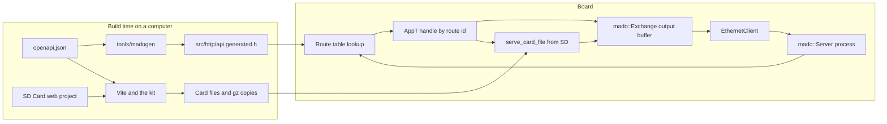

<div align="center">

<h1>Madoguchi</h1>

<strong>Arduino Uno R4 Minima向けの、ヒープを使わないHTTPサーバー。ページはSDカードから配信し、OpenAPIから生成したJWT認証付きREST APIを提供します。</strong>

<br>
<br>

[English](README.md) | 日本語 | [简体中文](README.zh-Hans.md) | [繁體中文 (香港)](README.zh-HK.md)

[](https://github.com/gufranco/madoguchi/actions/workflows/ci.yml)
[](LICENSE)

</div>

<p align="center">
  <a href="#クイックスタート">クイックスタート</a> |
  <a href="#サンプル">サンプル</a> |
  <a href="#sdカードのwebプロジェクト">SDカードのページ</a> |
  <a href="#openapiとjwtによるrest-api">REST API</a> |
  <a href="#開発">開発</a> |
  <a href="CHANGELOG.md">変更履歴</a>
</p>

---

Madoguchiは、W5x00またはENC28J60のシールドとSDカードを載せたUno R4 Minimaで動作し、ヒープを一切確保しません。C++のコードにはHTML、CSS、スクリプト、画像を一切含めません。すべてのページはカード上にあり、サンプルごとに独立したWebプロジェクトから作られます。TypeScriptとクラス不要のPico CSSで書かれ、Viteがカードのファイルとgzipのコピーにビルドします。ボードは1つのOpenAPIドキュメントから生成したREST APIに応答し、JWTによるログイン、JSONボディ、すべてのHTTPメソッドを扱います。CIは、プッシュとプルリクエストのたびに9個のサンプルすべてをビルドしてボードのフラッシュまたはRAMの上限を超えたビルドを失敗させ、ホストテスト1,546件、ツールテスト91件、ページテスト135件、ブラウザーテスト32件を実行し、すべてのカードをビルドし、パーサーをファズテストします。

名前の由来は、依頼を受け取って答えを返す「窓口」です。

## 使い方

ハンドラーは、ルートIDで分岐する静的関数です。ページはカードから、APIはコードから返します。スケッチの中心部分は次のとおりです。

```cpp
struct WebApp {
  static bool handle(WebExchange& exchange, const uint8_t route) {
    switch (route) {
      case kStatus: return send_status_json(exchange);
      default: return mado::serve_card_file<FILE_READ>(exchange, sd_card);
    }
  }
};

const char kStatusPath[] PROGMEM = "/api/status";
const char kCardPath[] PROGMEM = "/*";
const mado::Route kRoutes[] PROGMEM = {
    {&kStatusPath[0], mado::Method::kGet, kStatus},
    {&kCardPath[0], mado::Method::kGet, kCard},
    {nullptr, mado::Method::kAny, 0U},
};
mado::Server<EthernetClient, WebApp> web(&kRoutes[0], &kHeaderNames[0]);

void loop() {
  EthernetClient client = ethernet_server.available();
  const bool has_client = static_cast<bool>(client);
  if (has_client) {
    web.process(client);
  }
}
```

`process()`は、待機中のリクエストがなければすぐに戻ります。リクエストがあれば読み取り、一致したルートのIDで`WebApp::handle`を呼び出して接続を閉じます。`serve_card_file()`は`/`を`/index.html`に対応させ、ブラウザーがgzipを受け付けるときはファイルの隣にある`.gz`のコピーを優先し、ハッシュ名のファイルを1年間キャッシュさせます。

## クイックスタート

### 前提条件

| ツール | バージョン | 用途 |
|:-----|:--------|:-----------|
| [arduino-cli](https://arduino.github.io/arduino-cli/)またはArduino IDE | CIはarduino-cli 1.5.1を使用 | ボード向けのビルド |
| `arduino:renesas_uno`コア | 1.6.0 | Uno R4 Minima |
| EthernetライブラリとSdFatライブラリ | Ethernet 2.0.2、SdFat 2.3.0 | すべてのサンプル |
| Node.jsとpnpm | Node 24、pnpm 12.15.0 | カード用ページのビルド |
| CMakeとC++コンパイラー | CMake 3.24以降 | コンピューター上でのREST APIの実行 |

### インストール

MadoguchiはArduinoライブラリマネージャーには登録されていません。このリポジトリからインストールしてください。

```sh
arduino-cli config set library.enable_unsafe_install true
arduino-cli lib install --git-url https://github.com/gufranco/madoguchi.git
arduino-cli lib install Ethernet@2.0.2 SdFat@2.3.0
```

Arduino IDEでは、リポジトリをZIPでダウンロードし、**スケッチ > ライブラリをインクルード > .ZIP形式のライブラリをインストール**を使います。

### ボードとカードのビルド

このリポジトリをクローンし、ボードをUSBで接続した状態で次を実行します。

```sh
git clone https://github.com/gufranco/madoguchi.git
cd madoguchi
arduino-cli compile --fqbn arduino:renesas_uno:minima --library . examples/RestGet
arduino-cli board list
arduino-cli upload --fqbn arduino:renesas_uno:minima --port <port from board list> examples/RestGet
corepack enable
pnpm install
pnpm --filter ./examples/RestGet/SD\ Card run build
```

`examples/RestGet/SD Card/dist`の中身をすべて、FAT16、FAT32、exFATのいずれかでフォーマットしたmicroSDカードのルートにコピーし、シールドに挿します。カードの準備には[`RestFormat`](examples/RestFormat/RestFormat.ino)を使えます。スケッチはアドレス192.168.1.177を使います。ネットワークのアドレス範囲が異なる場合は変更してください。その後`http://192.168.1.177/`を開きます。

### ボードなしでREST APIを試す

同じクローンで`mado_host_server`を使うと、[`RestApi`](examples/RestApi/RestApi.ino)のアプリケーションコードを127.0.0.1上で、テスト用の署名鍵とパスワード`correct-horse-battery`で実行できます。3つ目の引数は、カードの代わりになるフォルダーです。

```sh
pnpm --filter ./examples/RestApi/SD\ Card run build
cmake -S tests -B build
cmake --build build --target mado_host_server
build/mado_host_server 8080 100000 "examples/RestApi/SD Card/dist"
```

別のターミナルで次を実行します。

```sh
TOKEN=$(curl -s -H 'Content-Type: application/json' \
  -d '{"username":"admin","password":"correct-horse-battery"}' \
  http://127.0.0.1:8080/api/auth/login | python3 -c 'import json,sys; print(json.load(sys.stdin)["access_token"])')
curl -s -i -H "Authorization: Bearer $TOKEN" -H 'Content-Type: application/json' \
  -d '{"name":"lamp","value":3,"on":true}' http://127.0.0.1:8080/api/items
```

期待される出力は次のとおりです。

```text
HTTP/1.1 201 Created
Connection: close
Content-Type: application/json
Cache-Control: no-store
Location: /api/items/1

{"id":1,"name":"lamp","value":3,"on":true}
```

サイトは`http://127.0.0.1:8080/`、Swagger UIは`http://127.0.0.1:8080/docs/`で開けます。ページを作業するときは、`pnpm --filter ./examples/RestApi/SD\ Card run dev`がライブリロード付きでページを配信し、`/api`を`MADOGUCHI_BOARD`で指定したボードへ送ります。既定値は`http://madoguchi.local`です。

## 対応ハードウェア

Madoguchiが対応するボードは、Renesas RA4M1を載せたArduino Uno R4 Minimaの1つだけです。Uno R3やUno R4 WiFiを含め、ほかのボードは対象外です。

| ハードウェア | ライブラリ | クライアント型 |
|:---------|:--------|:------------|
| Wiznet W5100、W5200、W5500シールド | Ethernet 2.0.2 | `EthernetClient` |
| ENC28J60モジュール | EthernetENC 2.0.5 | `EthernetClient` |
| シールドのmicroSDスロット | SdFat 2.3.0 | `SdFs`と`FsFile` |

サーバーはクライアント型を引数に取るテンプレートなので、`available()`、`read()`、`read(buffer, size)`、`write(buffer, size)`、`connected()`、`stop()`を持つクラスであれば動作します。SdFatはFAT16、FAT32、exFATで長いファイル名を読めます。ArduinoのSDライブラリは8.3形式の名前しか読めないため、MadoguchiはSdFatを使います。`<SdFat.h>`はMadoguchiのすべてのヘッダーより後にインクルードしてください。R4のコアは`F()`を関数として定義しており、SdFatはそれをフラッシュの型を失うマクロで置き換えるためです。

## サンプル

サイズの単位はバイトで、Uno R4 Minima上でarduino-cli 1.5.1、arduino:renesas_uno 1.6.0、Ethernet 2.0.2、SdFat 2.3.0を使ってビルドした値です。RestFormat以外の各サンプルには、ページを収めた`SD Card`フォルダーがあります。

| サンプル | 内容 | フラッシュ（262,144中） | 使用RAM（32,768中） |
|:--------|:------|------:|------:|
| [`RestGet`](examples/RestGet/RestGet.ino) | 項目一覧と項目1件の`GET` | 89,612 | 6,312 |
| [`RestPost`](examples/RestPost/RestPost.ino) | JSONによる新しい項目の`POST` | 90,816 | 6,928 |
| [`RestPut`](examples/RestPut/RestPut.ino) | 項目を置き換える`PUT` | 91,652 | 6,332 |
| [`RestPatch`](examples/RestPatch/RestPatch.ino) | 項目の一部のフィールドを変更する`PATCH` | 91,656 | 6,332 |
| [`RestDelete`](examples/RestDelete/RestDelete.ino) | IDによる項目の`DELETE` | 89,076 | 6,312 |
| [`RestAuth`](examples/RestAuth/RestAuth.ino) | ログインと保護されたルート1つ | 88,324 | 6,224 |
| [`RestFiles`](examples/RestFiles/RestFiles.ino) | SD上のファイル。一覧、ダウンロード、範囲指定、進捗付きアップロード、削除 | 104,108 | 7,048 |
| [`RestApi`](examples/RestApi/RestApi.ino) | 完全なAPI、そのサイト、Swagger UI、リクエストログ | 110,600 | 7,328 |
| [`RestFormat`](examples/RestFormat/RestFormat.ino) | 0x00と0xFFで消去して検証し、FAT16、FAT32、exFATでフォーマット。JSONのみ | 92,456 | 10,344 |

RestFormat以外のどのサンプルも`/api/openapi.json`にカードから応答し、`/docs/`でSwagger UIを配信します。CIは、ボードの上限を超えたビルドを失敗させます。

各サンプルはそれ自体が1つのプロジェクトで、設計を説明するREADMEを持ちます。コードはサンプルの`src`フォルダーにあり、境界づけられたコンテキストごと、次にレイヤーごとにまとめています。`domain`はルールを持ち、Arduinoのヘッダーを一切インクルードしません。`application`はユースケースとそれが必要とするポートを持ち、`adapters`はHTTPコントローラーとストレージを持ちます。`.ino`ファイルはアダプターを組み立てて結び付けるだけです。各サンプルの`tests`フォルダーにはホストテストがあり、`SD Card`のページも同じ分け方に従います。

## SDカードのWebプロジェクト

ブラウザーが読み込むファイルはすべてカードから届きます。各サンプルの`SD Card`フォルダーは独立したWebプロジェクトで、セマンティックなHTML、strictモードのTypeScript、ライトモードとダークモードに対応したクラス不要の[Pico CSS](https://picocss.com/)、カバレッジ付きのVitestテストで構成されます。ワークスペースですべてをビルドします。

```sh
corepack enable
pnpm install
pnpm run check
pnpm run test
pnpm run build
```

| 段階 | ツール | 内容 |
|:-----|:-----|:-------------|
| チェック | Biome 2.6.3、TypeScript 7.0.2、html-validate 11.17.0 | リントと整形、strictな型チェック、HTMLの標準準拠 |
| テスト | Vitest 5.0.5とhappy-dom | 各ページを模擬ボードに対して検証、カバレッジ95パーセントのゲート |
| ビルド | Vite 8.3.5と`@madoguchi/kit/vite` | TypeScriptを8桁の16進ハッシュ名のファイルにまとめ、HTMLを縮小し、縮むファイルの隣に`.gz`のコピーを作り、OpenAPIドキュメントを`openapi.json`としてコピーし、すべての名前をボードが配信できるものと照合 |
| ブラウザー | Playwright 1.64.0とChromium | ビルドした各ページとそのドキュメントページを320 pxと1280 pxで検証。ボードはルートの横取りで模擬し、見出し、計算済みスタイル、横スクロールがないこと、テーマ切り替え、キーボードのフォーカスリング、Swaggerの全操作、空のコンソールを確認 |

サードパーティーのフロントエンドコードはカードに置きません。Pico CSS 2.1.1はjsDelivrから、Swagger UI 5.33.2はunpkgから読み込み、それぞれ正確なバージョンとSubresource Integrityハッシュで固定しています。ビルドは各ページにContent-Security-Policyを書き込み、ページ自身のファイルとこれらのCDNホストだけを許可します。テーマは訪問者が切り替えボタンを押すまでシステム設定に従い、選んだテーマはブラウザーに保存されます。

共通のコードは[`web/kit`](web/kit)にあります。CDNの固定値、テーマ切り替え、RFC 9457のproblemを読むfetchヘルパー、メモリーだけに保持するBearerセッション、Viteの設定です。

## アーキテクチャ



- C++のコードにはアセットを置きません。コードが書くのはデータだけです。JSON、RFC 9457のproblem、短い状態メッセージです。
- バッファーは固定長で、テンプレート引数として渡す`Limits`型でサイズを決めます。ヒープには何も確保しません。
- ライブラリは関数ポインターを持たず、仮想関数も宣言しません。ルートIDで分岐する静的な`handle`により、呼び出しグラフが解析ツールから見えます。
- すべてのループに反復回数の上限があり、すべての読み取りにタイムアウトがあり、リクエスト全体に期限があるため、遅いクライアントがスケッチを止めることはありません。
- リクエストはRFC 9112に従って解析します。`HTTP/1.1`のリクエストには`Host`がちょうど1つ必要で、`Content-Length`の重複は`400`、`Transfer-Encoding`は`501`になり、ハンドラーが読み残したボディは接続を閉じる前に読み捨てます。

コードはJPL D-60411のC言語標準とPower of Tenのルールを最も厳格に解釈し、C++に適用しています。各ルールとその適用方法は[`AGENTS.md`](AGENTS.md)にあります。

## 含まれる機能

| 分野 | 機能 | API |
|:-----|:--------|:----|
| リクエスト | パスとメソッドによるルーティング。末尾の`*`で前方一致、`405`には`Allow`ヘッダーを付与 | `mado::Route {path, method, id}` |
| リクエスト | クエリパラメーターとurlencodedフォームのフィールドを、指定したバッファーにデコード | `query_param()`、`mado::next_form_field()` |
| リクエスト | 指定したヘッダーだけを大文字と小文字を区別せずに取得。ボディは`100 Continue`の後にブロック単位で読み取り | `header()`、`read_body()` |
| リクエスト | 読み取りの停滞や遅いリクエストには`408`、長すぎるリクエスト行には`414`、多すぎるヘッダー行には`431`、HTTP/1.0と1.1以外のバージョンには`505` | 自動 |
| リクエスト | DNSリバインディング対策として、列挙した`Host`名だけをポートの有無にかかわらず受け付け、レスポンスごとに呼ばれるフック | `PolicyT::trusted_hosts()`、`PolicyT::on_response()` |
| レスポンス | 理由句付きのステータス行、任意のヘッダー、列挙したオリジンへのCORS、リダイレクト、最大1,460バイトの書き込みにまとめる出力 | `send_status()`、`send_header()`、`mado::send_cors_headers()`、`send_redirect()`、`mado::Reply` |
| レスポンス | RFC 9457のproblem details。タイトル、ステータス、詳細を含む`application/problem+json` | `mado::send_problem()`、`mado::json_problem()` |
| レスポンス | ファイルから読むテンプレートの`$NAME$`タグ。`Content-Length`が正確なArduinoJsonドキュメント | `mado::send_template()`、`mado::send_json()` |
| カード | カード上のページとファイル。`/`を`index.html`へ、各ファイルの隣の`.gz`コピー、`Vary: Accept-Encoding`、ハッシュ名には1年のキャッシュ、それ以外には`no-cache` | `mado::serve_card_file()`、`mado::serve_card_path()` |
| ファイル | 拡張子ごとのContent-Typeを付けたファイル。1つのバイト範囲を`206`または`416`と`If-Range`で返し、弱いETagと`304`、ダウンロード名に対応 | `mado::send_file()`、`mado::FileReply`、`mado::content_type_for()` |
| ファイル | URLパスをデコードして検査。`.`と`..`のセグメント、空のセグメント、バックスラッシュ、エンコードされたNULバイトを拒否 | `mado::resolve_static_path()` |
| ファイル | アップロードを長い名前と`Repr-Digest`で検査し、一時ファイルに書いてから所定の場所へ移動。4 GiBを超えるサイズは拒否 | `mado::valid_card_name()`、`mado::parse_repr_digest()`、`mado::copy_file()`、`mado::replace_file()`、`mado::file_length()` |
| ネットワーク | タイムアウト付きのDHCPと固定のフォールバックアドレス。一度だけ作ってEEPROMに保存するランダムなMAC | `mado::begin_network()`、`mado::load_mac()` |
| ネットワーク | ケーブルやチップが戻ったときの再起動。mDNSで応答する`<name>.local` | `mado::NetworkWatch`、`mado::MdnsResponder` |
| ストレージ | レスポンスごとにpino-httpと同じ形のJSONを1行。指定サイズを超えるとローテーション | `mado::SdLog`、`mado::write_request_log()` |
| ストレージ | 小さなカウンターをSD上のテキストファイルに、固定のレコードをEEPROMに保存 | `mado::read_count_file()`、`mado::write_count_file()`、`mado::EepromTable` |
| 認証 | 定数時間で照合するHTTP Basic認証 | `mado::check_basic_auth()` |
| 認証 | HS256のJSON Web Tokenの発行と検証。PBKDF2-HMAC-SHA256によるパスワードハッシュ | `mado::issue_token()`、`mado::verify_bearer()`、`mado::pbkdf2_sha256()` |
| 認証 | 5回失敗するとログインを15分間ロック | `mado::LoginGuard` |
| 認証 | SHA-256、HMAC-SHA256、Base64url | `mado::Sha256`、`mado::HmacSha256`、`mado::Base64UrlEncoder`、`mado::Base64UrlDecoder` |
| REST | JSONのリクエストボディをRAMにドキュメントを置かずにフィールド単位で読み取り。エスケープしたJSON文字列 | `mado::JsonReader`、`mado::json_write_string()` |
| REST | パス末尾の`{id}`の読み取り。レコードの固定テーブル | `mado::parse_path_id()`、`mado::SlotTable` |
| REST | OpenAPI 3.1ドキュメントから生成するC++のルートとスキーマ | [`tools/madogen`](tools/madogen/cli.py) |

## ガイド

### ルートとハンドラー

ルートは`{path, method, id}`で、テーブルはパスが`nullptr`のエントリーで終わります。ルートはテーブルの順に照合されるため、具体的なパスをワイルドカードより前に置き、カードのルート`/*`を最後に置きます。

- `/api/status`のような完全なパスは、そのパスにだけ一致します。照合ではクエリ文字列を無視します。
- `/api/files/*`のように`*`で終わるパスは、`/api/files/`で始まるすべてのパスに一致します。
- `mado::Method::kAny`はすべてのメソッドを受け付けます。`kGet`のルートは`HEAD`にも応答し、ボディを省きます。
- パスは一致してもメソッドが違う場合は`405`、何も一致しない場合は`404`になります。

`handle`は、レスポンスが完了して接続を閉じてよいときに`true`を返します。たとえば後で`exchange.client()`経由で更新を送り続けるために接続を開いたままにするには`false`を返します。W5100のソケットは4つなので、開いたままの接続は少なくしてください。

### Exchange

`mado::Exchange`は、1つの接続のリクエストとレスポンスを表します。

| リクエスト | 戻り値 |
|:--------|:--------|
| `method()` | `mado::Method` |
| `path()` | 送られたとおりのパス、クエリ文字列を除く |
| `query()` | 生のクエリ文字列、ない場合は空 |
| `query_param(name, out, size)` | `true`と、`out`にデコードされた値 |
| `header(name)` | 取得した値、または`nullptr` |
| `content_length()` | 宣言されたボディの長さ |
| `read_body(buffer, size)` | 読み取ったバイト数、終端で`0`、タイムアウトまたは接続終了で`-1` |
| `remaining_body()` | まだ読み取っていないボディのバイト数 |
| `client()` | 直接アクセス用のクライアントへのポインター |

| レスポンス | 送信内容 |
|:---------|:------|
| `send_status(code)` | `HTTP/1.1 <code> <reason>`と`Connection: close` |
| `send_header(F("Name"), value)` | ヘッダー1つ。値はRAM上の文字列、数値、または`mado::FlashText(F("..."))` |
| `send_content_type(F("type"))` | `Content-Type` |
| `send_content_length(length)` | `Content-Length` |
| `send_cors_headers()` | `Access-Control-Allow-Origin: *`と、許可するメソッドとヘッダー |
| `mado::send_cors_headers(exchange, origins)` | `Vary: Origin`と、取得した`Origin`がリストにある場合だけCORSヘッダー |
| `send_location(F("/api/items/"), id)` | `Location: /api/items/<id>` |
| `status_code()` | これまでに送ったステータス、または`0` |
| `end_headers()` | 空行。これ以降、`HEAD`リクエストではボディが省かれます |
| `send_empty(code)` | ボディのない完全なレスポンス |
| `send_redirect(F("/next"))` | `Location`付きの`303 See Other` |
| `print(...)`、`print_signed(...)`、`write(...)` | ボディのテキスト、数値、バイト列 |

### リクエストヘッダー

必要なヘッダーはサーバーの作成時に指定します。値は固定のプールを共有し、既定では48バイトで、長い値は切り詰められます。`Content-Length`と`Expect`は常に読み取ります。カードのルートには、gzipのコピーを選ぶために`Accept-Encoding`が必要です。

```cpp
const char kAuthorization[] PROGMEM = "Authorization";
const char kAcceptEncoding[] PROGMEM = "Accept-Encoding";
const char* const kHeaderNames[] PROGMEM = {&kAuthorization[0], &kAcceptEncoding[0], nullptr};
mado::Server<EthernetClient, WebApp> web(&kRoutes[0], &kHeaderNames[0]);
```

### クエリ文字列とフォーム

```cpp
#include <mado/next_form_field.h>

char name[24];
char value[24];
if (exchange.query_param(F("name"), &name[0], sizeof(name))) {
  exchange.print(&name[0]);
}
while (mado::next_form_field(exchange, &name[0], sizeof(name), &value[0], sizeof(value)) ==
       mado::FormStatus::kField) {
  exchange.print(&value[0]);
}
```

### カード上のファイル

```cpp
#include <mado/serve_card_file.h>

const bool served = mado::serve_card_file<FILE_READ>(exchange, sd_card);
const char kSpecPath[] PROGMEM = "/openapi.json";
const bool spec = mado::serve_card_path<FILE_READ>(exchange, sd_card, &kSpecPath[0]);
```

`serve_card_file()`はリクエストのパスをカード上で解決し、外へ出ようとするパスには`400`、存在しないファイルやフォルダーには`404`を返し、ブラウザーがgzipを受け付けるときはファイルの隣の`.gz`のコピーを送ります。`9f86d081.js`のように16進8桁と拡張子からなる名前は`public, max-age=31536000, immutable`でキャッシュさせ、それ以外のファイルには`no-cache`を付けます。`serve_card_path()`は1つの決まったファイルを配信し、`/api/openapi.json`はこれで`/openapi.json`を返します。

ダウンロード、範囲指定、条件付きリクエストには、サイズ、タイプ、gzipフラグ、ETag、ダウンロード名、`Cache-Control`の値を入れた`mado::FileReply`を`mado::send_file()`に渡します。`mado::file_etag()`は、名前、サイズ、スケッチが書き込みのたびと起動時に変えるバージョンから弱いETagを作ります。そのため、同じサイズのファイルで置き換えても新しいタグになります。弱いタグでは`If-Range`付きの`Range`にファイル全体を返します。部分同士が同じ版であることを証明できないためです。[`RestFiles`](examples/RestFiles/RestFiles.ino)は同じタグの強い形を送ります。バージョンは書き込み、削除、再マウントのたびに変わるのでそれが成り立ち、範囲の再開ができます。`PUT`がファイルを置き換える前には`mado::if_match()`がその強いタグを比べます。

### Basic認証

```cpp
#include <mado/check_basic_auth.h>
#include <mado/send_auth_challenge.h>

if (!mado::check_basic_auth(exchange.header(F("Authorization")), F("YWRtaW46Y2hhbmdlLW1l"))) {
  return mado::send_auth_challenge(exchange, F("Madoguchi"));
}
```

期待値は`user:password`をBase64にしたもので、`printf 'admin:change-me' | base64`で求めます。

> [!WARNING]
> ボードにはTLSがありません。Basic認証のパスワード、ログインのパスワード、Bearerトークンは、平文のままネットワークを通ります。ボードは信頼できるネットワークに置くか、TLSを終端するリバースプロキシの背後に置いてください。

### テンプレート

テンプレートは`$NAME$`タグを含むカード上のファイルで、コードがファイルを送りながらタグを埋めます。

```cpp
#include <mado/FileSource.h>
#include <mado/send_template.h>

struct PageTags {
  static bool render(WebExchange& exchange, const char* tag) {
    if (strcmp_P(tag, PSTR("TEMP")) == 0) {
      exchange.print(static_cast<uint32_t>(analogRead(A0)));
      return true;
    }
    return false;
  }
};

FsFile page = sd_card.open("/status.html", FILE_READ);
mado::FileSource<FsFile> source(page);
mado::send_template<WebExchange, PageTags>(exchange, source);
```

タグは最大16文字の英字、数字、アンダースコアです。不明なタグは書かれたまま送信され、タグの前の`$$`は`$`を1つ残します。

### ArduinoJsonによるJSON

```cpp
#include <ArduinoJson.h>
#include <MadoguchiJson.h>

JsonDocument document;
document["uptime_ms"] = millis();
mado::send_json(exchange, mado::http::kOk, document);
```

ArduinoJsonをインクルードするのは`MadoguchiJson.h`だけなので、これをインクルードしないスケッチではArduinoJsonはコンパイルされません。

### 制限値

バッファーサイズとタイムアウトは、3番目のテンプレート引数として渡す型で決まります。すべてのフィールドを宣言してください。その場合、ハンドラーは`mado::Exchange<EthernetClient, BigLimits>&`を受け取ります。

```cpp
struct BigLimits {
  static constexpr uint16_t kLineBufferSize = 256U;
  static constexpr uint16_t kOutputBufferSize = 512U;
  static constexpr uint8_t kHeaderPoolSize = 96U;
  static constexpr uint8_t kHeaderNameSize = 32U;
  static constexpr uint8_t kMaxCapturedHeaders = 8U;
  static constexpr uint8_t kMaxHeaderLines = 48U;
  static constexpr uint8_t kMaxRoutes = 32U;
  static constexpr uint16_t kReadTimeoutMs = 1000U;
  static constexpr uint32_t kMaxPollsPerRead = 100000UL;
  static constexpr uint16_t kRequestTimeoutMs = 5000U;
  static constexpr uint16_t kMaxDrainBytes = 1024U;
  static constexpr uint16_t kFileChunkSize = 512U;
};
mado::Server<EthernetClient, WebApp, BigLimits> web(&kRoutes[0], nullptr);
```

| フィールド | 既定値 | 意味 |
|:------|--------:|:--------|
| `kLineBufferSize` | 128 | 最も長いリクエスト行。メソッド、パス、クエリの合計 |
| `kOutputBufferSize` | 32 | ネットワークに書き込む前にまとめるバイト数。最大1,460で、それより大きな書き込みは1回で送ります |
| `kHeaderPoolSize` | 48 | 取得するすべてのヘッダー値の領域 |
| `kHeaderNameSize` | 32 | 取得できる最も長いヘッダー名 |
| `kMaxCapturedHeaders` | 8 | ヘッダーリストの名前の数 |
| `kMaxHeaderLines` | 48 | `431`を返す前に受け付けるヘッダー行の数 |
| `kMaxRoutes` | 32 | テーブル内で走査するルートの数 |
| `kReadTimeoutMs` | 1000 | `408`を返すまで次のバイトを待つ時間 |
| `kMaxPollsPerRead` | 100000 | 1回の読み取りあたりのポーリング回数の上限 |
| `kRequestTimeoutMs` | 5000 | `408`を返すまでの、リクエスト行とヘッダー、さらにボディそれぞれの制限時間 |
| `kMaxDrainBytes` | 1024 | 接続を閉じる前に読み捨てる未読ボディのバイト数。これより長いボディは読みません |
| `kFileChunkSize` | 32 | ファイルレスポンスの1ステップでファイルから読むバイト数 |

4つ目のテンプレート引数であるポリシーは、信頼するホストを列挙し、各レスポンスを受け取ります。デフォルトは255バイトまでの任意の`Host`を信頼し、フックは何もしません。

```cpp
struct BoardPolicy {
  static constexpr bool kTrustedHostsOnly = true;
  static const char* const* trusted_hosts() {
    static const char* const kHosts[] = {"192.168.1.177", "board.local", nullptr};
    return &kHosts[0];
  }
  static void on_response(const mado::RequestLine&, const mado::ResponseSummary&) {}
};
mado::Server<EthernetClient, WebApp, mado::DefaultLimits, BoardPolicy> web(&kRoutes[0], nullptr);
```

### ネットワーク

```cpp
#include <mado/MdnsResponder.h>
#include <mado/begin_network.h>
#include <mado/load_mac.h>

const char kHostName[] PROGMEM = "madoguchi";
uint8_t mac[mado::kMacSize] = {};
mado::MdnsResponder<EthernetUDP, IPAddress> mdns(&kHostName[0]);

void setup() {
  mado::load_mac(EEPROM, 8U, mac, micros());
  mado::begin_network(Ethernet, &mac[0], IPAddress(192, 168, 1, 177), 10000UL);
  mdns_socket.beginMulticast(IPAddress(224, 0, 0, 251), mado::kMdnsPort);
}
```

`load_mac()`は、初回起動時にローカル管理のランダムなMACをEEPROMの7バイトに書き込み、以後はそれを読み戻します。`begin_network()`は、DHCPが時間内に応答せず固定アドレスを使っているときに`false`を返します。`loop()`では、`http://madoguchi.local`を解決できるように`mdns.poll(mdns_socket, Ethernet.localIP())`を、リースを更新するために`Ethernet.maintain()`を呼び、チップとリンクの状態を渡して`mado::NetworkWatch::update()`を呼びます。ネットワークを再起動すべきときは`mado::NetworkAction::kRestart`が返ります。[`RestApi.ino`](examples/RestApi/RestApi.ino)はこれをすべて行います。

### リクエストログ

`mado::SdLog`は、レスポンスごとにpino-httpと同じ形のJSONを1行追記し、指定したサイズを超えるとファイルを別名に移します。

```json
{"level":30,"boot":3,"uptime":1500,"hostname":"madoguchi","req":{"id":12,"method":"PUT","url":"/api/items/2"},"res":{"statusCode":200},"responseTime":9,"msg":"request completed"}
```

`level`は、500未満のレスポンスで30、サーバーエラーで50です。ボードには時計がないため、`boot`は再起動の回数、`uptime`は`millis()`です。ポリシーの`on_response()`から`log.request()`を呼び、ログインなどそれ以外の記録には`log.event()`を使います。RestApiは`/LOG.TXT`に書き込み、直前の64 KiBを`/LOG.OLD`に残し、ユーザー名やアドレスは記録しません。NDJSONを扱える任意のツールで読めます。

```sh
curl -s -H "Authorization: Bearer $TOKEN" http://madoguchi.local/api/log | jq -c 'select(.level >= 40)'
```

## OpenAPIとJWTによるREST API

[`RestApi`](examples/RestApi/RestApi.ino)は、W5x00シールドで動く認証付きの完全なAPIです。

| パス | 提供するもの |
|:-----|:-------|
| `/` | サインインして項目の一覧、追加、切り替え、削除を行うページ。カードから配信 |
| `/docs/` | ボード自身のAPIのSwagger UI。カードから配信 |
| `GET /api/openapi.json` | OpenAPI 3.1ドキュメント。カードから配信 |
| `POST /api/auth/login` | 正しいユーザー名とパスワードに対するBearerトークン |
| `GET /api/items`、`GET /api/items/{id}` | 項目。公開 |
| `POST /api/items`、`PUT`、`PATCH`、`DELETE /api/items/{id}` | 変更、Bearerトークンが必要 |
| `GET /api/log`、`DELETE /api/log` | JSON行のリクエストログ、末尾を読むための`Range`、ログの消去。Bearerトークンが必要 |

[`RestAuth`](examples/RestAuth/RestAuth.ino)は、ログインと保護されたルート1つを示します。[`RestGet`](examples/RestGet/RestGet.ino)、[`RestPost`](examples/RestPost/RestPost.ino)、[`RestPut`](examples/RestPut/RestPut.ino)、[`RestPatch`](examples/RestPatch/RestPatch.ino)、[`RestDelete`](examples/RestDelete/RestDelete.ino)は、それぞれ同じログインの後ろで1つのメソッドを示し、`POST /api/auth/login`を除くすべての`/api`ルートにベアラートークンが必要です。[`RestFiles`](examples/RestFiles/RestFiles.ino)は、SDカード上のファイルの一覧、ダウンロード、進捗バー付きのアップロード、削除を行います。一覧とダウンロードは公開で、アップロードと削除にはトークンが必要です。どのサンプルもアプリケーションコードを`src/`の下に層に分けて置くので、ホストテストはボードと同じコードを動かし、カードがないときは問題ドキュメント付きの`503`を返します。どのログインも、失敗が5回続いたクライアントアドレスだけを締め出し、ほかのアドレスは使えるままです。

### カードの消去とフォーマット

[`RestFormat`](examples/RestFormat/RestFormat.ino)は、ほかのすべてのサンプル用にカードを準備します。応答はJSONだけでページはなく、すべてのルートに`POST /api/auth/login`のベアラートークンが必要です。カード上のものはすべて消えます。

| ルート | 動作 |
|:------|:-----|
| `GET /api/card` | MiB単位の容量、種類（`SDSC`、`SDHC`、`SDXC`）、フォーマットで書くファイルシステム |
| `POST /api/card/format` | 消去を始めます。ボディは容量を繰り返し、`{"capacity_mib":30436}`のように送るため、あるカード向けのリクエストが別のカードを消すことはありません。`Location`付きの`202`、消去中は`409`、容量が違えば`422` |
| `GET /api/card/format` | フェーズ、その進捗率、失敗したときはその内容 |

フェーズは`fill-zero`、`check-zero`、`fill-one`、`check-one`、`format`、`mount`、`done`、または`failed`です。ボードはすべてのセクターに0x00を書いてすべて読み戻し、次に0xFFで同じことをします。`loop()`の1回ごとに数セクターずつ進めるため、その間もAPIは応答します。その後SdFatのフォーマッターで容量に応じたファイルシステムを書き、マウントして結果を確かめます。

| セクター数 | ファイルシステム | カード |
|:--------|:------------|:-----|
| 4,194,304未満、2 GiBまで | FAT16 | SDSC |
| 67,108,864まで、32 GiB | FAT32 | SDHC |
| それ以上 | exFAT | SDXC |

消去はカード全体を書き込みと読み取りで2回ずつ通すため、かかる時間はカードの容量とSPIの速度に比例します。フォーマットとマウントの間、ボードは数秒止まります。

```sh
curl -s http://192.168.1.177/api/card
curl -s -H 'Content-Type: application/json' -d '{"capacity_mib":30436}' http://192.168.1.177/api/card/format
curl -s http://192.168.1.177/api/card/format
```

### APIコードの生成

各RESTスケッチは`openapi.json`を持ちます。[`tools/madogen`](tools/madogen/cli.py)はそれを`src/http/api.generated.h`に変換します。このファイルはコミットされるため、Arduino IDEはPythonなしでスケッチをビルドできます。ジェネレーターはPythonの標準ライブラリだけを使います。

```sh
python3 -m tools.madogen generate examples/RestApi
python3 -m tools.madogen check examples/RestApi
```

`generate`が書き出すもの：

- 各`operationId`からのルートID、`paths`からのルートテーブル、`/api/openapi.json`のルート、カード用の最後のルート`/*`
- 各操作の`security`から作る`route_needs_token()`
- パス末尾の`{id}`を読む`route_path_id()`
- `components.schemas`の各スキーマに対する構造体とフィールドリーダー。各`maxLength`、`minimum`、`maximum`を検査します。JSONライターは、レスポンスで使うスキーマと`x-mado-writer: true`を指定したスキーマに作られます
- `Content-Type`と長さを確認してボディを読み、最初に欠けている必須プロパティを`mado::Problem`で示す`read_<schema>_body()`と、IDによる`GET`ごとの`<operation>_url()`
- 仕様とそれ以外のすべてのパスをカードから配信し、カードがないときは`503`を返す`send_card()`

`check`は、`src/http/api.generated.h`がソースと一致しなくなった場合、または`arduino_secrets.h`に本物の鍵が入っている場合に失敗します。CIは9つのサンプルすべてで実行します。

ジェネレーターはOpenAPI 3.1のサブセットを受け付け、範囲外のものはJSONポインターで示します。

- パスは`/api/`で始まり、パラメーターにできるのは最後のセグメントだけです
- リクエストボディはコンポーネントのスキーマを参照する`application/json`か、`application/octet-stream`です
- `in: header`のパラメーターは、取得するリクエストヘッダーになります
- 省略可能な最上位の`x-mado-limits`で、`outputBufferSize`を8から1,460、`fileChunkSize`を1,024まで設定できます
- スキーマは`additionalProperties: false`のフラットなオブジェクトで、`maxLength`付きの文字列、`minimum`と`maximum`付きの整数、真偽値を持ちます
- securityは`[]`または`[{"bearerAuth": []}]`で、`bearerAuth`はHTTP Bearer JWT方式です
- 操作は最大31個です

`python3 -m tools.madogen sri FILE`はファイルのSubresource Integrityハッシュを表示します。キットで新しいCDNファイルを固定するときに使います。

### サインイン

コミットされている`arduino_secrets.h`の鍵はすべてゼロで、置き換えるまではログインが`503`を返し、どのトークンも受け付けません。ボードごとに一度、本物の秘密情報を作ります。

```sh
python3 -m tools.madogen secrets examples/RestApi --user admin
```

12〜64文字のパスワードを尋ね、ランダムな32バイトの署名鍵、ランダムなソルト、パスワードのPBKDF2-HMAC-SHA256ハッシュを書き出します。このファイルは絶対にコミットしないでください。CIが実行する`check`は、本物の鍵が入っていると失敗します。

- トークンはHS256のJWTです。ボードはトークンのヘッダーをバイト単位で比較するため、`alg: none`やほかのアルゴリズムは失敗し、署名は定数時間で比較します。
- トークンの有効期間は稼働時間で15分で、ボードを再起動すると無効になります。起動のたびにEEPROMのセッションカウンターが進むためです。
- ログインに5回続けて失敗すると、ログインは15分間ロックされ、`Retry-After`付きの`429`を返します。
- Argon2idやbcryptはボードのRAMでは足りないため、パスワードにはPBKDF2を使います。ログインに約1秒かかるよう`--iterations`を調整してください。
- ページはトークンをメモリーにだけ保持し、ブラウザーのストレージには保存しないため、再読み込みするとサインアウトします。

ページはPico CSSとSwagger UIを公開CDNから読み込むため、スタイルと`/docs/`にはブラウザーのインターネット接続が必要です。API自体はオフラインで動作します。

生成される`Limits`はヘッダープールを240バイトに広げ、`Accept-Encoding`、`If-None-Match`、`Content-Type`と並べてBearerトークンを保持します。256バイトを超えるリクエストボディは`413`になり、APIのエラーにはすべて`{"title":"Unprocessable Content","status":422,"detail":"missing required property: on"}`のような`application/problem+json`のボディが付きます。

## 開発

ホストテストはCMakeとgoogletestを使い、小さなArduinoシム、模擬クライアント、FATと同じく大文字と小文字を区別せずに名前を照合する模擬SDカード、フォーマットのサンプル用の模擬セクターデバイスで動きます。

| スイート | コマンド | 対象 |
|:------|:--------|:-------|
| ライブラリとサンプル | `cmake -S tests -B build -DMADO_COVERAGE=ON && cmake --build build && ctest --test-dir build --output-on-failure` | 1,546件。RFC 9112適合表、解析、ルーティング、レスポンス、カードのファイル、範囲指定、ネットワーク補助関数、SDログ、暗号、トークン、サンプルのアプリケーションコード、各ファズコーパスの再生 |
| カバレッジ | `gcovr build --root . --filter src/ --merge-lines --txt` | `src/`の行と関数のカバレッジ。CIでは95パーセントを下限とします |
| ジェネレーターとゲート | `python3 -m pytest -q tests/madogen tests/assertion_density tests/size_gate tests/throughput` | `madogen`、アサーション密度ゲート、サイズゲート、スループットツールの91件 |
| ページ | `pnpm audit --audit-level=low && pnpm run check && pnpm run test && pnpm run build` | 依存関係の監査、Biome、TypeScript、html-validate、カバレッジ95パーセントのゲート付きVitestテスト135件、すべてのカードのビルド |
| ブラウザー | `pnpm exec playwright install chromium && pnpm run build && pnpm run e2e` | Playwrightテスト32件。すべてのページとドキュメントページを320 pxとデスクトップ幅で検証 |
| スループット | `python3 tools/throughput.py --download http://madoguchi.local/ --upload http://madoguchi.local/api/files/BENCH.BIN` | ボードに対するダウンロードとアップロードの速度をJSONで表示 |
| 生成コード | `python3 -m tools.madogen check examples/Rest*` | `src/http/api.generated.h`がソースと一致し、本物の鍵がコミットされていないこと |
| ファズテスト | `cmake -S tests -B fuzz -DMADO_FUZZ=ON -DCMAKE_CXX_COMPILER=clang++ && cmake --build fuzz && fuzz/mado_fuzz_request tests/fuzz/corpus/request` | AddressSanitizerとUBSanを有効にしたlibFuzzerで、サーバー、RestApiとRestFilesのアプリ、JSONリーダー、テキストデコーダーを検査 |
| サイズ上限 | `python3 tools/size_gate.py --fqbn arduino:renesas_uno:minima examples/RestApi` | ボードの上限に対するフラッシュとRAM、コンパイラー警告ゼロ |

CIはさらに、clang-format、clang-tidy、`--enable=all`付きのcppcheck 2.22.0、アサーション密度ゲート、strictモードのarduino-lintを、警告ゼロを条件に実行します。正確なコマンドは[`.github/workflows/ci.yml`](.github/workflows/ci.yml)に、コーディングルールは[`AGENTS.md`](AGENTS.md)にあります。

## ライセンス

[MIT](LICENSE)。著作権表示をコードに残す限り、商用を含むあらゆるプロジェクトで使用、複製、変更、配布できます。
