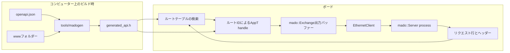

<div align="center">

<h1>Madoguchi</h1>

<strong>Uno R3とUno R4 Minima向けの、ヒープを使わない小さなHTTPサーバーです。R4ではJWTで保護されたREST APIを提供します。</strong>

<br>
<br>

[English](README.md) | 日本語 | [简体中文](README.zh-Hans.md) | [繁體中文 (香港)](README.zh-HK.md)

[](https://github.com/gufranco/madoguchi/actions/workflows/ci.yml)
[](LICENSE)

</div>

<p align="center">
  <a href="#クイックスタート">クイックスタート</a> |
  <a href="#サンプル">サンプル</a> |
  <a href="#openapiとjwtによるrest-api">REST API</a> |
  <a href="#開発">開発</a> |
  <a href="CHANGELOG.md">変更履歴</a>
</p>

---

Madoguchiは、Uno R3のATmega328P上でEthernetライブラリやSDライブラリと共存し、ヒープを一切確保しません。Uno R4 Minimaでは、1つのOpenAPIドキュメントから生成した完全なREST APIを提供します。JWTによるログイン、JSONボディ、すべてのHTTPメソッド、`/`のサイト、`/docs`のSwagger UIを含みます。CIは17個のサンプルすべてを対象ボード向けにビルドし、ボードのフラッシュまたはRAMの上限を超えたビルドを失敗させます。また、プッシュとプルリクエストのたびに、ホストテスト1,142件、ツールテスト113件、ページスクリプトテスト12件を実行し、パーサーをファズテストします。

名前の由来は、依頼を受け取って答えを返す「窓口」です。

## 使い方

ハンドラーは、ルートIDで分岐する静的関数です。以下は[`SimpleWebServer`](examples/SimpleWebServer/SimpleWebServer.ino)の中核部分で、Uno R3では18,640バイトのフラッシュを使います。

```cpp
struct WebApp {
  static bool handle(WebExchange& exchange, const uint8_t route) {
    const bool known = route == kIndex;
    if (!known) {
      return exchange.send_empty(404U);
    }
    const bool status = exchange.send_status(200U);
    const bool type = exchange.send_content_type(F("text/html"));
    const bool ended = exchange.end_headers();
    const size_t written = exchange.print(F("<html><body><h1>Hello World!</h1></body></html>\n"));
    return status && type && ended && (written > 0U);
  }
};

const char kIndexPath[] PROGMEM = "/";
const mado::Route kRoutes[] PROGMEM = {
    {&kIndexPath[0], mado::Method::kGet, kIndex},
    {nullptr, mado::Method::kAny, 0U},
};
mado::Server<EthernetClient, WebApp> web(kRoutes, nullptr);

void loop() {
  EthernetClient client = ethernet_server.available();
  const bool has_client = static_cast<bool>(client);
  if (has_client) {
    web.process(client);
  }
}
```

`process()`は、待機中のリクエストがなければすぐに戻ります。リクエストがあれば読み取り、一致したルートのIDで`WebApp::handle`を呼び出し、接続を閉じます。

## クイックスタート

### 前提条件

| ツール | バージョン | 用途 |
|:-----|:--------|:-----------|
| [arduino-cli](https://arduino.github.io/arduino-cli/)またはArduino IDE | CIはarduino-cli 1.5.1を使用 | ボード向けのビルド |
| `arduino:avr`または`arduino:renesas_uno`コア | 1.8.8または1.6.0 | Uno R3またはUno R4 Minima |
| Ethernetライブラリ | 2.0.2 | EthernetENC以外のすべてのサンプル |
| CMakeとC++コンパイラー | CMake 3.24以降 | コンピューター上でのREST APIの実行 |

### インストール

MadoguchiはArduino Library Managerに登録されていません。このリポジトリからインストールしてください。

```sh
arduino-cli config set library.enable_unsafe_install true
arduino-cli lib install --git-url https://github.com/gufranco/madoguchi.git
arduino-cli lib install Ethernet@2.0.2
```

Arduino IDEでは、リポジトリをZIPでダウンロードし、**スケッチ > ライブラリをインクルード > .ZIP形式のライブラリをインストール**を使います。

ライブラリ自体には依存関係がありません。SD、EthernetENC、ArduinoJsonは、それらをインクルードするサンプルでのみ必要です。

### ボード向けのビルド

このリポジトリをクローンし、ボードをUSBで接続した状態で実行します。

```sh
git clone https://github.com/gufranco/madoguchi.git
cd Madoguchi
arduino-cli compile --fqbn arduino:avr:uno --library . examples/SimpleWebServer
arduino-cli board list
arduino-cli upload --fqbn arduino:avr:uno --port <port from board list> examples/SimpleWebServer
```

Uno R4 Minimaでは`--fqbn arduino:renesas_uno:minima`を使います。スケッチはアドレス192.168.1.177を使うため、ネットワークのアドレス範囲が異なる場合はスケッチ内で変更してください。ボードにW5x00シールドを載せていれば、`curl http://192.168.1.177/`でHello Worldページが返ります。

### ボードなしでREST APIを試す

同じクローンで、`mado_host_server`が[`RestApi`](examples/RestApi/RestApi.ino)のアプリケーションコードを127.0.0.1上で実行します。テスト用の署名鍵とパスワード`correct-horse-battery`を使います。

```sh
cmake -S tests -B build
cmake --build build --target mado_host_server
build/mado_host_server 8080
```

別のターミナルで次を実行します。

```sh
TOKEN=$(curl -s -H 'Content-Type: application/json' \
  -d '{"username":"admin","password":"correct-horse-battery"}' \
  http://127.0.0.1:8080/api/auth/login | python3 -c 'import json,sys; print(json.load(sys.stdin)["access_token"])')
curl -s -i -H "Authorization: Bearer $TOKEN" -H 'Content-Type: application/json' \
  -d '{"name":"lamp","value":3,"on":true}' http://127.0.0.1:8080/api/items
```

期待される出力は次のとおりです。

```text
HTTP/1.1 201 Created
Connection: close
Content-Type: application/json
Cache-Control: no-store
Location: /api/items/1

{"id":1,"name":"lamp","value":3,"on":true}
```

サイトは`http://127.0.0.1:8080/`、Swagger UIは`http://127.0.0.1:8080/docs`で開けます。

## 対応ハードウェア

Madoguchiが対応するボードは、ATmega328Pを搭載したArduino Uno R3と、Renesas RA4M1を搭載したArduino Uno R4 Minimaの2つです。それ以外のボードは対象外です。

| ハードウェア | ライブラリ | クライアント型 |
|:---------|:--------|:------------|
| Wiznet W5100、W5200、W5500シールド | Ethernet 2.0.2 | `EthernetClient` |
| ENC28J60モジュール | EthernetENC 2.0.5 | `EthernetClient` |

サーバーはクライアント型をテンプレート引数に取るため、`available()`、`read()`、`read(buffer, size)`、`write(buffer, size)`、`connected()`、`stop()`を持つクラスであれば動作します。

ATmega168には対応していません。Ethernet 2.0.2だけで、14,336バイトのフラッシュのうち11,208バイトを使うためです。UNO Qにも対応していません。arduino:zephyr 1.0.0上のスケッチにはソケットAPIがないためです。

## サンプル

サイズの単位はバイトです。arduino-cli 1.5.1、arduino:avr 1.8.8、arduino:renesas_uno 1.6.0、Ethernet 2.0.2、SD 1.3.0、EthernetENC 2.0.5、ArduinoJson 7.4.3でビルドしました。

| サンプル | 内容 | Uno R3フラッシュ、32,256中 | Uno R3空きRAM、2,048中 | R4 Minimaフラッシュ、262,144中 | R4 Minima使用RAM、32,768中 |
|:--------|:------|------:|------:|------:|------:|
| [`SimpleWebServer`](examples/SimpleWebServer/SimpleWebServer.ino) | 1ページ | 18,864 | 1,546 | 57,796 | 4,560 |
| [`FormAndQuery`](examples/FormAndQuery/FormAndQuery.ino) | クエリ文字列とurlencodedフォーム | 21,288 | 1,546 | 59,600 | 4,560 |
| [`TemplatePage`](examples/TemplatePage/TemplatePage.ino) | フラッシュ上のページの`$NAME$`タグ | 19,524 | 1,546 | 58,380 | 4,560 |
| [`BasicAuth`](examples/BasicAuth/BasicAuth.ino) | HTTP Basic認証 | 19,596 | 1,546 | 58,440 | 4,560 |
| [`JsonApi`](examples/JsonApi/JsonApi.ino) | ArduinoJsonによるレスポンス | 25,978 | 1,494 | 62,564 | 4,564 |
| [`EthernetENC`](examples/EthernetENC/EthernetENC.ino) | ENC28J60モジュール | 25,264 | 851 | 63,176 | 5,184 |
| [`WebServerSD`](examples/WebServerSD/WebServerSD.ino) | SD上のファイルとフォルダー、gzip版付き | 30,822 | 735 | 65,648 | 5,220 |
| [`FileUpload`](examples/FileUpload/FileUpload.ino) | SDへの`PUT`アップロード | 31,554 | 739 | 65,648 | 5,220 |
| [`BlinkLed`](examples/BlinkLed/BlinkLed.ino) | SD上のページから切り替えるLED | 31,984 | 738 | 66,108 | 5,224 |
| [`RestGet`](examples/RestGet/RestGet.ino) | アイテム一覧と1件の`GET` | 24,486 | 1,395 | 61,796 | 4,712 |
| [`RestPost`](examples/RestPost/RestPost.ino) | JSONによる新規アイテムの`POST` | 27,162 | 1,403 | 64,068 | 4,712 |
| [`RestPut`](examples/RestPut/RestPut.ino) | アイテムを置き換える`PUT` | 27,368 | 1,395 | 64,312 | 4,712 |
| [`RestPatch`](examples/RestPatch/RestPatch.ino) | アイテムの一部のフィールドを変更する`PATCH` | 27,512 | 1,395 | 64,296 | 4,712 |
| [`RestDelete`](examples/RestDelete/RestDelete.ino) | IDによるアイテムの`DELETE` | 23,206 | 1,395 | 60,948 | 4,712 |
| [`RestAuth`](examples/RestAuth/RestAuth.ino) | ログインと保護されたルート1つ | 収まりません |  | 80,072 | 5,600 |
| [`RestFiles`](examples/RestFiles/RestFiles.ino) | SD上のファイルの一覧、ダウンロード、範囲指定、進捗付きアップロード、削除 | 収まりません |  | 93,312 | 6,392 |
| [`RestApi`](examples/RestApi/RestApi.ino) | API全体、サイト、Swagger UI | 収まりません |  | 104,828 | 6,088 |

RestApiとRestAuthはトークンへの署名、パスワードのハッシュ化、サイトの保持を行い、RestFilesはサイトとSHA-256を持つため、この3つにはR4 Minimaが必要です。それ以外のサンプルはどちらのボードにも収まります。CIは、いずれかのボードの上限を超えたビルドを失敗させます。また、Uno R3上のSimpleWebServerがスタック用に1,024バイト以上のRAMを残さない場合も失敗させます。

## アーキテクチャ



- バッファーは固定長で、テンプレート引数として渡す`Limits`型でサイズが決まります。ヒープには何も確保しません。
- ライブラリは関数ポインターを持たず、仮想関数も宣言しません。ルートIDで分岐する静的な`handle`により、呼び出しグラフが解析ツールから見える状態を保ちます。
- すべてのループに反復回数の上限があり、すべての読み取りにタイムアウトがあり、リクエスト全体にも期限があるため、遅いクライアントがスケッチを止めることはありません。定数文字列とテーブルは`F()`と`PROGMEM`でフラッシュに置かれます。
- リクエストはRFC 9112のとおりに解析します。`HTTP/1.1`のリクエストには`Host`がちょうど1つ必要で、`Content-Length`が重複すると`400`、`Transfer-Encoding`には`501`を返し、ハンドラーが読まなかったボディは接続を閉じる前に読み捨てます。

コードは、JPL D-60411のC言語標準とPower of Tenのルールに、最も厳しい解釈でC++向けに合わせて従っています。各ルールとその適用方法は[`AGENTS.md`](AGENTS.md)にあります。

## 含まれる機能

| 分野 | 機能 | API |
|:-----|:--------|:----|
| リクエスト | パスとメソッドによるルーティング、プレフィックス用の末尾`*`、`Allow`ヘッダー付きの`405` | `mado::Route {path, method, id}` |
| リクエスト | クエリパラメーターとurlencodedフォームのフィールドを、用意したバッファーにデコード | `query_param()`、`mado::next_form_field()` |
| リクエスト | 指定したヘッダーだけを大文字小文字を区別せずに取得、`100 Continue`の後にボディをブロック単位で読み取り | `header()`、`read_body()` |
| リクエスト | 読み取りが止まるかリクエストが遅いと`408`、リクエスト行が長すぎると`414`、ヘッダー行が多すぎると`431`、HTTP/1.0と1.1以外のバージョンには`505` | 自動 |
| リクエスト | DNSリバインディング対策として、列挙した`Host`名だけをポートの有無にかかわらず受け付け、レスポンスごとにステータスを渡すフック | `PolicyT::trusted_hosts()`、`PolicyT::on_response()` |
| レスポンス | 理由句付きのステータス行、任意のヘッダー、列挙したオリジン向けのCORS、リダイレクト、32バイト単位にまとめた出力 | `send_status()`、`send_header()`、`mado::send_cors_headers()`、`send_redirect()`、`mado::Reply` |
| レスポンス | RFC 9457のProblem Details。タイトル、ステータス、詳細を持つ`application/problem+json` | `mado::send_problem()`、`mado::json_problem()` |
| レスポンス | フラッシュに置いたページの`$NAME$`タグ、正確な`Content-Length`付きのArduinoJsonドキュメント | `mado::send_template()`、`mado::send_json()` |
| ファイル | SDや任意の読み取り可能なファイルの配信、フォルダー、gzip版、拡張子ごとのContent-Type | `mado::send_file()`、`mado::content_type_for()`、`mado::accepts_gzip()` |
| ファイル | URLパスをデコードして検査し、`.`と`..`のセグメント、空のセグメント、バックスラッシュ、エンコードされたNULバイトを拒否 | `mado::resolve_static_path()` |
| ファイル | 1つのバイト範囲を`206`または`416`で返し、`If-Range`、弱いETagと`304`、ダウンロード名に対応 | `mado::send_file(exchange, file, mado::FileReply)` |
| ファイル | アップロードを8.3形式の名前と`Repr-Digest`で検査し、一時ファイルに書いてから所定の場所へ移動 | `mado::valid_short_name()`、`mado::parse_repr_digest()`、`mado::copy_file()`、`mado::replace_file()` |
| ファイル | フラッシュ上の縮小・gzip化したファイルを、ETag、`304 Not Modified`、`406 Not Acceptable`、Content-Security-Policy、コンパイル時に組み立てたヘッダーブロック付きで配信 | `mado::send_asset()` |
| ネットワーク | タイムアウト付きのDHCPと固定のフォールバックアドレス。一度だけ作ってEEPROMに保存するランダムなMAC | `mado::begin_network()`、`mado::load_mac()` |
| ネットワーク | ケーブルやチップが戻ったときの再起動。mDNSで応答する`<name>.local` | `mado::NetworkWatch`、`mado::MdnsResponder` |
| ストレージ | レスポンスごとにpino-httpと同じ形のJSONを1行。指定サイズを超えるとローテーション | `mado::SdLog`、`mado::write_request_log()` |
| ストレージ | 小さなカウンターをSD上のテキストファイルに、固定のレコードをEEPROMに保存 | `mado::read_count_file()`、`mado::write_count_file()`、`mado::EepromTable` |
| 認証 | HTTP Basic認証の資格情報を定数時間で検査 | `mado::check_basic_auth()` |
| 認証 | HS256のJSON Web Tokenの発行と検証、PBKDF2-HMAC-SHA256によるパスワードハッシュ | `mado::issue_token()`、`mado::verify_bearer()`、`mado::pbkdf2_sha256()` |
| 認証 | 5回失敗するとログインを15分間ロック | `mado::LoginGuard` |
| 認証 | SHA-256、HMAC-SHA256、Base64url | `mado::Sha256`、`mado::HmacSha256`、`mado::Base64UrlEncoder`、`mado::Base64UrlDecoder` |
| REST | JSONリクエストボディをRAM上にドキュメントを置かずにフィールド単位で読み取り、JSON文字列をエスケープして出力 | `mado::JsonReader`、`mado::json_write_string()` |
| REST | パス末尾の`{id}`の読み取り、レコードの固定テーブル | `mado::parse_path_id()`、`mado::SlotTable` |
| REST | OpenAPI 3.1ドキュメントとWebファイルのフォルダーからC++を生成 | [`tools/madogen`](tools/madogen/cli.py) |

## ガイド

### ルートとハンドラー

ルートは`{path, method, id}`で、テーブルはパスが`nullptr`のエントリーで終わります。ルートはテーブルの順に照合されるため、具体的なパスをワイルドカードより前に置いてください。

- `/led`のような完全なパスは`/led`にだけ一致します。照合ではクエリ文字列を無視します。
- `/files/*`のように`*`で終わるパスは、`/files/`で始まるすべてのパスに一致します。
- `mado::Method::kAny`はすべてのメソッドを受け付けます。`kGet`のルートは`HEAD`にも応答し、ボディは省かれます。
- パスは一致してもメソッドが違う場合は`405`、どれにも一致しない場合は`404`になります。

`handle`は、レスポンスが完了して接続を閉じてよい場合に`true`を返します。後で`exchange.client()`を通じて更新を送り続けるなど、接続を開いたままにする場合は`false`を返します。W5100のソケットは4つなので、開いたままの接続は少なくしてください。

### Exchange

`mado::Exchange`は、1つの接続のリクエストとレスポンスを表します。

| リクエスト | 戻り値 |
|:--------|:--------|
| `method()` | `mado::Method` |
| `path()` | 送られたとおりのパス、クエリ文字列を除く |
| `query()` | 生のクエリ文字列、ない場合は空 |
| `query_param(name, out, size)` | `true`と、`out`にデコードされた値 |
| `header(name)` | 取得した値、または`nullptr` |
| `content_length()` | 宣言されたボディの長さ |
| `read_body(buffer, size)` | 読み取ったバイト数、終端で`0`、タイムアウトまたは接続終了で`-1` |
| `remaining_body()` | まだ読み取っていないボディのバイト数 |
| `client()` | 直接アクセス用のクライアントへのポインター |

| レスポンス | 送信内容 |
|:---------|:------|
| `send_status(code)` | `HTTP/1.1 <code> <reason>`と`Connection: close` |
| `send_header(F("Name"), value)` | ヘッダー1つ。値はRAM上の文字列、数値、または`mado::FlashText(F("..."))` |
| `send_content_type(F("type"))` | `Content-Type` |
| `send_content_length(length)` | `Content-Length` |
| `send_cors_headers()` | `Access-Control-Allow-Origin: *`と、許可するメソッドとヘッダー |
| `mado::send_cors_headers(exchange, origins)` | `Vary: Origin`と、取得した`Origin`がリストにある場合だけCORSヘッダー |
| `send_location(F("/api/items/"), id)` | `Location: /api/items/<id>` |
| `status_code()` | これまでに送ったステータス、または`0` |
| `end_headers()` | 空行。これ以降、`HEAD`リクエストではボディが省かれます |
| `send_empty(code)` | ボディのない完全なレスポンス |
| `send_redirect(F("/next"))` | `Location`付きの`303 See Other` |
| `print(...)`、`print_signed(...)`、`write(...)` | ボディのテキスト、数値、バイト列 |

### リクエストヘッダー

必要なヘッダー名はサーバーの作成時に指定します。値は固定長のプールを共有し、既定では48バイトで、それより長い値は切り詰められます。`Content-Length`と`Expect`は常に読み取られます。

```cpp
const char kAuthorization[] PROGMEM = "Authorization";
const char kAcceptEncoding[] PROGMEM = "Accept-Encoding";
const char* const kHeaderNames[] PROGMEM = {&kAuthorization[0], &kAcceptEncoding[0], nullptr};
mado::Server<EthernetClient, WebApp> web(&kRoutes[0], &kHeaderNames[0]);
```

### クエリ文字列とフォーム

```cpp
#include <mado/next_form_field.h>

char name[24];
char value[24];
if (exchange.query_param(F("name"), &name[0], sizeof(name))) {
  exchange.print(&name[0]);
}
while (mado::next_form_field(exchange, &name[0], sizeof(name), &value[0], sizeof(value)) ==
       mado::FormStatus::kField) {
  exchange.print(&value[0]);
}
```

スケッチ全体は[`FormAndQuery`](examples/FormAndQuery/FormAndQuery.ino)にあります。

### 静的ファイルとアップロード

```cpp
#include <mado/content_type_for.h>
#include <mado/resolve_static_path.h>
#include <mado/send_file.h>

char path[40];
if (!mado::resolve_static_path(exchange.path(), "", F("INDEX.HTM"), &path[0], sizeof(path))) {
  return exchange.send_empty(mado::http::kBadRequest);
}
File file = SD.open(&path[0], FILE_READ);
mado::send_file(exchange, file, file.size(), mado::content_type_for(&path[0]), false);
```

省略可能な6番目の引数、たとえば`F("max-age=300")`を渡すと、約70バイトのフラッシュで`Cache-Control`ヘッダーを付けます。Uno R3ではSDと並べるとETagへの完全な対応が収まらないため、WebServerSDとBlinkLedはこちらを使います。

範囲指定、条件付きリクエスト、ダウンロードには、サイズ、タイプ、gzipフラグ、ETag、ダウンロード名、`Cache-Control`の値を入れた`mado::FileReply`を渡します。`mado::file_etag()`は、名前、サイズ、スケッチが書き込みのたびと起動時に変えるバージョンから弱いETagを作ります。そのため、同じサイズのファイルで置き換えても新しいタグになります。`If-Range`付きの`Range`にはファイル全体を返します。弱いタグでは、部分同士が同じ版であることを証明できないためです。

SDライブラリは8.3形式の名前しか受け付けないため、[`WebServerSD`](examples/WebServerSD/WebServerSD.ino)は事前圧縮したファイルを`/GZ`の下に置きます。[`FileUpload`](examples/FileUpload/FileUpload.ino)は`PUT /upload/NAME`をカードに保存します。

```sh
curl --upload-file index.htm http://192.168.1.177/upload/index.htm
```

### Basic認証

```cpp
#include <mado/check_basic_auth.h>
#include <mado/send_auth_challenge.h>

if (!mado::check_basic_auth(exchange.header(F("Authorization")), F("YWRtaW46Y2hhbmdlLW1l"))) {
  return mado::send_auth_challenge(exchange, F("Madoguchi"));
}
```

期待値は`user:password`をBase64にしたもので、`printf 'admin:change-me' | base64`で求めます。

> [!WARNING]
> ボードにはTLSがありません。Basic認証のパスワード、ログインのパスワード、Bearerトークンは、平文のままネットワークを通ります。ボードは信頼できるネットワークに置くか、TLSを終端するリバースプロキシの背後に置いてください。

### テンプレート

```cpp
#include <mado/send_template.h>

struct PageTags {
  static bool render(WebExchange& exchange, const char* tag) {
    if (strcmp_P(tag, PSTR("TEMP")) == 0) {
      exchange.print(static_cast<uint32_t>(analogRead(A0)));
      return true;
    }
    return false;
  }
};

mado::send_template<WebExchange, PageTags>(exchange, F("<p>Reading: $TEMP$</p>"));
```

タグは最大16文字の英字、数字、アンダースコアです。不明なタグは書かれたまま送信されます。

### ArduinoJsonによるJSON

```cpp
#include <ArduinoJson.h>
#include <MadoguchiJson.h>

JsonDocument document;
document["uptime_ms"] = millis();
mado::send_json(exchange, mado::http::kOk, document);
```

ArduinoJsonをインクルードするのは`MadoguchiJson.h`だけなので、これをインクルードしないスケッチではArduinoJsonはコンパイルされません。

### 制限値

バッファーサイズとタイムアウトは、3番目のテンプレート引数として渡す型で決まります。すべてのフィールドを宣言してください。その場合、ハンドラーは`mado::Exchange<EthernetClient, BigLimits>&`を受け取ります。

```cpp
struct BigLimits {
  static constexpr uint16_t kLineBufferSize = 256U;
  static constexpr uint16_t kOutputBufferSize = 512U;
  static constexpr uint8_t kHeaderPoolSize = 96U;
  static constexpr uint8_t kHeaderNameSize = 32U;
  static constexpr uint8_t kMaxCapturedHeaders = 8U;
  static constexpr uint8_t kMaxHeaderLines = 48U;
  static constexpr uint8_t kMaxRoutes = 32U;
  static constexpr uint16_t kReadTimeoutMs = 1000U;
  static constexpr uint32_t kMaxPollsPerRead = 100000UL;
  static constexpr uint16_t kRequestTimeoutMs = 5000U;
  static constexpr uint16_t kMaxDrainBytes = 1024U;
  static constexpr uint16_t kFileChunkSize = 512U;
};
mado::Server<EthernetClient, WebApp, BigLimits> web(&kRoutes[0], nullptr);
```

| フィールド | 既定値 | 意味 |
|:------|--------:|:--------|
| `kLineBufferSize` | 128 | 最も長いリクエスト行。メソッド、パス、クエリの合計 |
| `kOutputBufferSize` | 32 | ネットワークに書き込む前にまとめるバイト数。最大1,460で、それより大きな書き込みは1回で送ります |
| `kHeaderPoolSize` | 48 | 取得するすべてのヘッダー値の領域 |
| `kHeaderNameSize` | 32 | 取得できる最も長いヘッダー名 |
| `kMaxCapturedHeaders` | 8 | ヘッダーリストの名前の数 |
| `kMaxHeaderLines` | 48 | `431`を返す前に受け付けるヘッダー行の数 |
| `kMaxRoutes` | 32 | テーブル内で走査するルートの数 |
| `kReadTimeoutMs` | 1000 | `408`を返すまで次のバイトを待つ時間 |
| `kMaxPollsPerRead` | 100000 | 1回の読み取りあたりのポーリング回数の上限 |
| `kRequestTimeoutMs` | 5000 | `408`を返すまでの、リクエスト行とヘッダー、さらにボディそれぞれの制限時間 |
| `kMaxDrainBytes` | 1024 | 接続を閉じる前に読み捨てる未読ボディのバイト数。これより長いボディは読みません |
| `kFileChunkSize` | 32 | `send_file()`が1回にファイルから読むバイト数 |

4つ目のテンプレート引数であるポリシーは、信頼するホストを列挙し、各レスポンスのステータスを受け取ります。デフォルトは255バイトまでの任意の`Host`を信頼し、フックは何もしません。

```cpp
struct BoardPolicy {
  static constexpr bool kTrustedHostsOnly = true;
  static const char* const* trusted_hosts() {
    static const char* const kHosts[] = {"192.168.1.177", "board.local", nullptr};
    return &kHosts[0];
  }
  static void on_response(const mado::RequestLine&, const mado::ResponseSummary&) {}
};
mado::Server<EthernetClient, WebApp, mado::DefaultLimits, BoardPolicy> web(&kRoutes[0], nullptr);
```

### ネットワーク

```cpp
#include <mado/MdnsResponder.h>
#include <mado/begin_network.h>
#include <mado/load_mac.h>

const char kHostName[] PROGMEM = "madoguchi";
uint8_t mac[mado::kMacSize] = {};
mado::MdnsResponder<EthernetUDP, IPAddress> mdns(&kHostName[0]);

void setup() {
  mado::load_mac(EEPROM, 8U, mac, micros());
  mado::begin_network(Ethernet, &mac[0], IPAddress(192, 168, 1, 177), 10000UL);
  mdns_socket.beginMulticast(IPAddress(224, 0, 0, 251), mado::kMdnsPort);
}
```

`load_mac()`は、初回起動時にローカル管理のランダムなMACをEEPROMの7バイトに書き込み、以後はそれを読み戻します。`begin_network()`は、DHCPが時間内に応答せず固定アドレスを使っているときに`false`を返します。`loop()`では、`http://madoguchi.local`を解決できるように`mdns.poll(mdns_socket, Ethernet.localIP())`を、リースを更新するために`Ethernet.maintain()`を呼び、チップとリンクの状態を渡して`mado::NetworkWatch::update()`を呼びます。ネットワークを再起動すべきときは`mado::NetworkAction::kRestart`が返ります。[`RestApi.ino`](examples/RestApi/RestApi.ino)はこれをすべて行います。

### リクエストログ

`mado::SdLog`は、レスポンスごとにpino-httpと同じ形のJSONを1行追記し、指定したサイズを超えるとファイルを別名に移します。

```json
{"level":30,"boot":3,"uptime":1500,"hostname":"madoguchi","req":{"id":12,"method":"PUT","url":"/api/items/2"},"res":{"statusCode":200},"responseTime":9,"msg":"request completed"}
```

`level`は、500未満のレスポンスで30、サーバーエラーで50です。ボードには時計がないため、`boot`は再起動の回数、`uptime`は`millis()`です。ポリシーの`on_response()`から`log.request()`を呼び、ログインなどそれ以外の記録には`log.event()`を使います。RestApiは`/LOG.TXT`に書き込み、直前の64 KiBを`/LOG.OLD`に残し、ユーザー名やアドレスは記録しません。NDJSONを扱える任意のツールで読めます。

```sh
curl -s -H "Authorization: Bearer $TOKEN" http://madoguchi.local/api/log | jq -c 'select(.level >= 40)'
```

## OpenAPIとJWTによるREST API

[`RestApi`](examples/RestApi/RestApi.ino)は、W5x00シールドを載せたUno R4 Minima向けの、認証付きの完全なAPIです。

| パス | 提供する内容 |
|:-----|:-------|
| `/` | サインインして、アイテムの一覧、追加、切り替え、削除を行うページ |
| `/docs` | ボード自身のAPIのSwagger UI |
| `GET /api/openapi.json` | OpenAPI 3.1ドキュメント |
| `POST /api/auth/login` | 正しいユーザー名とパスワードに対するBearerトークン |
| `GET /api/items`、`GET /api/items/{id}` | アイテム、公開 |
| `POST /api/items`、`PUT`、`PATCH`、`DELETE /api/items/{id}` | 変更、Bearerトークンが必要 |
| `GET /api/log`、`DELETE /api/log` | JSON行のリクエストログ、末尾を読むための`Range`、ログの消去。Bearerトークンが必要 |

[`RestAuth`](examples/RestAuth/RestAuth.ino)は、ログインと保護されたルート1つを示します。[`RestGet`](examples/RestGet/RestGet.ino)、[`RestPost`](examples/RestPost/RestPost.ino)、[`RestPut`](examples/RestPut/RestPut.ino)、[`RestPatch`](examples/RestPatch/RestPatch.ino)、[`RestDelete`](examples/RestDelete/RestDelete.ino)は、それぞれ認証なしで1つのメソッドを示します。[`RestFiles`](examples/RestFiles/RestFiles.ino)は、SDカード上のファイルの一覧、ダウンロード、進捗バー付きのアップロード、削除を行います。認証がないため、信頼できるネットワークで使ってください。どれもアプリケーションコードをスケッチの隣のヘッダーに置いているため、ホストテストはボードが実行するのと同じコードを実行します。

### APIコードの生成

各RESTスケッチは`openapi.json`を持ち、RestApiはさらにHTML、CSS、JavaScriptの`www`フォルダーを持ちます。[`tools/madogen`](tools/madogen/cli.py)がこれらを`generated_api.h`に変換します。このファイルはコミットされているため、Arduino IDEはPythonなしでスケッチをビルドできます。ジェネレーターはPython標準ライブラリだけを使います。

```sh
python3 -m tools.madogen generate examples/RestApi
python3 -m tools.madogen check examples/RestApi
```

`generate`が書き出すものは次のとおりです。

- 各`operationId`からのルートID、`paths`からのルートテーブル
- 各オペレーションの`security`からの`route_needs_token()`
- パス末尾の`{id}`を読み取る`route_path_id()`
- `components.schemas`の各スキーマに対する構造体とフィールドリーダー。各`maxLength`、`minimum`、`maximum`を検査します。JSONライターは、レスポンスで使うスキーマと`x-mado-writer: true`を指定したスキーマに作られます
- `Content-Type`と長さを検査してボディを読み、最初に欠けている必須プロパティを`mado::Problem`で示す`read_<schema>_body()`と、IDによる`GET`ごとの`<operation>_url()`
- `www`内のすべてのファイルを縮小・gzip化したもの、そのヘッダーブロック全体とETag、各HTMLページのContent-Security-Policy。HTMLページ以外のファイルは内容のハッシュに基づく名前に変わり、`immutable`として1年間キャッシュされます。HTMLページは名前を保ち、`documentMaxAge`秒後に再検証されます
- `/api/openapi.json`で配信するOpenAPIドキュメント自体

`check`は、`generated_api.h`がソースと一致しなくなった場合、または`arduino_secrets.h`に本物の鍵が入っている場合に失敗します。CIは8つのRESTサンプルすべてで実行します。

ジェネレーターはOpenAPI 3.1のサブセットを受け付け、その範囲外のものはJSONポインターで示します。

- パスは`/api/`で始まり、パラメーターにできるのは最後のセグメントだけです
- `in: header`のパラメーターは、取得するリクエストヘッダーになります
- 省略可能な最上位の`x-mado-limits`で、`outputBufferSize`を8から1,460、`fileChunkSize`を1,024まで、`documentMaxAge`を86,400秒まで設定できます
- リクエストボディは`application/json`でコンポーネントのスキーマを参照するか、`application/octet-stream`です
- スキーマは`additionalProperties: false`のフラットなオブジェクトで、`maxLength`付きの文字列、`minimum`と`maximum`付きの整数、真偽値を持ちます
- securityは`[]`または`[{"bearerAuth": []}]`で、`bearerAuth`はHTTP BearerのJWT方式です
- オペレーションは最大31個です

ページはスクリプトとスタイルをファイルに分けておきます。インラインスクリプト、`style`属性、`on...`ハンドラーがあると、ポリシーでブロックされるため生成は止まります。別のホストのスクリプトやスタイルシートには`integrity`ハッシュが必要で、`python3 -m tools.madogen sri FILE`で出力できます。

### サインイン

コミットされている`arduino_secrets.h`の鍵はすべてゼロで、置き換えるまではログインが`503`を返し、どのトークンも受け付けません。本物のシークレットはボードごとに一度作成します。

```sh
python3 -m tools.madogen secrets examples/RestApi --user admin
```

12〜64文字のパスワードを尋ね、ランダムな32バイトの署名鍵、ランダムなソルト、パスワードのPBKDF2-HMAC-SHA256ハッシュを書き出します。このファイルは決してコミットしないでください。CIが実行する`check`は、本物の鍵が入っていると失敗します。

- トークンはHS256のJWTです。ボードはトークンのヘッダーをバイト単位で比較するため、`alg: none`やその他のアルゴリズムは失敗します。署名は定数時間で比較します。
- トークンの有効期間は稼働時間で15分で、ボードを再起動すると無効になります。起動のたびにEEPROM上のセッションカウンターを進めるためです。
- ログインに5回続けて失敗すると、ログインが15分間ロックされ、`Retry-After`付きの`429`を返します。
- Argon2idとbcryptはボードのRAMを超えるため、パスワードにはPBKDF2を使います。ログインが約1秒かかるように`--iterations`を調整してください。

`/docs`はunpkg.comからSwagger UI 5.33.2をSubresource Integrity付きで読み込むため、そのページにはブラウザーのインターネット接続が必要です。それ以外のページとAPIはオフラインで動作します。

生成される`Limits`はヘッダープールを240バイトに広げ、`Accept-Encoding`、`If-None-Match`、`Content-Type`と並べてBearerトークンを保持できるようにします。256バイトを超えるリクエストボディには`413`を返し、APIのエラーにはすべて`{"title":"Unprocessable Content","status":422,"detail":"missing required property: on"}`のような`application/problem+json`のボディが付きます。静的ファイルはgzip形式でのみ保存され、gzipを受け付けないクライアントには`406`を返します。

## 開発

ホストテストはCMakeとgoogletestを使い、小さなArduinoシムと偽のクライアントで動きます。

| スイート | コマンド | 対象 |
|:------|:--------|:-------|
| ライブラリとサンプル | `cmake -S tests -B build -DMADO_COVERAGE=ON && cmake --build build && ctest --test-dir build --output-on-failure` | 1,142件。RFC 9112適合表、解析、ルーティング、レスポンス、ファイル、範囲指定、ネットワーク補助関数、SDログ、暗号、トークン、RESTサンプルのアプリケーションコード、各ファズコーパスの再生 |
| カバレッジ | `gcovr build --root . --filter src/ --merge-lines --txt` | `src/`の行と関数のカバレッジ。CIでは95パーセントを下限とします |
| ジェネレーターとゲート | `python3 -m pytest -q tests/madogen tests/assertion_density tests/size_gate tests/throughput` | `madogen`とその縮小処理、アサーション密度ゲート、サイズゲート、スループットツールの113件 |
| ページスクリプト | `node --test tests/web/*.test.mjs` | RestApiのサイト、そのログ表示、RestFilesのページ、Swagger UIローダーの12件 |
| スループット | `python3 tools/throughput.py --download http://madoguchi.local/ --upload http://madoguchi.local/api/files/BENCH.BIN` | ボードに対するダウンロードとアップロードの速度をJSONで表示 |
| 生成コード | `python3 -m tools.madogen check examples/Rest*` | `generated_api.h`がソースと一致し、本物の鍵がコミットされていないこと |
| ファズテスト | `cmake -S tests -B fuzz -DMADO_FUZZ=ON -DCMAKE_CXX_COMPILER=clang++ && cmake --build fuzz && fuzz/mado_fuzz_request tests/fuzz/corpus/request` | AddressSanitizerとUBSanを有効にしたlibFuzzerで、サーバー、RestApiとRestFilesのアプリ、JSONリーダー、テキストデコーダーを検査 |
| サイズ上限 | `python3 tools/size_gate.py --fqbn arduino:avr:uno --min-free-ram 1024 examples/SimpleWebServer` | ボードの上限に対するフラッシュとRAM、コンパイラー警告ゼロ |

CIはさらに、clang-format、clang-tidy、`--enable=all`付きのcppcheck 2.22.0、アサーション密度ゲート、strictモードのarduino-lintを、警告ゼロを条件に実行します。正確なコマンドは[`.github/workflows/ci.yml`](.github/workflows/ci.yml)に、コーディングルールは[`AGENTS.md`](AGENTS.md)にあります。

## ライセンス

[MIT](LICENSE)。著作権表示をコードに残す限り、商用を含むあらゆるプロジェクトで使用、複製、変更、配布できます。
