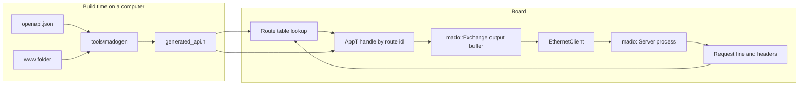

<div align="center">

<h1>Madoguchi</h1>

<strong>Small, heap-free HTTP server for the Uno R3 and Uno R4 Minima, with a JWT-secured REST API on the R4.</strong>

<br>
<br>

English | [日本語](README.ja.md) | [简体中文](README.zh-Hans.md) | [繁體中文 (香港)](README.zh-HK.md)

[](https://github.com/gufranco/madoguchi/actions/workflows/ci.yml)
[](LICENSE)

</div>

<p align="center">
  <a href="#quick-start">Quick start</a> |
  <a href="#examples">Examples</a> |
  <a href="#rest-api-with-openapi-and-jwt">REST API</a> |
  <a href="#development">Development</a> |
  <a href="CHANGELOG.md">Changelog</a>
</p>

---

Madoguchi runs on the Uno R3's ATmega328P next to the Ethernet and SD libraries and allocates nothing on the heap. On the Uno R4 Minima it serves a complete REST API generated from one OpenAPI document: JWT login, JSON bodies, every HTTP verb, a site at `/` and Swagger UI at `/docs`. CI builds all 17 examples for the boards they target, fails any build over a board's flash or RAM budget, runs 1,142 host tests, 113 tool tests and 12 page-script tests, and fuzzes the parsers on every push and pull request.

The name is 窓口, Japanese for the service counter where you hand over a request and get an answer back.

## Usage

A handler is a static function that switches on a route id. The core of [`SimpleWebServer`](examples/SimpleWebServer/SimpleWebServer.ino), which takes 18,640 bytes of flash on the Uno R3:

```cpp
struct WebApp {
  static bool handle(WebExchange& exchange, const uint8_t route) {
    const bool known = route == kIndex;
    if (!known) {
      return exchange.send_empty(404U);
    }
    const bool status = exchange.send_status(200U);
    const bool type = exchange.send_content_type(F("text/html"));
    const bool ended = exchange.end_headers();
    const size_t written = exchange.print(F("<html><body><h1>Hello World!</h1></body></html>\n"));
    return status && type && ended && (written > 0U);
  }
};

const char kIndexPath[] PROGMEM = "/";
const mado::Route kRoutes[] PROGMEM = {
    {&kIndexPath[0], mado::Method::kGet, kIndex},
    {nullptr, mado::Method::kAny, 0U},
};
mado::Server<EthernetClient, WebApp> web(kRoutes, nullptr);

void loop() {
  EthernetClient client = ethernet_server.available();
  const bool has_client = static_cast<bool>(client);
  if (has_client) {
    web.process(client);
  }
}
```

`process()` returns at once when no request is waiting. Otherwise it reads the request, calls `WebApp::handle` with the id of the matching route, and closes the connection.

## Quick start

### Prerequisites

| Tool | Version | Needed for |
|:-----|:--------|:-----------|
| [arduino-cli](https://arduino.github.io/arduino-cli/) or the Arduino IDE | arduino-cli 1.5.1 is what CI uses | Building for a board |
| `arduino:avr` or `arduino:renesas_uno` core | 1.8.8 or 1.6.0 | The Uno R3 or the Uno R4 Minima |
| Ethernet library | 2.0.2 | Every example except EthernetENC |
| CMake and a C++ compiler | CMake 3.24 or later | Running the REST API on a computer |

### Install

Madoguchi is not in the Arduino Library Manager. Install it from this repository:

```sh
arduino-cli config set library.enable_unsafe_install true
arduino-cli lib install --git-url https://github.com/gufranco/madoguchi.git
arduino-cli lib install Ethernet@2.0.2
```

In the Arduino IDE, download the repository as a ZIP and use **Sketch > Include Library > Add .ZIP Library**.

The library has no dependency of its own. SD, EthernetENC and ArduinoJson are needed only by the examples that include them.

### Build for a board

From a clone of this repository, with the board on USB:

```sh
git clone https://github.com/gufranco/madoguchi.git
cd Madoguchi
arduino-cli compile --fqbn arduino:avr:uno --library . examples/SimpleWebServer
arduino-cli board list
arduino-cli upload --fqbn arduino:avr:uno --port <port from board list> examples/SimpleWebServer
```

For the Uno R4 Minima, use `--fqbn arduino:renesas_uno:minima`. The sketch uses the address 192.168.1.177; change it in the sketch if your network uses another range. With a W5x00 shield on the board, `curl http://192.168.1.177/` answers with the Hello World page.

### Try the REST API without a board

From the same clone, `mado_host_server` runs the [`RestApi`](examples/RestApi/RestApi.ino) application code on 127.0.0.1, with a test signing key and the password `correct-horse-battery`:

```sh
cmake -S tests -B build
cmake --build build --target mado_host_server
build/mado_host_server 8080
```

In a second terminal:

```sh
TOKEN=$(curl -s -H 'Content-Type: application/json' \
  -d '{"username":"admin","password":"correct-horse-battery"}' \
  http://127.0.0.1:8080/api/auth/login | python3 -c 'import json,sys; print(json.load(sys.stdin)["access_token"])')
curl -s -i -H "Authorization: Bearer $TOKEN" -H 'Content-Type: application/json' \
  -d '{"name":"lamp","value":3,"on":true}' http://127.0.0.1:8080/api/items
```

Expected output:

```text
HTTP/1.1 201 Created
Connection: close
Content-Type: application/json
Cache-Control: no-store
Location: /api/items/1

{"id":1,"name":"lamp","value":3,"on":true}
```

Open `http://127.0.0.1:8080/` for the site and `http://127.0.0.1:8080/docs` for Swagger UI.

## Supported hardware

Madoguchi supports two boards: the Arduino Uno R3, an ATmega328P, and the Arduino Uno R4 Minima, a Renesas RA4M1. No other board is a target.

| Hardware | Library | Client type |
|:---------|:--------|:------------|
| Wiznet W5100, W5200, W5500 shields | Ethernet 2.0.2 | `EthernetClient` |
| ENC28J60 modules | EthernetENC 2.0.5 | `EthernetClient` |

The server is a template on the client type, so any class with `available()`, `read()`, `read(buffer, size)`, `write(buffer, size)`, `connected()` and `stop()` works.

The ATmega168 is not supported: Ethernet 2.0.2 alone takes 11,208 of its 14,336 bytes of flash. The UNO Q is not supported either, because a sketch on arduino:zephyr 1.0.0 has no socket API.

## Examples

Sizes in bytes, built with arduino-cli 1.5.1, arduino:avr 1.8.8, arduino:renesas_uno 1.6.0, Ethernet 2.0.2, SD 1.3.0, EthernetENC 2.0.5 and ArduinoJson 7.4.3:

| Example | Shows | Uno R3 flash, of 32,256 | Uno R3 RAM free, of 2,048 | R4 Minima flash, of 262,144 | R4 Minima RAM used, of 32,768 |
|:--------|:------|------:|------:|------:|------:|
| [`SimpleWebServer`](examples/SimpleWebServer/SimpleWebServer.ino) | one page | 18,864 | 1,546 | 57,796 | 4,560 |
| [`FormAndQuery`](examples/FormAndQuery/FormAndQuery.ino) | query strings and urlencoded forms | 21,288 | 1,546 | 59,600 | 4,560 |
| [`TemplatePage`](examples/TemplatePage/TemplatePage.ino) | `$NAME$` tags in a page in flash | 19,524 | 1,546 | 58,380 | 4,560 |
| [`BasicAuth`](examples/BasicAuth/BasicAuth.ino) | HTTP Basic credentials | 19,596 | 1,546 | 58,440 | 4,560 |
| [`JsonApi`](examples/JsonApi/JsonApi.ino) | ArduinoJson responses | 25,978 | 1,494 | 62,564 | 4,564 |
| [`EthernetENC`](examples/EthernetENC/EthernetENC.ino) | an ENC28J60 module | 25,264 | 851 | 63,176 | 5,184 |
| [`WebServerSD`](examples/WebServerSD/WebServerSD.ino) | files and folders from SD, with gzip copies | 30,822 | 735 | 65,648 | 5,220 |
| [`FileUpload`](examples/FileUpload/FileUpload.ino) | `PUT` uploads to SD | 31,554 | 739 | 65,648 | 5,220 |
| [`BlinkLed`](examples/BlinkLed/BlinkLed.ino) | an LED switched from a page on SD | 31,984 | 738 | 66,108 | 5,224 |
| [`RestGet`](examples/RestGet/RestGet.ino) | `GET` of the item list and of one item | 24,486 | 1,395 | 61,796 | 4,712 |
| [`RestPost`](examples/RestPost/RestPost.ino) | `POST` of a new item as JSON | 27,162 | 1,403 | 64,068 | 4,712 |
| [`RestPut`](examples/RestPut/RestPut.ino) | `PUT` replacing an item | 27,368 | 1,395 | 64,312 | 4,712 |
| [`RestPatch`](examples/RestPatch/RestPatch.ino) | `PATCH` changing some fields of an item | 27,512 | 1,395 | 64,296 | 4,712 |
| [`RestDelete`](examples/RestDelete/RestDelete.ino) | `DELETE` of an item by id | 23,206 | 1,395 | 60,948 | 4,712 |
| [`RestAuth`](examples/RestAuth/RestAuth.ino) | login and one protected route | does not fit |  | 80,072 | 5,600 |
| [`RestFiles`](examples/RestFiles/RestFiles.ino) | files on SD: list, download, ranges, upload with progress, delete | does not fit |  | 93,312 | 6,392 |
| [`RestApi`](examples/RestApi/RestApi.ino) | the full API, site and Swagger UI | does not fit |  | 104,828 | 6,088 |

RestApi and RestAuth sign tokens, hash passwords and carry the site, and RestFiles carries its site and SHA-256, so the three need the R4 Minima. Every other example fits both boards. CI fails a build that crosses either board's budget, and fails SimpleWebServer on the Uno R3 if it leaves less than 1,024 bytes of RAM for the stack.

## Architecture



- Buffers are fixed and sized by a `Limits` type passed as a template argument. Nothing is allocated on the heap.
- The library holds no function pointers and declares no virtual functions. A static `handle` that switches on the route id keeps the call graph visible to analyzers.
- Every loop has an iteration cap, every read has a timeout and a whole request has a deadline, so a slow client cannot hang the sketch. Constant strings and tables live in flash through `F()` and `PROGMEM`.
- Requests are parsed as RFC 9112 requires: an `HTTP/1.1` request needs exactly one `Host`, a repeated `Content-Length` gets `400`, `Transfer-Encoding` gets `501`, and a body the handler left unread is read and dropped before the connection closes.

The code follows the JPL D-60411 C standard and the Power of Ten rules at their strictest reading, adapted to C++. [`AGENTS.md`](AGENTS.md) lists every rule and how it applies.

## What's included

| Area | Feature | API |
|:-----|:--------|:----|
| Requests | Routing by path and method, with a trailing `*` for prefixes, and `405` with an `Allow` header | `mado::Route {path, method, id}` |
| Requests | Query parameters and urlencoded form fields decoded into your buffers | `query_param()`, `mado::next_form_field()` |
| Requests | Only the headers you name, matched without regard to case; bodies in blocks after `100 Continue` | `header()`, `read_body()` |
| Requests | `408` on a stalled read or a slow request, `414` on a long request line, `431` on too many header lines, `505` on any version but HTTP/1.0 and 1.1 | automatic |
| Requests | Only the `Host` names you list, with or without a port, against DNS rebinding; a hook called with every response status | `PolicyT::trusted_hosts()`, `PolicyT::on_response()` |
| Responses | Status lines with reason phrases, any header, CORS for listed origins, redirects, output gathered into 32-byte writes | `send_status()`, `send_header()`, `mado::send_cors_headers()`, `send_redirect()`, `mado::Reply` |
| Responses | RFC 9457 problem details: `application/problem+json` with a title, the status and a detail | `mado::send_problem()`, `mado::json_problem()` |
| Responses | `$NAME$` tags in pages stored in flash; ArduinoJson documents with an exact `Content-Length` | `mado::send_template()`, `mado::send_json()` |
| Files | Files from SD or any readable file, with folders, gzip copies and a content type per extension | `mado::send_file()`, `mado::content_type_for()`, `mado::accepts_gzip()` |
| Files | URL paths decoded and checked; `.` and `..` segments, empty segments, backslashes and encoded NUL bytes are rejected | `mado::resolve_static_path()` |
| Files | One byte range with `206` or `416` and `If-Range`, a weak ETag with `304`, and a download name | `mado::send_file(exchange, file, mado::FileReply)` |
| Files | Uploads checked against 8.3 names and a `Repr-Digest`, written to a temporary file and moved into place | `mado::valid_short_name()`, `mado::parse_repr_digest()`, `mado::copy_file()`, `mado::replace_file()` |
| Files | Minified, gzipped files in flash with an ETag, `304 Not Modified`, `406 Not Acceptable`, a Content-Security-Policy and a header block built at compile time | `mado::send_asset()` |
| Network | DHCP with a timeout and a fixed fallback address; a random MAC created once and kept in EEPROM | `mado::begin_network()`, `mado::load_mac()` |
| Network | A restart when the cable or the chip comes back; `<name>.local` answered over mDNS | `mado::NetworkWatch`, `mado::MdnsResponder` |
| Storage | One JSON line per response in the shape pino-http writes, rotated past a size you set | `mado::SdLog`, `mado::write_request_log()` |
| Storage | Small counters as text files on SD; fixed records in EEPROM | `mado::read_count_file()`, `mado::write_count_file()`, `mado::EepromTable` |
| Auth | HTTP Basic credentials checked in constant time | `mado::check_basic_auth()` |
| Auth | HS256 JSON Web Tokens issued and verified; PBKDF2-HMAC-SHA256 password hashes | `mado::issue_token()`, `mado::verify_bearer()`, `mado::pbkdf2_sha256()` |
| Auth | Login locked for 15 minutes after five failures | `mado::LoginGuard` |
| Auth | SHA-256, HMAC-SHA256 and Base64url | `mado::Sha256`, `mado::HmacSha256`, `mado::Base64UrlEncoder`, `mado::Base64UrlDecoder` |
| REST | JSON request bodies read field by field with no document in RAM; escaped JSON strings | `mado::JsonReader`, `mado::json_write_string()` |
| REST | `{id}` read from the end of a path; a fixed table of records | `mado::parse_path_id()`, `mado::SlotTable` |
| REST | C++ generated from an OpenAPI 3.1 document and a folder of web files | [`tools/madogen`](tools/madogen/cli.py) |

## Guide

### Routes and handlers

A route is `{path, method, id}`, and the table ends with an entry whose path is `nullptr`. Routes match in table order, so put specific paths before wildcards.

- An exact path such as `/led` matches only `/led`. The query string is ignored when matching.
- A path ending in `*`, such as `/files/*`, matches every path that starts with `/files/`.
- `mado::Method::kAny` accepts every method. A `kGet` route also answers `HEAD`, and the body is left out.
- A path that matches with the wrong method gets `405`. No match at all gets `404`.

`handle` returns `true` when the response is complete and the connection should close. Return `false` to keep it open, for example to stream updates later through `exchange.client()`. A W5100 has four sockets, so keep few connections open.

### The exchange

`mado::Exchange` is the request and the response for one connection.

| Request | Returns |
|:--------|:--------|
| `method()` | `mado::Method` |
| `path()` | the path as sent, without the query string |
| `query()` | the raw query string, empty when there is none |
| `query_param(name, out, size)` | `true` and the decoded value in `out` |
| `header(name)` | the captured value, or `nullptr` |
| `content_length()` | the declared body length |
| `read_body(buffer, size)` | bytes read, `0` at the end, `-1` on timeout or a closed connection |
| `remaining_body()` | body bytes not read yet |
| `client()` | a pointer to the client, for raw access |

| Response | Sends |
|:---------|:------|
| `send_status(code)` | `HTTP/1.1 <code> <reason>` and `Connection: close` |
| `send_header(F("Name"), value)` | one header; the value is a RAM string, a number, or `mado::FlashText(F("..."))` |
| `send_content_type(F("type"))` | `Content-Type` |
| `send_content_length(length)` | `Content-Length` |
| `send_cors_headers()` | `Access-Control-Allow-Origin: *` and the allowed methods and headers |
| `mado::send_cors_headers(exchange, origins)` | `Vary: Origin`, and the CORS headers only when the captured `Origin` is in the list |
| `send_location(F("/api/items/"), id)` | `Location: /api/items/<id>` |
| `status_code()` | the status sent so far, or `0` |
| `end_headers()` | the blank line; after it, a `HEAD` request drops the body |
| `send_empty(code)` | a complete response with no body |
| `send_redirect(F("/next"))` | `303 See Other` with `Location` |
| `print(...)`, `print_signed(...)`, `write(...)` | body text, numbers and bytes |

### Request headers

Name the headers you need when you create the server. Their values share a fixed pool, 48 bytes by default, and longer values are cut short. `Content-Length` and `Expect` are always read.

```cpp
const char kAuthorization[] PROGMEM = "Authorization";
const char kAcceptEncoding[] PROGMEM = "Accept-Encoding";
const char* const kHeaderNames[] PROGMEM = {&kAuthorization[0], &kAcceptEncoding[0], nullptr};
mado::Server<EthernetClient, WebApp> web(&kRoutes[0], &kHeaderNames[0]);
```

### Query strings and forms

```cpp
#include <mado/next_form_field.h>

char name[24];
char value[24];
if (exchange.query_param(F("name"), &name[0], sizeof(name))) {
  exchange.print(&name[0]);
}
while (mado::next_form_field(exchange, &name[0], sizeof(name), &value[0], sizeof(value)) ==
       mado::FormStatus::kField) {
  exchange.print(&value[0]);
}
```

[`FormAndQuery`](examples/FormAndQuery/FormAndQuery.ino) is the full sketch.

### Static files and uploads

```cpp
#include <mado/content_type_for.h>
#include <mado/resolve_static_path.h>
#include <mado/send_file.h>

char path[40];
if (!mado::resolve_static_path(exchange.path(), "", F("INDEX.HTM"), &path[0], sizeof(path))) {
  return exchange.send_empty(mado::http::kBadRequest);
}
File file = SD.open(&path[0], FILE_READ);
mado::send_file(exchange, file, file.size(), mado::content_type_for(&path[0]), false);
```

An optional sixth argument, such as `F("max-age=300")`, adds a `Cache-Control` header for about 70 bytes of flash; WebServerSD and BlinkLed use it, since full ETag support would not fit next to SD on the Uno R3.

For ranges, conditional requests and downloads, pass a `mado::FileReply` with the size, type, gzip flag, ETag, download name and `Cache-Control` value. `mado::file_etag()` builds a weak ETag from the name, the size and a version that the sketch changes on every write and at boot, so a file replaced by one of the same size gets a new tag. A `Range` with `If-Range` gets the whole file, because a weak tag cannot prove the parts belong together.

[`WebServerSD`](examples/WebServerSD/WebServerSD.ino) keeps pre-compressed copies under `/GZ`, because the SD library accepts only 8.3 names. [`FileUpload`](examples/FileUpload/FileUpload.ino) stores `PUT /upload/NAME` on the card:

```sh
curl --upload-file index.htm http://192.168.1.177/upload/index.htm
```

### Basic auth

```cpp
#include <mado/check_basic_auth.h>
#include <mado/send_auth_challenge.h>

if (!mado::check_basic_auth(exchange.header(F("Authorization")), F("YWRtaW46Y2hhbmdlLW1l"))) {
  return mado::send_auth_challenge(exchange, F("Madoguchi"));
}
```

The expected value is `user:password` in Base64, from `printf 'admin:change-me' | base64`.

> [!WARNING]
> The board has no TLS. Basic auth passwords, login passwords and bearer tokens cross the network in clear text. Keep the board on a network you trust, or behind a reverse proxy that terminates TLS.

### Templates

```cpp
#include <mado/send_template.h>

struct PageTags {
  static bool render(WebExchange& exchange, const char* tag) {
    if (strcmp_P(tag, PSTR("TEMP")) == 0) {
      exchange.print(static_cast<uint32_t>(analogRead(A0)));
      return true;
    }
    return false;
  }
};

mado::send_template<WebExchange, PageTags>(exchange, F("<p>Reading: $TEMP$</p>"));
```

Tags are up to 16 letters, digits or underscores. An unknown tag is sent as written.

### JSON with ArduinoJson

```cpp
#include <ArduinoJson.h>
#include <MadoguchiJson.h>

JsonDocument document;
document["uptime_ms"] = millis();
mado::send_json(exchange, mado::http::kOk, document);
```

`MadoguchiJson.h` is the only file that includes ArduinoJson, so a sketch that does not include it never compiles it.

### Limits

Buffer sizes and timeouts come from a type passed as the third template argument. Declare every field, and the handler then takes `mado::Exchange<EthernetClient, BigLimits>&`.

```cpp
struct BigLimits {
  static constexpr uint16_t kLineBufferSize = 256U;
  static constexpr uint16_t kOutputBufferSize = 512U;
  static constexpr uint8_t kHeaderPoolSize = 96U;
  static constexpr uint8_t kHeaderNameSize = 32U;
  static constexpr uint8_t kMaxCapturedHeaders = 8U;
  static constexpr uint8_t kMaxHeaderLines = 48U;
  static constexpr uint8_t kMaxRoutes = 32U;
  static constexpr uint16_t kReadTimeoutMs = 1000U;
  static constexpr uint32_t kMaxPollsPerRead = 100000UL;
  static constexpr uint16_t kRequestTimeoutMs = 5000U;
  static constexpr uint16_t kMaxDrainBytes = 1024U;
  static constexpr uint16_t kFileChunkSize = 512U;
};
mado::Server<EthernetClient, WebApp, BigLimits> web(&kRoutes[0], nullptr);
```

| Field | Default | Meaning |
|:------|--------:|:--------|
| `kLineBufferSize` | 128 | longest request line: method, path and query together |
| `kOutputBufferSize` | 32 | bytes gathered before a network write, up to 1,460; a larger write goes out in one call |
| `kHeaderPoolSize` | 48 | room for all captured header values |
| `kHeaderNameSize` | 32 | longest header name that can be captured |
| `kMaxCapturedHeaders` | 8 | names in the header list |
| `kMaxHeaderLines` | 48 | header lines accepted before `431` |
| `kMaxRoutes` | 32 | routes scanned in the table |
| `kReadTimeoutMs` | 1000 | wait for the next byte before `408` |
| `kMaxPollsPerRead` | 100000 | upper bound on polls per read |
| `kRequestTimeoutMs` | 5000 | time for the request line and headers, and again for the body, before `408` |
| `kMaxDrainBytes` | 1024 | unread body bytes dropped before closing; a longer body is left unread |
| `kFileChunkSize` | 32 | bytes read from a file per step of `send_file()` |

A fourth template argument, the policy, lists the trusted hosts and receives each response status. The default trusts any `Host` up to 255 bytes and ignores the hook.

```cpp
struct BoardPolicy {
  static constexpr bool kTrustedHostsOnly = true;
  static const char* const* trusted_hosts() {
    static const char* const kHosts[] = {"192.168.1.177", "board.local", nullptr};
    return &kHosts[0];
  }
  static void on_response(const mado::RequestLine&, const mado::ResponseSummary&) {}
};
mado::Server<EthernetClient, WebApp, mado::DefaultLimits, BoardPolicy> web(&kRoutes[0], nullptr);
```

### Network

```cpp
#include <mado/MdnsResponder.h>
#include <mado/begin_network.h>
#include <mado/load_mac.h>

const char kHostName[] PROGMEM = "madoguchi";
uint8_t mac[mado::kMacSize] = {};
mado::MdnsResponder<EthernetUDP, IPAddress> mdns(&kHostName[0]);

void setup() {
  mado::load_mac(EEPROM, 8U, mac, micros());
  mado::begin_network(Ethernet, &mac[0], IPAddress(192, 168, 1, 177), 10000UL);
  mdns_socket.beginMulticast(IPAddress(224, 0, 0, 251), mado::kMdnsPort);
}
```

`load_mac()` writes a random locally administered MAC to seven bytes of EEPROM on first boot and reads it back after. `begin_network()` returns `false` when DHCP did not answer in time and the fixed address is in use. In `loop()`, call `mdns.poll(mdns_socket, Ethernet.localIP())` so `http://madoguchi.local` resolves, `Ethernet.maintain()` to renew the lease, and `mado::NetworkWatch::update()` with the chip and link status; it returns `mado::NetworkAction::kRestart` when the network must be started again. [`RestApi.ino`](examples/RestApi/RestApi.ino) does all of it.

### Request log

`mado::SdLog` appends one JSON line per response, in the shape pino-http writes, and moves the file to a second name past a size you set:

```json
{"level":30,"boot":3,"uptime":1500,"hostname":"madoguchi","req":{"id":12,"method":"PUT","url":"/api/items/2"},"res":{"statusCode":200},"responseTime":9,"msg":"request completed"}
```

`level` is 30 for a response below 500 and 50 for a server error. `boot` counts restarts and `uptime` is `millis()`, since the board has no clock. Call `log.request()` from the policy's `on_response()`, and `log.event()` for anything else, such as a login. RestApi writes `/LOG.TXT`, keeps the previous 64 KiB in `/LOG.OLD`, and records no user name or address. Read it with any NDJSON tool:

```sh
curl -s -H "Authorization: Bearer $TOKEN" http://madoguchi.local/api/log | jq -c 'select(.level >= 40)'
```

## REST API with OpenAPI and JWT

[`RestApi`](examples/RestApi/RestApi.ino) is a complete authenticated API for the Uno R4 Minima with a W5x00 shield:

| Path | Serves |
|:-----|:-------|
| `/` | a page that signs in and lists, adds, toggles and deletes items |
| `/docs` | Swagger UI for the board's own API |
| `GET /api/openapi.json` | the OpenAPI 3.1 document |
| `POST /api/auth/login` | a bearer token for a valid user name and password |
| `GET /api/items`, `GET /api/items/{id}` | the items, public |
| `POST /api/items`, `PUT`, `PATCH`, `DELETE /api/items/{id}` | changes, with a bearer token |
| `GET /api/log`, `DELETE /api/log` | the request log as JSON lines, with `Range` for its end, and clearing it, with a bearer token |

[`RestAuth`](examples/RestAuth/RestAuth.ino) shows login and one protected route. [`RestGet`](examples/RestGet/RestGet.ino), [`RestPost`](examples/RestPost/RestPost.ino), [`RestPut`](examples/RestPut/RestPut.ino), [`RestPatch`](examples/RestPatch/RestPatch.ino) and [`RestDelete`](examples/RestDelete/RestDelete.ino) each show one verb with no authentication. [`RestFiles`](examples/RestFiles/RestFiles.ino) lists, downloads, uploads with a progress bar and deletes files on the SD card, with no authentication, so it belongs on a trusted network. Each keeps its application code in a header next to the sketch, so the host tests run the code the board runs.

### Generating the API code

Each REST sketch keeps an `openapi.json` and, for RestApi, a `www` folder of HTML, CSS and JavaScript. [`tools/madogen`](tools/madogen/cli.py) turns them into `generated_api.h`, which is committed, so the Arduino IDE builds the sketch with no Python installed. The generator uses only the Python standard library.

```sh
python3 -m tools.madogen generate examples/RestApi
python3 -m tools.madogen check examples/RestApi
```

`generate` writes:

- route ids from each `operationId`, and the route table from `paths`;
- `route_needs_token()`, from each operation's `security`;
- `route_path_id()`, which reads the `{id}` at the end of a path;
- a struct and a field reader for every schema in `components.schemas`, checking each `maxLength`, `minimum` and `maximum`, and a JSON writer for each schema a response uses or that sets `x-mado-writer: true`;
- `read_<schema>_body()`, which checks `Content-Type` and length, reads the body and names the first missing required property in a `mado::Problem`, and `<operation>_url()` for each `GET` by id;
- every file in `www`, minified and gzipped, with its whole header block, ETag and a Content-Security-Policy for each HTML page; every file but an HTML page is renamed after its content hash and cached for a year as `immutable`, and HTML pages keep their names and revalidate after `documentMaxAge` seconds;
- the OpenAPI document itself, served at `/api/openapi.json`.

`check` fails when `generated_api.h` no longer matches its sources, or when `arduino_secrets.h` holds a real key. CI runs it on all eight REST examples.

The generator accepts a subset of OpenAPI 3.1 and names the JSON pointer of anything outside it:

- paths start with `/api/`, and only the last segment may be a parameter;
- request bodies are `application/json` referencing a component schema, or `application/octet-stream`;
- `in: header` parameters become captured request headers;
- an optional top-level `x-mado-limits` sets `outputBufferSize` from 8 to 1,460, `fileChunkSize` up to 1,024 and `documentMaxAge` up to 86,400 seconds;
- schemas are flat objects with `additionalProperties: false`, holding strings with `maxLength`, integers with `minimum` and `maximum`, and booleans;
- security is `[]` or `[{"bearerAuth": []}]`, with `bearerAuth` an HTTP bearer JWT scheme;
- at most 31 operations.

Pages keep scripts and styles in files. An inline script, a `style` attribute or an `on...` handler stops generation, because the policy would block it. A script or stylesheet from another host needs an `integrity` hash, which `python3 -m tools.madogen sri FILE` prints.

### Signing in

The committed `arduino_secrets.h` holds an all-zero key, and until it is replaced, login answers `503` and no token is accepted. Create real secrets once per board:

```sh
python3 -m tools.madogen secrets examples/RestApi --user admin
```

It asks for a password of 12 to 64 characters and writes a random 32-byte signing key, a random salt and the password's PBKDF2-HMAC-SHA256 hash. Never commit that file: `check`, which CI runs, fails when it holds a real key.

- Tokens are HS256 JWTs. The board compares the token header byte for byte, so `alg: none` and every other algorithm fail, and it compares signatures in constant time.
- A token lasts 15 minutes of uptime and ends when the board restarts, because each start bumps a session counter in EEPROM.
- Five failed logins in a row lock login for 15 minutes and answer `429` with `Retry-After`.
- Passwords use PBKDF2 because Argon2id and bcrypt need more RAM than the board has. Tune `--iterations` so a login takes about one second.

`/docs` loads Swagger UI 5.33.2 from unpkg.com with Subresource Integrity, so the browser needs internet access for that page. Every other page and the API work offline.

The generated `Limits` raises the header pool to 240 bytes, which holds a bearer token next to `Accept-Encoding`, `If-None-Match` and `Content-Type`. Request bodies over 256 bytes get `413`, and every API error carries an `application/problem+json` body such as `{"title":"Unprocessable Content","status":422,"detail":"missing required property: on"}`. Static files are stored only gzipped, and a client that does not accept gzip gets `406`.

## Development

Host tests use CMake and googletest, with a small Arduino shim and a fake client.

| Suite | Command | Covers |
|:------|:--------|:-------|
| Library and examples | `cmake -S tests -B build -DMADO_COVERAGE=ON && cmake --build build && ctest --test-dir build --output-on-failure` | 1,142 tests: an RFC 9112 conformance table, parsing, routing, responses, files, ranges, the network helpers, the SD log, crypto, tokens, the REST examples' application code, and a replay of each fuzz corpus |
| Coverage | `gcovr build --root . --filter src/ --merge-lines --txt` | line and function coverage of `src/`, gated at 95 percent in CI |
| Generator and gates | `python3 -m pytest -q tests/madogen tests/assertion_density tests/size_gate tests/throughput` | 113 tests for `madogen`, its minifier, the assertion density gate, the size gate and the throughput tool |
| Page scripts | `node --test tests/web/*.test.mjs` | 12 tests for the RestApi site, its log view, the RestFiles page and the Swagger UI loader |
| Throughput | `python3 tools/throughput.py --download http://madoguchi.local/ --upload http://madoguchi.local/api/files/BENCH.BIN` | download and upload speed against a board, printed as JSON |
| Generated code | `python3 -m tools.madogen check examples/Rest*` | `generated_api.h` matches its sources and no real key is committed |
| Fuzzing | `cmake -S tests -B fuzz -DMADO_FUZZ=ON -DCMAKE_CXX_COMPILER=clang++ && cmake --build fuzz && fuzz/mado_fuzz_request tests/fuzz/corpus/request` | libFuzzer with AddressSanitizer and UBSan on the server, the RestApi and RestFiles apps, the JSON reader and the text decoders |
| Size budget | `python3 tools/size_gate.py --fqbn arduino:avr:uno --min-free-ram 1024 examples/SimpleWebServer` | flash and RAM against a board's budget, with zero compiler warnings |

CI also runs clang-format, clang-tidy, cppcheck 2.22.0 with `--enable=all`, the assertion density gate and arduino-lint in strict mode, with zero warnings allowed. The exact commands are in [`.github/workflows/ci.yml`](.github/workflows/ci.yml), and the coding rules are in [`AGENTS.md`](AGENTS.md).

## License

[MIT](LICENSE). Use, copy, change and ship it in any project, commercial ones included, as long as the copyright notice stays with the code.
