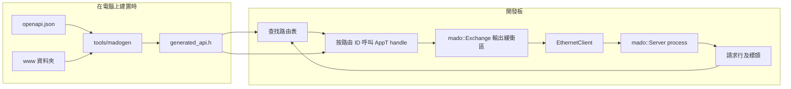

<div align="center">

<h1>Madoguchi</h1>

<strong>適用於 Uno R3 及 Uno R4 Minima 的小型 HTTP 伺服器，不使用堆積記憶體，並在 R4 上提供以 JWT 保護的 REST API。</strong>

<br>
<br>

[English](README.md) | [日本語](README.ja.md) | [简体中文](README.zh-Hans.md) | 繁體中文 (香港)

[](https://github.com/gufranco/madoguchi/actions/workflows/ci.yml)
[](LICENSE)

</div>

<p align="center">
  <a href="#快速開始">快速開始</a> |
  <a href="#範例">範例</a> |
  <a href="#以-openapi-及-jwt-建構的-rest-api">REST API</a> |
  <a href="#開發">開發</a> |
  <a href="CHANGELOG.md">變更記錄</a>
</p>

---

Madoguchi 可在 Uno R3 的 ATmega328P 上與 Ethernet 程式庫及 SD 程式庫並存，而且完全不在堆積上配置記憶體。在 Uno R4 Minima 上，它提供一個由單一 OpenAPI 文件產生的完整 REST API：JWT 登入、JSON 請求主體、所有 HTTP 方法、`/` 的網站，以及 `/docs` 的 Swagger UI。CI 會為全部 17 個範例建置其目標開發板的韌體，任何超出開發板快閃記憶體或 RAM 預算的建置都會失敗；每次推送及 pull request 都會執行 1,142 個主機測試、113 個工具測試及 12 個頁面腳本測試，並對剖析器進行模糊測試。

名稱來自日語的「窓口」，即遞交請求、取回答覆的服務窗口。

## 用法

處理函數是一個按路由 ID 分支的靜態函數。以下是 [`SimpleWebServer`](examples/SimpleWebServer/SimpleWebServer.ino) 的核心部分，它在 Uno R3 上佔用 18,640 位元組快閃記憶體：

```cpp
struct WebApp {
  static bool handle(WebExchange& exchange, const uint8_t route) {
    const bool known = route == kIndex;
    if (!known) {
      return exchange.send_empty(404U);
    }
    const bool status = exchange.send_status(200U);
    const bool type = exchange.send_content_type(F("text/html"));
    const bool ended = exchange.end_headers();
    const size_t written = exchange.print(F("<html><body><h1>Hello World!</h1></body></html>\n"));
    return status && type && ended && (written > 0U);
  }
};

const char kIndexPath[] PROGMEM = "/";
const mado::Route kRoutes[] PROGMEM = {
    {&kIndexPath[0], mado::Method::kGet, kIndex},
    {nullptr, mado::Method::kAny, 0U},
};
mado::Server<EthernetClient, WebApp> web(kRoutes, nullptr);

void loop() {
  EthernetClient client = ethernet_server.available();
  const bool has_client = static_cast<bool>(client);
  if (has_client) {
    web.process(client);
  }
}
```

如沒有等候中的請求，`process()` 會立即返回。否則它會讀取請求，以相符路由的 ID 呼叫 `WebApp::handle`，然後關閉連線。

## 快速開始

### 先決條件

| 工具 | 版本 | 用途 |
|:-----|:--------|:-----------|
| [arduino-cli](https://arduino.github.io/arduino-cli/) 或 Arduino IDE | CI 使用 arduino-cli 1.5.1 | 為開發板建置 |
| `arduino:avr` 或 `arduino:renesas_uno` 核心 | 1.8.8 或 1.6.0 | Uno R3 或 Uno R4 Minima |
| Ethernet 程式庫 | 2.0.2 | 除 EthernetENC 外的所有範例 |
| CMake 及 C++ 編譯器 | CMake 3.24 或更新版本 | 在電腦上執行 REST API |

### 安裝

Madoguchi 尚未收錄於 Arduino 程式庫管理員。請從本儲存庫安裝：

```sh
arduino-cli config set library.enable_unsafe_install true
arduino-cli lib install --git-url https://github.com/gufranco/madoguchi.git
arduino-cli lib install Ethernet@2.0.2
```

在 Arduino IDE 中，將儲存庫下載為 ZIP 檔案，然後使用 **草稿碼 > 匯入程式庫 > 加入 .ZIP 程式庫**。

本程式庫本身沒有任何依賴。只有包含 SD、EthernetENC 及 ArduinoJson 的範例才需要這些程式庫。

### 為開發板建置

在本儲存庫的複本中，以 USB 連接開發板後執行：

```sh
git clone https://github.com/gufranco/madoguchi.git
cd Madoguchi
arduino-cli compile --fqbn arduino:avr:uno --library . examples/SimpleWebServer
arduino-cli board list
arduino-cli upload --fqbn arduino:avr:uno --port <port from board list> examples/SimpleWebServer
```

如使用 Uno R4 Minima，請改用 `--fqbn arduino:renesas_uno:minima`。範例使用地址 192.168.1.177；如你的網絡使用其他地址範圍，請在範例中修改。開發板裝上 W5x00 擴充板後，`curl http://192.168.1.177/` 會回傳 Hello World 頁面。

### 無需開發板試用 REST API

在同一個複本中，`mado_host_server` 會在 127.0.0.1 上執行 [`RestApi`](examples/RestApi/RestApi.ino) 的應用程式碼，並使用測試簽署密鑰及密碼 `correct-horse-battery`：

```sh
cmake -S tests -B build
cmake --build build --target mado_host_server
build/mado_host_server 8080
```

在另一個終端機中執行：

```sh
TOKEN=$(curl -s -H 'Content-Type: application/json' \
  -d '{"username":"admin","password":"correct-horse-battery"}' \
  http://127.0.0.1:8080/api/auth/login | python3 -c 'import json,sys; print(json.load(sys.stdin)["access_token"])')
curl -s -i -H "Authorization: Bearer $TOKEN" -H 'Content-Type: application/json' \
  -d '{"name":"lamp","value":3,"on":true}' http://127.0.0.1:8080/api/items
```

預期輸出：

```text
HTTP/1.1 201 Created
Connection: close
Content-Type: application/json
Cache-Control: no-store
Location: /api/items/1

{"id":1,"name":"lamp","value":3,"on":true}
```

開啟 `http://127.0.0.1:8080/` 瀏覽網站，開啟 `http://127.0.0.1:8080/docs` 使用 Swagger UI。

## 支援的硬件

Madoguchi 支援兩塊開發板：搭載 ATmega328P 的 Arduino Uno R3，以及搭載 Renesas RA4M1 的 Arduino Uno R4 Minima。其他開發板一概不在支援範圍內。

| 硬件 | 程式庫 | 用戶端類型 |
|:---------|:--------|:------------|
| Wiznet W5100、W5200、W5500 擴充板 | Ethernet 2.0.2 | `EthernetClient` |
| ENC28J60 模組 | EthernetENC 2.0.5 | `EthernetClient` |

伺服器以用戶端類型作為範本參數，因此任何具備 `available()`、`read()`、`read(buffer, size)`、`write(buffer, size)`、`connected()` 及 `stop()` 的類別都可以使用。

本程式庫不支援 ATmega168：單是 Ethernet 2.0.2 已佔用其 14,336 位元組快閃記憶體中的 11,208 位元組。亦不支援 UNO Q，因為 arduino:zephyr 1.0.0 上的草稿碼沒有 socket API。

## 範例

大小以位元組為單位，使用 arduino-cli 1.5.1、arduino:avr 1.8.8、arduino:renesas_uno 1.6.0、Ethernet 2.0.2、SD 1.3.0、EthernetENC 2.0.5 及 ArduinoJson 7.4.3 建置：

| 範例 | 示範內容 | Uno R3 快閃記憶體，共 32,256 | Uno R3 可用 RAM，共 2,048 | R4 Minima 快閃記憶體，共 262,144 | R4 Minima 已用 RAM，共 32,768 |
|:--------|:------|------:|------:|------:|------:|
| [`SimpleWebServer`](examples/SimpleWebServer/SimpleWebServer.ino) | 一個頁面 | 18,864 | 1,546 | 57,796 | 4,560 |
| [`FormAndQuery`](examples/FormAndQuery/FormAndQuery.ino) | 查詢字串及 urlencoded 表單 | 21,288 | 1,546 | 59,600 | 4,560 |
| [`TemplatePage`](examples/TemplatePage/TemplatePage.ino) | 快閃記憶體中頁面的 `$NAME$` 標籤 | 19,524 | 1,546 | 58,380 | 4,560 |
| [`BasicAuth`](examples/BasicAuth/BasicAuth.ino) | HTTP Basic 憑證 | 19,596 | 1,546 | 58,440 | 4,560 |
| [`JsonApi`](examples/JsonApi/JsonApi.ino) | ArduinoJson 回應 | 25,978 | 1,494 | 62,564 | 4,564 |
| [`EthernetENC`](examples/EthernetENC/EthernetENC.ino) | ENC28J60 模組 | 25,264 | 851 | 63,176 | 5,184 |
| [`WebServerSD`](examples/WebServerSD/WebServerSD.ino) | SD 卡上的檔案及資料夾，附 gzip 副本 | 30,822 | 735 | 65,648 | 5,220 |
| [`FileUpload`](examples/FileUpload/FileUpload.ino) | 以 `PUT` 上載至 SD 卡 | 31,554 | 739 | 65,648 | 5,220 |
| [`BlinkLed`](examples/BlinkLed/BlinkLed.ino) | 由 SD 卡上的頁面控制的 LED | 31,984 | 738 | 66,108 | 5,224 |
| [`RestGet`](examples/RestGet/RestGet.ino) | 對項目清單及單一項目的 `GET` | 24,486 | 1,395 | 61,796 | 4,712 |
| [`RestPost`](examples/RestPost/RestPost.ino) | 以 JSON 新增項目的 `POST` | 27,162 | 1,403 | 64,068 | 4,712 |
| [`RestPut`](examples/RestPut/RestPut.ino) | 取代項目的 `PUT` | 27,368 | 1,395 | 64,312 | 4,712 |
| [`RestPatch`](examples/RestPatch/RestPatch.ino) | 修改項目部分欄位的 `PATCH` | 27,512 | 1,395 | 64,296 | 4,712 |
| [`RestDelete`](examples/RestDelete/RestDelete.ino) | 按 ID 刪除項目的 `DELETE` | 23,206 | 1,395 | 60,948 | 4,712 |
| [`RestAuth`](examples/RestAuth/RestAuth.ino) | 登入及一個受保護的路由 | 容納不下 |  | 80,072 | 5,600 |
| [`RestFiles`](examples/RestFiles/RestFiles.ino) | SD 上的檔案：列表、下載、範圍請求、附進度上載、刪除 | 容納不下 |  | 93,312 | 6,392 |
| [`RestApi`](examples/RestApi/RestApi.ino) | 完整 API、網站及 Swagger UI | 容納不下 |  | 104,828 | 6,088 |

RestApi 及 RestAuth 需要簽署權杖、計算密碼雜湊值並載有網站，RestFiles 則載有網站及 SHA-256，因此這三個範例需要 R4 Minima。其他範例兩塊開發板均可容納。任何超出開發板預算的建置都會令 CI 失敗；如 Uno R3 上的 SimpleWebServer 為堆疊保留的 RAM 少於 1,024 位元組，CI 亦會失敗。

## 架構



- 緩衝區大小固定，由作為範本參數傳入的 `Limits` 類型決定。不會在堆積上配置任何記憶體。
- 本程式庫不保存函數指標，亦不宣告虛擬函數。按路由 ID 分支的靜態 `handle` 令呼叫圖對分析工具保持可見。
- 每個迴圈都有迭代上限，每次讀取都有逾時，整個請求亦有限期，因此緩慢的用戶端無法令草稿碼停頓。常數字串及表格透過 `F()` 及 `PROGMEM` 存放在快閃記憶體中。
- 請求按 RFC 9112 的要求剖析：`HTTP/1.1` 請求必須剛好有一個 `Host`，重複的 `Content-Length` 會收到 `400`，`Transfer-Encoding` 會收到 `501`，處理常式未讀取的請求主體會在關閉連線前讀出並捨棄。

程式碼以最嚴格的詮釋遵循 JPL D-60411 C 語言標準及 Power of Ten 規則，並套用至 C++。[`AGENTS.md`](AGENTS.md) 列出每條規則及其套用方式。

## 包含的功能

| 範疇 | 功能 | API |
|:-----|:--------|:----|
| 請求 | 按路徑及方法路由，以結尾的 `*` 配對前綴，並回傳附 `Allow` 標頭的 `405` | `mado::Route {path, method, id}` |
| 請求 | 將查詢參數及 urlencoded 表單欄位解碼至你提供的緩衝區 | `query_param()`、`mado::next_form_field()` |
| 請求 | 只擷取你指定的標頭，名稱不分大小寫；在 `100 Continue` 之後分塊讀取請求主體 | `header()`、`read_body()` |
| 請求 | 讀取停滯或請求過慢時回傳 `408`，請求行過長時回傳 `414`，標頭行過多時回傳 `431`，HTTP/1.0 及 1.1 以外的版本回傳 `505` | 自動 |
| 請求 | 為防範 DNS 重新繫結，只接受列出的 `Host` 名稱，有沒有連接埠皆可；每個回應的狀態都會交給一個掛鈎 | `PolicyT::trusted_hosts()`、`PolicyT::on_response()` |
| 回應 | 附原因短語的狀態行、任何標頭、針對列出來源的 CORS、重新導向，以及按 32 位元組合併的輸出 | `send_status()`、`send_header()`、`mado::send_cors_headers()`、`send_redirect()`、`mado::Reply` |
| 回應 | RFC 9457 問題詳情：附標題、狀態及詳情的 `application/problem+json` | `mado::send_problem()`、`mado::json_problem()` |
| 回應 | 快閃記憶體中頁面的 `$NAME$` 標籤；附準確 `Content-Length` 的 ArduinoJson 文件 | `mado::send_template()`、`mado::send_json()` |
| 檔案 | 傳送 SD 卡或任何可讀取的檔案，支援資料夾、gzip 副本及按副檔名決定的內容類型 | `mado::send_file()`、`mado::content_type_for()`、`mado::accepts_gzip()` |
| 檔案 | 解碼並檢查 URL 路徑；拒絕 `.` 及 `..` 片段、空片段、反斜線及經編碼的 NUL 位元組 | `mado::resolve_static_path()` |
| 檔案 | 以 `206` 或 `416` 回應單一位元組範圍並支援 `If-Range`，弱 ETag 及 `304`，以及下載檔案名稱 | `mado::send_file(exchange, file, mado::FileReply)` |
| 檔案 | 按 8.3 檔案名稱及 `Repr-Digest` 檢查上載，先寫入暫存檔再移至目標位置 | `mado::valid_short_name()`、`mado::parse_repr_digest()`、`mado::copy_file()`、`mado::replace_file()` |
| 檔案 | 傳送快閃記憶體中經壓縮及 gzip 的檔案，附 ETag、`304 Not Modified`、`406 Not Acceptable`、Content-Security-Policy 及編譯時產生的標頭區塊 | `mado::send_asset()` |
| 網絡 | 設有逾時的 DHCP 及固定的後備地址；只產生一次並保存在 EEPROM 的隨機 MAC | `mado::begin_network()`、`mado::load_mac()` |
| 網絡 | 網線或晶片恢復後重新啟動；透過 mDNS 回應 `<name>.local` | `mado::NetworkWatch`、`mado::MdnsResponder` |
| 儲存 | 每個回應一行 JSON，格式與 pino-http 相同，超過設定大小後輪替 | `mado::SdLog`、`mado::write_request_log()` |
| 儲存 | 小計數器保存為 SD 上的文字檔；固定記錄保存在 EEPROM | `mado::read_count_file()`、`mado::write_count_file()`、`mado::EepromTable` |
| 認證 | 以恆定時間檢查 HTTP Basic 憑證 | `mado::check_basic_auth()` |
| 認證 | 簽發及驗證 HS256 JSON Web Token；PBKDF2-HMAC-SHA256 密碼雜湊 | `mado::issue_token()`、`mado::verify_bearer()`、`mado::pbkdf2_sha256()` |
| 認證 | 連續五次失敗後鎖定登入 15 分鐘 | `mado::LoginGuard` |
| 認證 | SHA-256、HMAC-SHA256 及 Base64url | `mado::Sha256`、`mado::HmacSha256`、`mado::Base64UrlEncoder`、`mado::Base64UrlDecoder` |
| REST | 逐個欄位讀取 JSON 請求主體，無需在 RAM 中保存文件；輸出經跳脫的 JSON 字串 | `mado::JsonReader`、`mado::json_write_string()` |
| REST | 讀取路徑結尾的 `{id}`；固定大小的記錄表 | `mado::parse_path_id()`、`mado::SlotTable` |
| REST | 從 OpenAPI 3.1 文件及一個網頁檔案資料夾產生 C++ 程式碼 | [`tools/madogen`](tools/madogen/cli.py) |

## 指南

### 路由與處理函數

路由是 `{path, method, id}`，路由表以路徑為 `nullptr` 的項目作結。路由按表中次序配對，因此應把具體路徑放在萬用字元之前。

- `/led` 這類精確路徑只配對 `/led`。配對時會忽略查詢字串。
- 以 `*` 結尾的路徑，例如 `/files/*`，會配對所有以 `/files/` 開頭的路徑。
- `mado::Method::kAny` 接受所有方法。`kGet` 路由亦會回應 `HEAD`，並略去主體。
- 路徑相符但方法不符時回傳 `405`，完全沒有相符項目時回傳 `404`。

回應完成、可以關閉連線時，`handle` 回傳 `true`。如要保持連線開啟，例如稍後透過 `exchange.client()` 持續傳送更新，則回傳 `false`。W5100 只有四個 socket，因此應盡量減少保持開啟的連線。

### Exchange 物件

`mado::Exchange` 代表一個連線的請求及回應。

| 請求 | 回傳值 |
|:--------|:--------|
| `method()` | `mado::Method` |
| `path()` | 按原樣傳送的路徑，不含查詢字串 |
| `query()` | 原始查詢字串，沒有時為空 |
| `query_param(name, out, size)` | `true`，並在 `out` 中提供解碼後的值 |
| `header(name)` | 擷取到的值，或 `nullptr` |
| `content_length()` | 宣告的主體長度 |
| `read_body(buffer, size)` | 已讀取的位元組數，結束時為 `0`，逾時或連線關閉時為 `-1` |
| `remaining_body()` | 尚未讀取的主體位元組數 |
| `client()` | 指向用戶端的指標，供直接存取 |

| 回應 | 傳送內容 |
|:---------|:------|
| `send_status(code)` | `HTTP/1.1 <code> <reason>` 及 `Connection: close` |
| `send_header(F("Name"), value)` | 一個標頭；值可以是 RAM 中的字串、數字或 `mado::FlashText(F("..."))` |
| `send_content_type(F("type"))` | `Content-Type` |
| `send_content_length(length)` | `Content-Length` |
| `send_cors_headers()` | `Access-Control-Allow-Origin: *` 以及允許的方法及標頭 |
| `mado::send_cors_headers(exchange, origins)` | `Vary: Origin`，只有擷取到的 `Origin` 在清單內時才傳送 CORS 標頭 |
| `send_location(F("/api/items/"), id)` | `Location: /api/items/<id>` |
| `status_code()` | 目前已傳送的狀態，沒有則為 `0` |
| `end_headers()` | 空行；之後 `HEAD` 請求會略去主體 |
| `send_empty(code)` | 沒有主體的完整回應 |
| `send_redirect(F("/next"))` | 附 `Location` 的 `303 See Other` |
| `print(...)`、`print_signed(...)`、`write(...)` | 主體文字、數字及位元組 |

### 請求標頭

建立伺服器時指定所需的標頭名稱。它們的值共用一個固定大小的池，預設為 48 位元組，過長的值會被截短。`Content-Length` 及 `Expect` 一律會被讀取。

```cpp
const char kAuthorization[] PROGMEM = "Authorization";
const char kAcceptEncoding[] PROGMEM = "Accept-Encoding";
const char* const kHeaderNames[] PROGMEM = {&kAuthorization[0], &kAcceptEncoding[0], nullptr};
mado::Server<EthernetClient, WebApp> web(&kRoutes[0], &kHeaderNames[0]);
```

### 查詢字串與表單

```cpp
#include <mado/next_form_field.h>

char name[24];
char value[24];
if (exchange.query_param(F("name"), &name[0], sizeof(name))) {
  exchange.print(&name[0]);
}
while (mado::next_form_field(exchange, &name[0], sizeof(name), &value[0], sizeof(value)) ==
       mado::FormStatus::kField) {
  exchange.print(&value[0]);
}
```

完整草稿碼見 [`FormAndQuery`](examples/FormAndQuery/FormAndQuery.ino)。

### 靜態檔案與上載

```cpp
#include <mado/content_type_for.h>
#include <mado/resolve_static_path.h>
#include <mado/send_file.h>

char path[40];
if (!mado::resolve_static_path(exchange.path(), "", F("INDEX.HTM"), &path[0], sizeof(path))) {
  return exchange.send_empty(mado::http::kBadRequest);
}
File file = SD.open(&path[0], FILE_READ);
mado::send_file(exchange, file, file.size(), mado::content_type_for(&path[0]), false);
```

可選的第六個參數，例如 `F("max-age=300")`，會以約 70 位元組快閃記憶體的代價加上 `Cache-Control` 標頭；在 Uno R3 上完整的 ETag 支援無法與 SD 程式庫一同容納，所以 WebServerSD 及 BlinkLed 採用這種方式。

如要支援範圍請求、條件式請求及下載，請傳入 `mado::FileReply`，當中包括大小、類型、gzip 旗標、ETag、下載檔案名稱及 `Cache-Control` 值。`mado::file_etag()` 會根據檔案名稱、大小及一個版本號產生弱 ETag，草稿碼會在每次寫入及開機時改變該版本號，因此被同樣大小的檔案取代後會得到新的標籤。附 `If-Range` 的 `Range` 請求會得到整個檔案，因為弱標籤無法證明各部分屬於同一版本。

由於 SD 程式庫只接受 8.3 格式的檔案名稱，[`WebServerSD`](examples/WebServerSD/WebServerSD.ino) 把預先壓縮的副本放在 `/GZ` 之下。[`FileUpload`](examples/FileUpload/FileUpload.ino) 將 `PUT /upload/NAME` 儲存至記憶卡：

```sh
curl --upload-file index.htm http://192.168.1.177/upload/index.htm
```

### Basic 認證

```cpp
#include <mado/check_basic_auth.h>
#include <mado/send_auth_challenge.h>

if (!mado::check_basic_auth(exchange.header(F("Authorization")), F("YWRtaW46Y2hhbmdlLW1l"))) {
  return mado::send_auth_challenge(exchange, F("Madoguchi"));
}
```

預期值是以 Base64 編碼的 `user:password`，可用 `printf 'admin:change-me' | base64` 計算。

> [!WARNING]
> 開發板沒有 TLS。Basic 認證密碼、登入密碼及 Bearer 權杖都會以明文在網絡上傳送。請把開發板放在你信任的網絡中，或放在終止 TLS 的反向代理伺服器之後。

### 範本

```cpp
#include <mado/send_template.h>

struct PageTags {
  static bool render(WebExchange& exchange, const char* tag) {
    if (strcmp_P(tag, PSTR("TEMP")) == 0) {
      exchange.print(static_cast<uint32_t>(analogRead(A0)));
      return true;
    }
    return false;
  }
};

mado::send_template<WebExchange, PageTags>(exchange, F("<p>Reading: $TEMP$</p>"));
```

標籤最多 16 個字母、數字或底線。未知的標籤會按原樣傳送。

### 以 ArduinoJson 處理 JSON

```cpp
#include <ArduinoJson.h>
#include <MadoguchiJson.h>

JsonDocument document;
document["uptime_ms"] = millis();
mado::send_json(exchange, mado::http::kOk, document);
```

只有 `MadoguchiJson.h` 包含 ArduinoJson，因此不包含它的草稿碼永遠不會編譯 ArduinoJson。

### 限制參數

緩衝區大小及逾時由作為第三個範本參數傳入的類型決定。必須宣告所有欄位，此時處理函數接收 `mado::Exchange<EthernetClient, BigLimits>&`。

```cpp
struct BigLimits {
  static constexpr uint16_t kLineBufferSize = 256U;
  static constexpr uint16_t kOutputBufferSize = 512U;
  static constexpr uint8_t kHeaderPoolSize = 96U;
  static constexpr uint8_t kHeaderNameSize = 32U;
  static constexpr uint8_t kMaxCapturedHeaders = 8U;
  static constexpr uint8_t kMaxHeaderLines = 48U;
  static constexpr uint8_t kMaxRoutes = 32U;
  static constexpr uint16_t kReadTimeoutMs = 1000U;
  static constexpr uint32_t kMaxPollsPerRead = 100000UL;
  static constexpr uint16_t kRequestTimeoutMs = 5000U;
  static constexpr uint16_t kMaxDrainBytes = 1024U;
  static constexpr uint16_t kFileChunkSize = 512U;
};
mado::Server<EthernetClient, WebApp, BigLimits> web(&kRoutes[0], nullptr);
```

| 欄位 | 預設值 | 意思 |
|:------|--------:|:--------|
| `kLineBufferSize` | 128 | 最長的請求行：方法、路徑及查詢合計 |
| `kOutputBufferSize` | 32 | 寫入網絡前合併的位元組數，最多 1,460；更大的寫入會一次過送出 |
| `kHeaderPoolSize` | 48 | 所有擷取標頭值的空間 |
| `kHeaderNameSize` | 32 | 可擷取的最長標頭名稱 |
| `kMaxCapturedHeaders` | 8 | 標頭清單中的名稱數目 |
| `kMaxHeaderLines` | 48 | 回傳 `431` 之前接受的標頭行數 |
| `kMaxRoutes` | 32 | 在路由表中掃描的路由數目 |
| `kReadTimeoutMs` | 1000 | 回傳 `408` 之前等候下一個位元組的時間 |
| `kMaxPollsPerRead` | 100000 | 每次讀取的輪詢次數上限 |
| `kRequestTimeoutMs` | 5000 | 回傳 `408` 之前，請求行及標頭的時限，請求主體另有同樣的時限 |
| `kMaxDrainBytes` | 1024 | 關閉連線前讀出並捨棄的未讀請求主體位元組數；更長的請求主體不會讀取 |
| `kFileChunkSize` | 32 | `send_file()` 每一步從檔案讀取的位元組數 |

第四個範本引數是策略，它列出受信任的主機，並接收每個回應的狀態。預設策略信任任何不超過 255 位元組的 `Host`，掛鈎不做任何事。

```cpp
struct BoardPolicy {
  static constexpr bool kTrustedHostsOnly = true;
  static const char* const* trusted_hosts() {
    static const char* const kHosts[] = {"192.168.1.177", "board.local", nullptr};
    return &kHosts[0];
  }
  static void on_response(const mado::RequestLine&, const mado::ResponseSummary&) {}
};
mado::Server<EthernetClient, WebApp, mado::DefaultLimits, BoardPolicy> web(&kRoutes[0], nullptr);
```

### 網絡

```cpp
#include <mado/MdnsResponder.h>
#include <mado/begin_network.h>
#include <mado/load_mac.h>

const char kHostName[] PROGMEM = "madoguchi";
uint8_t mac[mado::kMacSize] = {};
mado::MdnsResponder<EthernetUDP, IPAddress> mdns(&kHostName[0]);

void setup() {
  mado::load_mac(EEPROM, 8U, mac, micros());
  mado::begin_network(Ethernet, &mac[0], IPAddress(192, 168, 1, 177), 10000UL);
  mdns_socket.beginMulticast(IPAddress(224, 0, 0, 251), mado::kMdnsPort);
}
```

`load_mac()` 會在首次開機時把一個隨機的本地管理 MAC 寫入 EEPROM 的 7 個位元組，之後再讀回。DHCP 未能及時回應而改用固定地址時，`begin_network()` 會傳回 `false`。在 `loop()` 中呼叫 `mdns.poll(mdns_socket, Ethernet.localIP())`，令 `http://madoguchi.local` 可以解析；呼叫 `Ethernet.maintain()` 續租；並把晶片及連結狀態傳給 `mado::NetworkWatch::update()`，需要重新啟動網絡時它會傳回 `mado::NetworkAction::kRestart`。[`RestApi.ino`](examples/RestApi/RestApi.ino) 已完成以上全部步驟。

### 請求日誌

`mado::SdLog` 會為每個回應附加一行 JSON，格式與 pino-http 相同，檔案超過設定的大小後會改名保存：

```json
{"level":30,"boot":3,"uptime":1500,"hostname":"madoguchi","req":{"id":12,"method":"PUT","url":"/api/items/2"},"res":{"statusCode":200},"responseTime":9,"msg":"request completed"}
```

回應低於 500 時 `level` 為 30，伺服器錯誤時為 50。開發板沒有時鐘，所以 `boot` 是重新開機的次數，`uptime` 是 `millis()`。在策略的 `on_response()` 中呼叫 `log.request()`，登入等其他事件則用 `log.event()`。RestApi 會寫入 `/LOG.TXT`，把之前的 64 KiB 保留在 `/LOG.OLD`，並且不記錄用戶名稱或地址。任何 NDJSON 工具都能讀取：

```sh
curl -s -H "Authorization: Bearer $TOKEN" http://madoguchi.local/api/log | jq -c 'select(.level >= 40)'
```

## 以 OpenAPI 及 JWT 建構的 REST API

[`RestApi`](examples/RestApi/RestApi.ino) 是一個適用於裝有 W5x00 擴充板的 Uno R4 Minima 的完整認證 API：

| 路徑 | 提供內容 |
|:-----|:-------|
| `/` | 登入後可列出、新增、切換及刪除項目的頁面 |
| `/docs` | 開發板自身 API 的 Swagger UI |
| `GET /api/openapi.json` | OpenAPI 3.1 文件 |
| `POST /api/auth/login` | 為有效的用戶名稱及密碼簽發 Bearer 權杖 |
| `GET /api/items`、`GET /api/items/{id}` | 項目，公開 |
| `POST /api/items`、`PUT`、`PATCH`、`DELETE /api/items/{id}` | 修改，需要 Bearer 權杖 |
| `GET /api/log`、`DELETE /api/log` | JSON 行格式的請求日誌，可用 `Range` 讀取結尾，以及清除日誌，需要 Bearer 權杖 |

[`RestAuth`](examples/RestAuth/RestAuth.ino) 示範登入及一個受保護的路由。[`RestGet`](examples/RestGet/RestGet.ino)、[`RestPost`](examples/RestPost/RestPost.ino)、[`RestPut`](examples/RestPut/RestPut.ino)、[`RestPatch`](examples/RestPatch/RestPatch.ino) 及 [`RestDelete`](examples/RestDelete/RestDelete.ino) 各自示範一種不需認證的方法。[`RestFiles`](examples/RestFiles/RestFiles.ino) 可列出、下載、附進度列上載及刪除 SD 卡上的檔案；它不設認證，所以只應在可信的網絡中使用。它們都把應用程式碼放在草稿碼旁的標頭檔中，因此主機測試執行的正是開發板執行的程式碼。

### 產生 API 程式碼

每個 REST 草稿碼都有一個 `openapi.json`，RestApi 另有一個載有 HTML、CSS 及 JavaScript 的 `www` 資料夾。[`tools/madogen`](tools/madogen/cli.py) 會把它們轉換為 `generated_api.h`。這個檔案已提交至儲存庫，因此 Arduino IDE 無需安裝 Python 即可建置草稿碼。產生器只使用 Python 標準程式庫。

```sh
python3 -m tools.madogen generate examples/RestApi
python3 -m tools.madogen check examples/RestApi
```

`generate` 會寫出：

- 由每個 `operationId` 產生的路由 ID，以及由 `paths` 產生的路由表；
- 由每個操作的 `security` 產生的 `route_needs_token()`；
- 讀取路徑結尾 `{id}` 的 `route_path_id()`；
- 為 `components.schemas` 中每個結構描述產生結構體及欄位讀取器，並檢查每個 `maxLength`、`minimum` 及 `maximum`；回應使用的結構描述及設定了 `x-mado-writer: true` 的結構描述亦會得到 JSON 寫入器；
- `read_<schema>_body()`，它檢查 `Content-Type` 及長度、讀取請求主體，並在 `mado::Problem` 中指出第一個欠缺的必要屬性；以及每個按 id 進行的 `GET` 對應的 `<operation>_url()`；
- `www` 中的每個檔案，經壓縮及 gzip，附完整的標頭區塊及 ETag，並為每個 HTML 頁面產生 Content-Security-Policy；HTML 頁面以外的檔案會按內容雜湊重新命名，並以 `immutable` 快取一年，HTML 頁面則保留原名，於 `documentMaxAge` 秒後重新驗證；
- OpenAPI 文件本身，於 `/api/openapi.json` 提供。

當 `generated_api.h` 與來源不再一致，或 `arduino_secrets.h` 載有真正的密鑰時，`check` 會失敗。CI 會對全部八個 REST 範例執行它。

產生器接受 OpenAPI 3.1 的一個子集，並以 JSON 指標指出任何超出範圍的內容：

- 路徑以 `/api/` 開頭，只有最後一個片段可以是參數；
- 請求主體為參照組件結構描述的 `application/json`，或 `application/octet-stream`；
- `in: header` 參數會成為擷取的請求標頭；
- 可選的頂層 `x-mado-limits` 可把 `outputBufferSize` 設為 8 至 1,460，`fileChunkSize` 最多設為 1,024，`documentMaxAge` 最多設為 86,400 秒；
- 結構描述是附 `additionalProperties: false` 的扁平物件，包含附 `maxLength` 的字串、附 `minimum` 及 `maximum` 的整數，以及布林值；
- security 為 `[]` 或 `[{"bearerAuth": []}]`，其中 `bearerAuth` 是 HTTP Bearer JWT 方案；
- 最多 31 個操作。

頁面須把腳本及樣式放在檔案中。內嵌腳本、`style` 屬性或 `on...` 處理常式會被政策阻擋，因此會中止產生。來自其他主機的腳本或樣式表需要 `integrity` 雜湊值，可用 `python3 -m tools.madogen sri FILE` 輸出。

### 登入

已提交的 `arduino_secrets.h` 載有全零密鑰；在替換之前，登入會回傳 `503`，亦不會接受任何權杖。每塊開發板只需建立一次真正的密鑰：

```sh
python3 -m tools.madogen secrets examples/RestApi --user admin
```

它會要求輸入 12 至 64 個字元的密碼，然後寫出隨機的 32 位元組簽署密鑰、隨機鹽值，以及密碼的 PBKDF2-HMAC-SHA256 雜湊值。切勿提交該檔案：CI 執行的 `check` 會在其中載有真正密鑰時失敗。

- 權杖是 HS256 JWT。開發板逐個位元組比較權杖標頭，因此 `alg: none` 及任何其他演算法都會失敗；簽章以恆定時間比較。
- 權杖的有效期為 15 分鐘的運作時間，開發板重新啟動後即失效，因為每次啟動都會遞增 EEPROM 中的工作階段計數器。
- 連續五次登入失敗會鎖定登入 15 分鐘，並回傳附 `Retry-After` 的 `429`。
- Argon2id 及 bcrypt 所需的 RAM 超出開發板容量，因此密碼使用 PBKDF2。請調整 `--iterations`，令每次登入約需一秒。

`/docs` 透過 Subresource Integrity 從 unpkg.com 載入 Swagger UI 5.33.2，因此瀏覽器開啟該頁面時需要連接互聯網。其他頁面及 API 均可離線運作。

產生的 `Limits` 把標頭池擴大至 240 位元組，足以在 `Accept-Encoding`、`If-None-Match` 及 `Content-Type` 之外再容納一個 Bearer 權杖。超過 256 位元組的請求主體會收到 `413`，每個 API 錯誤都附有 `application/problem+json` 主體，例如 `{"title":"Unprocessable Content","status":422,"detail":"missing required property: on"}`。靜態檔案只以 gzip 格式儲存，不接受 gzip 的用戶端會收到 `406`。

## 開發

主機測試使用 CMake 及 googletest，配合一個小型 Arduino 墊片及一個模擬用戶端。

| 測試組 | 指令 | 涵蓋範圍 |
|:------|:--------|:-------|
| 程式庫及範例 | `cmake -S tests -B build -DMADO_COVERAGE=ON && cmake --build build && ctest --test-dir build --output-on-failure` | 1,142 個測試：RFC 9112 一致性表、剖析、路由、回應、檔案、範圍請求、網絡輔助函式、SD 日誌、加密、權杖、REST 範例的應用程式碼，以及每個模糊測試語料庫的重播 |
| 覆蓋率 | `gcovr build --root . --filter src/ --merge-lines --txt` | `src/` 的行及函數覆蓋率，CI 的下限為 95% |
| 產生器及閘門 | `python3 -m pytest -q tests/madogen tests/assertion_density tests/size_gate tests/throughput` | `madogen` 及其壓縮器、斷言密度閘門、大小閘門及吞吐量工具的 113 個測試 |
| 頁面腳本 | `node --test tests/web/*.test.mjs` | RestApi 網站、其日誌檢視、RestFiles 頁面及 Swagger UI 載入器的 12 個測試 |
| 吞吐量 | `python3 tools/throughput.py --download http://madoguchi.local/ --upload http://madoguchi.local/api/files/BENCH.BIN` | 量度開發板的下載及上載速度，以 JSON 輸出 |
| 產生的程式碼 | `python3 -m tools.madogen check examples/Rest*` | `generated_api.h` 與來源一致，且沒有提交真正的密鑰 |
| 模糊測試 | `cmake -S tests -B fuzz -DMADO_FUZZ=ON -DCMAKE_CXX_COMPILER=clang++ && cmake --build fuzz && fuzz/mado_fuzz_request tests/fuzz/corpus/request` | 啟用 AddressSanitizer 及 UBSan 的 libFuzzer，涵蓋伺服器、RestApi 及 RestFiles 應用程式、JSON 讀取器及文字解碼器 |
| 大小預算 | `python3 tools/size_gate.py --fqbn arduino:avr:uno --min-free-ram 1024 examples/SimpleWebServer` | 按開發板預算檢查快閃記憶體及 RAM，編譯器警告為零 |

CI 亦會執行 clang-format、clang-tidy、附 `--enable=all` 的 cppcheck 2.22.0、斷言密度閘門及嚴格模式的 arduino-lint，並且不容許任何警告。確實指令見 [`.github/workflows/ci.yml`](.github/workflows/ci.yml)，編碼規則見 [`AGENTS.md`](AGENTS.md)。

## 授權條款

[MIT](LICENSE)。只要隨程式碼保留版權聲明，便可在任何項目中使用、複製、修改及發佈，包括商業項目。
