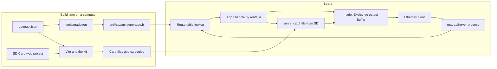

<div align="center">

<h1>Madoguchi</h1>

<strong>為 Arduino Uno R4 Minima 而設、不使用堆積的 HTTP 伺服器：頁面由 SD 卡提供，REST API 由 OpenAPI 產生並受 JWT 保護。</strong>

<br>
<br>

[English](README.md) | [日本語](README.ja.md) | [简体中文](README.zh-Hans.md) | 繁體中文 (香港)

[](https://github.com/gufranco/madoguchi/actions/workflows/ci.yml)
[](LICENSE)

</div>

<p align="center">
  <a href="#快速開始">快速開始</a> |
  <a href="#範例">範例</a> |
  <a href="#sd-卡網頁項目">SD 卡頁面</a> |
  <a href="#以-openapi-及-jwt-建構的-rest-api">REST API</a> |
  <a href="#開發">開發</a> |
  <a href="CHANGELOG.md">變更記錄</a>
</p>

---

Madoguchi 在裝有 W5x00 或 ENC28J60 擴充板及 SD 卡的 Uno R4 Minima 上運作，而且完全不在堆積上配置記憶體。C++ 程式碼不含任何 HTML、CSS、腳本或圖片：所有頁面都在卡上，由每個範例各自獨立的網頁項目產生。這些項目以 TypeScript 及無類別的 Pico CSS 編寫，由 Vite 建置為記憶卡上的檔案及 gzip 副本。開發板會回應由單一 OpenAPI 文件產生的 REST API，支援 JWT 登入、JSON 請求主體及所有 HTTP 方法。每次推送及 pull request 時，CI 都會建置全部 9 個範例，任何超出開發板快閃記憶體或 RAM 預算的建置都會失敗；同時執行 1,336 個主機測試、91 個工具測試、127 個頁面測試及 32 個瀏覽器測試，建置每張卡，並對剖析器進行模糊測試。

名稱來自日語的「窓口」，即遞交請求、取回答覆的服務窗口。

## 用法

處理函數是一個按路由 ID 分支的靜態函數。頁面來自卡，API 來自程式碼。草稿碼的核心部分：

```cpp
struct WebApp {
  static bool handle(WebExchange& exchange, const uint8_t route) {
    switch (route) {
      case kStatus: return send_status_json(exchange);
      default: return mado::serve_card_file<FILE_READ>(exchange, sd_card);
    }
  }
};

const char kStatusPath[] PROGMEM = "/api/status";
const char kCardPath[] PROGMEM = "/*";
const mado::Route kRoutes[] PROGMEM = {
    {&kStatusPath[0], mado::Method::kGet, kStatus},
    {&kCardPath[0], mado::Method::kGet, kCard},
    {nullptr, mado::Method::kAny, 0U},
};
mado::Server<EthernetClient, WebApp> web(&kRoutes[0], &kHeaderNames[0]);

void loop() {
  EthernetClient client = ethernet_server.available();
  const bool has_client = static_cast<bool>(client);
  if (has_client) {
    web.process(client);
  }
}
```

如沒有等候中的請求，`process()` 會立即返回。否則它會讀取請求，以相符路由的 ID 呼叫 `WebApp::handle`，然後關閉連線。`serve_card_file()` 把 `/` 對應至 `/index.html`，瀏覽器接受 gzip 時優先傳送檔案旁邊的 `.gz` 副本，並令附雜湊值的檔名快取一年。

## 快速開始

### 先決條件

| 工具 | 版本 | 用途 |
|:-----|:--------|:-----------|
| [arduino-cli](https://arduino.github.io/arduino-cli/) 或 Arduino IDE | CI 使用 arduino-cli 1.5.1 | 為開發板建置 |
| `arduino:renesas_uno` 核心 | 1.6.0 | Uno R4 Minima |
| Ethernet 及 SdFat 程式庫 | Ethernet 2.0.2、SdFat 2.3.0 | 所有範例 |
| Node.js 及 pnpm | Node 24、pnpm 12.15.0 | 建置卡上的頁面 |
| CMake 及 C++ 編譯器 | CMake 3.24 或以上 | 在電腦上執行 REST API |

### 安裝

Madoguchi 尚未收錄於 Arduino 程式庫管理員。請從本儲存庫安裝：

```sh
arduino-cli config set library.enable_unsafe_install true
arduino-cli lib install --git-url https://github.com/gufranco/madoguchi.git
arduino-cli lib install Ethernet@2.0.2 SdFat@2.3.0
```

在 Arduino IDE 中，將儲存庫下載為 ZIP 檔案，然後使用 **草稿碼 > 匯入程式庫 > 加入 .ZIP 程式庫**。

### 建置開發板韌體及記憶卡

在本儲存庫的複本中，以 USB 連接開發板後執行：

```sh
git clone https://github.com/gufranco/madoguchi.git
cd madoguchi
arduino-cli compile --fqbn arduino:renesas_uno:minima --library . examples/RestGet
arduino-cli board list
arduino-cli upload --fqbn arduino:renesas_uno:minima --port <port from board list> examples/RestGet
corepack enable
pnpm install
pnpm --filter ./examples/RestGet/SD\ Card run build
```

把 `examples/RestGet/SD Card/dist` 中的所有內容複製到一張以 FAT16、FAT32 或 exFAT 格式化的 microSD 卡的根目錄，然後插入擴充板。可以用 [`RestFormat`](examples/RestFormat/RestFormat.ino) 準備這張卡。草稿碼使用地址 192.168.1.177；如你的網絡使用其他地址範圍，請修改它。然後開啟 `http://192.168.1.177/`。

### 無需開發板試用 REST API

在同一個複本中，`mado_host_server` 會在 127.0.0.1 上執行 [`RestApi`](examples/RestApi/RestApi.ino) 的應用程式碼，並使用測試簽署密鑰及密碼 `correct-horse-battery`。第三個參數是代替記憶卡的資料夾：

```sh
pnpm --filter ./examples/RestApi/SD\ Card run build
cmake -S tests -B build
cmake --build build --target mado_host_server
build/mado_host_server 8080 100000 "examples/RestApi/SD Card/dist"
```

在另一個終端機中執行：

```sh
TOKEN=$(curl -s -H 'Content-Type: application/json' \
  -d '{"username":"admin","password":"correct-horse-battery"}' \
  http://127.0.0.1:8080/api/auth/login | python3 -c 'import json,sys; print(json.load(sys.stdin)["access_token"])')
curl -s -i -H "Authorization: Bearer $TOKEN" -H 'Content-Type: application/json' \
  -d '{"name":"lamp","value":3,"on":true}' http://127.0.0.1:8080/api/items
```

預期輸出：

```text
HTTP/1.1 201 Created
Connection: close
Content-Type: application/json
Cache-Control: no-store
Location: /api/items/1

{"id":1,"name":"lamp","value":3,"on":true}
```

開啟 `http://127.0.0.1:8080/` 瀏覽網站，開啟 `http://127.0.0.1:8080/docs/` 使用 Swagger UI。開發頁面時，`pnpm --filter ./examples/RestApi/SD\ Card run dev` 會以即時重新載入的方式提供頁面，並把 `/api` 轉發至 `MADOGUCHI_BOARD` 指定的開發板，預設為 `http://madoguchi.local`。

## 支援的硬件

Madoguchi 只支援一塊開發板：搭載 Renesas RA4M1 的 Arduino Uno R4 Minima。其他開發板一概不在支援範圍內，包括 Uno R3 及 Uno R4 WiFi。

| 硬件 | 程式庫 | 用戶端類型 |
|:---------|:--------|:------------|
| Wiznet W5100、W5200、W5500 擴充板 | Ethernet 2.0.2 | `EthernetClient` |
| ENC28J60 模組 | EthernetENC 2.0.5 | `EthernetClient` |
| 擴充板上的 microSD 插槽 | SdFat 2.3.0 | `SdFs` 及 `FsFile` |

伺服器以用戶端類型作為範本參數，因此任何具備 `available()`、`read()`、`read(buffer, size)`、`write(buffer, size)`、`connected()` 及 `stop()` 的類別都可以使用。SdFat 能在 FAT16、FAT32 及 exFAT 上讀取長檔名。Arduino 的 SD 程式庫只能讀取 8.3 檔名，所以 Madoguchi 使用 SdFat。`<SdFat.h>` 必須在所有 Madoguchi 標頭檔之後引入：R4 核心把 `F()` 定義為函數，而 SdFat 會以一個失去快閃記憶體類型的巨集取代它。

## 範例

大小以位元組為單位，在 Uno R4 Minima 上以 arduino-cli 1.5.1、arduino:renesas_uno 1.6.0、Ethernet 2.0.2 及 SdFat 2.3.0 建置。除 RestFormat 外，每個範例都有一個存放頁面的 `SD Card` 資料夾：

| 範例 | 示範內容 | 快閃記憶體，共 262,144 | 已用 RAM，共 32,768 |
|:--------|:------|------:|------:|
| [`RestGet`](examples/RestGet/RestGet.ino) | 項目清單及單一項目的 `GET` | 74,764 | 5,904 |
| [`RestPost`](examples/RestPost/RestPost.ino) | 以 JSON 新增項目的 `POST` | 77,032 | 5,904 |
| [`RestPut`](examples/RestPut/RestPut.ino) | 取代項目的 `PUT` | 77,656 | 5,904 |
| [`RestPatch`](examples/RestPatch/RestPatch.ino) | 修改項目部分欄位的 `PATCH` | 77,692 | 5,904 |
| [`RestDelete`](examples/RestDelete/RestDelete.ino) | 按 id 刪除項目的 `DELETE` | 73,856 | 5,904 |
| [`RestAuth`](examples/RestAuth/RestAuth.ino) | 登入及一個受保護的路由 | 87,496 | 6,184 |
| [`RestFiles`](examples/RestFiles/RestFiles.ino) | SD 上的檔案：列出、下載、範圍請求、附進度的上載、刪除 | 94,472 | 6,944 |
| [`RestApi`](examples/RestApi/RestApi.ino) | 完整的 API、其網站、Swagger UI 及請求日誌 | 107,364 | 6,648 |
| [`RestFormat`](examples/RestFormat/RestFormat.ino) | 以 0x00 及 0xFF 清除並驗證，再格式化為 FAT16、FAT32 或 exFAT；只有 JSON | 71,852 | 9,936 |

除 RestFormat 外，每個範例都會從記憶卡回應 `/api/openapi.json`，並在 `/docs/` 提供 Swagger UI。建置超出開發板預算時，CI 會失敗。

每個範例都是一個獨立的項目，並有一份說明其設計的 README。程式碼位於範例的 `src` 資料夾中，先按限界上下文分組，再按層分組：`domain` 存放規則，不包含任何 Arduino 標頭檔；`application` 存放用例及其所需的端口；`adapters` 存放 HTTP 控制器及儲存。`.ino` 檔案只負責建構轉接器並把它們連接起來。每個範例的 `tests` 資料夾存放其主機測試，其 `SD Card` 頁面亦遵循同樣的劃分。

## SD 卡網頁項目

瀏覽器載入的每個檔案都來自記憶卡。每個範例的 `SD Card` 資料夾都是一個獨立的網頁項目：語義化 HTML、嚴格模式的 TypeScript、支援淺色及深色模式的無類別 [Pico CSS](https://picocss.com/)，以及附覆蓋率的 Vitest 測試。工作區會一次過建置全部項目：

```sh
corepack enable
pnpm install
pnpm run check
pnpm run test
pnpm run build
```

| 步驟 | 工具 | 作用 |
|:-----|:-----|:-------------|
| 檢查 | Biome 2.6.3、TypeScript 7.0.2、html-validate 11.17.0 | 程式碼檢查及格式化、嚴格類型檢查、HTML 標準 |
| 測試 | Vitest 5.0.5 及 happy-dom | 以模擬開發板測試每個頁面，覆蓋率閘門為 95% |
| 建置 | Vite 8.3.5 及 `@madoguchi/kit/vite` | 把 TypeScript 打包成以 8 位十六進位雜湊值命名的檔案，壓縮 HTML，在每個能壓縮的檔案旁邊產生 `.gz` 副本，把 OpenAPI 文件複製為 `openapi.json`，並按開發板能提供的名稱檢查每個名稱 |
| 瀏覽器 | Playwright 1.64.0 及 Chromium | 以 320 px 及 1280 px 測試建置後的每個頁面及其文件頁，開發板以路由攔截模擬：標題、計算樣式、沒有橫向捲動、主題切換、鍵盤焦點環、每個 Swagger 操作，以及空白的主控台 |

第三方前端程式碼從不放在記憶卡上。Pico CSS 2.1.1 從 jsDelivr 載入，Swagger UI 5.33.2 從 unpkg 載入，各自固定至確實版本並附 Subresource Integrity 雜湊值。建置會在每個頁面寫入 Content-Security-Policy，只容許頁面自身的檔案及這些 CDN 主機。在訪客按下切換按鈕之前，主題會跟隨系統設定，所選主題會保存在瀏覽器中。

共用程式碼位於 [`web/kit`](web/kit)：CDN 版本固定、主題切換、讀取 RFC 9457 問題詳情的 fetch 輔助函式、只保存在記憶體中的 Bearer 工作階段，以及 Vite 設定。

## 架構



- C++ 程式碼中沒有任何資源檔案。程式碼只寫出資料：JSON、RFC 9457 問題詳情及簡短的狀態訊息。
- 緩衝區大小固定，由作為範本參數傳入的 `Limits` 類型決定。不會在堆積上配置任何記憶體。
- 本程式庫不保存函數指標，亦不宣告虛擬函數。按路由 ID 分支的靜態 `handle` 令呼叫圖對分析工具保持可見。
- 每個迴圈都有迭代上限，每次讀取都有逾時，整個請求亦有限期，因此緩慢的用戶端無法令草稿碼停頓。
- 請求按 RFC 9112 的要求剖析：`HTTP/1.1` 請求必須剛好有一個 `Host`，重複的 `Content-Length` 會收到 `400`，`Transfer-Encoding` 會收到 `501`，處理常式未讀取的請求主體會在關閉連線前讀出並捨棄。

程式碼以最嚴格的詮釋遵循 JPL D-60411 C 語言標準及 Power of Ten 規則，並套用至 C++。[`AGENTS.md`](AGENTS.md) 列出每條規則及其套用方式。

## 包含的功能

| 範疇 | 功能 | API |
|:-----|:--------|:----|
| 請求 | 按路徑及方法路由，以結尾的 `*` 配對前綴，並回傳附 `Allow` 標頭的 `405` | `mado::Route {path, method, id}` |
| 請求 | 將查詢參數及 urlencoded 表單欄位解碼至你提供的緩衝區 | `query_param()`、`mado::next_form_field()` |
| 請求 | 只擷取你指定的標頭，名稱不分大小寫；在 `100 Continue` 之後分塊讀取請求主體 | `header()`、`read_body()` |
| 請求 | 讀取停滯或請求過慢時回傳 `408`，請求行過長時回傳 `414`，標頭行過多時回傳 `431`，HTTP/1.0 及 1.1 以外的版本回傳 `505` | 自動 |
| 請求 | 為防範 DNS 重新繫結，只接受列出的 `Host` 名稱，有沒有連接埠皆可；每個回應都會交給一個掛鈎 | `PolicyT::trusted_hosts()`、`PolicyT::on_response()` |
| 回應 | 附原因短語的狀態行、任何標頭、針對列出來源的 CORS、重新導向，以及合併為每次最多 1,460 位元組寫入的輸出 | `send_status()`、`send_header()`、`mado::send_cors_headers()`、`send_redirect()`、`mado::Reply` |
| 回應 | RFC 9457 問題詳情：附標題、狀態及詳情的 `application/problem+json` | `mado::send_problem()`、`mado::json_problem()` |
| 回應 | 從檔案讀取的範本中的 `$NAME$` 標籤；附準確 `Content-Length` 的 ArduinoJson 文件 | `mado::send_template()`、`mado::send_json()` |
| 記憶卡 | 記憶卡上的頁面及檔案：`/` 對應至 `index.html`，每個檔案旁邊的 `.gz` 副本，`Vary: Accept-Encoding`，附雜湊值的名稱快取一年，其餘為 `no-cache` | `mado::serve_card_file()`、`mado::serve_card_path()` |
| 檔案 | 按副檔名決定內容類型的檔案；以 `206` 或 `416` 回應單一位元組範圍並支援 `If-Range`，弱 ETag 及 `304`，以及下載檔案名稱 | `mado::send_file()`、`mado::FileReply`、`mado::content_type_for()` |
| 檔案 | 解碼並檢查 URL 路徑；拒絕 `.` 及 `..` 片段、空片段、反斜線及經編碼的 NUL 位元組 | `mado::resolve_static_path()` |
| 檔案 | 按長檔名及 `Repr-Digest` 檢查上載，先寫入暫存檔再移至目標位置；拒絕超過 4 GiB 的大小 | `mado::valid_card_name()`、`mado::parse_repr_digest()`、`mado::copy_file()`、`mado::replace_file()`、`mado::file_length()` |
| 網絡 | 設有逾時的 DHCP 及固定的後備地址；只產生一次並保存在 EEPROM 的隨機 MAC | `mado::begin_network()`、`mado::load_mac()` |
| 網絡 | 網線或晶片恢復後重新啟動；透過 mDNS 回應 `<name>.local` | `mado::NetworkWatch`、`mado::MdnsResponder` |
| 儲存 | 每個回應一行 JSON，格式與 pino-http 相同，超過設定大小後輪替 | `mado::SdLog`、`mado::write_request_log()` |
| 儲存 | 小計數器保存為 SD 上的文字檔；固定記錄保存在 EEPROM | `mado::read_count_file()`、`mado::write_count_file()`、`mado::EepromTable` |
| 認證 | 以恆定時間檢查 HTTP Basic 憑證 | `mado::check_basic_auth()` |
| 認證 | 簽發及驗證 HS256 JSON Web Token；PBKDF2-HMAC-SHA256 密碼雜湊 | `mado::issue_token()`、`mado::verify_bearer()`、`mado::pbkdf2_sha256()` |
| 認證 | 連續五次失敗後鎖定登入 15 分鐘 | `mado::LoginGuard` |
| 認證 | SHA-256、HMAC-SHA256 及 Base64url | `mado::Sha256`、`mado::HmacSha256`、`mado::Base64UrlEncoder`、`mado::Base64UrlDecoder` |
| REST | 逐個欄位讀取 JSON 請求主體，無需在 RAM 中保存文件；輸出經跳脫的 JSON 字串 | `mado::JsonReader`、`mado::json_write_string()` |
| REST | 讀取路徑結尾的 `{id}`；固定大小的記錄表 | `mado::parse_path_id()`、`mado::SlotTable` |
| REST | 從 OpenAPI 3.1 文件產生 C++ 路由及結構描述 | [`tools/madogen`](tools/madogen/cli.py) |

## 指南

### 路由與處理函數

路由是 `{path, method, id}`，路由表以路徑為 `nullptr` 的項目作結。路由按表中次序配對，因此應把具體路徑放在萬用字元之前，並把記憶卡的路由 `/*` 放在最後。

- `/api/status` 這類精確路徑只配對該路徑。配對時會忽略查詢字串。
- 以 `*` 結尾的路徑，例如 `/api/files/*`，會配對所有以 `/api/files/` 開頭的路徑。
- `mado::Method::kAny` 接受所有方法。`kGet` 路由亦會回應 `HEAD`，並略去主體。
- 路徑相符但方法不符時回傳 `405`，完全沒有相符項目時回傳 `404`。

回應完成、可以關閉連線時，`handle` 回傳 `true`。如要保持連線開啟，例如稍後透過 `exchange.client()` 持續傳送更新，則回傳 `false`。W5100 只有四個 socket，因此應盡量減少保持開啟的連線。

### Exchange 物件

`mado::Exchange` 代表一個連線的請求及回應。

| 請求 | 回傳值 |
|:--------|:--------|
| `method()` | `mado::Method` |
| `path()` | 按原樣傳送的路徑，不含查詢字串 |
| `query()` | 原始查詢字串，沒有時為空 |
| `query_param(name, out, size)` | `true`，並在 `out` 中提供解碼後的值 |
| `header(name)` | 擷取到的值，或 `nullptr` |
| `content_length()` | 宣告的主體長度 |
| `read_body(buffer, size)` | 已讀取的位元組數，結束時為 `0`，逾時或連線關閉時為 `-1` |
| `remaining_body()` | 尚未讀取的主體位元組數 |
| `client()` | 指向用戶端的指標，供直接存取 |

| 回應 | 傳送內容 |
|:---------|:------|
| `send_status(code)` | `HTTP/1.1 <code> <reason>` 及 `Connection: close` |
| `send_header(F("Name"), value)` | 一個標頭；值可以是 RAM 中的字串、數字或 `mado::FlashText(F("..."))` |
| `send_content_type(F("type"))` | `Content-Type` |
| `send_content_length(length)` | `Content-Length` |
| `send_cors_headers()` | `Access-Control-Allow-Origin: *` 以及允許的方法及標頭 |
| `mado::send_cors_headers(exchange, origins)` | `Vary: Origin`，只有擷取到的 `Origin` 在清單內時才傳送 CORS 標頭 |
| `send_location(F("/api/items/"), id)` | `Location: /api/items/<id>` |
| `status_code()` | 目前已傳送的狀態，沒有則為 `0` |
| `end_headers()` | 空行；之後 `HEAD` 請求會略去主體 |
| `send_empty(code)` | 沒有主體的完整回應 |
| `send_redirect(F("/next"))` | 附 `Location` 的 `303 See Other` |
| `print(...)`、`print_signed(...)`、`write(...)` | 主體文字、數字及位元組 |

### 請求標頭

建立伺服器時指定所需的標頭。它們的值共用一個固定的池，預設為 48 位元組，過長的值會被截短。`Content-Length` 及 `Expect` 一律會讀取。記憶卡的路由需要 `Accept-Encoding` 來選擇 gzip 副本。

```cpp
const char kAuthorization[] PROGMEM = "Authorization";
const char kAcceptEncoding[] PROGMEM = "Accept-Encoding";
const char* const kHeaderNames[] PROGMEM = {&kAuthorization[0], &kAcceptEncoding[0], nullptr};
mado::Server<EthernetClient, WebApp> web(&kRoutes[0], &kHeaderNames[0]);
```

### 查詢字串與表單

```cpp
#include <mado/next_form_field.h>

char name[24];
char value[24];
if (exchange.query_param(F("name"), &name[0], sizeof(name))) {
  exchange.print(&name[0]);
}
while (mado::next_form_field(exchange, &name[0], sizeof(name), &value[0], sizeof(value)) ==
       mado::FormStatus::kField) {
  exchange.print(&value[0]);
}
```

### 記憶卡上的檔案

```cpp
#include <mado/serve_card_file.h>

const bool served = mado::serve_card_file<FILE_READ>(exchange, sd_card);
const char kSpecPath[] PROGMEM = "/openapi.json";
const bool spec = mado::serve_card_path<FILE_READ>(exchange, sd_card, &kSpecPath[0]);
```

`serve_card_file()` 會在記憶卡上解析請求路徑：企圖跳出根目錄的路徑回傳 `400`，不存在的檔案或資料夾回傳 `404`，瀏覽器接受 gzip 時傳送檔案旁邊的 `.gz` 副本。由 8 位十六進位數字加副檔名組成的名稱，例如 `9f86d081.js`，會以 `public, max-age=31536000, immutable` 快取；其他檔案一律為 `no-cache`。`serve_card_path()` 提供一個固定檔案，`/api/openapi.json` 就是這樣回傳 `/openapi.json` 的。

處理下載、範圍請求及條件請求時，把載有大小、類型、gzip 旗標、ETag、下載檔案名稱及 `Cache-Control` 值的 `mado::FileReply` 傳給 `mado::send_file()`。`mado::file_etag()` 以檔案名稱、大小及一個版本號產生弱 ETag，草稿碼會在每次寫入及啟動時更改該版本號，因此即使以相同大小的檔案替換，也會得到新的標籤。附 `If-Range` 的 `Range` 會得到整個檔案，因為弱標籤無法證明各部分屬於同一版本。[`RestFiles`](examples/RestFiles/RestFiles.ino) 用上了以上全部功能。

### Basic 認證

```cpp
#include <mado/check_basic_auth.h>
#include <mado/send_auth_challenge.h>

if (!mado::check_basic_auth(exchange.header(F("Authorization")), F("YWRtaW46Y2hhbmdlLW1l"))) {
  return mado::send_auth_challenge(exchange, F("Madoguchi"));
}
```

預期值是以 Base64 編碼的 `user:password`，可用 `printf 'admin:change-me' | base64` 計算。

> [!WARNING]
> 開發板沒有 TLS。Basic 認證密碼、登入密碼及 Bearer 權杖都會以明文在網絡上傳送。請把開發板放在你信任的網絡中，或放在終止 TLS 的反向代理伺服器之後。

### 範本

範本是記憶卡上附 `$NAME$` 標籤的檔案，程式碼會在傳送檔案的同時填入標籤：

```cpp
#include <mado/FileSource.h>
#include <mado/send_template.h>

struct PageTags {
  static bool render(WebExchange& exchange, const char* tag) {
    if (strcmp_P(tag, PSTR("TEMP")) == 0) {
      exchange.print(static_cast<uint32_t>(analogRead(A0)));
      return true;
    }
    return false;
  }
};

FsFile page = sd_card.open("/status.html", FILE_READ);
mado::FileSource<FsFile> source(page);
mado::send_template<WebExchange, PageTags>(exchange, source);
```

標籤最多 16 個英文字母、數字或底線。未知的標籤會按原樣傳送，標籤前的 `$$` 會保留一個 `$`。

### 以 ArduinoJson 處理 JSON

```cpp
#include <ArduinoJson.h>
#include <MadoguchiJson.h>

JsonDocument document;
document["uptime_ms"] = millis();
mado::send_json(exchange, mado::http::kOk, document);
```

只有 `MadoguchiJson.h` 包含 ArduinoJson，因此不包含它的草稿碼永遠不會編譯 ArduinoJson。

### 限制參數

緩衝區大小及逾時由作為第三個範本參數傳入的類型決定。必須宣告所有欄位，此時處理函數接收 `mado::Exchange<EthernetClient, BigLimits>&`。

```cpp
struct BigLimits {
  static constexpr uint16_t kLineBufferSize = 256U;
  static constexpr uint16_t kOutputBufferSize = 512U;
  static constexpr uint8_t kHeaderPoolSize = 96U;
  static constexpr uint8_t kHeaderNameSize = 32U;
  static constexpr uint8_t kMaxCapturedHeaders = 8U;
  static constexpr uint8_t kMaxHeaderLines = 48U;
  static constexpr uint8_t kMaxRoutes = 32U;
  static constexpr uint16_t kReadTimeoutMs = 1000U;
  static constexpr uint32_t kMaxPollsPerRead = 100000UL;
  static constexpr uint16_t kRequestTimeoutMs = 5000U;
  static constexpr uint16_t kMaxDrainBytes = 1024U;
  static constexpr uint16_t kFileChunkSize = 512U;
};
mado::Server<EthernetClient, WebApp, BigLimits> web(&kRoutes[0], nullptr);
```

| 欄位 | 預設值 | 意思 |
|:------|--------:|:--------|
| `kLineBufferSize` | 128 | 最長的請求行：方法、路徑及查詢合計 |
| `kOutputBufferSize` | 32 | 寫入網絡前合併的位元組數，最多 1,460；更大的寫入會一次過送出 |
| `kHeaderPoolSize` | 48 | 所有擷取標頭值的空間 |
| `kHeaderNameSize` | 32 | 可擷取的最長標頭名稱 |
| `kMaxCapturedHeaders` | 8 | 標頭清單中的名稱數目 |
| `kMaxHeaderLines` | 48 | 回傳 `431` 之前接受的標頭行數 |
| `kMaxRoutes` | 32 | 在路由表中掃描的路由數目 |
| `kReadTimeoutMs` | 1000 | 回傳 `408` 之前等候下一個位元組的時間 |
| `kMaxPollsPerRead` | 100000 | 每次讀取的輪詢次數上限 |
| `kRequestTimeoutMs` | 5000 | 回傳 `408` 之前，請求行及標頭的時限，請求主體另有同樣的時限 |
| `kMaxDrainBytes` | 1024 | 關閉連線前讀出並捨棄的未讀請求主體位元組數；更長的請求主體不會讀取 |
| `kFileChunkSize` | 32 | 檔案回應每一步從檔案讀取的位元組數 |

第四個範本引數是策略，它列出受信任的主機，並接收每個回應。預設策略信任任何不超過 255 位元組的 `Host`，掛鈎不做任何事。

```cpp
struct BoardPolicy {
  static constexpr bool kTrustedHostsOnly = true;
  static const char* const* trusted_hosts() {
    static const char* const kHosts[] = {"192.168.1.177", "board.local", nullptr};
    return &kHosts[0];
  }
  static void on_response(const mado::RequestLine&, const mado::ResponseSummary&) {}
};
mado::Server<EthernetClient, WebApp, mado::DefaultLimits, BoardPolicy> web(&kRoutes[0], nullptr);
```

### 網絡

```cpp
#include <mado/MdnsResponder.h>
#include <mado/begin_network.h>
#include <mado/load_mac.h>

const char kHostName[] PROGMEM = "madoguchi";
uint8_t mac[mado::kMacSize] = {};
mado::MdnsResponder<EthernetUDP, IPAddress> mdns(&kHostName[0]);

void setup() {
  mado::load_mac(EEPROM, 8U, mac, micros());
  mado::begin_network(Ethernet, &mac[0], IPAddress(192, 168, 1, 177), 10000UL);
  mdns_socket.beginMulticast(IPAddress(224, 0, 0, 251), mado::kMdnsPort);
}
```

`load_mac()` 會在首次開機時把一個隨機的本地管理 MAC 寫入 EEPROM 的 7 個位元組，之後再讀回。DHCP 未能及時回應而改用固定地址時，`begin_network()` 會傳回 `false`。在 `loop()` 中呼叫 `mdns.poll(mdns_socket, Ethernet.localIP())`，令 `http://madoguchi.local` 可以解析；呼叫 `Ethernet.maintain()` 續租；並把晶片及連結狀態傳給 `mado::NetworkWatch::update()`，需要重新啟動網絡時它會傳回 `mado::NetworkAction::kRestart`。[`RestApi.ino`](examples/RestApi/RestApi.ino) 已完成以上全部步驟。

### 請求日誌

`mado::SdLog` 會為每個回應附加一行 JSON，格式與 pino-http 相同，檔案超過設定的大小後會改名保存：

```json
{"level":30,"boot":3,"uptime":1500,"hostname":"madoguchi","req":{"id":12,"method":"PUT","url":"/api/items/2"},"res":{"statusCode":200},"responseTime":9,"msg":"request completed"}
```

回應低於 500 時 `level` 為 30，伺服器錯誤時為 50。開發板沒有時鐘，所以 `boot` 是重新開機的次數，`uptime` 是 `millis()`。在策略的 `on_response()` 中呼叫 `log.request()`，登入等其他事件則用 `log.event()`。RestApi 會寫入 `/LOG.TXT`，把之前的 64 KiB 保留在 `/LOG.OLD`，並且不記錄用戶名稱或地址。任何 NDJSON 工具都能讀取：

```sh
curl -s -H "Authorization: Bearer $TOKEN" http://madoguchi.local/api/log | jq -c 'select(.level >= 40)'
```

## 以 OpenAPI 及 JWT 建構的 REST API

[`RestApi`](examples/RestApi/RestApi.ino) 是一個使用 W5x00 擴充板的完整認證 API：

| 路徑 | 提供內容 |
|:-----|:-------|
| `/` | 登入後可列出、新增、切換及刪除項目的頁面，來自記憶卡 |
| `/docs/` | 開發板自身 API 的 Swagger UI，來自記憶卡 |
| `GET /api/openapi.json` | OpenAPI 3.1 文件，來自記憶卡 |
| `POST /api/auth/login` | 為有效的用戶名稱及密碼簽發 Bearer 權杖 |
| `GET /api/items`、`GET /api/items/{id}` | 項目，公開 |
| `POST /api/items`、`PUT`、`PATCH`、`DELETE /api/items/{id}` | 修改，需要 Bearer 權杖 |
| `GET /api/log`、`DELETE /api/log` | JSON 行格式的請求日誌，可用 `Range` 讀取結尾，以及清除日誌，需要 Bearer 權杖 |

[`RestAuth`](examples/RestAuth/RestAuth.ino) 示範登入及一個受保護的路由。[`RestGet`](examples/RestGet/RestGet.ino)、[`RestPost`](examples/RestPost/RestPost.ino)、[`RestPut`](examples/RestPut/RestPut.ino)、[`RestPatch`](examples/RestPatch/RestPatch.ino) 及 [`RestDelete`](examples/RestDelete/RestDelete.ino) 各自示範一種不需認證的方法。[`RestFiles`](examples/RestFiles/RestFiles.ino) 可列出、下載、附進度列上載及刪除 SD 卡上的檔案；它不設認證，所以只應在可信的網絡中使用。它們都把應用程式碼放在草稿碼旁的標頭檔中，因此主機測試執行的正是開發板執行的程式碼；沒有記憶卡時，它們會回傳附問題文件的 `503`。

### 清除及格式化記憶卡

[`RestFormat`](examples/RestFormat/RestFormat.ino) 為其他所有範例準備記憶卡。它只回應 JSON，沒有頁面亦沒有登入，所以只應在可信的網絡中使用。它會清除記憶卡上的全部內容。

| 路由 | 作用 |
|:------|:-----|
| `GET /api/card` | 以 MiB 為單位的容量、類型（`SDSC`、`SDHC` 或 `SDXC`），以及格式化會寫入的檔案系統 |
| `POST /api/card/format` | 開始清除；請求主體要重複容量，例如 `{"capacity_mib":30436}`，令發給一張卡的請求不會清除另一張卡；回傳附 `Location` 的 `202`，清除進行中回傳 `409`，容量不符回傳 `422` |
| `GET /api/card/format` | 目前階段、其百分比，以及說明失敗原因的詳情 |

階段依次為 `fill-zero`、`check-zero`、`fill-one`、`check-one`、`format`、`mount` 及 `done`，或 `failed`。開發板向每個扇區寫入 0x00 並逐一讀回，然後以 0xFF 再做一次；每次 `loop()` 只處理數個扇區，因此 API 一直可以回應。之後以 SdFat 的格式化工具按容量選擇檔案系統進行格式化，並掛載以確認結果：

| 扇區數 | 檔案系統 | 記憶卡 |
|:--------|:------------|:-----|
| 少於 4,194,304，最多 2 GiB | FAT16 | SDSC |
| 最多 67,108,864，32 GiB | FAT32 | SDHC |
| 更多 | exFAT | SDXC |

清除會對整張記憶卡各寫入兩次、讀取兩次，因此所需時間隨記憶卡的容量及 SPI 速度增加。格式化及掛載期間，開發板會停頓數秒。

```sh
curl -s http://192.168.1.177/api/card
curl -s -H 'Content-Type: application/json' -d '{"capacity_mib":30436}' http://192.168.1.177/api/card/format
curl -s http://192.168.1.177/api/card/format
```

### 產生 API 程式碼

每個 REST 草稿碼都有一個 `openapi.json`。[`tools/madogen`](tools/madogen/cli.py) 會把它轉換為 `src/http/api.generated.h`。這個檔案已提交至儲存庫，因此 Arduino IDE 無需安裝 Python 即可建置草稿碼。產生器只使用 Python 標準程式庫。

```sh
python3 -m tools.madogen generate examples/RestApi
python3 -m tools.madogen check examples/RestApi
```

`generate` 會寫出：

- 由每個 `operationId` 產生的路由 ID、由 `paths` 產生的路由表、`/api/openapi.json` 的路由，以及最後一條供記憶卡使用的路由 `/*`；
- 由每個操作的 `security` 產生的 `route_needs_token()`；
- 讀取路徑結尾 `{id}` 的 `route_path_id()`；
- 為 `components.schemas` 中每個結構描述產生結構體及欄位讀取器，並檢查每個 `maxLength`、`minimum` 及 `maximum`；回應使用的結構描述及設定了 `x-mado-writer: true` 的結構描述亦會得到 JSON 寫入器；
- `read_<schema>_body()`，它檢查 `Content-Type` 及長度、讀取請求主體，並在 `mado::Problem` 中指出第一個欠缺的必要屬性；以及每個按 id 進行的 `GET` 對應的 `<operation>_url()`；
- `send_card()`，它從記憶卡提供規格文件及其他所有路徑，沒有記憶卡時回傳 `503`。

當 `src/http/api.generated.h` 與來源不再一致，或 `arduino_secrets.h` 載有真正的密鑰時，`check` 會失敗。CI 會對全部九個範例執行它。

產生器接受 OpenAPI 3.1 的一個子集，並以 JSON 指標指出任何超出範圍的內容：

- 路徑以 `/api/` 開頭，只有最後一個片段可以是參數；
- 請求主體為參照組件結構描述的 `application/json`，或 `application/octet-stream`；
- `in: header` 參數會成為擷取的請求標頭；
- 可選的頂層 `x-mado-limits` 可把 `outputBufferSize` 設為 8 至 1,460，`fileChunkSize` 最多設為 1,024；
- 結構描述是附 `additionalProperties: false` 的扁平物件，包含附 `maxLength` 的字串、附 `minimum` 及 `maximum` 的整數，以及布林值；
- security 為 `[]` 或 `[{"bearerAuth": []}]`，其中 `bearerAuth` 是 HTTP Bearer JWT 方案；
- 最多 31 個操作。

`python3 -m tools.madogen sri FILE` 會輸出檔案的 Subresource Integrity 雜湊值，用於在工具套件中固定新的 CDN 檔案。

### 登入

已提交的 `arduino_secrets.h` 載有全零密鑰；在替換之前，登入會回傳 `503`，亦不會接受任何權杖。每塊開發板只需建立一次真正的密鑰：

```sh
python3 -m tools.madogen secrets examples/RestApi --user admin
```

它會要求輸入 12 至 64 個字元的密碼，然後寫出隨機的 32 位元組簽署密鑰、隨機鹽值，以及密碼的 PBKDF2-HMAC-SHA256 雜湊值。切勿提交該檔案：CI 執行的 `check` 會在其中載有真正密鑰時失敗。

- 權杖是 HS256 JWT。開發板逐個位元組比較權杖標頭，因此 `alg: none` 及任何其他演算法都會失敗；簽章以恆定時間比較。
- 權杖的有效期為 15 分鐘的運作時間，開發板重新啟動後即失效，因為每次啟動都會遞增 EEPROM 中的工作階段計數器。
- 連續五次登入失敗會鎖定登入 15 分鐘，並回傳附 `Retry-After` 的 `429`。
- Argon2id 及 bcrypt 所需的 RAM 超出開發板容量，因此密碼使用 PBKDF2。請調整 `--iterations`，令每次登入約需一秒。
- 頁面只在記憶體中保存權杖，從不寫入瀏覽器儲存空間，因此重新載入頁面即會登出。

頁面從公共 CDN 載入 Pico CSS 及 Swagger UI，因此瀏覽器需要連接互聯網才能顯示樣式及 `/docs/`。API 本身可離線運作。

產生的 `Limits` 把標頭池擴大至 240 位元組，足以在 `Accept-Encoding`、`If-None-Match` 及 `Content-Type` 之外再容納一個 Bearer 權杖。超過 256 位元組的請求主體會收到 `413`，每個 API 錯誤都附有 `application/problem+json` 主體，例如 `{"title":"Unprocessable Content","status":422,"detail":"missing required property: on"}`。

## 開發

主機測試使用 CMake 及 googletest，配合一個小型 Arduino 墊片、一個模擬用戶端、一張模擬 SD 卡，以及供格式化範例使用的模擬扇區裝置；模擬卡與 FAT 一樣，配對檔名時不分大小寫。

| 測試組 | 指令 | 涵蓋範圍 |
|:------|:--------|:-------|
| 程式庫及範例 | `cmake -S tests -B build -DMADO_COVERAGE=ON && cmake --build build && ctest --test-dir build --output-on-failure` | 1,336 個測試：RFC 9112 一致性表、剖析、路由、回應、記憶卡上的檔案、範圍請求、網絡輔助函式、SD 日誌、加密、權杖、範例的應用程式碼，以及每個模糊測試語料庫的重播 |
| 覆蓋率 | `gcovr build --root . --filter src/ --merge-lines --txt` | `src/` 的行及函數覆蓋率，CI 的下限為 95% |
| 產生器及閘門 | `python3 -m pytest -q tests/madogen tests/assertion_density tests/size_gate tests/throughput` | `madogen`、斷言密度閘門、大小閘門及吞吐量工具的 91 個測試 |
| 頁面 | `pnpm audit --audit-level=low && pnpm run check && pnpm run test && pnpm run build` | 依賴審計、Biome、TypeScript、html-validate、127 個附 95% 覆蓋率閘門的 Vitest 測試，以及每張記憶卡的建置 |
| 瀏覽器 | `pnpm exec playwright install chromium && pnpm run build && pnpm run e2e` | 32 個 Playwright 測試：以 320 px 及桌面闊度測試每個頁面及文件頁 |
| 吞吐量 | `python3 tools/throughput.py --download http://madoguchi.local/ --upload http://madoguchi.local/api/files/BENCH.BIN` | 量度開發板的下載及上載速度，以 JSON 輸出 |
| 產生的程式碼 | `python3 -m tools.madogen check examples/Rest*` | `src/http/api.generated.h` 與來源一致，且沒有提交真正的密鑰 |
| 模糊測試 | `cmake -S tests -B fuzz -DMADO_FUZZ=ON -DCMAKE_CXX_COMPILER=clang++ && cmake --build fuzz && fuzz/mado_fuzz_request tests/fuzz/corpus/request` | 啟用 AddressSanitizer 及 UBSan 的 libFuzzer，涵蓋伺服器、RestApi 及 RestFiles 應用程式、JSON 讀取器及文字解碼器 |
| 大小預算 | `python3 tools/size_gate.py --fqbn arduino:renesas_uno:minima examples/RestApi` | 按開發板預算檢查快閃記憶體及 RAM，編譯器警告為零 |

CI 亦會執行 clang-format、clang-tidy、附 `--enable=all` 的 cppcheck 2.22.0、斷言密度閘門及嚴格模式的 arduino-lint，並且不容許任何警告。確實指令見 [`.github/workflows/ci.yml`](.github/workflows/ci.yml)，編碼規則見 [`AGENTS.md`](AGENTS.md)。

## 授權條款

[MIT](LICENSE)。只要隨程式碼保留版權聲明，便可在任何項目中使用、複製、修改及發佈，包括商業項目。
