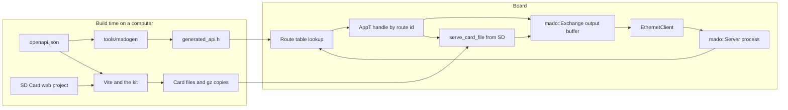

<div align="center">

<h1>Madoguchi</h1>

<strong>面向 Arduino Uno R4 Minima、不使用堆的 HTTP 服务器：页面从 SD 卡提供，REST API 由 OpenAPI 生成并受 JWT 保护。</strong>

<br>
<br>

[English](README.md) | [日本語](README.ja.md) | 简体中文 | [繁體中文 (香港)](README.zh-HK.md)

[](https://github.com/gufranco/madoguchi/actions/workflows/ci.yml)
[](LICENSE)

</div>

<p align="center">
  <a href="#快速开始">快速开始</a> |
  <a href="#示例">示例</a> |
  <a href="#sd-卡-web-项目">SD 卡页面</a> |
  <a href="#基于-openapi-和-jwt-的-rest-api">REST API</a> |
  <a href="#开发">开发</a> |
  <a href="CHANGELOG.md">更新日志</a>
</p>

---

Madoguchi 运行在装有 W5x00 或 ENC28J60 扩展板和 SD 卡的 Uno R4 Minima 上，并且完全不在堆上分配内存。C++ 代码中不含任何 HTML、CSS、脚本或图片：所有页面都在卡上，由每个示例各自独立的 Web 项目生成。这些项目用 TypeScript 和无类的 Pico CSS 编写，由 Vite 构建为卡上的文件和 gzip 副本。开发板应答由单个 OpenAPI 文档生成的 REST API，支持 JWT 登录、JSON 请求体和所有 HTTP 方法。每次推送和拉取请求时，CI 都会构建全部 9 个示例，任何超出开发板闪存或 RAM 预算的构建都会失败；同时运行 1,182 个主机测试、91 个工具测试、106 个页面测试和 32 个浏览器测试，构建每张卡，并对解析器进行模糊测试。

名字来自日语的「窓口」，即递交请求、拿回答复的服务窗口。

## 用法

处理函数是一个按路由 ID 分支的静态函数。页面来自卡，API 来自代码。程序的核心部分：

```cpp
struct WebApp {
  static bool handle(WebExchange& exchange, const uint8_t route) {
    switch (route) {
      case kStatus: return send_status_json(exchange);
      default: return mado::serve_card_file<FILE_READ>(exchange, sd_card);
    }
  }
};

const char kStatusPath[] PROGMEM = "/api/status";
const char kCardPath[] PROGMEM = "/*";
const mado::Route kRoutes[] PROGMEM = {
    {&kStatusPath[0], mado::Method::kGet, kStatus},
    {&kCardPath[0], mado::Method::kGet, kCard},
    {nullptr, mado::Method::kAny, 0U},
};
mado::Server<EthernetClient, WebApp> web(&kRoutes[0], &kHeaderNames[0]);

void loop() {
  EthernetClient client = ethernet_server.available();
  const bool has_client = static_cast<bool>(client);
  if (has_client) {
    web.process(client);
  }
}
```

没有等待中的请求时，`process()` 立即返回。否则它读取请求，用匹配路由的 ID 调用 `WebApp::handle`，然后关闭连接。`serve_card_file()` 把 `/` 映射到 `/index.html`，浏览器接受 gzip 时优先发送文件旁边的 `.gz` 副本，并让带哈希的文件名缓存一年。

## 快速开始

### 前提条件

| 工具 | 版本 | 用途 |
|:-----|:--------|:-----------|
| [arduino-cli](https://arduino.github.io/arduino-cli/) 或 Arduino IDE | CI 使用 arduino-cli 1.5.1 | 为开发板构建 |
| `arduino:renesas_uno` 内核 | 1.6.0 | Uno R4 Minima |
| Ethernet 库和 SdFat 库 | Ethernet 2.0.2、SdFat 2.3.0 | 所有示例 |
| Node.js 和 pnpm | Node 24、pnpm 12.15.0 | 构建卡上的页面 |
| CMake 和 C++ 编译器 | CMake 3.24 或更高版本 | 在计算机上运行 REST API |

### 安装

Madoguchi 尚未收录于 Arduino 库管理器。请从本仓库安装：

```sh
arduino-cli config set library.enable_unsafe_install true
arduino-cli lib install --git-url https://github.com/gufranco/madoguchi.git
arduino-cli lib install Ethernet@2.0.2 SdFat@2.3.0
```

在 Arduino IDE 中，将仓库下载为 ZIP 文件，然后使用 **项目 > 导入库 > 添加 .ZIP 库**。

### 构建开发板固件和卡

在本仓库的克隆中，将开发板通过 USB 连接后运行：

```sh
git clone https://github.com/gufranco/madoguchi.git
cd madoguchi
arduino-cli compile --fqbn arduino:renesas_uno:minima --library . examples/RestGet
arduino-cli board list
arduino-cli upload --fqbn arduino:renesas_uno:minima --port <port from board list> examples/RestGet
corepack enable
pnpm install
pnpm --filter ./examples/RestGet/SD\ Card run build
```

把 `examples/RestGet/SD Card/dist` 中的所有内容复制到一张 FAT16、FAT32 或 exFAT 格式的 microSD 卡的根目录，然后插入扩展板。可以用 [`RestFormat`](examples/RestFormat/RestFormat.ino) 准备这张卡。程序使用地址 192.168.1.177；如果你的网络使用其他地址段，请修改它。然后打开 `http://192.168.1.177/`。

### 无需开发板试用 REST API

在同一个克隆中，`mado_host_server` 在 127.0.0.1 上运行 [`RestApi`](examples/RestApi/RestApi.ino) 的应用代码，使用测试签名密钥和密码 `correct-horse-battery`。第三个参数是代替卡的文件夹：

```sh
pnpm --filter ./examples/RestApi/SD\ Card run build
cmake -S tests -B build
cmake --build build --target mado_host_server
build/mado_host_server 8080 100000 "examples/RestApi/SD Card/dist"
```

在另一个终端中运行：

```sh
TOKEN=$(curl -s -H 'Content-Type: application/json' \
  -d '{"username":"admin","password":"correct-horse-battery"}' \
  http://127.0.0.1:8080/api/auth/login | python3 -c 'import json,sys; print(json.load(sys.stdin)["access_token"])')
curl -s -i -H "Authorization: Bearer $TOKEN" -H 'Content-Type: application/json' \
  -d '{"name":"lamp","value":3,"on":true}' http://127.0.0.1:8080/api/items
```

预期输出：

```text
HTTP/1.1 201 Created
Connection: close
Content-Type: application/json
Cache-Control: no-store
Location: /api/items/1

{"id":1,"name":"lamp","value":3,"on":true}
```

打开 `http://127.0.0.1:8080/` 查看网站，打开 `http://127.0.0.1:8080/docs/` 查看 Swagger UI。开发页面时，`pnpm --filter ./examples/RestApi/SD\ Card run dev` 会以实时重载方式提供页面，并把 `/api` 转发到 `MADOGUCHI_BOARD` 指定的开发板，默认为 `http://madoguchi.local`。

## 支持的硬件

Madoguchi 只支持一块开发板：搭载 Renesas RA4M1 的 Arduino Uno R4 Minima。其他开发板均不在支持范围内，包括 Uno R3 和 Uno R4 WiFi。

| 硬件 | 库 | 客户端类型 |
|:---------|:--------|:------------|
| Wiznet W5100、W5200、W5500 扩展板 | Ethernet 2.0.2 | `EthernetClient` |
| ENC28J60 模块 | EthernetENC 2.0.5 | `EthernetClient` |
| 扩展板上的 microSD 插槽 | SdFat 2.3.0 | `SdFs` 和 `FsFile` |

服务器以客户端类型作为模板参数，因此任何具有 `available()`、`read()`、`read(buffer, size)`、`write(buffer, size)`、`connected()` 和 `stop()` 的类都可以使用。SdFat 能在 FAT16、FAT32 和 exFAT 上读取长文件名。Arduino 的 SD 库只能读取 8.3 文件名，所以 Madoguchi 使用 SdFat。`<SdFat.h>` 必须在所有 Madoguchi 头文件之后包含：R4 内核把 `F()` 定义为函数，而 SdFat 会用一个丢失闪存类型的宏替换它。

## 示例

大小以字节为单位，在 Uno R4 Minima 上使用 arduino-cli 1.5.1、arduino:renesas_uno 1.6.0、Ethernet 2.0.2 和 SdFat 2.3.0 构建。除 RestFormat 外，每个示例都有一个存放页面的 `SD Card` 文件夹：

| 示例 | 演示内容 | 闪存，共 262,144 | 已用 RAM，共 32,768 |
|:--------|:------|------:|------:|
| [`RestGet`](examples/RestGet/RestGet.ino) | 条目列表和单个条目的 `GET` | 74,072 | 5,920 |
| [`RestPost`](examples/RestPost/RestPost.ino) | 以 JSON 新建条目的 `POST` | 76,340 | 5,920 |
| [`RestPut`](examples/RestPut/RestPut.ino) | 替换条目的 `PUT` | 76,540 | 5,920 |
| [`RestPatch`](examples/RestPatch/RestPatch.ino) | 修改条目部分字段的 `PATCH` | 76,508 | 5,920 |
| [`RestDelete`](examples/RestDelete/RestDelete.ino) | 按 id 删除条目的 `DELETE` | 73,316 | 5,920 |
| [`RestAuth`](examples/RestAuth/RestAuth.ino) | 登录和一个受保护的路由 | 86,920 | 6,144 |
| [`RestFiles`](examples/RestFiles/RestFiles.ino) | SD 上的文件：列出、下载、范围请求、带进度的上传、删除 | 94,040 | 6,936 |
| [`RestApi`](examples/RestApi/RestApi.ino) | 完整的 API、其网站、Swagger UI 和请求日志 | 105,644 | 6,632 |
| [`RestFormat`](examples/RestFormat/RestFormat.ino) | 用 0x00 和 0xFF 擦除并校验，再格式化为 FAT16、FAT32 或 exFAT；只有 JSON | 71,440 | 9,936 |

除 RestFormat 外，每个示例都从卡上应答 `/api/openapi.json`，并在 `/docs/` 提供 Swagger UI。构建超出开发板预算时，CI 会失败。

## SD 卡 Web 项目

浏览器加载的每个文件都来自卡。每个示例的 `SD Card` 文件夹都是一个独立的 Web 项目：语义化 HTML、严格模式的 TypeScript、支持浅色和深色模式的无类 [Pico CSS](https://picocss.com/)，以及带覆盖率的 Vitest 测试。工作区一次构建全部项目：

```sh
corepack enable
pnpm install
pnpm run check
pnpm run test
pnpm run build
```

| 步骤 | 工具 | 作用 |
|:-----|:-----|:-------------|
| 检查 | Biome 2.6.3、TypeScript 7.0.2、html-validate 11.17.0 | 代码检查和格式化、严格类型检查、HTML 标准 |
| 测试 | Vitest 5.0.5 和 happy-dom | 针对模拟开发板测试每个页面，覆盖率门禁为 95% |
| 构建 | Vite 8.3.5 和 `@madoguchi/kit/vite` | 把 TypeScript 打包成以 8 位十六进制哈希命名的文件，压缩 HTML，在每个能压缩的文件旁边生成 `.gz` 副本，把 OpenAPI 文档复制为 `openapi.json`，并按开发板能提供的名称检查每个名称 |
| 浏览器 | Playwright 1.64.0 和 Chromium | 以 320 px 和 1280 px 测试构建后的每个页面及其文档页，开发板由路由拦截模拟：标题、计算样式、无横向滚动、主题切换、键盘焦点环、每个 Swagger 操作，以及空的控制台 |

第三方前端代码从不放在卡上。Pico CSS 2.1.1 从 jsDelivr 加载，Swagger UI 5.33.2 从 unpkg 加载，各自固定到确切版本并带有 Subresource Integrity 哈希。构建会在每个页面中写入 Content-Security-Policy，只允许页面自身的文件和这些 CDN 主机。在访问者按下切换按钮之前，主题跟随系统设置，所选主题保存在浏览器中。

共享代码位于 [`web/kit`](web/kit)：CDN 版本固定、主题切换、读取 RFC 9457 问题详情的 fetch 辅助函数、只保存在内存中的 Bearer 会话，以及 Vite 配置。

## 架构



- C++ 代码中没有任何资源文件。代码只写出数据：JSON、RFC 9457 问题详情和简短的状态消息。
- 缓冲区大小固定，由作为模板参数传入的 `Limits` 类型决定。不在堆上分配任何内存。
- 本库不保存函数指针，也不声明虚函数。按路由 ID 分支的静态 `handle` 让调用图对分析工具保持可见。
- 每个循环都有迭代上限，每次读取都有超时，整个请求也有截止时间，因此缓慢的客户端无法卡住程序。
- 请求按 RFC 9112 的要求解析：`HTTP/1.1` 请求必须恰好有一个 `Host`，重复的 `Content-Length` 返回 `400`，`Transfer-Encoding` 返回 `501`，处理程序未读取的请求体会在关闭连接前读出并丢弃。

代码以最严格的解读遵循 JPL D-60411 C 语言标准和 Power of Ten 规则，并适配到 C++。[`AGENTS.md`](AGENTS.md) 列出了每条规则及其适用方式。

## 包含的功能

| 领域 | 功能 | API |
|:-----|:--------|:----|
| 请求 | 按路径和方法路由，末尾 `*` 匹配前缀，返回带 `Allow` 头的 `405` | `mado::Route {path, method, id}` |
| 请求 | 将查询参数和 urlencoded 表单字段解码到你提供的缓冲区 | `query_param()`、`mado::next_form_field()` |
| 请求 | 只捕获你指定的请求头，名称不区分大小写；在 `100 Continue` 之后分块读取请求体 | `header()`、`read_body()` |
| 请求 | 读取停滞或请求过慢时返回 `408`，请求行过长时返回 `414`，请求头行过多时返回 `431`，HTTP/1.0 和 1.1 以外的版本返回 `505` | 自动 |
| 请求 | 为防范 DNS 重绑定，只接受列出的 `Host` 名称，带不带端口均可；每个响应都会传给一个钩子 | `PolicyT::trusted_hosts()`、`PolicyT::on_response()` |
| 响应 | 带原因短语的状态行、任意响应头、面向列出来源的 CORS、重定向、合并为最多 1,460 字节一次写入的输出 | `send_status()`、`send_header()`、`mado::send_cors_headers()`、`send_redirect()`、`mado::Reply` |
| 响应 | RFC 9457 问题详情：带标题、状态和详情的 `application/problem+json` | `mado::send_problem()`、`mado::json_problem()` |
| 响应 | 从文件读取的模板中的 `$NAME$` 标签；带精确 `Content-Length` 的 ArduinoJson 文档 | `mado::send_template()`、`mado::send_json()` |
| 卡 | 卡上的页面和文件：`/` 映射到 `index.html`，每个文件旁边的 `.gz` 副本，`Vary: Accept-Encoding`，带哈希的名称缓存一年，其余为 `no-cache` | `mado::serve_card_file()`、`mado::serve_card_path()` |
| 文件 | 按扩展名设置内容类型的文件；以 `206` 或 `416` 应答单个字节范围并支持 `If-Range`，弱 ETag 与 `304`，以及下载文件名 | `mado::send_file()`、`mado::FileReply`、`mado::content_type_for()` |
| 文件 | 解码并检查 URL 路径；拒绝 `.` 和 `..` 段、空段、反斜杠和编码后的 NUL 字节 | `mado::resolve_static_path()` |
| 文件 | 按长文件名和 `Repr-Digest` 检查上传，先写入临时文件再移到目标位置；拒绝超过 4 GiB 的大小 | `mado::valid_card_name()`、`mado::parse_repr_digest()`、`mado::copy_file()`、`mado::replace_file()`、`mado::file_length()` |
| 网络 | 带超时的 DHCP 和固定的后备地址；只生成一次并保存在 EEPROM 中的随机 MAC | `mado::begin_network()`、`mado::load_mac()` |
| 网络 | 网线或芯片恢复后重新启动；通过 mDNS 应答 `<name>.local` | `mado::NetworkWatch`、`mado::MdnsResponder` |
| 存储 | 每个响应一行 JSON，格式与 pino-http 相同，超过设定大小后轮转 | `mado::SdLog`、`mado::write_request_log()` |
| 存储 | 小计数器保存为 SD 上的文本文件；固定记录保存在 EEPROM | `mado::read_count_file()`、`mado::write_count_file()`、`mado::EepromTable` |
| 认证 | 以恒定时间检查 HTTP Basic 凭据 | `mado::check_basic_auth()` |
| 认证 | 签发和验证 HS256 JSON Web Token；PBKDF2-HMAC-SHA256 密码哈希 | `mado::issue_token()`、`mado::verify_bearer()`、`mado::pbkdf2_sha256()` |
| 认证 | 连续五次失败后锁定登录 15 分钟 | `mado::LoginGuard` |
| 认证 | SHA-256、HMAC-SHA256 和 Base64url | `mado::Sha256`、`mado::HmacSha256`、`mado::Base64UrlEncoder`、`mado::Base64UrlDecoder` |
| REST | 逐字段读取 JSON 请求体，无需在 RAM 中保存文档；输出转义后的 JSON 字符串 | `mado::JsonReader`、`mado::json_write_string()` |
| REST | 读取路径末尾的 `{id}`；固定大小的记录表 | `mado::parse_path_id()`、`mado::SlotTable` |
| REST | 从 OpenAPI 3.1 文档生成 C++ 路由和模式 | [`tools/madogen`](tools/madogen/cli.py) |

## 指南

### 路由与处理函数

路由是 `{path, method, id}`，路由表以路径为 `nullptr` 的条目结尾。路由按表中顺序匹配，因此要把具体路径放在通配符之前，并把卡的路由 `/*` 放在最后。

- `/api/status` 这样的精确路径只匹配该路径。匹配时忽略查询字符串。
- 以 `*` 结尾的路径，例如 `/api/files/*`，匹配所有以 `/api/files/` 开头的路径。
- `mado::Method::kAny` 接受所有方法。`kGet` 路由也会响应 `HEAD`，并省略响应体。
- 路径匹配但方法不对时返回 `405`，完全没有匹配时返回 `404`。

响应完成、可以关闭连接时，`handle` 返回 `true`。要保持连接打开，例如之后通过 `exchange.client()` 持续推送更新，则返回 `false`。W5100 只有四个套接字，因此要尽量少保持打开的连接。

### Exchange 对象

`mado::Exchange` 代表一个连接的请求和响应。

| 请求 | 返回值 |
|:--------|:--------|
| `method()` | `mado::Method` |
| `path()` | 原样发送的路径，不含查询字符串 |
| `query()` | 原始查询字符串，没有时为空 |
| `query_param(name, out, size)` | `true`，并在 `out` 中给出解码后的值 |
| `header(name)` | 捕获到的值，或 `nullptr` |
| `content_length()` | 声明的请求体长度 |
| `read_body(buffer, size)` | 读取的字节数，结束时为 `0`，超时或连接关闭时为 `-1` |
| `remaining_body()` | 尚未读取的请求体字节数 |
| `client()` | 指向客户端的指针，用于直接访问 |

| 响应 | 发送内容 |
|:---------|:------|
| `send_status(code)` | `HTTP/1.1 <code> <reason>` 和 `Connection: close` |
| `send_header(F("Name"), value)` | 一个响应头；值可以是 RAM 中的字符串、数字或 `mado::FlashText(F("..."))` |
| `send_content_type(F("type"))` | `Content-Type` |
| `send_content_length(length)` | `Content-Length` |
| `send_cors_headers()` | `Access-Control-Allow-Origin: *` 以及允许的方法和请求头 |
| `mado::send_cors_headers(exchange, origins)` | `Vary: Origin`，仅当捕获的 `Origin` 在列表中时才发送 CORS 响应头 |
| `send_location(F("/api/items/"), id)` | `Location: /api/items/<id>` |
| `status_code()` | 目前已发送的状态，没有则为 `0` |
| `end_headers()` | 空行；此后 `HEAD` 请求会省略响应体 |
| `send_empty(code)` | 没有响应体的完整响应 |
| `send_redirect(F("/next"))` | 带 `Location` 的 `303 See Other` |
| `print(...)`、`print_signed(...)`、`write(...)` | 响应体文本、数字和字节 |

### 请求头

创建服务器时指定需要的请求头。它们的值共用一个固定的池，默认 48 字节，过长的值会被截断。`Content-Length` 和 `Expect` 总会读取。卡的路由需要 `Accept-Encoding` 来选择 gzip 副本。

```cpp
const char kAuthorization[] PROGMEM = "Authorization";
const char kAcceptEncoding[] PROGMEM = "Accept-Encoding";
const char* const kHeaderNames[] PROGMEM = {&kAuthorization[0], &kAcceptEncoding[0], nullptr};
mado::Server<EthernetClient, WebApp> web(&kRoutes[0], &kHeaderNames[0]);
```

### 查询字符串与表单

```cpp
#include <mado/next_form_field.h>

char name[24];
char value[24];
if (exchange.query_param(F("name"), &name[0], sizeof(name))) {
  exchange.print(&name[0]);
}
while (mado::next_form_field(exchange, &name[0], sizeof(name), &value[0], sizeof(value)) ==
       mado::FormStatus::kField) {
  exchange.print(&value[0]);
}
```

### 卡上的文件

```cpp
#include <mado/serve_card_file.h>

const bool served = mado::serve_card_file<FILE_READ>(exchange, sd_card);
const char kSpecPath[] PROGMEM = "/openapi.json";
const bool spec = mado::serve_card_path<FILE_READ>(exchange, sd_card, &kSpecPath[0]);
```

`serve_card_file()` 在卡上解析请求路径：试图跳出根目录的路径返回 `400`，不存在的文件或文件夹返回 `404`，浏览器接受 gzip 时发送文件旁边的 `.gz` 副本。由 8 位十六进制数字加扩展名组成的名称，例如 `9f86d081.js`，以 `public, max-age=31536000, immutable` 缓存；其他文件一律为 `no-cache`。`serve_card_path()` 提供一个固定文件，`/api/openapi.json` 就是这样返回 `/openapi.json` 的。

对于下载、范围请求和条件请求，把包含大小、类型、gzip 标志、ETag、下载文件名和 `Cache-Control` 值的 `mado::FileReply` 传给 `mado::send_file()`。`mado::file_etag()` 由文件名、大小和一个版本号生成弱 ETag，程序在每次写入和启动时都会更改该版本号，因此即使用相同大小的文件替换，也会得到新的标签。带 `If-Range` 的 `Range` 会得到整个文件，因为弱标签无法证明各部分属于同一版本。[`RestFiles`](examples/RestFiles/RestFiles.ino) 用到了以上全部功能。

### Basic 认证

```cpp
#include <mado/check_basic_auth.h>
#include <mado/send_auth_challenge.h>

if (!mado::check_basic_auth(exchange.header(F("Authorization")), F("YWRtaW46Y2hhbmdlLW1l"))) {
  return mado::send_auth_challenge(exchange, F("Madoguchi"));
}
```

期望值是 Base64 编码的 `user:password`，可用 `printf 'admin:change-me' | base64` 得到。

> [!WARNING]
> 开发板没有 TLS。Basic 认证密码、登录密码和 Bearer 令牌都以明文在网络上传输。请把开发板放在你信任的网络中，或放在终结 TLS 的反向代理之后。

### 模板

模板是卡上带 `$NAME$` 标签的文件，代码在发送文件的同时填入标签：

```cpp
#include <mado/FileSource.h>
#include <mado/send_template.h>

struct PageTags {
  static bool render(WebExchange& exchange, const char* tag) {
    if (strcmp_P(tag, PSTR("TEMP")) == 0) {
      exchange.print(static_cast<uint32_t>(analogRead(A0)));
      return true;
    }
    return false;
  }
};

FsFile page = sd_card.open("/status.html", FILE_READ);
mado::FileSource<FsFile> source(page);
mado::send_template<WebExchange, PageTags>(exchange, source);
```

标签最多 16 个字母、数字或下划线。未知标签按原样发送，标签前的 `$$` 会保留一个 `$`。

### 使用 ArduinoJson 处理 JSON

```cpp
#include <ArduinoJson.h>
#include <MadoguchiJson.h>

JsonDocument document;
document["uptime_ms"] = millis();
mado::send_json(exchange, mado::http::kOk, document);
```

只有 `MadoguchiJson.h` 包含 ArduinoJson，因此不包含它的程序永远不会编译 ArduinoJson。

### 限制参数

缓冲区大小和超时由作为第三个模板参数传入的类型决定。必须声明所有字段，此时处理函数接收 `mado::Exchange<EthernetClient, BigLimits>&`。

```cpp
struct BigLimits {
  static constexpr uint16_t kLineBufferSize = 256U;
  static constexpr uint16_t kOutputBufferSize = 512U;
  static constexpr uint8_t kHeaderPoolSize = 96U;
  static constexpr uint8_t kHeaderNameSize = 32U;
  static constexpr uint8_t kMaxCapturedHeaders = 8U;
  static constexpr uint8_t kMaxHeaderLines = 48U;
  static constexpr uint8_t kMaxRoutes = 32U;
  static constexpr uint16_t kReadTimeoutMs = 1000U;
  static constexpr uint32_t kMaxPollsPerRead = 100000UL;
  static constexpr uint16_t kRequestTimeoutMs = 5000U;
  static constexpr uint16_t kMaxDrainBytes = 1024U;
  static constexpr uint16_t kFileChunkSize = 512U;
};
mado::Server<EthernetClient, WebApp, BigLimits> web(&kRoutes[0], nullptr);
```

| 字段 | 默认值 | 含义 |
|:------|--------:|:--------|
| `kLineBufferSize` | 128 | 最长的请求行：方法、路径和查询合计 |
| `kOutputBufferSize` | 32 | 写入网络前合并的字节数，最多 1,460；更大的写入一次发出 |
| `kHeaderPoolSize` | 48 | 所有捕获请求头值的空间 |
| `kHeaderNameSize` | 32 | 可捕获的最长请求头名称 |
| `kMaxCapturedHeaders` | 8 | 请求头列表中的名称数量 |
| `kMaxHeaderLines` | 48 | 返回 `431` 之前接受的请求头行数 |
| `kMaxRoutes` | 32 | 在路由表中扫描的路由数 |
| `kReadTimeoutMs` | 1000 | 返回 `408` 之前等待下一个字节的时间 |
| `kMaxPollsPerRead` | 100000 | 每次读取的轮询次数上限 |
| `kRequestTimeoutMs` | 5000 | 返回 `408` 之前，请求行和请求头的时限，请求体另有同样的时限 |
| `kMaxDrainBytes` | 1024 | 关闭连接前读出并丢弃的未读请求体字节数；更长的请求体不会读取 |
| `kFileChunkSize` | 32 | 文件响应每一步从文件读取的字节数 |

第四个模板参数是策略，它列出受信任的主机，并接收每个响应。默认策略信任任何不超过 255 字节的 `Host`，钩子不做任何事。

```cpp
struct BoardPolicy {
  static constexpr bool kTrustedHostsOnly = true;
  static const char* const* trusted_hosts() {
    static const char* const kHosts[] = {"192.168.1.177", "board.local", nullptr};
    return &kHosts[0];
  }
  static void on_response(const mado::RequestLine&, const mado::ResponseSummary&) {}
};
mado::Server<EthernetClient, WebApp, mado::DefaultLimits, BoardPolicy> web(&kRoutes[0], nullptr);
```

### 网络

```cpp
#include <mado/MdnsResponder.h>
#include <mado/begin_network.h>
#include <mado/load_mac.h>

const char kHostName[] PROGMEM = "madoguchi";
uint8_t mac[mado::kMacSize] = {};
mado::MdnsResponder<EthernetUDP, IPAddress> mdns(&kHostName[0]);

void setup() {
  mado::load_mac(EEPROM, 8U, mac, micros());
  mado::begin_network(Ethernet, &mac[0], IPAddress(192, 168, 1, 177), 10000UL);
  mdns_socket.beginMulticast(IPAddress(224, 0, 0, 251), mado::kMdnsPort);
}
```

`load_mac()` 在首次启动时把一个随机的本地管理 MAC 写入 EEPROM 的 7 个字节，之后再读回。DHCP 没有及时应答、改用固定地址时，`begin_network()` 返回 `false`。在 `loop()` 中调用 `mdns.poll(mdns_socket, Ethernet.localIP())`，使 `http://madoguchi.local` 可以解析；调用 `Ethernet.maintain()` 续租；并把芯片和链路状态传给 `mado::NetworkWatch::update()`，需要重新启动网络时它返回 `mado::NetworkAction::kRestart`。[`RestApi.ino`](examples/RestApi/RestApi.ino) 完成了以上全部步骤。

### 请求日志

`mado::SdLog` 为每个响应追加一行 JSON，格式与 pino-http 相同，文件超过设定的大小后改名保存：

```json
{"level":30,"boot":3,"uptime":1500,"hostname":"madoguchi","req":{"id":12,"method":"PUT","url":"/api/items/2"},"res":{"statusCode":200},"responseTime":9,"msg":"request completed"}
```

响应低于 500 时 `level` 为 30，服务器错误时为 50。开发板没有时钟，所以 `boot` 是重启次数，`uptime` 是 `millis()`。在策略的 `on_response()` 中调用 `log.request()`，登录等其他事件用 `log.event()`。RestApi 写入 `/LOG.TXT`，把之前的 64 KiB 保留在 `/LOG.OLD`，不记录用户名或地址。任何 NDJSON 工具都能读取：

```sh
curl -s -H "Authorization: Bearer $TOKEN" http://madoguchi.local/api/log | jq -c 'select(.level >= 40)'
```

## 基于 OpenAPI 和 JWT 的 REST API

[`RestApi`](examples/RestApi/RestApi.ino) 是一个使用 W5x00 扩展板的完整认证 API：

| 路径 | 提供内容 |
|:-----|:-------|
| `/` | 登录后可列出、添加、切换和删除条目的页面，来自卡 |
| `/docs/` | 开发板自身 API 的 Swagger UI，来自卡 |
| `GET /api/openapi.json` | OpenAPI 3.1 文档，来自卡 |
| `POST /api/auth/login` | 为有效的用户名和密码签发 Bearer 令牌 |
| `GET /api/items`、`GET /api/items/{id}` | 条目，公开 |
| `POST /api/items`、`PUT`、`PATCH`、`DELETE /api/items/{id}` | 修改，需要 Bearer 令牌 |
| `GET /api/log`、`DELETE /api/log` | JSON 行格式的请求日志，可用 `Range` 读取末尾，以及清空日志，需要 Bearer 令牌 |

[`RestAuth`](examples/RestAuth/RestAuth.ino) 演示登录和一个受保护的路由。[`RestGet`](examples/RestGet/RestGet.ino)、[`RestPost`](examples/RestPost/RestPost.ino)、[`RestPut`](examples/RestPut/RestPut.ino)、[`RestPatch`](examples/RestPatch/RestPatch.ino) 和 [`RestDelete`](examples/RestDelete/RestDelete.ino) 各自演示一种不带认证的方法。[`RestFiles`](examples/RestFiles/RestFiles.ino) 列出、下载、带进度条上传和删除 SD 卡上的文件；它没有认证，因此只应在可信网络中使用。它们都把应用代码放在程序旁边的头文件中，因此主机测试运行的就是开发板运行的代码；没有卡时，它们返回带问题文档的 `503`。

### 擦除并格式化 SD 卡

[`RestFormat`](examples/RestFormat/RestFormat.ino) 为其他所有示例准备 SD 卡。它只应答 JSON，没有页面也没有登录，因此只应在可信网络中使用。它会擦除卡上的全部内容。

| 路由 | 作用 |
|:------|:-----|
| `GET /api/card` | 以 MiB 为单位的容量、类型（`SDSC`、`SDHC` 或 `SDXC`），以及格式化将写入的文件系统 |
| `POST /api/card/format` | 开始擦除；请求体要重复容量，例如 `{"capacity_mib":30436}`，这样发给一张卡的请求不会擦除另一张卡；返回带 `Location` 的 `202`，擦除进行中返回 `409`，容量不符返回 `422` |
| `GET /api/card/format` | 当前阶段、其百分比，以及说明失败原因的详情 |

阶段依次为 `fill-zero`、`check-zero`、`fill-one`、`check-one`、`format`、`mount` 和 `done`，或者 `failed`。开发板向每个扇区写入 0x00 并逐个读回，然后用 0xFF 再做一遍；每次 `loop()` 只处理几个扇区，因此 API 始终可以应答。随后用 SdFat 的格式化器按容量选择文件系统进行格式化，并挂载以确认结果：

| 扇区数 | 文件系统 | 卡 |
|:--------|:------------|:-----|
| 少于 4,194,304，最多 2 GiB | FAT16 | SDSC |
| 最多 67,108,864，32 GiB | FAT32 | SDHC |
| 更多 | exFAT | SDXC |

擦除会对整张卡各写入两次、读取两次，因此耗时随卡的容量和 SPI 速度增长。格式化和挂载期间，开发板会停顿几秒钟。

```sh
curl -s http://192.168.1.177/api/card
curl -s -H 'Content-Type: application/json' -d '{"capacity_mib":30436}' http://192.168.1.177/api/card/format
curl -s http://192.168.1.177/api/card/format
```

### 生成 API 代码

每个 REST 程序都有一个 `openapi.json`。[`tools/madogen`](tools/madogen/cli.py) 把它转换为 `generated_api.h`。该文件已提交到仓库，因此 Arduino IDE 无需安装 Python 即可构建程序。生成器只使用 Python 标准库。

```sh
python3 -m tools.madogen generate examples/RestApi
python3 -m tools.madogen check examples/RestApi
```

`generate` 会写出：

- 由每个 `operationId` 生成的路由 ID、由 `paths` 生成的路由表、`/api/openapi.json` 的路由，以及最后一条用于卡的路由 `/*`；
- 由每个操作的 `security` 生成的 `route_needs_token()`；
- 读取路径末尾 `{id}` 的 `route_path_id()`；
- 为 `components.schemas` 中每个模式生成结构体和字段读取器，并检查每个 `maxLength`、`minimum` 和 `maximum`；响应使用的模式和设置了 `x-mado-writer: true` 的模式还会得到 JSON 写入器；
- `read_<schema>_body()`，它检查 `Content-Type` 和长度、读取请求体，并在 `mado::Problem` 中指出第一个缺少的必需属性；以及每个按 id 进行的 `GET` 对应的 `<operation>_url()`；
- `send_card()`，它从卡上提供规范文档和其他所有路径，没有卡时返回 `503`。

当 `generated_api.h` 与源文件不再一致，或 `arduino_secrets.h` 中含有真实密钥时，`check` 会失败。CI 对全部九个示例运行它。

生成器接受 OpenAPI 3.1 的一个子集，对超出范围的内容会给出其 JSON 指针：

- 路径以 `/api/` 开头，只有最后一段可以是参数；
- 请求体为引用组件模式的 `application/json`，或 `application/octet-stream`；
- `in: header` 参数成为捕获的请求头；
- 可选的顶层 `x-mado-limits` 把 `outputBufferSize` 设为 8 到 1,460，`fileChunkSize` 最多设为 1,024；
- 模式是带 `additionalProperties: false` 的扁平对象，包含带 `maxLength` 的字符串、带 `minimum` 和 `maximum` 的整数以及布尔值；
- security 为 `[]` 或 `[{"bearerAuth": []}]`，其中 `bearerAuth` 是 HTTP Bearer JWT 方案；
- 最多 31 个操作。

`python3 -m tools.madogen sri FILE` 输出文件的 Subresource Integrity 哈希，用于在工具包中固定新的 CDN 文件。

### 登录

仓库中提交的 `arduino_secrets.h` 是全零密钥；在替换之前，登录会返回 `503`，也不会接受任何令牌。每块开发板只需创建一次真实的密钥：

```sh
python3 -m tools.madogen secrets examples/RestApi --user admin
```

它会要求输入 12 到 64 个字符的密码，然后写出随机的 32 字节签名密钥、随机盐值以及密码的 PBKDF2-HMAC-SHA256 哈希。切勿提交该文件：CI 运行的 `check` 在其中含有真实密钥时会失败。

- 令牌是 HS256 JWT。开发板逐字节比较令牌头，因此 `alg: none` 和其他任何算法都会失败；签名以恒定时间比较。
- 令牌有效期为 15 分钟的运行时间，开发板重启后失效，因为每次启动都会递增 EEPROM 中的会话计数器。
- 连续五次登录失败会锁定登录 15 分钟，并返回带 `Retry-After` 的 `429`。
- Argon2id 和 bcrypt 所需的 RAM 超出开发板容量，因此密码使用 PBKDF2。请调整 `--iterations`，使一次登录耗时约一秒。
- 页面只在内存中保存令牌，从不写入浏览器存储，因此重新加载页面即退出登录。

页面从公共 CDN 加载 Pico CSS 和 Swagger UI，因此浏览器需要联网才能显示样式和 `/docs/`。API 本身可离线工作。

生成的 `Limits` 把请求头池扩大到 240 字节，可以在 `Accept-Encoding`、`If-None-Match` 和 `Content-Type` 之外再容纳一个 Bearer 令牌。超过 256 字节的请求体返回 `413`，每个 API 错误都带有 `application/problem+json` 响应体，例如 `{"title":"Unprocessable Content","status":422,"detail":"missing required property: on"}`。

## 开发

主机测试使用 CMake 和 googletest，配合一个小型 Arduino 垫片、一个模拟客户端、一张模拟 SD 卡，以及供格式化示例使用的模拟扇区设备；模拟卡与 FAT 一样，匹配文件名时不区分大小写。

| 测试集 | 命令 | 覆盖范围 |
|:------|:--------|:-------|
| 库和示例 | `cmake -S tests -B build -DMADO_COVERAGE=ON && cmake --build build && ctest --test-dir build --output-on-failure` | 1,182 个测试：RFC 9112 一致性表、解析、路由、响应、卡上的文件、范围请求、网络辅助函数、SD 日志、加密、令牌、示例的应用代码，以及每个模糊测试语料库的重放 |
| 覆盖率 | `gcovr build --root . --filter src/ --merge-lines --txt` | `src/` 的行和函数覆盖率，CI 中下限为 95% |
| 生成器和门禁 | `python3 -m pytest -q tests/madogen tests/assertion_density tests/size_gate tests/throughput` | `madogen`、断言密度门禁、大小门禁和吞吐量工具的 91 个测试 |
| 页面 | `pnpm run check && pnpm run test && pnpm run build` | Biome、TypeScript、html-validate、106 个带 95% 覆盖率门禁的 Vitest 测试，以及每张卡的构建 |
| 浏览器 | `pnpm exec playwright install chromium && pnpm run build && pnpm run e2e` | 32 个 Playwright 测试：以 320 px 和桌面宽度测试每个页面和文档页 |
| 吞吐量 | `python3 tools/throughput.py --download http://madoguchi.local/ --upload http://madoguchi.local/api/files/BENCH.BIN` | 测量开发板的下载和上传速度，以 JSON 输出 |
| 生成代码 | `python3 -m tools.madogen check examples/Rest*` | `generated_api.h` 与源文件一致，且未提交真实密钥 |
| 模糊测试 | `cmake -S tests -B fuzz -DMADO_FUZZ=ON -DCMAKE_CXX_COMPILER=clang++ && cmake --build fuzz && fuzz/mado_fuzz_request tests/fuzz/corpus/request` | 启用 AddressSanitizer 和 UBSan 的 libFuzzer，覆盖服务器、RestApi 和 RestFiles 应用、JSON 读取器和文本解码器 |
| 大小预算 | `python3 tools/size_gate.py --fqbn arduino:renesas_uno:minima examples/RestApi` | 对照开发板预算检查闪存和 RAM，编译器警告为零 |

CI 还会运行 clang-format、clang-tidy、带 `--enable=all` 的 cppcheck 2.22.0、断言密度门禁以及严格模式的 arduino-lint，且不允许任何警告。确切命令见 [`.github/workflows/ci.yml`](.github/workflows/ci.yml)，编码规则见 [`AGENTS.md`](AGENTS.md)。

## 许可证

[MIT](LICENSE)。只要随代码保留版权声明，就可以在任何项目中使用、复制、修改和发布，包括商业项目。
