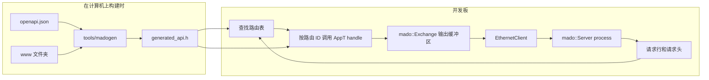

<div align="center">

<h1>Madoguchi</h1>

<strong>面向 Uno R3 和 Uno R4 Minima 的小型、不使用堆的 HTTP 服务器，在 R4 上提供受 JWT 保护的 REST API。</strong>

<br>
<br>

[English](README.md) | [日本語](README.ja.md) | 简体中文 | [繁體中文 (香港)](README.zh-HK.md)

[](https://github.com/gufranco/madoguchi/actions/workflows/ci.yml)
[](LICENSE)

</div>

<p align="center">
  <a href="#快速开始">快速开始</a> |
  <a href="#示例">示例</a> |
  <a href="#基于-openapi-和-jwt-的-rest-api">REST API</a> |
  <a href="#开发">开发</a> |
  <a href="CHANGELOG.md">更新日志</a>
</p>

---

Madoguchi 在 Uno R3 的 ATmega328P 上与 Ethernet 库和 SD 库共存，并且完全不在堆上分配内存。在 Uno R4 Minima 上，它提供一个由单个 OpenAPI 文档生成的完整 REST API：JWT 登录、JSON 请求体、所有 HTTP 方法、`/` 下的网站以及 `/docs` 下的 Swagger UI。CI 为全部 17 个示例构建其目标开发板的固件，任何超出开发板闪存或 RAM 预算的构建都会失败；每次推送和拉取请求都会运行 1,142 个主机测试、113 个工具测试和 12 个页面脚本测试，并对解析器进行模糊测试。

名字来自日语的「窓口」，即递交请求、拿回答复的服务窗口。

## 用法

处理函数是一个按路由 ID 分支的静态函数。下面是 [`SimpleWebServer`](examples/SimpleWebServer/SimpleWebServer.ino) 的核心部分，它在 Uno R3 上占用 18,640 字节闪存：

```cpp
struct WebApp {
  static bool handle(WebExchange& exchange, const uint8_t route) {
    const bool known = route == kIndex;
    if (!known) {
      return exchange.send_empty(404U);
    }
    const bool status = exchange.send_status(200U);
    const bool type = exchange.send_content_type(F("text/html"));
    const bool ended = exchange.end_headers();
    const size_t written = exchange.print(F("<html><body><h1>Hello World!</h1></body></html>\n"));
    return status && type && ended && (written > 0U);
  }
};

const char kIndexPath[] PROGMEM = "/";
const mado::Route kRoutes[] PROGMEM = {
    {&kIndexPath[0], mado::Method::kGet, kIndex},
    {nullptr, mado::Method::kAny, 0U},
};
mado::Server<EthernetClient, WebApp> web(kRoutes, nullptr);

void loop() {
  EthernetClient client = ethernet_server.available();
  const bool has_client = static_cast<bool>(client);
  if (has_client) {
    web.process(client);
  }
}
```

没有等待中的请求时，`process()` 立即返回。否则它读取请求，用匹配路由的 ID 调用 `WebApp::handle`，然后关闭连接。

## 快速开始

### 前提条件

| 工具 | 版本 | 用途 |
|:-----|:--------|:-----------|
| [arduino-cli](https://arduino.github.io/arduino-cli/) 或 Arduino IDE | CI 使用 arduino-cli 1.5.1 | 为开发板构建 |
| `arduino:avr` 或 `arduino:renesas_uno` 内核 | 1.8.8 或 1.6.0 | Uno R3 或 Uno R4 Minima |
| Ethernet 库 | 2.0.2 | 除 EthernetENC 外的所有示例 |
| CMake 和 C++ 编译器 | CMake 3.24 或更高版本 | 在计算机上运行 REST API |

### 安装

Madoguchi 尚未收录于 Arduino 库管理器。请从本仓库安装：

```sh
arduino-cli config set library.enable_unsafe_install true
arduino-cli lib install --git-url https://github.com/gufranco/madoguchi.git
arduino-cli lib install Ethernet@2.0.2
```

在 Arduino IDE 中，将仓库下载为 ZIP 文件，然后使用 **项目 > 导入库 > 添加 .ZIP 库**。

本库自身没有依赖。只有包含 SD、EthernetENC 和 ArduinoJson 的示例才需要这些库。

### 为开发板构建

在本仓库的克隆中，将开发板通过 USB 连接后运行：

```sh
git clone https://github.com/gufranco/madoguchi.git
cd Madoguchi
arduino-cli compile --fqbn arduino:avr:uno --library . examples/SimpleWebServer
arduino-cli board list
arduino-cli upload --fqbn arduino:avr:uno --port <port from board list> examples/SimpleWebServer
```

对于 Uno R4 Minima，请使用 `--fqbn arduino:renesas_uno:minima`。示例使用地址 192.168.1.177；如果你的网络使用其他地址段，请在示例中修改。开发板装上 W5x00 扩展板后，`curl http://192.168.1.177/` 会返回 Hello World 页面。

### 无需开发板试用 REST API

在同一个克隆中，`mado_host_server` 在 127.0.0.1 上运行 [`RestApi`](examples/RestApi/RestApi.ino) 的应用代码，使用测试签名密钥和密码 `correct-horse-battery`：

```sh
cmake -S tests -B build
cmake --build build --target mado_host_server
build/mado_host_server 8080
```

在另一个终端中运行：

```sh
TOKEN=$(curl -s -H 'Content-Type: application/json' \
  -d '{"username":"admin","password":"correct-horse-battery"}' \
  http://127.0.0.1:8080/api/auth/login | python3 -c 'import json,sys; print(json.load(sys.stdin)["access_token"])')
curl -s -i -H "Authorization: Bearer $TOKEN" -H 'Content-Type: application/json' \
  -d '{"name":"lamp","value":3,"on":true}' http://127.0.0.1:8080/api/items
```

预期输出：

```text
HTTP/1.1 201 Created
Connection: close
Content-Type: application/json
Cache-Control: no-store
Location: /api/items/1

{"id":1,"name":"lamp","value":3,"on":true}
```

打开 `http://127.0.0.1:8080/` 查看网站，打开 `http://127.0.0.1:8080/docs` 查看 Swagger UI。

## 支持的硬件

Madoguchi 支持两块开发板：搭载 ATmega328P 的 Arduino Uno R3，以及搭载 Renesas RA4M1 的 Arduino Uno R4 Minima。其他开发板均不在支持范围内。

| 硬件 | 库 | 客户端类型 |
|:---------|:--------|:------------|
| Wiznet W5100、W5200、W5500 扩展板 | Ethernet 2.0.2 | `EthernetClient` |
| ENC28J60 模块 | EthernetENC 2.0.5 | `EthernetClient` |

服务器以客户端类型作为模板参数，因此任何具有 `available()`、`read()`、`read(buffer, size)`、`write(buffer, size)`、`connected()` 和 `stop()` 的类都可以使用。

不支持 ATmega168：仅 Ethernet 2.0.2 就占用其 14,336 字节闪存中的 11,208 字节。也不支持 UNO Q，因为 arduino:zephyr 1.0.0 上的程序没有套接字 API。

## 示例

大小以字节为单位，使用 arduino-cli 1.5.1、arduino:avr 1.8.8、arduino:renesas_uno 1.6.0、Ethernet 2.0.2、SD 1.3.0、EthernetENC 2.0.5 和 ArduinoJson 7.4.3 构建：

| 示例 | 演示内容 | Uno R3 闪存，共 32,256 | Uno R3 可用 RAM，共 2,048 | R4 Minima 闪存，共 262,144 | R4 Minima 已用 RAM，共 32,768 |
|:--------|:------|------:|------:|------:|------:|
| [`SimpleWebServer`](examples/SimpleWebServer/SimpleWebServer.ino) | 一个页面 | 18,864 | 1,546 | 57,796 | 4,560 |
| [`FormAndQuery`](examples/FormAndQuery/FormAndQuery.ino) | 查询字符串和 urlencoded 表单 | 21,288 | 1,546 | 59,600 | 4,560 |
| [`TemplatePage`](examples/TemplatePage/TemplatePage.ino) | 闪存中页面的 `$NAME$` 标签 | 19,524 | 1,546 | 58,380 | 4,560 |
| [`BasicAuth`](examples/BasicAuth/BasicAuth.ino) | HTTP Basic 凭据 | 19,596 | 1,546 | 58,440 | 4,560 |
| [`JsonApi`](examples/JsonApi/JsonApi.ino) | ArduinoJson 响应 | 25,978 | 1,494 | 62,564 | 4,564 |
| [`EthernetENC`](examples/EthernetENC/EthernetENC.ino) | ENC28J60 模块 | 25,264 | 851 | 63,176 | 5,184 |
| [`WebServerSD`](examples/WebServerSD/WebServerSD.ino) | SD 卡上的文件和文件夹，带 gzip 副本 | 30,822 | 735 | 65,648 | 5,220 |
| [`FileUpload`](examples/FileUpload/FileUpload.ino) | 通过 `PUT` 上传到 SD 卡 | 31,554 | 739 | 65,648 | 5,220 |
| [`BlinkLed`](examples/BlinkLed/BlinkLed.ino) | 由 SD 卡上的页面控制的 LED | 31,984 | 738 | 66,108 | 5,224 |
| [`RestGet`](examples/RestGet/RestGet.ino) | 对条目列表和单个条目的 `GET` | 24,486 | 1,395 | 61,796 | 4,712 |
| [`RestPost`](examples/RestPost/RestPost.ino) | 以 JSON 发送新条目的 `POST` | 27,162 | 1,403 | 64,068 | 4,712 |
| [`RestPut`](examples/RestPut/RestPut.ino) | 替换条目的 `PUT` | 27,368 | 1,395 | 64,312 | 4,712 |
| [`RestPatch`](examples/RestPatch/RestPatch.ino) | 修改条目部分字段的 `PATCH` | 27,512 | 1,395 | 64,296 | 4,712 |
| [`RestDelete`](examples/RestDelete/RestDelete.ino) | 按 ID 删除条目的 `DELETE` | 23,206 | 1,395 | 60,948 | 4,712 |
| [`RestAuth`](examples/RestAuth/RestAuth.ino) | 登录和一个受保护的路由 | 放不下 |  | 80,072 | 5,600 |
| [`RestFiles`](examples/RestFiles/RestFiles.ino) | SD 上的文件：列表、下载、范围请求、带进度上传、删除 | 放不下 |  | 93,312 | 6,392 |
| [`RestApi`](examples/RestApi/RestApi.ino) | 完整的 API、网站和 Swagger UI | 放不下 |  | 104,828 | 6,088 |

RestApi 和 RestAuth 要签发令牌、计算密码哈希并携带网站，RestFiles 携带网站和 SHA-256，因此这三个示例需要 R4 Minima。其他示例两块开发板都能装下。任何超出开发板预算的构建都会让 CI 失败；如果 Uno R3 上的 SimpleWebServer 为栈留出的 RAM 少于 1,024 字节，CI 也会失败。

## 架构



- 缓冲区大小固定，由作为模板参数传入的 `Limits` 类型决定。不在堆上分配任何内存。
- 本库不保存函数指针，也不声明虚函数。按路由 ID 分支的静态 `handle` 让调用图对分析工具保持可见。
- 每个循环都有迭代上限，每次读取都有超时，整个请求也有截止时间，因此缓慢的客户端无法卡住程序。常量字符串和表通过 `F()` 和 `PROGMEM` 存放在闪存中。
- 请求按 RFC 9112 的要求解析：`HTTP/1.1` 请求必须恰好有一个 `Host`，重复的 `Content-Length` 返回 `400`，`Transfer-Encoding` 返回 `501`，处理程序未读取的请求体会在关闭连接前读出并丢弃。

代码以最严格的解读遵循 JPL D-60411 C 语言标准和 Power of Ten 规则，并适配到 C++。[`AGENTS.md`](AGENTS.md) 列出了每条规则及其适用方式。

## 包含的功能

| 领域 | 功能 | API |
|:-----|:--------|:----|
| 请求 | 按路径和方法路由，末尾 `*` 匹配前缀，返回带 `Allow` 头的 `405` | `mado::Route {path, method, id}` |
| 请求 | 将查询参数和 urlencoded 表单字段解码到你提供的缓冲区 | `query_param()`、`mado::next_form_field()` |
| 请求 | 只捕获你指定的请求头，名称不区分大小写；在 `100 Continue` 之后分块读取请求体 | `header()`、`read_body()` |
| 请求 | 读取停滞或请求过慢时返回 `408`，请求行过长时返回 `414`，请求头行过多时返回 `431`，HTTP/1.0 和 1.1 以外的版本返回 `505` | 自动 |
| 请求 | 为防范 DNS 重绑定，只接受列出的 `Host` 名称，带不带端口均可；每个响应的状态都会传给一个钩子 | `PolicyT::trusted_hosts()`、`PolicyT::on_response()` |
| 响应 | 带原因短语的状态行、任意响应头、面向列出来源的 CORS、重定向、按 32 字节合并的输出 | `send_status()`、`send_header()`、`mado::send_cors_headers()`、`send_redirect()`、`mado::Reply` |
| 响应 | RFC 9457 问题详情：带标题、状态和详情的 `application/problem+json` | `mado::send_problem()`、`mado::json_problem()` |
| 响应 | 闪存中页面的 `$NAME$` 标签；带精确 `Content-Length` 的 ArduinoJson 文档 | `mado::send_template()`、`mado::send_json()` |
| 文件 | 发送 SD 卡或任何可读文件，支持文件夹、gzip 副本和按扩展名的内容类型 | `mado::send_file()`、`mado::content_type_for()`、`mado::accepts_gzip()` |
| 文件 | 解码并检查 URL 路径；拒绝 `.` 和 `..` 段、空段、反斜杠和编码后的 NUL 字节 | `mado::resolve_static_path()` |
| 文件 | 以 `206` 或 `416` 应答单个字节范围并支持 `If-Range`，弱 ETag 与 `304`，以及下载文件名 | `mado::send_file(exchange, file, mado::FileReply)` |
| 文件 | 按 8.3 文件名和 `Repr-Digest` 检查上传，先写入临时文件再移到目标位置 | `mado::valid_short_name()`、`mado::parse_repr_digest()`、`mado::copy_file()`、`mado::replace_file()` |
| 文件 | 发送闪存中经过压缩和 gzip 的文件，带 ETag、`304 Not Modified`、`406 Not Acceptable`、Content-Security-Policy 和编译时生成的响应头块 | `mado::send_asset()` |
| 网络 | 带超时的 DHCP 和固定的后备地址；只生成一次并保存在 EEPROM 中的随机 MAC | `mado::begin_network()`、`mado::load_mac()` |
| 网络 | 网线或芯片恢复后重新启动；通过 mDNS 应答 `<name>.local` | `mado::NetworkWatch`、`mado::MdnsResponder` |
| 存储 | 每个响应一行 JSON，格式与 pino-http 相同，超过设定大小后轮转 | `mado::SdLog`、`mado::write_request_log()` |
| 存储 | 小计数器保存为 SD 上的文本文件；固定记录保存在 EEPROM | `mado::read_count_file()`、`mado::write_count_file()`、`mado::EepromTable` |
| 认证 | 以恒定时间检查 HTTP Basic 凭据 | `mado::check_basic_auth()` |
| 认证 | 签发和验证 HS256 JSON Web Token；PBKDF2-HMAC-SHA256 密码哈希 | `mado::issue_token()`、`mado::verify_bearer()`、`mado::pbkdf2_sha256()` |
| 认证 | 连续五次失败后锁定登录 15 分钟 | `mado::LoginGuard` |
| 认证 | SHA-256、HMAC-SHA256 和 Base64url | `mado::Sha256`、`mado::HmacSha256`、`mado::Base64UrlEncoder`、`mado::Base64UrlDecoder` |
| REST | 逐字段读取 JSON 请求体，无需在 RAM 中保存文档；输出转义后的 JSON 字符串 | `mado::JsonReader`、`mado::json_write_string()` |
| REST | 读取路径末尾的 `{id}`；固定大小的记录表 | `mado::parse_path_id()`、`mado::SlotTable` |
| REST | 从 OpenAPI 3.1 文档和一个 Web 文件夹生成 C++ 代码 | [`tools/madogen`](tools/madogen/cli.py) |

## 指南

### 路由与处理函数

路由是 `{path, method, id}`，路由表以路径为 `nullptr` 的条目结尾。路由按表中顺序匹配，因此要把具体路径放在通配符之前。

- `/led` 这样的精确路径只匹配 `/led`。匹配时忽略查询字符串。
- 以 `*` 结尾的路径，例如 `/files/*`，匹配所有以 `/files/` 开头的路径。
- `mado::Method::kAny` 接受所有方法。`kGet` 路由也会响应 `HEAD`，并省略响应体。
- 路径匹配但方法不对时返回 `405`，完全没有匹配时返回 `404`。

响应完成、可以关闭连接时，`handle` 返回 `true`。要保持连接打开，例如之后通过 `exchange.client()` 持续推送更新，则返回 `false`。W5100 只有四个套接字，因此要尽量少保持打开的连接。

### Exchange 对象

`mado::Exchange` 代表一个连接的请求和响应。

| 请求 | 返回值 |
|:--------|:--------|
| `method()` | `mado::Method` |
| `path()` | 原样发送的路径，不含查询字符串 |
| `query()` | 原始查询字符串，没有时为空 |
| `query_param(name, out, size)` | `true`，并在 `out` 中给出解码后的值 |
| `header(name)` | 捕获到的值，或 `nullptr` |
| `content_length()` | 声明的请求体长度 |
| `read_body(buffer, size)` | 读取的字节数，结束时为 `0`，超时或连接关闭时为 `-1` |
| `remaining_body()` | 尚未读取的请求体字节数 |
| `client()` | 指向客户端的指针，用于直接访问 |

| 响应 | 发送内容 |
|:---------|:------|
| `send_status(code)` | `HTTP/1.1 <code> <reason>` 和 `Connection: close` |
| `send_header(F("Name"), value)` | 一个响应头；值可以是 RAM 中的字符串、数字或 `mado::FlashText(F("..."))` |
| `send_content_type(F("type"))` | `Content-Type` |
| `send_content_length(length)` | `Content-Length` |
| `send_cors_headers()` | `Access-Control-Allow-Origin: *` 以及允许的方法和请求头 |
| `mado::send_cors_headers(exchange, origins)` | `Vary: Origin`，仅当捕获的 `Origin` 在列表中时才发送 CORS 响应头 |
| `send_location(F("/api/items/"), id)` | `Location: /api/items/<id>` |
| `status_code()` | 目前已发送的状态，没有则为 `0` |
| `end_headers()` | 空行；此后 `HEAD` 请求会省略响应体 |
| `send_empty(code)` | 没有响应体的完整响应 |
| `send_redirect(F("/next"))` | 带 `Location` 的 `303 See Other` |
| `print(...)`、`print_signed(...)`、`write(...)` | 响应体文本、数字和字节 |

### 请求头

创建服务器时指定需要的请求头名称。它们的值共用一个固定大小的池，默认 48 字节，过长的值会被截断。`Content-Length` 和 `Expect` 总是会被读取。

```cpp
const char kAuthorization[] PROGMEM = "Authorization";
const char kAcceptEncoding[] PROGMEM = "Accept-Encoding";
const char* const kHeaderNames[] PROGMEM = {&kAuthorization[0], &kAcceptEncoding[0], nullptr};
mado::Server<EthernetClient, WebApp> web(&kRoutes[0], &kHeaderNames[0]);
```

### 查询字符串与表单

```cpp
#include <mado/next_form_field.h>

char name[24];
char value[24];
if (exchange.query_param(F("name"), &name[0], sizeof(name))) {
  exchange.print(&name[0]);
}
while (mado::next_form_field(exchange, &name[0], sizeof(name), &value[0], sizeof(value)) ==
       mado::FormStatus::kField) {
  exchange.print(&value[0]);
}
```

完整程序见 [`FormAndQuery`](examples/FormAndQuery/FormAndQuery.ino)。

### 静态文件与上传

```cpp
#include <mado/content_type_for.h>
#include <mado/resolve_static_path.h>
#include <mado/send_file.h>

char path[40];
if (!mado::resolve_static_path(exchange.path(), "", F("INDEX.HTM"), &path[0], sizeof(path))) {
  return exchange.send_empty(mado::http::kBadRequest);
}
File file = SD.open(&path[0], FILE_READ);
mado::send_file(exchange, file, file.size(), mado::content_type_for(&path[0]), false);
```

可选的第六个参数，例如 `F("max-age=300")`，会以约 70 字节闪存的代价加上 `Cache-Control` 响应头；在 Uno R3 上完整的 ETag 支持无法与 SD 库一起放下，所以 WebServerSD 和 BlinkLed 使用这种方式。

要支持范围请求、条件请求和下载，请传入 `mado::FileReply`，其中包含大小、类型、gzip 标志、ETag、下载文件名和 `Cache-Control` 值。`mado::file_etag()` 根据文件名、大小和一个版本号生成弱 ETag，程序在每次写入和启动时改变该版本号，因此被同样大小的文件替换后会得到新的标签。带 `If-Range` 的 `Range` 请求会得到整个文件，因为弱标签无法证明各部分属于同一版本。

由于 SD 库只接受 8.3 格式的文件名，[`WebServerSD`](examples/WebServerSD/WebServerSD.ino) 把预压缩的副本放在 `/GZ` 下。[`FileUpload`](examples/FileUpload/FileUpload.ino) 将 `PUT /upload/NAME` 保存到存储卡：

```sh
curl --upload-file index.htm http://192.168.1.177/upload/index.htm
```

### Basic 认证

```cpp
#include <mado/check_basic_auth.h>
#include <mado/send_auth_challenge.h>

if (!mado::check_basic_auth(exchange.header(F("Authorization")), F("YWRtaW46Y2hhbmdlLW1l"))) {
  return mado::send_auth_challenge(exchange, F("Madoguchi"));
}
```

期望值是 Base64 编码的 `user:password`，可用 `printf 'admin:change-me' | base64` 得到。

> [!WARNING]
> 开发板没有 TLS。Basic 认证密码、登录密码和 Bearer 令牌都以明文在网络上传输。请把开发板放在你信任的网络中，或放在终结 TLS 的反向代理之后。

### 模板

```cpp
#include <mado/send_template.h>

struct PageTags {
  static bool render(WebExchange& exchange, const char* tag) {
    if (strcmp_P(tag, PSTR("TEMP")) == 0) {
      exchange.print(static_cast<uint32_t>(analogRead(A0)));
      return true;
    }
    return false;
  }
};

mado::send_template<WebExchange, PageTags>(exchange, F("<p>Reading: $TEMP$</p>"));
```

标签最多 16 个字母、数字或下划线。未知标签按原样发送。

### 使用 ArduinoJson 处理 JSON

```cpp
#include <ArduinoJson.h>
#include <MadoguchiJson.h>

JsonDocument document;
document["uptime_ms"] = millis();
mado::send_json(exchange, mado::http::kOk, document);
```

只有 `MadoguchiJson.h` 包含 ArduinoJson，因此不包含它的程序永远不会编译 ArduinoJson。

### 限制参数

缓冲区大小和超时由作为第三个模板参数传入的类型决定。必须声明所有字段，此时处理函数接收 `mado::Exchange<EthernetClient, BigLimits>&`。

```cpp
struct BigLimits {
  static constexpr uint16_t kLineBufferSize = 256U;
  static constexpr uint16_t kOutputBufferSize = 512U;
  static constexpr uint8_t kHeaderPoolSize = 96U;
  static constexpr uint8_t kHeaderNameSize = 32U;
  static constexpr uint8_t kMaxCapturedHeaders = 8U;
  static constexpr uint8_t kMaxHeaderLines = 48U;
  static constexpr uint8_t kMaxRoutes = 32U;
  static constexpr uint16_t kReadTimeoutMs = 1000U;
  static constexpr uint32_t kMaxPollsPerRead = 100000UL;
  static constexpr uint16_t kRequestTimeoutMs = 5000U;
  static constexpr uint16_t kMaxDrainBytes = 1024U;
  static constexpr uint16_t kFileChunkSize = 512U;
};
mado::Server<EthernetClient, WebApp, BigLimits> web(&kRoutes[0], nullptr);
```

| 字段 | 默认值 | 含义 |
|:------|--------:|:--------|
| `kLineBufferSize` | 128 | 最长的请求行：方法、路径和查询合计 |
| `kOutputBufferSize` | 32 | 写入网络前合并的字节数，最多 1,460；更大的写入一次发出 |
| `kHeaderPoolSize` | 48 | 所有捕获请求头值的空间 |
| `kHeaderNameSize` | 32 | 可捕获的最长请求头名称 |
| `kMaxCapturedHeaders` | 8 | 请求头列表中的名称数量 |
| `kMaxHeaderLines` | 48 | 返回 `431` 之前接受的请求头行数 |
| `kMaxRoutes` | 32 | 在路由表中扫描的路由数 |
| `kReadTimeoutMs` | 1000 | 返回 `408` 之前等待下一个字节的时间 |
| `kMaxPollsPerRead` | 100000 | 每次读取的轮询次数上限 |
| `kRequestTimeoutMs` | 5000 | 返回 `408` 之前，请求行和请求头的时限，请求体另有同样的时限 |
| `kMaxDrainBytes` | 1024 | 关闭连接前读出并丢弃的未读请求体字节数；更长的请求体不会读取 |
| `kFileChunkSize` | 32 | `send_file()` 每一步从文件读取的字节数 |

第四个模板参数是策略，它列出受信任的主机，并接收每个响应的状态。默认策略信任任何不超过 255 字节的 `Host`，钩子不做任何事。

```cpp
struct BoardPolicy {
  static constexpr bool kTrustedHostsOnly = true;
  static const char* const* trusted_hosts() {
    static const char* const kHosts[] = {"192.168.1.177", "board.local", nullptr};
    return &kHosts[0];
  }
  static void on_response(const mado::RequestLine&, const mado::ResponseSummary&) {}
};
mado::Server<EthernetClient, WebApp, mado::DefaultLimits, BoardPolicy> web(&kRoutes[0], nullptr);
```

### 网络

```cpp
#include <mado/MdnsResponder.h>
#include <mado/begin_network.h>
#include <mado/load_mac.h>

const char kHostName[] PROGMEM = "madoguchi";
uint8_t mac[mado::kMacSize] = {};
mado::MdnsResponder<EthernetUDP, IPAddress> mdns(&kHostName[0]);

void setup() {
  mado::load_mac(EEPROM, 8U, mac, micros());
  mado::begin_network(Ethernet, &mac[0], IPAddress(192, 168, 1, 177), 10000UL);
  mdns_socket.beginMulticast(IPAddress(224, 0, 0, 251), mado::kMdnsPort);
}
```

`load_mac()` 在首次启动时把一个随机的本地管理 MAC 写入 EEPROM 的 7 个字节，之后再读回。DHCP 没有及时应答、改用固定地址时，`begin_network()` 返回 `false`。在 `loop()` 中调用 `mdns.poll(mdns_socket, Ethernet.localIP())`，使 `http://madoguchi.local` 可以解析；调用 `Ethernet.maintain()` 续租；并把芯片和链路状态传给 `mado::NetworkWatch::update()`，需要重新启动网络时它返回 `mado::NetworkAction::kRestart`。[`RestApi.ino`](examples/RestApi/RestApi.ino) 完成了以上全部步骤。

### 请求日志

`mado::SdLog` 为每个响应追加一行 JSON，格式与 pino-http 相同，文件超过设定的大小后改名保存：

```json
{"level":30,"boot":3,"uptime":1500,"hostname":"madoguchi","req":{"id":12,"method":"PUT","url":"/api/items/2"},"res":{"statusCode":200},"responseTime":9,"msg":"request completed"}
```

响应低于 500 时 `level` 为 30，服务器错误时为 50。开发板没有时钟，所以 `boot` 是重启次数，`uptime` 是 `millis()`。在策略的 `on_response()` 中调用 `log.request()`，登录等其他事件用 `log.event()`。RestApi 写入 `/LOG.TXT`，把之前的 64 KiB 保留在 `/LOG.OLD`，不记录用户名或地址。任何 NDJSON 工具都能读取：

```sh
curl -s -H "Authorization: Bearer $TOKEN" http://madoguchi.local/api/log | jq -c 'select(.level >= 40)'
```

## 基于 OpenAPI 和 JWT 的 REST API

[`RestApi`](examples/RestApi/RestApi.ino) 是一个面向装有 W5x00 扩展板的 Uno R4 Minima 的完整认证 API：

| 路径 | 提供内容 |
|:-----|:-------|
| `/` | 登录后可列出、添加、切换和删除条目的页面 |
| `/docs` | 开发板自身 API 的 Swagger UI |
| `GET /api/openapi.json` | OpenAPI 3.1 文档 |
| `POST /api/auth/login` | 为有效的用户名和密码签发 Bearer 令牌 |
| `GET /api/items`、`GET /api/items/{id}` | 条目，公开 |
| `POST /api/items`、`PUT`、`PATCH`、`DELETE /api/items/{id}` | 修改，需要 Bearer 令牌 |
| `GET /api/log`、`DELETE /api/log` | JSON 行格式的请求日志，可用 `Range` 读取末尾，以及清空日志，需要 Bearer 令牌 |

[`RestAuth`](examples/RestAuth/RestAuth.ino) 演示登录和一个受保护的路由。[`RestGet`](examples/RestGet/RestGet.ino)、[`RestPost`](examples/RestPost/RestPost.ino)、[`RestPut`](examples/RestPut/RestPut.ino)、[`RestPatch`](examples/RestPatch/RestPatch.ino) 和 [`RestDelete`](examples/RestDelete/RestDelete.ino) 各自演示一种不带认证的方法。[`RestFiles`](examples/RestFiles/RestFiles.ino) 列出、下载、带进度条上传和删除 SD 卡上的文件；它没有认证，因此只应在可信网络中使用。它们都把应用代码放在程序旁边的头文件中，因此主机测试运行的就是开发板运行的代码。

### 生成 API 代码

每个 REST 程序都有一个 `openapi.json`，RestApi 还有一个包含 HTML、CSS 和 JavaScript 的 `www` 文件夹。[`tools/madogen`](tools/madogen/cli.py) 把它们转换为 `generated_api.h`。该文件已提交到仓库，因此 Arduino IDE 无需安装 Python 即可构建程序。生成器只使用 Python 标准库。

```sh
python3 -m tools.madogen generate examples/RestApi
python3 -m tools.madogen check examples/RestApi
```

`generate` 会写出：

- 由每个 `operationId` 生成的路由 ID，以及由 `paths` 生成的路由表；
- 由每个操作的 `security` 生成的 `route_needs_token()`；
- 读取路径末尾 `{id}` 的 `route_path_id()`；
- 为 `components.schemas` 中每个模式生成结构体和字段读取器，并检查每个 `maxLength`、`minimum` 和 `maximum`；响应使用的模式和设置了 `x-mado-writer: true` 的模式还会得到 JSON 写入器；
- `read_<schema>_body()`，它检查 `Content-Type` 和长度、读取请求体，并在 `mado::Problem` 中指出第一个缺少的必需属性；以及每个按 id 进行的 `GET` 对应的 `<operation>_url()`；
- `www` 中的每个文件，经过压缩和 gzip，附带完整的响应头块和 ETag，并为每个 HTML 页面生成 Content-Security-Policy；HTML 页面以外的文件按内容哈希重命名，并以 `immutable` 缓存一年，HTML 页面保留原名，在 `documentMaxAge` 秒后重新验证；
- OpenAPI 文档本身，在 `/api/openapi.json` 提供。

当 `generated_api.h` 与源文件不再一致，或 `arduino_secrets.h` 中含有真实密钥时，`check` 会失败。CI 对全部八个 REST 示例运行它。

生成器接受 OpenAPI 3.1 的一个子集，对超出范围的内容会给出其 JSON 指针：

- 路径以 `/api/` 开头，只有最后一段可以是参数；
- 请求体为引用组件模式的 `application/json`，或 `application/octet-stream`；
- `in: header` 参数成为捕获的请求头；
- 可选的顶层 `x-mado-limits` 把 `outputBufferSize` 设为 8 到 1,460，`fileChunkSize` 最多设为 1,024，`documentMaxAge` 最多设为 86,400 秒；
- 模式是带 `additionalProperties: false` 的扁平对象，包含带 `maxLength` 的字符串、带 `minimum` 和 `maximum` 的整数以及布尔值；
- security 为 `[]` 或 `[{"bearerAuth": []}]`，其中 `bearerAuth` 是 HTTP Bearer JWT 方案；
- 最多 31 个操作。

页面要把脚本和样式放在文件中。内联脚本、`style` 属性或 `on...` 处理程序会被策略拦截，因此会中止生成。来自其他主机的脚本或样式表需要 `integrity` 哈希，可用 `python3 -m tools.madogen sri FILE` 输出。

### 登录

仓库中提交的 `arduino_secrets.h` 是全零密钥；在替换之前，登录会返回 `503`，也不会接受任何令牌。每块开发板只需创建一次真实的密钥：

```sh
python3 -m tools.madogen secrets examples/RestApi --user admin
```

它会要求输入 12 到 64 个字符的密码，然后写出随机的 32 字节签名密钥、随机盐值以及密码的 PBKDF2-HMAC-SHA256 哈希。切勿提交该文件：CI 运行的 `check` 在其中含有真实密钥时会失败。

- 令牌是 HS256 JWT。开发板逐字节比较令牌头，因此 `alg: none` 和其他任何算法都会失败；签名以恒定时间比较。
- 令牌有效期为 15 分钟的运行时间，开发板重启后失效，因为每次启动都会递增 EEPROM 中的会话计数器。
- 连续五次登录失败会锁定登录 15 分钟，并返回带 `Retry-After` 的 `429`。
- Argon2id 和 bcrypt 所需的 RAM 超出开发板容量，因此密码使用 PBKDF2。请调整 `--iterations`，使一次登录耗时约一秒。

`/docs` 通过 Subresource Integrity 从 unpkg.com 加载 Swagger UI 5.33.2，因此浏览器访问该页面时需要联网。其他页面和 API 都可离线工作。

生成的 `Limits` 把请求头池扩大到 240 字节，可以在 `Accept-Encoding`、`If-None-Match` 和 `Content-Type` 之外再容纳一个 Bearer 令牌。超过 256 字节的请求体返回 `413`，每个 API 错误都带有 `application/problem+json` 响应体，例如 `{"title":"Unprocessable Content","status":422,"detail":"missing required property: on"}`。静态文件只以 gzip 形式存储，不接受 gzip 的客户端会收到 `406`。

## 开发

主机测试使用 CMake 和 googletest，配合一个小型 Arduino 垫片和一个模拟客户端。

| 测试集 | 命令 | 覆盖范围 |
|:------|:--------|:-------|
| 库和示例 | `cmake -S tests -B build -DMADO_COVERAGE=ON && cmake --build build && ctest --test-dir build --output-on-failure` | 1,142 个测试：RFC 9112 一致性表、解析、路由、响应、文件、范围请求、网络辅助函数、SD 日志、加密、令牌、REST 示例的应用代码，以及每个模糊测试语料库的重放 |
| 覆盖率 | `gcovr build --root . --filter src/ --merge-lines --txt` | `src/` 的行和函数覆盖率，CI 中下限为 95% |
| 生成器和门禁 | `python3 -m pytest -q tests/madogen tests/assertion_density tests/size_gate tests/throughput` | `madogen` 及其压缩器、断言密度门禁、大小门禁和吞吐量工具的 113 个测试 |
| 页面脚本 | `node --test tests/web/*.test.mjs` | RestApi 网站、其日志视图、RestFiles 页面和 Swagger UI 加载器的 12 个测试 |
| 吞吐量 | `python3 tools/throughput.py --download http://madoguchi.local/ --upload http://madoguchi.local/api/files/BENCH.BIN` | 测量开发板的下载和上传速度，以 JSON 输出 |
| 生成代码 | `python3 -m tools.madogen check examples/Rest*` | `generated_api.h` 与源文件一致，且未提交真实密钥 |
| 模糊测试 | `cmake -S tests -B fuzz -DMADO_FUZZ=ON -DCMAKE_CXX_COMPILER=clang++ && cmake --build fuzz && fuzz/mado_fuzz_request tests/fuzz/corpus/request` | 启用 AddressSanitizer 和 UBSan 的 libFuzzer，覆盖服务器、RestApi 和 RestFiles 应用、JSON 读取器和文本解码器 |
| 大小预算 | `python3 tools/size_gate.py --fqbn arduino:avr:uno --min-free-ram 1024 examples/SimpleWebServer` | 对照开发板预算检查闪存和 RAM，编译器警告为零 |

CI 还会运行 clang-format、clang-tidy、带 `--enable=all` 的 cppcheck 2.22.0、断言密度门禁以及严格模式的 arduino-lint，且不允许任何警告。确切命令见 [`.github/workflows/ci.yml`](.github/workflows/ci.yml)，编码规则见 [`AGENTS.md`](AGENTS.md)。

## 许可证

[MIT](LICENSE)。只要随代码保留版权声明，就可以在任何项目中使用、复制、修改和发布，包括商业项目。
