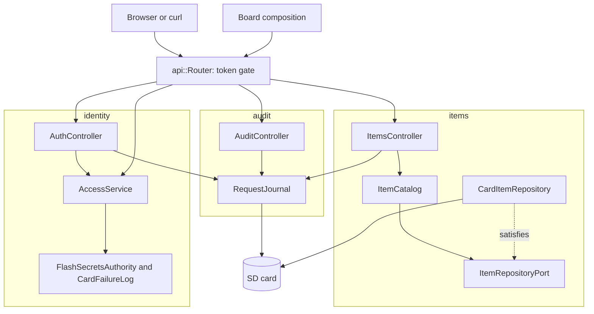

# RestApi

Ethernetシールドを載せたArduino Uno R4 Minimaで動く、Webサイト、Swagger UI、リクエストログ付きの認証REST APIです。アイテムは誰でも読めますが、変更にはベアラートークンが必要です。アイテム、ログインのロックアウト、ログはSDカードに残り、再起動後も失われません。

[English](README.md) | 日本語 | [简体中文](README.zh-Hans.md) | [繁體中文（香港）](README.zh-HK.md)

## このサンプルの内容

| 領域 | 作ったもの |
|:-----|:-----------|
| 境界づけられたコンテキスト | `items`はカタログ、`identity`はログインとトークンの確認、`audit`はリクエストログを受け持ちます。それぞれに`domain`、`application`、`adapters`があります。 |
| ドメイン | 名前と値の規則を持つ`Item`、`ItemDraft`、`ItemChange`、`Credentials`、`next_session`、`token_ends_at`、`response_ms`。Arduinoのヘッダーは含みません。 |
| ポート | `ItemRepositoryPort`は`insert`、`find`、`store`、`erase`を名指しし、各書き込みをカードが保存したかを報告します。`TokenAuthorityPort`と`FailureLogPort`はRestAuthと同じです。 |
| ユースケース | `ItemCatalog`は追加、検索、置き換え、変更、削除を行い、`AccessService`は受け付け、ログイン、認可を行い、`RequestJournal`は応答ごとにJSONを1行書きます。 |
| アダプター | `CardItemRepository`はRAMの表を持ち、各アイテムを一時ファイル経由で`/ITEMn.TXT`に書きます。ほかに`FlashSecretsAuthority`、`CardFailureLog`、`EepromSessionCounter`、3つのコントローラー。 |
| コンポジション | [`board.composition.h`](src/board.composition.h)がすべてのアダプターとサービスを1か所で組み立てます。スケッチ、テスト、ファズターゲット、ホストサーバーがどれもこれを使うので、テストは本物の配線を通ります。 |
| ネットワーク | 代替アドレス付きのDHCP、EEPROMに保存したMAC、リンク復帰時の再起動、mDNSの`madoguchi.local`。 |
| テスト | 5ファイルのホストテスト86件、ファズターゲット、ホストサーバー、カバレッジ100パーセントのページテスト9件。 |
| ルール | JPL D-60411とPower of Ten。ヒープなし、仮想関数なし、関数ポインターなし、関数あたり2.10個のアサーション。 |

## アーキテクチャ



ルーターは、生成ヘッダーの`route_needs_token`を使い、保護されたルートすべてで振り分けの前にトークンを確かめます。コントローラーはカードが拒否した書き込みとログインをジャーナルに報告します。ユースケースはログの存在を知りません。

## プロジェクト構成

```text
RestApi/
  RestApi.ino                                    ハードウェア、ネットワーク、mDNS、setupとloop
  arduino_secrets.h                              仮の秘密情報
  openapi.json                                   API契約
  src/board.composition.h                        すべてのアダプターとサービスを1回で配線
  src/http/api.generated.h                       生成
  src/http/api.router.h                          トークンの関門と振り分け
  src/items/domain/item.entity.h                 Item、ItemDraft、ItemChangeとその規則
  src/items/application/item_repository.port.h   ItemRepositoryPort、Written
  src/items/application/item_catalog.service.h   ItemCatalog
  src/items/adapters/card_item.repository.h      RAMの表と/ITEMn.TXT
  src/items/adapters/items.controller.h          アイテムの6つのルート
  src/identity/...                               RestAuthと同じ、失敗回数は/LOGIN.TXT
  src/audit/domain/response_time.policy.h        response_ms
  src/audit/application/request_journal.service.h    mado::SdLogの上のRequestJournal
  src/audit/adapters/audit.controller.h          ログの読み出しと消去
  tests/                                         ホストテスト
  SD Card/                                       サイトとSwagger UI
```

## APIエンドポイント

| メソッド | エンドポイント | 認証 | 説明 |
|:---------|:---------------|:-----|:-----|
| POST | `/api/auth/login` | なし | 認証情報で15分有効のトークン |
| GET | `/api/items` | なし | すべてのアイテム |
| POST | `/api/items` | ベアラー | `{"name":"lamp","value":3,"on":true}`から作る |
| GET | `/api/items/{id}` | なし | 1つのアイテム |
| PUT | `/api/items/{id}` | ベアラー | すべてのフィールドを置き換える |
| PATCH | `/api/items/{id}` | ベアラー | 一部のフィールドを変える |
| DELETE | `/api/items/{id}` | ベアラー | 削除する |
| GET | `/api/log` | ベアラー | NDJSONのログ。`Range: bytes=-4096`で末尾を読む |
| DELETE | `/api/log` | ベアラー | ログとローテーションしたコピーを消す |
| GET | `/api/openapi.json`、`/docs/`、その他のパス | なし | 仕様、Swagger UI、カード上のページ |

`GET /api/items/1`の応答：

```json
{"id":1,"name":"lamp","value":3,"on":true}
```

| エラーの条件 | ステータス | 詳細 |
|:-------------|:----------:|:-----|
| 保護されたルートにトークンがない、または不正 | 401 | `WWW-Authenticate: Bearer realm="api"` |
| ログインに5回失敗 | 429 | 秒数の`Retry-After` |
| そのidのアイテムがない | 404 | `no item has this id` |
| `value`が-100000から100000の外 | 422 | `a number is outside its range` |
| 何も変えないPATCH | 422 | `the body changes no property` |
| 4つの枠がすべて使用中 | 507 | `every item slot is taken` |
| カードなしでログを読む、または消す | 503 | `the SD card is not available` |

## 設計上の判断

### すべての入口で同じコンポジション

`Board`はオーソリティ、失敗ログ、アクセスサービス、リポジトリ、ジャーナル、時計を持ち、`begin`でそれらを配線します。スケッチは`SdFs`と書き込まれた秘密情報で、テスト、ファズターゲット、ホストサーバーは`FakeSd`とテスト用の秘密情報でこれを実体化します。配線の誤りはボードだけでなくそのすべてで失敗します。アクセスサービスが内部を指すので、`Board`のコピーは削除しています。

### 書き込みはカードが保存したかを伝える

`insert`、`store`、`erase`は`Written{done, saved}`を返します。ボードの動作中はRAMが正なので、カードがいっぱいでも故障していてもリクエストは失敗しません。コントローラーはwarnレベルで`the SD card refused a save`を記録し、いつもどおり応答します。カードがなければ`saved`はtrueで、アイテムはRAMだけにあります。

### 保存にもワイヤー形式を使う

各アイテムのファイルには、生成された`write_item_patch`が書き`read_item_patch`が読み戻すJSONが1行入ります。形式はAPIそのものなので、どのエディターでも読め、解析できないファイルは起動時に飛ばします。

### PATCHはドメインで一度だけ定義する

`draft_of(item, change)`はクライアントが送ったフィールドを現在のアイテムにまとめ、`change_status`はまとめた下書きを、POSTとPUTが使うのと同じ`draft_status`で判定します。有効なアイテムを決める場所は1つです。

### ログはアダプターの副作用

`RequestJournal`はサーバーの応答フックとコントローラーから呼ばれ、ユースケースからは呼ばれません。ログが失敗してもリクエストは失敗せず、カタログはカードなしでテストできます。

## トレードオフ

| できること | 今はしない理由 | このままのリスク |
|:-----------|:---------------|:-----------------|
| TLS | ボードにTLSスタックがない | トークンが平文でネットワークを通る |
| 1人を超えるロール | このサンプルには所有者1人で足りる | どのトークンでも何でもできる |

## 前提

- ネットワークは平文のパスワードを送れる程度に信頼できる。
- [`arduino_secrets.h`](arduino_secrets.h)は`python3 -m tools.madogen secrets examples/RestApi --user admin`で書き込み、本物のファイルはコミットしない。

## ログインと安全な書き込み

1つのクライアントアドレスからログインに5回失敗すると、そのアドレスは`429`と`Retry-After`で15分間ロックされ、ほかのアドレスはログインを続けられます。表は4つのアドレスを持ち、4つすべてがロック中の間は新しいアドレスもロックされるので、アドレスを替えてもロックは解けません。 アドレスごとの回数は`/LOGIN.TXT`に書き込まれるので、ロックは再起動後も残ります。

項目を返す応答は、起動ごとの乱数、id、書き込みのたびに上がるリビジョンから作る強い`ETag`を送ります。それを`If-Match`で送り返すと、その後に誰かが項目を変えていた場合、書き込みは変更を上書きせずに`412 Precondition Failed`を返します。

`POST`は`Idempotency-Key: "<1から64文字>"`を受け付けます。同じキーと同じボディの再試行は、最初のリクエストが作った項目とともに`201`を返し、同じキーで異なるボディなら`422`を返します。ボードは最後の8つのキーを覚えます。`/KEYS.TXT`に保存するので、再起動後の再試行も項目を見つけます。

## テスト

```bash
cmake -S ../../tests -B build && cmake --build build --target mado_example_restapi
ctest --test-dir build -R '^RestApi\.' --output-on-failure
```

| ファイル | テスト数 | 対象 |
|:---------|---------:|:-----|
| [`items.domain.test.cpp`](tests/items.domain.test.cpp) | 8 | 値の範囲、空の名前、変更のマージ、空の変更と不正な変更 |
| [`items.repository.test.cpp`](tests/items.repository.test.cpp) | 5 | アイテムのファイル、起動時の読み込み、削除したアイテムの忘却、拒否された保存、カードなし |
| [`identity.adapters.test.cpp`](tests/identity.adapters.test.cpp) | 9 | セッション、ログイン、カード上の失敗回数、再起動をまたぐロックアウト、トークンの確認 |
| [`audit.journal.test.cpp`](tests/audit.journal.test.cpp) | 5 | 桁あふれをまたぐ応答時間、応答ごとに1行、消去、カードなし |
| [`api.http.test.cpp`](tests/api.http.test.cpp) | 59 | ページとgzip、すべてのルート、トークンの関門、ロックアウト、ログ、再起動 |

ファズターゲット[`rest_fuzz.cpp`](../../tests/fuzz/rest_fuzz.cpp)とホストサーバー[`main.cpp`](../../tests/host_server/main.cpp)は同じ`Board`を動かします。`cd "SD Card" && pnpm run test`はカバレッジ100パーセントで9件のページテストを実行します。

## 前提条件

| ツール | バージョン | 用途 |
|:-------|:-----------|:-----|
| Arduino Uno R4 Minima | | ボード |
| microSDスロット付きのW5100、W5500、ENC28J60シールド | | ネットワークとカード |
| arduino-cli | 1.5.1 | スケッチのビルド |
| arduino:renesas_unoコア | 1.6.0 | ボードパッケージ |
| EthernetとSdFat | 2.0.2と2.3.0 | ネットワークとカードのライブラリ |
| Python 3 | 標準ライブラリのみ | 秘密情報の書き込み |
| Node.jsとpnpm | 24と12.15.0 | ページのビルド |

## はじめに

```bash
cd ../.. && python3 -m tools.madogen secrets examples/RestApi --user admin && cd examples/RestApi
arduino-cli lib install Ethernet@2.0.2 SdFat@2.3.0
arduino-cli compile --fqbn arduino:renesas_uno:minima --library ../.. .
arduino-cli upload --fqbn arduino:renesas_uno:minima --port /dev/cu.usbmodem1101 .
cd "SD Card" && pnpm install && pnpm run build
```

`SD Card/dist`をカードにコピーし、`http://madoguchi.local/`か代替の`http://192.168.1.177/`を開きます。

## 技術スタック

| 分類 | 技術 |
|:-----|:-----|
| ボード | Arduino Uno R4 Minima：フラッシュ262,144バイト中110,600バイト、RAM 32,768バイト中7,328バイト |
| HTTPと認証 | Madoguchi：HS256、PBKDF2-HMAC-SHA256、`LoginGuard`、`SdLog`、mDNS |
| カード | SdFat 2.3.0 |
| ネットワーク | Ethernet 2.0.2 |
| ホストテスト | googletest 1.18.0、CMake、libFuzzer |
| ページ | TypeScript 7.0.2、Vite 8.3.5、CDNから読み込むPico CSS 2.1.1とSwagger UI 5.33.2、Vitest 5.0.5 |
| 解析 | clang-tidy 23.1.3、cppcheck 2.22.0、clang-format 23.1.3、Biome 2.6.3 |
