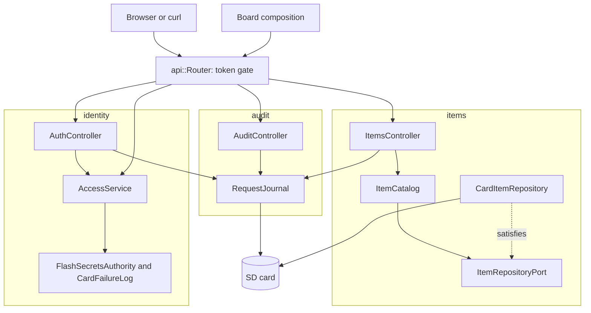

# RestApi

Authenticated REST API with a web site, Swagger UI and a request log on an Arduino Uno R4 Minima with an Ethernet shield. Anyone can read items; changing them needs a bearer token. Items, the login lockout and the log survive a restart on the SD card.

English | [日本語](README.ja.md) | [简体中文](README.zh-Hans.md) | [繁體中文（香港）](README.zh-HK.md)

## What this example covers

| Area | What is built |
|:-----|:--------------|
| Bounded contexts | `items` holds the catalog, `identity` signs people in and checks tokens, `audit` keeps the request log. Each has `domain`, `application` and `adapters`. |
| Domain | `Item`, `ItemDraft` and `ItemChange` with name and value rules; `Credentials`, `next_session` and `token_ends_at`; `response_ms`. No Arduino header. |
| Ports | `ItemRepositoryPort` names `insert`, `find`, `store` and `erase` and reports whether the card saved each write; `TokenAuthorityPort` and `FailureLogPort` as in RestAuth. |
| Use cases | `ItemCatalog` adds, finds, replaces, changes and removes; `AccessService` admits, signs in and authorizes; `RequestJournal` writes one JSON line per response. |
| Adapters | `CardItemRepository` keeps a RAM table and writes each item to `/ITEMn.TXT` through a temporary file; `FlashSecretsAuthority`, `CardFailureLog`, `EepromSessionCounter`; three controllers. |
| Composition | [`board.composition.h`](src/board.composition.h) builds every adapter and service in one place. The sketch, the tests, the fuzz target and the host server all use it, so the tests exercise the real wiring. |
| Network | DHCP with a fallback address, a MAC kept in EEPROM, a restart when the link returns, `madoguchi.local` over mDNS. |
| Tests | 74 host tests in five files, a fuzz target, a host server, and 9 page tests with 100 percent coverage. |
| Rules | JPL D-60411 and the Power of Ten: no heap, no virtual functions, no function pointers, 2.03 assertions per function. |

## Architecture



The router checks the token for every secured route before it dispatches, using `route_needs_token` from the generated header. Controllers report a write the card refused, and a login, to the journal; the use cases never know a log exists.

## Project structure

```text
RestApi/
  RestApi.ino                                    hardware, network, mDNS, setup and loop
  arduino_secrets.h                              placeholder secrets
  openapi.json                                   API contract
  src/board.composition.h                        every adapter and service, wired once
  src/http/api.generated.h                       generated
  src/http/api.router.h                          token gate and dispatch
  src/items/domain/item.entity.h                 Item, ItemDraft, ItemChange and their rules
  src/items/application/item_repository.port.h   ItemRepositoryPort, Written
  src/items/application/item_catalog.service.h   ItemCatalog
  src/items/adapters/card_item.repository.h      RAM table plus /ITEMn.TXT
  src/items/adapters/items.controller.h          six item routes
  src/identity/...                               as in RestAuth, failures kept in /LOGIN.TXT
  src/audit/domain/response_time.policy.h        response_ms
  src/audit/application/request_journal.service.h    RequestJournal on mado::SdLog
  src/audit/adapters/audit.controller.h          read and clear the log
  tests/                                         host tests
  SD Card/                                       the site and Swagger UI
```

## API endpoints

| Method | Endpoint | Auth | Description |
|:-------|:---------|:-----|:------------|
| POST | `/api/auth/login` | none | Credentials for a 15-minute token |
| GET | `/api/items` | none | Every item |
| POST | `/api/items` | bearer | Create from `{"name":"lamp","value":3,"on":true}` |
| GET | `/api/items/{id}` | none | One item |
| PUT | `/api/items/{id}` | bearer | Replace every field |
| PATCH | `/api/items/{id}` | bearer | Change some fields |
| DELETE | `/api/items/{id}` | bearer | Delete |
| GET | `/api/log` | bearer | The log as NDJSON; `Range: bytes=-4096` reads the tail |
| DELETE | `/api/log` | bearer | Delete the log and its rotated copy |
| GET | `/api/openapi.json`, `/docs/`, any other path | none | The spec, Swagger UI and pages from the card |

`GET /api/items/1` answers:

```json
{"id":1,"name":"lamp","value":3,"on":true}
```

| Error condition | Status | Detail |
|:----------------|:------:|:-------|
| No token or a bad one on a secured route | 401 | `WWW-Authenticate: Bearer realm="api"` |
| Five failed logins | 429 | `Retry-After` in seconds |
| No item has the id | 404 | `no item has this id` |
| `value` outside -100000 to 100000 | 422 | `a number is outside its range` |
| A PATCH that changes nothing | 422 | `the body changes no property` |
| All four slots are taken | 507 | `every item slot is taken` |
| The log is read or cleared without a card | 503 | `the SD card is not available` |

## Design decisions

### One composition used by every entry point

`Board` holds the authority, the failure log, the access service, the repository, the journal and the clock, and wires them in `begin`. The sketch instantiates it with `SdFs` and the provisioned secrets; the tests, the fuzz target and the host server instantiate it with `FakeSd` and test secrets. A wiring mistake fails every one of them, not only the board. Copying a `Board` is deleted, because the access service points into it.

### Writes say whether the card kept them

`insert`, `store` and `erase` return `Written{done, saved}`. RAM is the source of truth while the board runs, so a full or failing card does not fail the request; the controller logs `the SD card refused a save` at warn level and answers as usual. Without a card, `saved` is true and items live in RAM only.

### Persistence reuses the wire format

Each item file holds one JSON line written by the generated `write_item_patch` and read back by `read_item_patch`. The format is the API's own, a file is readable with any editor, and a file that fails to parse is skipped at boot.

### PATCH is defined once in the domain

`draft_of(item, change)` merges the fields a client sent into the current item, and `change_status` judges the merged draft with the same `draft_status` that POST and PUT use. There is one place that decides what a valid item is.

### The log is a side effect of the adapters

`RequestJournal` is called from the server's response hook and from controllers, never from a use case. Logging can fail without failing a request, and the catalog stays testable without a card.

## Trade-offs

| What could be done | Why it is not done | Risk as shipped |
|:-------------------|:-------------------|:----------------|
| TLS | The board has no TLS stack | Tokens cross the network in clear text |
| Idempotency keys on POST | Four slots; a retry costs one | A retried POST creates a second item |
| Roles beyond one user | One owner fits the example | Every token can do everything |

## Assumptions

- The network is trusted enough for clear-text passwords.
- [`arduino_secrets.h`](arduino_secrets.h) is provisioned with `python3 -m tools.madogen secrets examples/RestApi --user admin` and the real file is never committed.

## Testing

```bash
cmake -S ../../tests -B build && cmake --build build --target mado_example_restapi
ctest --test-dir build -R '^RestApi\.' --output-on-failure
```

| File | Tests | Covers |
|:-----|------:|:-------|
| [`items.domain.test.cpp`](tests/items.domain.test.cpp) | 6 | value limits, an empty name, merging a change, empty and invalid changes |
| [`items.repository.test.cpp`](tests/items.repository.test.cpp) | 5 | the item file, loading at boot, forgetting a removed item, a refused save, no card |
| [`identity.adapters.test.cpp`](tests/identity.adapters.test.cpp) | 7 | sessions, sign-in, failures on the card, a lockout across a restart, token checks |
| [`audit.journal.test.cpp`](tests/audit.journal.test.cpp) | 5 | response times across the wrap, one line per response, clearing, no card |
| [`api.http.test.cpp`](tests/api.http.test.cpp) | 51 | pages and gzip, every route, the token gate, the lockout, the log, restarts |

The fuzz target [`rest_fuzz.cpp`](../../tests/fuzz/rest_fuzz.cpp) and the host server [`main.cpp`](../../tests/host_server/main.cpp) run the same `Board`. `cd "SD Card" && pnpm run test` runs 9 page tests at 100 percent coverage.

## Prerequisites

| Tool | Version | Required for |
|:-----|:--------|:-------------|
| Arduino Uno R4 Minima | | the board |
| W5100, W5500 or ENC28J60 shield with a microSD slot | | network and card |
| arduino-cli | 1.5.1 | building the sketch |
| arduino:renesas_uno core | 1.6.0 | the board package |
| Ethernet and SdFat | 2.0.2 and 2.3.0 | network and card libraries |
| Python 3 | standard library only | provisioning the secrets |
| Node.js and pnpm | 24 and 12.15.0 | building the pages |

## Getting started

```bash
cd ../.. && python3 -m tools.madogen secrets examples/RestApi --user admin && cd examples/RestApi
arduino-cli lib install Ethernet@2.0.2 SdFat@2.3.0
arduino-cli compile --fqbn arduino:renesas_uno:minima --library ../.. .
arduino-cli upload --fqbn arduino:renesas_uno:minima --port /dev/cu.usbmodem1101 .
cd "SD Card" && pnpm install && pnpm run build
```

Copy `SD Card/dist` to the card and open `http://madoguchi.local/`, or the fallback `http://192.168.1.177/`.

## Tech stack

| Category | Technology |
|:---------|:-----------|
| Board | Arduino Uno R4 Minima: 107,364 of 262,144 bytes of flash, 6,648 of 32,768 bytes of RAM |
| HTTP and auth | Madoguchi: HS256, PBKDF2-HMAC-SHA256, `LoginGuard`, `SdLog`, mDNS |
| Card | SdFat 2.3.0 |
| Network | Ethernet 2.0.2 |
| Host tests | googletest 1.18.0, CMake, libFuzzer |
| Pages | TypeScript 7.0.2, Vite 8.3.5, Pico CSS 2.1.1 and Swagger UI 5.33.2 from CDNs, Vitest 5.0.5 |
| Analysis | clang-tidy 23.1.3, cppcheck 2.22.0, clang-format 23.1.3, Biome 2.6.3 |
