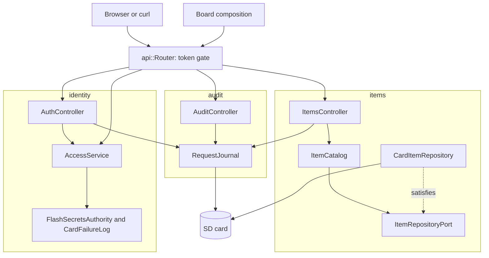

# RestApi

裝有以太網擴充板的 Arduino Uno R4 Minima 上附網站、Swagger UI 及請求日誌的認證 REST API。任何人都能讀取項目；修改項目需要持有人權杖。項目、登入鎖定狀態及日誌保存在 SD 卡上，重啟後依然存在。

[English](README.md) | [日本語](README.ja.md) | [简体中文](README.zh-Hans.md) | 繁體中文（香港）

## 本範例涵蓋的內容

| 範疇 | 實作內容 |
|:-----|:---------|
| 限界上下文 | `items` 保存目錄，`identity` 負責登入及檢查權杖，`audit` 保存請求日誌。每個都有 `domain`、`application` 及 `adapters`。 |
| 領域 | 附名稱及數值規則的 `Item`、`ItemDraft` 及 `ItemChange`；`Credentials`、`next_session` 及 `token_ends_at`；`response_ms`。不含 Arduino 標頭檔。 |
| 端口 | `ItemRepositoryPort` 列出 `insert`、`find`、`store` 及 `erase`，並報告記憶卡是否保存了每次寫入；`TokenAuthorityPort` 及 `FailureLogPort` 與 RestAuth 相同。 |
| 用例 | `ItemCatalog` 負責新增、尋找、替換、修改及刪除；`AccessService` 負責接受、登入及授權；`RequestJournal` 每個回應寫一行 JSON。 |
| 轉接器 | `CardItemRepository` 維護一張 RAM 表，並透過暫存檔把每個項目寫到 `/ITEMn.TXT`；`FlashSecretsAuthority`、`CardFailureLog`、`EepromSessionCounter`；三個控制器。 |
| 組合 | [`board.composition.h`](src/board.composition.h) 在一處建構所有轉接器及服務。草稿碼、測試、模糊測試目標及主機伺服器都使用它，所以測試走的是真實的接線。 |
| 網絡 | 附後備位址的 DHCP、保存在 EEPROM 中的 MAC、連結恢復時重啟、透過 mDNS 提供的 `madoguchi.local`。 |
| 測試 | 五個檔案中的 86 個主機測試、一個模糊測試目標、一個主機伺服器，以及覆蓋率 100% 的 9 個頁面測試。 |
| 規則 | JPL D-60411 及 Power of Ten：不用堆積、不用虛擬函式、不用函式指標，每個函式平均 2.10 個斷言。 |

## 架構



路由器在分派之前，以產生的標頭檔中的 `route_needs_token` 為每個受保護的路由檢查權杖。控制器把記憶卡拒絕的寫入及登入報告給日誌；用例從不知道日誌的存在。

## 項目結構

```text
RestApi/
  RestApi.ino                                    硬件、網絡、mDNS、setup 及 loop
  arduino_secrets.h                              佔位密鑰
  openapi.json                                   API 契約
  src/board.composition.h                        所有轉接器及服務，只接線一次
  src/http/api.generated.h                       由工具產生
  src/http/api.router.h                          權杖關卡及分派
  src/items/domain/item.entity.h                 Item、ItemDraft、ItemChange 及其規則
  src/items/application/item_repository.port.h   ItemRepositoryPort、Written
  src/items/application/item_catalog.service.h   ItemCatalog
  src/items/adapters/card_item.repository.h      RAM 表加 /ITEMn.TXT
  src/items/adapters/items.controller.h          六個項目路由
  src/identity/...                               與 RestAuth 相同，失敗次數保存在 /LOGIN.TXT
  src/audit/domain/response_time.policy.h        response_ms
  src/audit/application/request_journal.service.h    基於 mado::SdLog 的 RequestJournal
  src/audit/adapters/audit.controller.h          讀取及清除日誌
  tests/                                         主機測試
  SD Card/                                       網站及 Swagger UI
```

## API 端點

| 方法 | 端點 | 認證 | 說明 |
|:-----|:-----|:-----|:-----|
| POST | `/api/auth/login` | 無 | 以憑證換取 15 分鐘的權杖 |
| GET | `/api/items` | 無 | 所有項目 |
| POST | `/api/items` | 持有人 | 從 `{"name":"lamp","value":3,"on":true}` 建立 |
| GET | `/api/items/{id}` | 無 | 一個項目 |
| PUT | `/api/items/{id}` | 持有人 | 替換所有欄位 |
| PATCH | `/api/items/{id}` | 持有人 | 修改部分欄位 |
| DELETE | `/api/items/{id}` | 持有人 | 刪除 |
| GET | `/api/log` | 持有人 | NDJSON 格式的日誌；`Range: bytes=-4096` 讀取末端 |
| DELETE | `/api/log` | 持有人 | 刪除日誌及其輪替副本 |
| GET | `/api/openapi.json`、`/docs/`、其他路徑 | 無 | 規格、Swagger UI 及記憶卡上的頁面 |

`GET /api/items/1` 的回應：

```json
{"id":1,"name":"lamp","value":3,"on":true}
```

| 錯誤條件 | 狀態 | 詳情 |
|:---------|:----:|:-----|
| 受保護的路由上沒有權杖或權杖無效 | 401 | `WWW-Authenticate: Bearer realm="api"` |
| 登入失敗五次 | 429 | 以秒為單位的 `Retry-After` |
| 沒有該 id 的項目 | 404 | `no item has this id` |
| `value` 超出 -100000 至 100000 | 422 | `a number is outside its range` |
| 甚麼都不改的 PATCH | 422 | `the body changes no property` |
| 四個欄位都已佔用 | 507 | `every item slot is taken` |
| 沒有記憶卡時讀取或清除日誌 | 503 | `the SD card is not available` |

## 設計決定

### 每個入口使用同一個組合

`Board` 持有授權器、失敗日誌、存取服務、儲存庫、日誌及時鐘，並在 `begin` 中接線。草稿碼以 `SdFs` 及寫入的密鑰實例化它；測試、模糊測試目標及主機伺服器以 `FakeSd` 及測試密鑰實例化它。接線錯誤會令它們全部失敗，而不只是開發板。因為存取服務指向它的內部，所以禁止複製 `Board`。

### 寫入會說明記憶卡是否保存了它

`insert`、`store` 及 `erase` 回傳 `Written{done, saved}`。開發板運作時 RAM 才是事實來源，所以記憶卡滿了或故障都不會令請求失敗；控制器以 warn 級別記錄 `the SD card refused a save`，照常回應。沒有記憶卡時 `saved` 為 true，項目只存在於 RAM 中。

### 持久化沿用傳輸格式

每個項目檔案保存一行 JSON，由產生的 `write_item_patch` 寫入，由 `read_item_patch` 讀回。格式就是 API 本身的格式，任何編輯器都能讀，無法剖析的檔案在啟動時被略過。

### PATCH 只在領域中定義一次

`draft_of(item, change)` 把客戶端傳送的欄位合併到目前的項目中，`change_status` 以 POST 及 PUT 使用的同一個 `draft_status` 判定合併後的草稿。決定甚麼是有效項目的地方只有一個。

### 日誌是轉接器的副作用

`RequestJournal` 由伺服器的回應掛鈎及控制器呼叫，從不由用例呼叫。日誌可以失敗而不令請求失敗，目錄亦可以在沒有記憶卡的情況下測試。

## 取捨

| 可以做的事 | 現在不做的原因 | 照現狀發佈的風險 |
|:-----------|:---------------|:-----------------|
| TLS | 開發板沒有 TLS 協定堆疊 | 權杖以明文在網絡上傳送 |
| 多於一個用戶的角色 | 一個擁有者足以示範 | 任何權杖都能做任何事 |

## 假設

- 網絡足夠可信，可以傳送明文密碼。
- [`arduino_secrets.h`](arduino_secrets.h) 以 `python3 -m tools.madogen secrets examples/RestApi --user admin` 產生，真正的檔案從不提交。

## 登入及安全寫入

同一客戶端位址登入失敗五次，該位址會以 `429` 及 `Retry-After` 鎖定 15 分鐘，其他位址仍可登入。表中保存四個位址，四個都被鎖定時新位址亦被鎖定，所以輪換位址無法解除鎖定。 每個位址的次數寫入 `/LOGIN.TXT`，所以鎖定在重啟後依然有效。

附項目的回應會傳送強 `ETag`，由每次啟動的隨機基數、id 及每次寫入都會增加的修訂號組成。把它放在 `If-Match` 中傳回，如果之後有人改過該項目，寫入會回應 `412 Precondition Failed`，而不是覆寫對方的修改。

`POST` 支援 `Idempotency-Key: "<1 至 64 個字元>"`。相同鍵及相同請求主體的重試會回應 `201` 並傳回第一次請求建立的項目；相同鍵但請求主體不同則回應 `422`。開發板記住最近八個鍵，保存在 `/KEYS.TXT` 中，所以重啟後的重試仍能找到其項目。

## 測試

```bash
cmake -S ../../tests -B build && cmake --build build --target mado_example_restapi
ctest --test-dir build -R '^RestApi\.' --output-on-failure
```

| 檔案 | 測試數目 | 涵蓋內容 |
|:-----|------:|:---------|
| [`items.domain.test.cpp`](tests/items.domain.test.cpp) | 8 | 數值範圍、空名稱、合併修改、空修改及無效修改 |
| [`items.repository.test.cpp`](tests/items.repository.test.cpp) | 5 | 項目檔案、啟動時載入、遺忘已刪除的項目、被拒絕的保存、沒有記憶卡 |
| [`identity.adapters.test.cpp`](tests/identity.adapters.test.cpp) | 9 | 工作階段、登入、記憶卡上的失敗次數、跨重啟的鎖定、權杖檢查 |
| [`audit.journal.test.cpp`](tests/audit.journal.test.cpp) | 5 | 跨越回繞的回應時間、每個回應一行、清除、沒有記憶卡 |
| [`api.http.test.cpp`](tests/api.http.test.cpp) | 59 | 頁面及 gzip、每個路由、權杖關卡、鎖定、日誌、重啟 |

模糊測試目標 [`rest_fuzz.cpp`](../../tests/fuzz/rest_fuzz.cpp) 及主機伺服器 [`main.cpp`](../../tests/host_server/main.cpp) 運行同一個 `Board`。`cd "SD Card" && pnpm run test` 以 100% 覆蓋率執行 9 個頁面測試。

## 先決條件

| 工具 | 版本 | 用途 |
|:-----|:-----|:-----|
| Arduino Uno R4 Minima | | 開發板 |
| 附 microSD 插槽的 W5100、W5500 或 ENC28J60 擴充板 | | 網絡及記憶卡 |
| arduino-cli | 1.5.1 | 建置草稿碼 |
| arduino:renesas_uno 核心 | 1.6.0 | 開發板套件 |
| Ethernet 及 SdFat | 2.0.2 及 2.3.0 | 網絡及記憶卡程式庫 |
| Python 3 | 只用標準程式庫 | 產生密鑰 |
| Node.js 及 pnpm | 24 及 12.15.0 | 建置頁面 |

## 開始使用

```bash
cd ../.. && python3 -m tools.madogen secrets examples/RestApi --user admin && cd examples/RestApi
arduino-cli lib install Ethernet@2.0.2 SdFat@2.3.0
arduino-cli compile --fqbn arduino:renesas_uno:minima --library ../.. .
arduino-cli upload --fqbn arduino:renesas_uno:minima --port /dev/cu.usbmodem1101 .
cd "SD Card" && pnpm install && pnpm run build
```

把 `SD Card/dist` 複製到記憶卡上，打開 `http://madoguchi.local/` 或後備的 `http://192.168.1.177/`。

## 技術棧

| 類別 | 技術 |
|:-----|:-----|
| 開發板 | Arduino Uno R4 Minima：快閃記憶體 262,144 位元組中用 110,600 位元組，RAM 32,768 位元組中用 7,328 位元組 |
| HTTP 及認證 | Madoguchi：HS256、PBKDF2-HMAC-SHA256、`LoginGuard`、`SdLog`、mDNS |
| 記憶卡 | SdFat 2.3.0 |
| 網絡 | Ethernet 2.0.2 |
| 主機測試 | googletest 1.18.0、CMake、libFuzzer |
| 頁面 | TypeScript 7.0.2、Vite 8.3.5、從 CDN 載入的 Pico CSS 2.1.1 及 Swagger UI 5.33.2、Vitest 5.0.5 |
| 分析 | clang-tidy 23.1.3、cppcheck 2.22.0、clang-format 23.1.3、Biome 2.6.3 |
