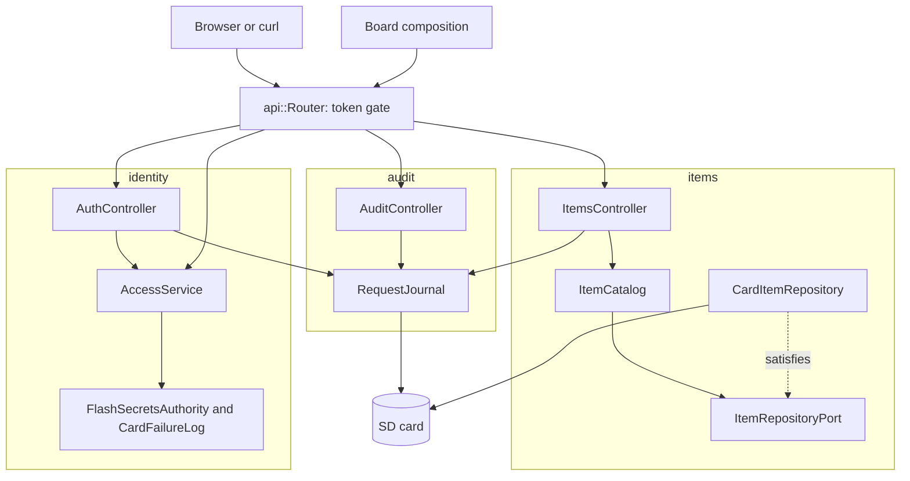

# RestApi

装有以太网扩展板的 Arduino Uno R4 Minima 上带网站、Swagger UI 和请求日志的认证 REST API。任何人都能读取条目；修改条目需要持有者令牌。条目、登录锁定状态和日志保存在 SD 卡上，重启后依然存在。

[English](README.md) | [日本語](README.ja.md) | 简体中文 | [繁體中文（香港）](README.zh-HK.md)

## 本示例涵盖的内容

| 方面 | 实现内容 |
|:-----|:---------|
| 限界上下文 | `items` 保存目录，`identity` 负责登录和检查令牌，`audit` 保存请求日志。每个都有 `domain`、`application` 和 `adapters`。 |
| 领域 | 带名称和数值规则的 `Item`、`ItemDraft` 和 `ItemChange`；`Credentials`、`next_session` 和 `token_ends_at`；`response_ms`。不含 Arduino 头文件。 |
| 端口 | `ItemRepositoryPort` 列出 `insert`、`find`、`store` 和 `erase`，并报告卡是否保存了每次写入；`TokenAuthorityPort` 和 `FailureLogPort` 与 RestAuth 相同。 |
| 用例 | `ItemCatalog` 负责添加、查找、替换、修改和删除；`AccessService` 负责接受、登录和授权；`RequestJournal` 每个应答写一行 JSON。 |
| 适配器 | `CardItemRepository` 维护一张 RAM 表，并通过临时文件把每个条目写到 `/ITEMn.TXT`；`FlashSecretsAuthority`、`CardFailureLog`、`EepromSessionCounter`；三个控制器。 |
| 组合 | [`board.composition.h`](src/board.composition.h) 在一处构建所有适配器和服务。程序、测试、模糊测试目标和主机服务器都使用它，所以测试走的是真实的连线。 |
| 网络 | 带备用地址的 DHCP、保存在 EEPROM 中的 MAC、链路恢复时重启、通过 mDNS 提供的 `madoguchi.local`。 |
| 测试 | 五个文件中的 86 个主机测试、一个模糊测试目标、一个主机服务器，以及覆盖率 100% 的 9 个页面测试。 |
| 规则 | JPL D-60411 与 Power of Ten：不用堆、不用虚函数、不用函数指针，每个函数平均 2.10 个断言。 |

## 架构



路由器在分发之前，用生成头文件中的 `route_needs_token` 为每个受保护的路由检查令牌。控制器把卡拒绝的写入和登录报告给日志；用例从不知道日志的存在。

## 项目结构

```text
RestApi/
  RestApi.ino                                    硬件、网络、mDNS、setup 和 loop
  arduino_secrets.h                              占位密钥
  openapi.json                                   API 契约
  src/board.composition.h                        所有适配器和服务，只连线一次
  src/http/api.generated.h                       由工具生成
  src/http/api.router.h                          令牌关卡和分发
  src/items/domain/item.entity.h                 Item、ItemDraft、ItemChange 及其规则
  src/items/application/item_repository.port.h   ItemRepositoryPort、Written
  src/items/application/item_catalog.service.h   ItemCatalog
  src/items/adapters/card_item.repository.h      RAM 表加 /ITEMn.TXT
  src/items/adapters/items.controller.h          六个条目路由
  src/identity/...                               与 RestAuth 相同，失败次数保存在 /LOGIN.TXT
  src/audit/domain/response_time.policy.h        response_ms
  src/audit/application/request_journal.service.h    基于 mado::SdLog 的 RequestJournal
  src/audit/adapters/audit.controller.h          读取和清除日志
  tests/                                         主机测试
  SD Card/                                       网站和 Swagger UI
```

## API 端点

| 方法 | 端点 | 认证 | 说明 |
|:-----|:-----|:-----|:-----|
| POST | `/api/auth/login` | 无 | 用凭据换取 15 分钟的令牌 |
| GET | `/api/items` | 无 | 所有条目 |
| POST | `/api/items` | 持有者 | 从 `{"name":"lamp","value":3,"on":true}` 创建 |
| GET | `/api/items/{id}` | 无 | 一个条目 |
| PUT | `/api/items/{id}` | 持有者 | 替换所有字段 |
| PATCH | `/api/items/{id}` | 持有者 | 修改部分字段 |
| DELETE | `/api/items/{id}` | 持有者 | 删除 |
| GET | `/api/log` | 持有者 | NDJSON 格式的日志；`Range: bytes=-4096` 读取末尾 |
| DELETE | `/api/log` | 持有者 | 删除日志及其轮转副本 |
| GET | `/api/openapi.json`、`/docs/`、其他路径 | 无 | 规范、Swagger UI 和卡上的页面 |

`GET /api/items/1` 的应答：

```json
{"id":1,"name":"lamp","value":3,"on":true}
```

| 错误条件 | 状态 | 详情 |
|:---------|:----:|:-----|
| 受保护的路由上没有令牌或令牌无效 | 401 | `WWW-Authenticate: Bearer realm="api"` |
| 登录失败五次 | 429 | 以秒为单位的 `Retry-After` |
| 没有该 id 的条目 | 404 | `no item has this id` |
| `value` 超出 -100000 到 100000 | 422 | `a number is outside its range` |
| 什么都不改的 PATCH | 422 | `the body changes no property` |
| 四个槽位都已占用 | 507 | `every item slot is taken` |
| 没有卡时读取或清除日志 | 503 | `the SD card is not available` |

## 设计决策

### 每个入口使用同一个组合

`Board` 持有授权器、失败日志、访问服务、仓库、日志和时钟，并在 `begin` 中连线。程序用 `SdFs` 和写入的密钥实例化它；测试、模糊测试目标和主机服务器用 `FakeSd` 和测试密钥实例化它。连线错误会让它们全部失败，而不只是开发板。因为访问服务指向它的内部，所以禁止复制 `Board`。

### 写入会说明卡是否保存了它

`insert`、`store` 和 `erase` 返回 `Written{done, saved}`。开发板运行时 RAM 才是事实来源，所以卡满或故障都不会让请求失败；控制器以 warn 级别记录 `the SD card refused a save`，照常应答。没有卡时 `saved` 为 true，条目只存在于 RAM 中。

### 持久化复用传输格式

每个条目文件保存一行 JSON，由生成的 `write_item_patch` 写入，由 `read_item_patch` 读回。格式就是 API 自己的格式，任何编辑器都能读，无法解析的文件在启动时被跳过。

### PATCH 只在领域中定义一次

`draft_of(item, change)` 把客户端发送的字段合并到当前条目中，`change_status` 用 POST 和 PUT 使用的同一个 `draft_status` 判定合并后的草稿。决定什么是有效条目的地方只有一个。

### 日志是适配器的副作用

`RequestJournal` 由服务器的应答钩子和控制器调用，从不由用例调用。日志可以失败而不让请求失败，目录也可以在没有卡的情况下测试。

## 权衡

| 可以做的事 | 现在不做的原因 | 照现状发布的风险 |
|:-----------|:---------------|:-----------------|
| TLS | 开发板没有 TLS 协议栈 | 令牌以明文在网络上传输 |
| 多于一个用户的角色 | 一个所有者足以演示 | 任何令牌都能做任何事 |

## 假设

- 网络足够可信，可以传输明文密码。
- [`arduino_secrets.h`](arduino_secrets.h) 用 `python3 -m tools.madogen secrets examples/RestApi --user admin` 生成，真正的文件从不提交。

## 登录与安全写入

同一客户端地址登录失败五次，该地址会以 `429` 和 `Retry-After` 锁定 15 分钟，其他地址仍可登录。表中保存四个地址，四个都被锁定时新地址也被锁定，所以轮换地址无法解除锁定。 每个地址的次数写入 `/LOGIN.TXT`，所以锁定在重启后依然有效。

带条目的应答会发送强 `ETag`，由每次启动的随机基数、id 和每次写入都会增加的修订号组成。把它放在 `If-Match` 中发回，如果之后有人改过该条目，写入会应答 `412 Precondition Failed`，而不是覆盖对方的修改。

`POST` 支持 `Idempotency-Key: "<1 到 64 个字符>"`。相同键和相同请求体的重试会应答 `201` 并返回第一次请求创建的条目；相同键但请求体不同则应答 `422`。开发板记住最近八个键，保存在 `/KEYS.TXT` 中，所以重启后的重试仍能找到其条目。

## 测试

```bash
cmake -S ../../tests -B build && cmake --build build --target mado_example_restapi
ctest --test-dir build -R '^RestApi\.' --output-on-failure
```

| 文件 | 测试数 | 覆盖内容 |
|:-----|------:|:---------|
| [`items.domain.test.cpp`](tests/items.domain.test.cpp) | 8 | 数值范围、空名称、合并修改、空修改和无效修改 |
| [`items.repository.test.cpp`](tests/items.repository.test.cpp) | 5 | 条目文件、启动时加载、遗忘已删除的条目、被拒绝的保存、没有卡 |
| [`identity.adapters.test.cpp`](tests/identity.adapters.test.cpp) | 9 | 会话、登录、卡上的失败次数、跨重启的锁定、令牌检查 |
| [`audit.journal.test.cpp`](tests/audit.journal.test.cpp) | 5 | 跨越回绕的应答时间、每个应答一行、清除、没有卡 |
| [`api.http.test.cpp`](tests/api.http.test.cpp) | 59 | 页面和 gzip、每个路由、令牌关卡、锁定、日志、重启 |

模糊测试目标 [`rest_fuzz.cpp`](../../tests/fuzz/rest_fuzz.cpp) 和主机服务器 [`main.cpp`](../../tests/host_server/main.cpp) 运行同一个 `Board`。`cd "SD Card" && pnpm run test` 以 100% 覆盖率运行 9 个页面测试。

## 前提条件

| 工具 | 版本 | 用途 |
|:-----|:-----|:-----|
| Arduino Uno R4 Minima | | 开发板 |
| 带 microSD 插槽的 W5100、W5500 或 ENC28J60 扩展板 | | 网络和卡 |
| arduino-cli | 1.5.1 | 构建程序 |
| arduino:renesas_uno 核心 | 1.6.0 | 开发板软件包 |
| Ethernet 和 SdFat | 2.0.2 和 2.3.0 | 网络和卡的库 |
| Python 3 | 只用标准库 | 生成密钥 |
| Node.js 和 pnpm | 24 和 12.15.0 | 构建页面 |

## 快速开始

```bash
cd ../.. && python3 -m tools.madogen secrets examples/RestApi --user admin && cd examples/RestApi
arduino-cli lib install Ethernet@2.0.2 SdFat@2.3.0
arduino-cli compile --fqbn arduino:renesas_uno:minima --library ../.. .
arduino-cli upload --fqbn arduino:renesas_uno:minima --port /dev/cu.usbmodem1101 .
cd "SD Card" && pnpm install && pnpm run build
```

把 `SD Card/dist` 复制到卡上，打开 `http://madoguchi.local/` 或备用的 `http://192.168.1.177/`。

## 技术栈

| 类别 | 技术 |
|:-----|:-----|
| 开发板 | Arduino Uno R4 Minima：闪存 262,144 字节中用 110,600 字节，RAM 32,768 字节中用 7,328 字节 |
| HTTP 和认证 | Madoguchi：HS256、PBKDF2-HMAC-SHA256、`LoginGuard`、`SdLog`、mDNS |
| 卡 | SdFat 2.3.0 |
| 网络 | Ethernet 2.0.2 |
| 主机测试 | googletest 1.18.0、CMake、libFuzzer |
| 页面 | TypeScript 7.0.2、Vite 8.3.5、从 CDN 加载的 Pico CSS 2.1.1 和 Swagger UI 5.33.2、Vitest 5.0.5 |
| 分析 | clang-tidy 23.1.3、cppcheck 2.22.0、clang-format 23.1.3、Biome 2.6.3 |
