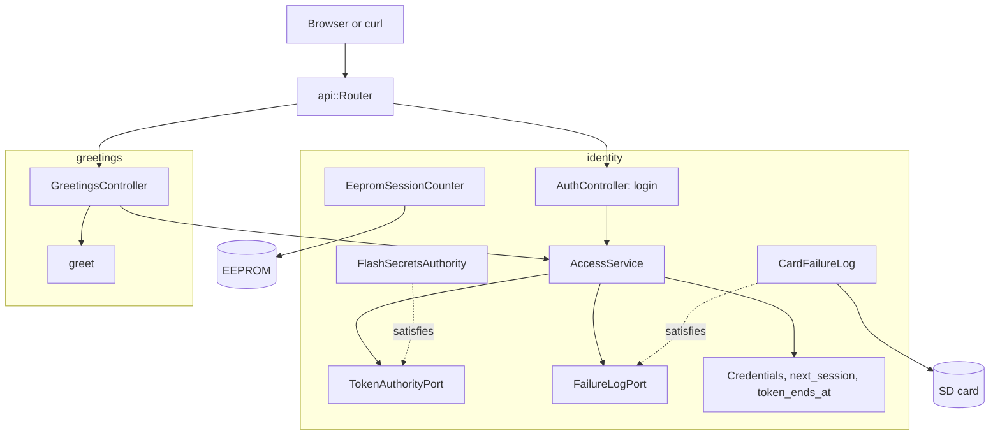

# RestAuth

Ethernetシールドを載せたArduino Uno R4 Minimaでの、ログインと保護されたルート1つの例です。`POST /api/auth/login`はPBKDF2のパスワードハッシュを確かめてHS256のベアラートークンを返し、`GET /api/greeting`は今回の起動で発行された有効なトークンにだけ応答します。

[English](README.md) | 日本語 | [简体中文](README.zh-Hans.md) | [繁體中文（香港）](README.zh-HK.md)

## このサンプルの内容

| 領域 | 作ったもの |
|:-----|:-----------|
| 境界づけられたコンテキスト | `identity`はサインインとトークンの検査を、`greetings`は保護されたリソースを担います。それぞれが自分の`domain`と`adapters`を持ちます。 |
| ドメイン | `Credentials`と`credentials_status`、`next_session`と`token_ends_at`、`Greeting`と`greet`。Arduinoのヘッダーはありません。 |
| ポート | `TokenAuthorityPort`は`provisioned`、`matches`、`sign`、`verify`を、`FailureLogPort`は`load`と`save`を名指しします。 |
| ユースケース | `AccessService`はログインを受け入れるか拒否し、失敗を記録し、5回でロックし、トークンに署名し、ベアラーヘッダーを認可します。 |
| アダプター | `FlashSecretsAuthority`は鍵、ソルト、ハッシュをフラッシュから読み、`CardFailureLog`は失敗回数をカードに保持し、`EepromSessionCounter`は起動回数を数え、2つのコントローラーがHTTPを扱います。 |
| コンポジションルート | [`RestAuth.ino`](RestAuth.ino)がカードをマウントし、アダプターとサービスを作り、EEPROMから新しいセッションを始めます。 |
| セキュリティ | 定数時間の比較、5回の失敗で15分のロックアウト（再起動後も残る）、次の起動で終わるトークン。 |
| テスト | 3ファイルのホストテスト26件と、カバレッジ100パーセントのページテスト6件。 |
| ルール | JPL D-60411とPower of Ten。ヒープなし、仮想関数なし、関数ポインターなし、関数あたり2.02個のアサーション。 |

## アーキテクチャ



greetingsのコントローラーはidentityのサービスにテンプレート引数を通してだけ依存するので、保護されたリソースがパスワード、鍵、ロックアウトを見ることはありません。

## プロジェクト構成

```text
RestAuth/
  RestAuth.ino                                   コンポジションルート
  arduino_secrets.h                              仮の秘密情報。本物はtools/madogen secretsが書く
  openapi.json                                   API契約
  src/http/api.generated.h                       生成
  src/http/api.router.h                          ログイン、挨拶、カードのページ
  src/identity/domain/credentials.value.h        Credentials、credentials_status
  src/identity/domain/session.value.h            next_session、token_ends_at
  src/identity/application/token_authority.port.h    TokenAuthorityPort、FailureLogPort
  src/identity/application/access.service.h      AccessService
  src/identity/adapters/flash_secrets.authority.h    フラッシュの秘密情報によるPBKDF2とHS256
  src/identity/adapters/card_failure.log.h       /LOGIN.TXTの失敗回数
  src/identity/adapters/eeprom_session.counter.h 起動ごとに1つのセッション
  src/identity/adapters/auth.controller.h        HTTPでのログイン
  src/greetings/domain/greeting.value.h          挨拶の文
  src/greetings/adapters/greetings.controller.h  保護されたルート
  tests/                                         ホストテスト
  SD Card/                                       ページ
```

## APIエンドポイント

| メソッド | エンドポイント | 認証 | 説明 |
|:---------|:---------------|:-----|:-----|
| POST | `/api/auth/login` | なし | `{"username":"admin","password":"..."}`でトークンを返す |
| GET | `/api/greeting` | ベアラー | `{"message":"Hello, admin"}` |
| GET | その他のパス | なし | カード上のページ |

ログインの応答：

```json
{"access_token":"eyJhbGciOiJIUzI1NiIsInR5cCI6IkpXVCJ9...","token_type":"Bearer","expires_in":900}
```

| エラーの条件 | ステータス | 詳細 |
|:-------------|:----------:|:-----|
| ユーザー名またはパスワードが違う | 401 | `WWW-Authenticate: Bearer realm="api"` |
| 5回続けて失敗した | 429 | 秒単位の`Retry-After` |
| 秘密情報がまだ全ゼロの仮のもの | 503 | `the token key is not provisioned` |
| トークンがない、署名が違う、前回の起動のもの、15分を過ぎた | 401 | トークンを送った場合は`error="invalid_token"` |
| ボディのエラー | 400、413、415、422 | 生成されたリーダーのproblem詳細 |

## 設計上の判断

### 小さなスケッチに2つのコンテキスト

サインインと挨拶は別の理由で変わります。新しいハッシュやロックアウトの方針は`identity`だけに、新しいリソースは`greetings`だけに触れます。分割のコストは小さなフォルダー2つで、保護されたリソースを資格情報から切り離せます。

### パスワードとトークンを1つのアダプターで

`FlashSecretsAuthority`はPBKDF2-HMAC-SHA256でパスワードを確かめ、HS256でトークンに署名し検証します。どちらも同じフラッシュの秘密情報を読むので、1つのアダプターがそれを持ち、ポートはその4つの呼び出しを名指しします。状態を持たないので、関数はすべてstaticです。

### ボディの前に受け入れを判断する

`AccessService::admit`はコントローラーがボディを読む前に動きます。ロック中のクライアントや鍵のないボードは、ボードが256バイトを解析する前に`429`または`503`を受け取ります。以前のスケッチと同じ動きです。

### ロックアウトは再起動を越えて残る

`CardFailureLog`は失敗回数を一時ファイルと名前の付け替えを通して書き、`AccessService::begin`がそれを復元します。電源を抜いても回数は戻りません。カードがなければ回数はRAMにだけあります。

### セッションが再起動でトークンを終わらせる

`EepromSessionCounter`は4バイトを読み、`next_session`を当てはめ、変わらないセルを飛ばす`update`で書き戻します。トークンはセッション番号を持つので、再起動前のトークンはすべて`kStaleSession`で失敗します。

## トレードオフ

| できること | 今はしない理由 | このままのリスク |
|:-----------|:---------------|:-----------------|
| TLS | ボードにTLSのスタックがない | 資格情報とトークンが平文でネットワークを渡る |
| 複数のユーザー | このサンプルには1人で足りる | 全員が1つのアカウントを共有する |
| クライアントのアドレスごとのロックアウト | カウンター1つの方が単純 | 攻撃者1人で持ち主を15分締め出せる |

## 前提

- ネットワークは平文のパスワードを流せる程度に信頼できる。
- [`arduino_secrets.h`](arduino_secrets.h)は`python3 -m tools.madogen secrets examples/RestAuth --user admin`で用意し、本物のファイルは決してコミットしない。

## テスト

```bash
cmake -S ../../tests -B build && cmake --build build --target mado_example_restauth
ctest --test-dir build -R '^RestAuth\.' --output-on-failure
```

| ファイル | テスト数 | 対象 |
|:---------|---------:|:-----|
| [`identity.domain.test.cpp`](tests/identity.domain.test.cpp) | 12 | 資格情報のルール、セッションカウンターの5ケース、トークンの終了時刻、挨拶 |
| [`identity.adapters.test.cpp`](tests/identity.adapters.test.cpp) | 7 | EEPROMカウンター、サインイン、カード上の失敗回数、再起動をまたぐロックアウト、トークンの検査 |
| [`auth.api.test.cpp`](tests/auth.api.test.cpp) | 7 | ログイン、違うパスワード、ロックアウト、挨拶、トークンなし、改ざん、期限切れ |

`cd "SD Card" && pnpm run test`はカバレッジ100パーセントで6件のページテストを実行します。ページはトークンをメモリーにだけ保持します。

## 前提条件

| ツール | バージョン | 用途 |
|:-------|:-----------|:-----|
| Arduino Uno R4 Minima | | ボード |
| microSDスロット付きのW5100、W5500、ENC28J60シールド | | ネットワークとカード |
| arduino-cli | 1.5.1 | スケッチのビルド |
| arduino:renesas_unoコア | 1.6.0 | ボードパッケージ |
| EthernetとSdFat | 2.0.2と2.3.0 | ネットワークとカードのライブラリ |
| Python 3 | 標準ライブラリのみ | 秘密情報の用意 |
| Node.jsとpnpm | 24と12.15.0 | ページのビルド |

## はじめに

```bash
cd ../.. && python3 -m tools.madogen secrets examples/RestAuth --user admin && cd examples/RestAuth
arduino-cli lib install Ethernet@2.0.2 SdFat@2.3.0
arduino-cli compile --fqbn arduino:renesas_uno:minima --library ../.. .
arduino-cli upload --fqbn arduino:renesas_uno:minima --port /dev/cu.usbmodem1101 .
cd "SD Card" && pnpm install && pnpm run build
```

```bash
TOKEN=$(curl -s -H 'Content-Type: application/json' -d '{"username":"admin","password":"your password"}' http://192.168.1.177/api/auth/login | python3 -c 'import json,sys; print(json.load(sys.stdin)["access_token"])')
curl -H "Authorization: Bearer $TOKEN" http://192.168.1.177/api/greeting
```

## 技術スタック

| 分類 | 技術 |
|:-----|:-----|
| ボード | Arduino Uno R4 Minima：フラッシュ262,144バイト中87,496バイト、RAM 32,768バイト中6,184バイト |
| HTTPと認証 | Madoguchi：HS256、PBKDF2-HMAC-SHA256、`LoginGuard` |
| カード | SdFat 2.3.0 |
| ネットワーク | Ethernet 2.0.2 |
| ホストテスト | googletest 1.18.0、CMake |
| ページ | TypeScript 7.0.2、Vite 8.3.5、CDNから読み込むPico CSS 2.1.1、Vitest 5.0.5 |
| 解析 | clang-tidy 23.1.3、cppcheck 2.22.0、clang-format 23.1.3、Biome 2.6.3 |
