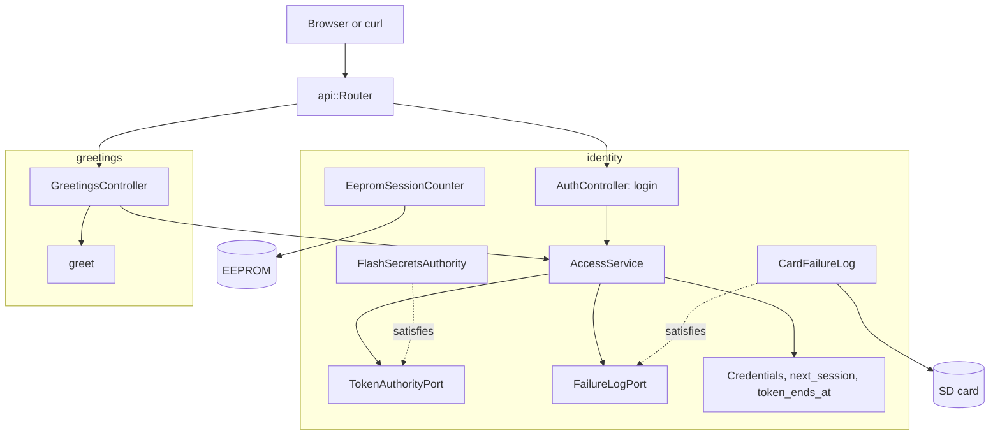

# RestAuth

Login and one protected route on an Arduino Uno R4 Minima with an Ethernet shield. `POST /api/auth/login` checks a PBKDF2 password hash and returns an HS256 bearer token; `GET /api/greeting` answers only to a valid token from the current boot.

English | [日本語](README.ja.md) | [简体中文](README.zh-Hans.md) | [繁體中文（香港）](README.zh-HK.md)

## What this example covers

| Area | What is built |
|:-----|:--------------|
| Bounded contexts | `identity` signs people in and checks tokens; `greetings` is the protected resource. Each has its own `domain` and `adapters`. |
| Domain | `Credentials` and `credentials_status`, `next_session` and `token_ends_at`, `Greeting` and `greet`. No Arduino header. |
| Ports | `TokenAuthorityPort` names `provisioned`, `matches`, `sign` and `verify`; `FailureLogPort` names `load` and `save`. |
| Use case | `AccessService` admits or refuses a login, records failures, locks after five, signs a token and authorizes a bearer header. |
| Adapters | `FlashSecretsAuthority` reads the key, salt and hash from flash; `CardFailureLog` keeps the failure count on the card; `EepromSessionCounter` counts boots; two controllers serve HTTP. |
| Composition root | [`RestAuth.ino`](RestAuth.ino) mounts the card, builds the adapters and the service, and starts a new session from EEPROM. |
| Security | Constant-time comparisons, a 15-minute lockout after five failures that survives a restart, tokens that end at the next boot. |
| Tests | 26 host tests in three files and 6 page tests with 100 percent coverage. |
| Rules | JPL D-60411 and the Power of Ten: no heap, no virtual functions, no function pointers, 2.02 assertions per function. |

## Architecture



The greetings controller depends on the identity service only through its template parameter, so the protected resource never sees a password, a key or the lockout.

## Project structure

```text
RestAuth/
  RestAuth.ino                                   composition root
  arduino_secrets.h                              placeholder secrets; tools/madogen secrets writes the real ones
  openapi.json                                   API contract
  src/http/api.generated.h                       generated
  src/http/api.router.h                          login, greeting, card pages
  src/identity/domain/credentials.value.h        Credentials, credentials_status
  src/identity/domain/session.value.h            next_session, token_ends_at
  src/identity/application/token_authority.port.h    TokenAuthorityPort, FailureLogPort
  src/identity/application/access.service.h      AccessService
  src/identity/adapters/flash_secrets.authority.h    PBKDF2 and HS256 with flash secrets
  src/identity/adapters/card_failure.log.h       failure count in /LOGIN.TXT
  src/identity/adapters/eeprom_session.counter.h one session per boot
  src/identity/adapters/auth.controller.h        login over HTTP
  src/greetings/domain/greeting.value.h          the greeting text
  src/greetings/adapters/greetings.controller.h  the protected route
  tests/                                         host tests
  SD Card/                                       the pages
```

## API endpoints

| Method | Endpoint | Auth | Description |
|:-------|:---------|:-----|:------------|
| POST | `/api/auth/login` | none | `{"username":"admin","password":"..."}` returns a token |
| GET | `/api/greeting` | bearer | `{"message":"Hello, admin"}` |
| GET | any other path | none | A page from the card |

A login answers:

```json
{"access_token":"eyJhbGciOiJIUzI1NiIsInR5cCI6IkpXVCJ9...","token_type":"Bearer","expires_in":900}
```

| Error condition | Status | Detail |
|:----------------|:------:|:-------|
| Wrong user or password | 401 | `WWW-Authenticate: Bearer realm="api"` |
| Five failures in a row | 429 | `Retry-After` in seconds |
| The secrets are still the all-zero placeholder | 503 | `the token key is not provisioned` |
| No token, a bad signature, a token from an earlier boot or past 15 minutes | 401 | `error="invalid_token"` when a token was sent |
| Body errors | 400, 413, 415, 422 | the generated reader's problem details |

## Design decisions

### Two contexts for one small sketch

Signing in and greeting change for different reasons: a new hash or lockout policy touches only `identity`, a new resource touches only `greetings`. The split costs two small folders and keeps the protected resource free of credentials.

### One authority adapter for passwords and tokens

`FlashSecretsAuthority` checks passwords with PBKDF2-HMAC-SHA256 and signs and verifies HS256 tokens. Both read the same flash secrets, so one adapter owns them and the port names its four calls. Every function in it is static, because it holds no state.

### Admission before the body

`AccessService::admit` runs before the controller reads the body. A locked client or a board without a key gets `429` or `503` without the board parsing 256 bytes, which matches what the earlier sketch did.

### The lockout survives a restart

`CardFailureLog` writes the failure count through a temporary file and a rename, and `AccessService::begin` restores it. Pulling the power does not reset the count. Without a card the count lives only in RAM.

### Sessions end tokens at a reboot

`EepromSessionCounter` reads four bytes, applies `next_session` and writes them back with `update`, which skips cells that did not change. A token carries the session number, so every token from before the reboot fails with `kStaleSession`.

## Trade-offs

| What could be done | Why it is not done | Risk as shipped |
|:-------------------|:-------------------|:----------------|
| TLS | The board has no TLS stack | Credentials and tokens cross the network in clear text |
| More than one user | One user fits the example | Everyone shares one account |
| A lockout per client address | A single counter is simpler | One attacker can lock out the owner for 15 minutes |

## Assumptions

- The network is trusted enough for clear-text passwords.
- [`arduino_secrets.h`](arduino_secrets.h) is provisioned with `python3 -m tools.madogen secrets examples/RestAuth --user admin` and the real file is never committed.

## Testing

```bash
cmake -S ../../tests -B build && cmake --build build --target mado_example_restauth
ctest --test-dir build -R '^RestAuth\.' --output-on-failure
```

| File | Tests | Covers |
|:-----|------:|:-------|
| [`identity.domain.test.cpp`](tests/identity.domain.test.cpp) | 12 | credential rules, five session counter cases, token end times, the greeting |
| [`identity.adapters.test.cpp`](tests/identity.adapters.test.cpp) | 7 | the EEPROM counter, sign-in, failures on the card, a lockout across a restart, token checks |
| [`auth.api.test.cpp`](tests/auth.api.test.cpp) | 7 | login, a wrong password, the lockout, the greeting, missing, tampered and expired tokens |

`cd "SD Card" && pnpm run test` runs 6 page tests at 100 percent coverage. The page keeps the token in memory only.

## Prerequisites

| Tool | Version | Required for |
|:-----|:--------|:-------------|
| Arduino Uno R4 Minima | | the board |
| W5100, W5500 or ENC28J60 shield with a microSD slot | | network and card |
| arduino-cli | 1.5.1 | building the sketch |
| arduino:renesas_uno core | 1.6.0 | the board package |
| Ethernet and SdFat | 2.0.2 and 2.3.0 | network and card libraries |
| Python 3 | standard library only | provisioning the secrets |
| Node.js and pnpm | 24 and 12.15.0 | building the pages |

## Getting started

```bash
cd ../.. && python3 -m tools.madogen secrets examples/RestAuth --user admin && cd examples/RestAuth
arduino-cli lib install Ethernet@2.0.2 SdFat@2.3.0
arduino-cli compile --fqbn arduino:renesas_uno:minima --library ../.. .
arduino-cli upload --fqbn arduino:renesas_uno:minima --port /dev/cu.usbmodem1101 .
cd "SD Card" && pnpm install && pnpm run build
```

```bash
TOKEN=$(curl -s -H 'Content-Type: application/json' -d '{"username":"admin","password":"your password"}' http://192.168.1.177/api/auth/login | python3 -c 'import json,sys; print(json.load(sys.stdin)["access_token"])')
curl -H "Authorization: Bearer $TOKEN" http://192.168.1.177/api/greeting
```

## Tech stack

| Category | Technology |
|:---------|:-----------|
| Board | Arduino Uno R4 Minima: 87,496 of 262,144 bytes of flash, 6,184 of 32,768 bytes of RAM |
| HTTP and auth | Madoguchi: HS256, PBKDF2-HMAC-SHA256, `LoginGuard` |
| Card | SdFat 2.3.0 |
| Network | Ethernet 2.0.2 |
| Host tests | googletest 1.18.0, CMake |
| Pages | TypeScript 7.0.2, Vite 8.3.5, Pico CSS 2.1.1 from a CDN, Vitest 5.0.5 |
| Analysis | clang-tidy 23.1.3, cppcheck 2.22.0, clang-format 23.1.3, Biome 2.6.3 |
