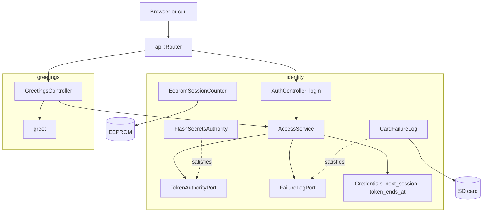

# RestAuth

在裝有以太網擴充板的 Arduino Uno R4 Minima 上示範登入及一個受保護的路由。`POST /api/auth/login` 驗證 PBKDF2 密碼雜湊並回傳 HS256 持有人權杖；`GET /api/greeting` 只回應本次啟動簽發的有效權杖。

[English](README.md) | [日本語](README.ja.md) | [简体中文](README.zh-Hans.md) | 繁體中文（香港）

## 本範例涵蓋的內容

| 範疇 | 實作內容 |
|:-----|:---------|
| 限界上下文 | `identity` 負責登入及檢查權杖；`greetings` 是受保護的資源。兩者各有自己的 `domain` 及 `adapters`。 |
| 領域 | `Credentials` 及 `credentials_status`、`next_session` 及 `token_ends_at`、`Greeting` 及 `greet`。不含 Arduino 標頭檔。 |
| 端口 | `TokenAuthorityPort` 列出 `provisioned`、`matches`、`sign` 及 `verify`；`FailureLogPort` 列出 `load` 及 `save`。 |
| 用例 | `AccessService` 接受或拒絕登入、記錄失敗、五次後鎖定、簽發權杖並授權持有人標頭。 |
| 轉接器 | `FlashSecretsAuthority` 從快閃記憶體讀取密鑰、鹽及雜湊；`CardFailureLog` 把失敗次數保存在記憶卡上；`EepromSessionCounter` 記錄啟動次數；兩個控制器負責 HTTP。 |
| 組合根 | [`RestAuth.ino`](RestAuth.ino) 掛載記憶卡、建立轉接器及服務，並從 EEPROM 開始一個新工作階段。 |
| 安全 | 常數時間比較；連續五次失敗後鎖定 15 分鐘，重啟後依然有效；權杖在下次啟動時失效。 |
| 測試 | 三個檔案中的 26 個主機測試，以及覆蓋率 100% 的 6 個頁面測試。 |
| 規則 | JPL D-60411 及 Power of Ten：不用堆積、不用虛擬函式、不用函式指標，每個函式平均 2.02 個斷言。 |

## 架構



greetings 的控制器只透過範本參數依賴 identity 的服務，所以受保護的資源從不接觸密碼、密鑰或鎖定狀態。

## 項目結構

```text
RestAuth/
  RestAuth.ino                                   組合根
  arduino_secrets.h                              佔位密鑰；真正的由 tools/madogen secrets 寫入
  openapi.json                                   API 契約
  src/http/api.generated.h                       由工具產生
  src/http/api.router.h                          登入、問候、記憶卡上的頁面
  src/identity/domain/credentials.value.h        Credentials、credentials_status
  src/identity/domain/session.value.h            next_session、token_ends_at
  src/identity/application/token_authority.port.h    TokenAuthorityPort、FailureLogPort
  src/identity/application/access.service.h      AccessService
  src/identity/adapters/flash_secrets.authority.h    使用快閃記憶體密鑰的 PBKDF2 及 HS256
  src/identity/adapters/card_failure.log.h       /LOGIN.TXT 中的失敗次數
  src/identity/adapters/eeprom_session.counter.h 每次啟動一個工作階段
  src/identity/adapters/auth.controller.h        透過 HTTP 登入
  src/greetings/domain/greeting.value.h          問候文字
  src/greetings/adapters/greetings.controller.h  受保護的路由
  tests/                                         主機測試
  SD Card/                                       頁面
```

## API 端點

| 方法 | 端點 | 認證 | 說明 |
|:-----|:-----|:-----|:-----|
| POST | `/api/auth/login` | 無 | `{"username":"admin","password":"..."}` 回傳權杖 |
| GET | `/api/greeting` | 持有人權杖 | `{"message":"Hello, admin"}` |
| GET | 其他路徑 | 無 | 記憶卡上的頁面 |

登入的回應：

```json
{"access_token":"eyJhbGciOiJIUzI1NiIsInR5cCI6IkpXVCJ9...","token_type":"Bearer","expires_in":900}
```

| 錯誤條件 | 狀態 | 詳情 |
|:---------|:----:|:-----|
| 用戶名稱或密碼錯誤 | 401 | `WWW-Authenticate: Bearer realm="api"` |
| 連續五次失敗 | 429 | 以秒為單位的 `Retry-After` |
| 密鑰仍是全零佔位值 | 503 | `the token key is not provisioned` |
| 沒有權杖、簽署錯誤、來自上次啟動或超過 15 分鐘 | 401 | 傳送了權杖時附 `error="invalid_token"` |
| 請求主體錯誤 | 400、413、415、422 | 產生的讀取器提供的問題詳情 |

## 設計決定

### 小草稿碼裏的兩個上下文

登入與問候因不同的原因而改變：新的雜湊或鎖定政策只涉及 `identity`，新的資源只涉及 `greetings`。分拆的代價是兩個小資料夾，換來受保護的資源不接觸憑證。

### 一個轉接器負責密碼及權杖

`FlashSecretsAuthority` 以 PBKDF2-HMAC-SHA256 驗證密碼，以 HS256 簽發及驗證權杖。兩者讀取同一份快閃記憶體密鑰，所以由一個轉接器擁有它們，端口列出它的四個呼叫。它不保存狀態，所以每個函式都是靜態的。

### 先決定是否接受，再讀請求主體

`AccessService::admit` 在控制器讀取請求主體之前執行。被鎖定的客戶端或沒有密鑰的開發板會在開發板剖析 256 位元組之前已得到 `429` 或 `503`，與早前的草稿碼行為一致。

### 鎖定在重啟後依然有效

`CardFailureLog` 透過暫存檔及重新命名寫入失敗次數，`AccessService::begin` 把它還原。拔掉電源不會重設次數。沒有記憶卡時次數只保存在 RAM 中。

### 工作階段令權杖在重啟時失效

`EepromSessionCounter` 讀取四個位元組，套用 `next_session`，再以會略過未改變儲存格的 `update` 寫回。權杖附有工作階段編號，所以重啟前的權杖都會以 `kStaleSession` 失敗。

## 取捨

| 可以做的事 | 現在不做的原因 | 照現狀發佈的風險 |
|:-----------|:---------------|:-----------------|
| TLS | 開發板沒有 TLS 協定堆疊 | 憑證及權杖以明文在網絡上傳送 |
| 多個用戶 | 一個用戶足以示範 | 所有人共用一個帳戶 |
| 按客戶端位址鎖定 | 單一計數器較簡單 | 一個攻擊者就能把主人鎖在外面 15 分鐘 |

## 假設

- 網絡足夠可信，可以傳送明文密碼。
- [`arduino_secrets.h`](arduino_secrets.h) 以 `python3 -m tools.madogen secrets examples/RestAuth --user admin` 產生，真正的檔案從不提交。

## 測試

```bash
cmake -S ../../tests -B build && cmake --build build --target mado_example_restauth
ctest --test-dir build -R '^RestAuth\.' --output-on-failure
```

| 檔案 | 測試數目 | 涵蓋內容 |
|:-----|------:|:---------|
| [`identity.domain.test.cpp`](tests/identity.domain.test.cpp) | 12 | 憑證規則、工作階段計數器的五種情況、權杖結束時間、問候 |
| [`identity.adapters.test.cpp`](tests/identity.adapters.test.cpp) | 7 | EEPROM 計數器、登入、記憶卡上的失敗次數、跨重啟的鎖定、權杖檢查 |
| [`auth.api.test.cpp`](tests/auth.api.test.cpp) | 7 | 登入、錯誤密碼、鎖定、問候、缺少、被竄改及過期的權杖 |

`cd "SD Card" && pnpm run test` 以 100% 覆蓋率執行 6 個頁面測試。頁面只在記憶體中保存權杖。

## 先決條件

| 工具 | 版本 | 用途 |
|:-----|:-----|:-----|
| Arduino Uno R4 Minima | | 開發板 |
| 附 microSD 插槽的 W5100、W5500 或 ENC28J60 擴充板 | | 網絡及記憶卡 |
| arduino-cli | 1.5.1 | 建置草稿碼 |
| arduino:renesas_uno 核心 | 1.6.0 | 開發板套件 |
| Ethernet 及 SdFat | 2.0.2 及 2.3.0 | 網絡及記憶卡程式庫 |
| Python 3 | 只用標準程式庫 | 產生密鑰 |
| Node.js 及 pnpm | 24 及 12.15.0 | 建置頁面 |

## 開始使用

```bash
cd ../.. && python3 -m tools.madogen secrets examples/RestAuth --user admin && cd examples/RestAuth
arduino-cli lib install Ethernet@2.0.2 SdFat@2.3.0
arduino-cli compile --fqbn arduino:renesas_uno:minima --library ../.. .
arduino-cli upload --fqbn arduino:renesas_uno:minima --port /dev/cu.usbmodem1101 .
cd "SD Card" && pnpm install && pnpm run build
```

```bash
TOKEN=$(curl -s -H 'Content-Type: application/json' -d '{"username":"admin","password":"your password"}' http://192.168.1.177/api/auth/login | python3 -c 'import json,sys; print(json.load(sys.stdin)["access_token"])')
curl -H "Authorization: Bearer $TOKEN" http://192.168.1.177/api/greeting
```

## 技術棧

| 類別 | 技術 |
|:-----|:-----|
| 開發板 | Arduino Uno R4 Minima：快閃記憶體 262,144 位元組中用 87,496 位元組，RAM 32,768 位元組中用 6,184 位元組 |
| HTTP 及認證 | Madoguchi：HS256、PBKDF2-HMAC-SHA256、`LoginGuard` |
| 記憶卡 | SdFat 2.3.0 |
| 網絡 | Ethernet 2.0.2 |
| 主機測試 | googletest 1.18.0、CMake |
| 頁面 | TypeScript 7.0.2、Vite 8.3.5、從 CDN 載入的 Pico CSS 2.1.1、Vitest 5.0.5 |
| 分析 | clang-tidy 23.1.3、cppcheck 2.22.0、clang-format 23.1.3、Biome 2.6.3 |
