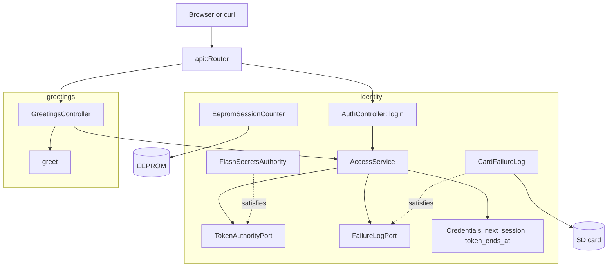

# RestAuth

在装有以太网扩展板的 Arduino Uno R4 Minima 上演示登录和一个受保护的路由。`POST /api/auth/login` 校验 PBKDF2 密码哈希并返回 HS256 持有者令牌；`GET /api/greeting` 只应答本次启动签发的有效令牌。

[English](README.md) | [日本語](README.ja.md) | 简体中文 | [繁體中文（香港）](README.zh-HK.md)

## 本示例涵盖的内容

| 方面 | 实现内容 |
|:-----|:---------|
| 限界上下文 | `identity` 负责登录和检查令牌；`greetings` 是受保护的资源。两者各有自己的 `domain` 和 `adapters`。 |
| 领域 | `Credentials` 和 `credentials_status`、`next_session` 和 `token_ends_at`、`Greeting` 和 `greet`。不含 Arduino 头文件。 |
| 端口 | `TokenAuthorityPort` 列出 `provisioned`、`matches`、`sign` 和 `verify`；`FailureLogPort` 列出 `load` 和 `save`。 |
| 用例 | `AccessService` 接受或拒绝登录、记录失败、五次后锁定、签发令牌并授权持有者请求头。 |
| 适配器 | `FlashSecretsAuthority` 从闪存读取密钥、盐和哈希；`CardFailureLog` 把失败次数保存在卡上；`EepromSessionCounter` 记录启动次数；两个控制器负责 HTTP。 |
| 组合根 | [`RestAuth.ino`](RestAuth.ino) 挂载卡、创建适配器和服务，并从 EEPROM 开始一个新会话。 |
| 安全 | 常量时间比较；连续五次失败后锁定 15 分钟，重启后依然有效；令牌在下次启动时失效。 |
| 测试 | 三个文件中的 28 个主机测试，以及覆盖率 100% 的 6 个页面测试。 |
| 规则 | JPL D-60411 与 Power of Ten：不用堆、不用虚函数、不用函数指针，每个函数平均 2.09 个断言。 |

## 架构



greetings 的控制器只通过模板参数依赖 identity 的服务，所以受保护的资源从不接触密码、密钥或锁定状态。

## 项目结构

```text
RestAuth/
  RestAuth.ino                                   组合根
  arduino_secrets.h                              占位密钥；真正的由 tools/madogen secrets 写入
  openapi.json                                   API 契约
  src/http/api.generated.h                       由工具生成
  src/http/api.router.h                          登录、问候、卡上的页面
  src/identity/domain/credentials.value.h        Credentials、credentials_status
  src/identity/domain/session.value.h            next_session、token_ends_at
  src/identity/application/token_authority.port.h    TokenAuthorityPort、FailureLogPort
  src/identity/application/access.service.h      AccessService
  src/identity/adapters/flash_secrets.authority.h    使用闪存密钥的 PBKDF2 和 HS256
  src/identity/adapters/card_failure.store.h     /LOGIN.TXT 中的失败次数
  src/identity/adapters/eeprom_session.counter.h 每次启动一个会话
  src/identity/adapters/auth.controller.h        通过 HTTP 登录
  src/greetings/domain/greeting.value.h          问候文字
  src/greetings/adapters/greetings.controller.h  受保护的路由
  tests/                                         主机测试
  SD Card/                                       页面
```

## API 端点

| 方法 | 端点 | 认证 | 说明 |
|:-----|:-----|:-----|:-----|
| POST | `/api/auth/login` | 无 | `{"username":"admin","password":"..."}` 返回令牌 |
| GET | `/api/greeting` | 持有者令牌 | `{"message":"Hello, admin"}` |
| GET | 其他路径 | 无 | 卡上的页面 |

登录的应答：

```json
{"access_token":"eyJhbGciOiJIUzI1NiIsInR5cCI6IkpXVCJ9...","token_type":"Bearer","expires_in":900}
```

| 错误条件 | 状态 | 详情 |
|:---------|:----:|:-----|
| 用户名或密码错误 | 401 | `WWW-Authenticate: Bearer realm="api"` |
| 连续五次失败 | 429 | 以秒为单位的 `Retry-After` |
| 密钥仍是全零占位值 | 503 | `the token key is not provisioned` |
| 没有令牌、签名错误、来自上次启动或超过 15 分钟 | 401 | 发送了令牌时带 `error="invalid_token"` |
| 请求体错误 | 400、413、415、422 | 生成的读取器给出的问题详情 |

## 设计决策

### 小程序里的两个上下文

登录和问候因不同的原因而改变：新的哈希或锁定策略只涉及 `identity`，新的资源只涉及 `greetings`。拆分的代价是两个小文件夹，换来的是受保护的资源不接触凭据。

### 一个适配器负责密码和令牌

`FlashSecretsAuthority` 用 PBKDF2-HMAC-SHA256 校验密码，用 HS256 签发和验证令牌。两者读取同一份闪存密钥，所以由一个适配器拥有它们，端口列出它的四个调用。它不保存状态，所以每个函数都是静态的。

### 先判断是否接受，再读请求体

`AccessService::admit` 在控制器读取请求体之前运行。被锁定的客户端或没有密钥的开发板会在开发板解析 256 字节之前就得到 `429` 或 `503`，与早先的程序行为一致。

### 锁定在重启后依然有效

`CardFailureLog` 通过临时文件和重命名写入失败次数，`AccessService::begin` 把它恢复。拔掉电源不会重置次数。没有卡时次数只保存在 RAM 中。

### 会话让令牌在重启时失效

`EepromSessionCounter` 读取四个字节，应用 `next_session`，再用会跳过未改变单元的 `update` 写回。令牌带有会话编号，所以重启前的令牌都会以 `kStaleSession` 失败。

## 权衡

| 可以做的事 | 现在不做的原因 | 照现状发布的风险 |
|:-----------|:---------------|:-----------------|
| TLS | 开发板没有 TLS 协议栈 | 凭据和令牌以明文在网络上传输 |
| 多个用户 | 一个用户足以演示 | 所有人共用一个账户 |

## 假设

- 网络足够可信，可以传输明文密码。
- [`arduino_secrets.h`](arduino_secrets.h) 用 `python3 -m tools.madogen secrets examples/RestAuth --user admin` 生成，真正的文件从不提交。

## 登录与安全写入

同一客户端地址登录失败五次，该地址会以 `429` 和 `Retry-After` 锁定 15 分钟，其他地址仍可登录。表中保存四个地址，四个都被锁定时新地址也被锁定，所以轮换地址无法解除锁定。 每个地址的次数写入 `/LOGIN.TXT`，所以锁定在重启后依然有效。

## 测试

```bash
cmake -S ../../tests -B build && cmake --build build --target mado_example_restauth
ctest --test-dir build -R '^RestAuth\.' --output-on-failure
```

| 文件 | 测试数 | 覆盖内容 |
|:-----|------:|:---------|
| [`identity.domain.test.cpp`](tests/identity.domain.test.cpp) | 12 | 凭据规则、会话计数器的五种情况、令牌结束时间、问候 |
| [`identity.adapters.test.cpp`](tests/identity.adapters.test.cpp) | 9 | EEPROM 计数器、登录、卡上的失败次数、跨重启的锁定、令牌检查 |
| [`auth.api.test.cpp`](tests/auth.api.test.cpp) | 7 | 登录、错误密码、锁定、问候、缺失、被篡改和过期的令牌 |

`cd "SD Card" && pnpm run test` 以 100% 覆盖率运行 6 个页面测试。页面只在内存中保存令牌。

## 前提条件

| 工具 | 版本 | 用途 |
|:-----|:-----|:-----|
| Arduino Uno R4 Minima | | 开发板 |
| 带 microSD 插槽的 W5100、W5500 或 ENC28J60 扩展板 | | 网络和卡 |
| arduino-cli | 1.5.1 | 构建程序 |
| arduino:renesas_uno 核心 | 1.6.0 | 开发板软件包 |
| Ethernet 和 SdFat | 2.0.2 和 2.3.0 | 网络和卡的库 |
| Python 3 | 只用标准库 | 生成密钥 |
| Node.js 和 pnpm | 24 和 12.15.0 | 构建页面 |

## 快速开始

```bash
cd ../.. && python3 -m tools.madogen secrets examples/RestAuth --user admin && cd examples/RestAuth
arduino-cli lib install Ethernet@2.0.2 SdFat@2.3.0
arduino-cli compile --fqbn arduino:renesas_uno:minima --library ../.. .
arduino-cli upload --fqbn arduino:renesas_uno:minima --port /dev/cu.usbmodem1101 .
cd "SD Card" && pnpm install && pnpm run build
```

```bash
TOKEN=$(curl -s -H 'Content-Type: application/json' -d '{"username":"admin","password":"your password"}' http://192.168.1.177/api/auth/login | python3 -c 'import json,sys; print(json.load(sys.stdin)["access_token"])')
curl -H "Authorization: Bearer $TOKEN" http://192.168.1.177/api/greeting
```

## 技术栈

| 类别 | 技术 |
|:-----|:-----|
| 开发板 | Arduino Uno R4 Minima：闪存 262,144 字节中用 88,324 字节，RAM 32,768 字节中用 6,224 字节 |
| HTTP 和认证 | Madoguchi：HS256、PBKDF2-HMAC-SHA256、`LoginGuard` |
| 卡 | SdFat 2.3.0 |
| 网络 | Ethernet 2.0.2 |
| 主机测试 | googletest 1.18.0、CMake |
| 页面 | TypeScript 7.0.2、Vite 8.3.5、从 CDN 加载的 Pico CSS 2.1.1、Vitest 5.0.5 |
| 分析 | clang-tidy 23.1.3、cppcheck 2.22.0、clang-format 23.1.3、Biome 2.6.3 |
