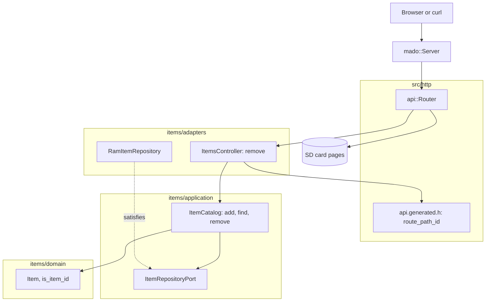

# RestDelete

4件の固定テーブルから項目を削除するRESTエンドポイントで、Ethernetシールドを載せたArduino Uno R4 Minimaが応答します。`DELETE /api/items/{id}`は1回目に`204 No Content`を返し、それ以降は`404`を返します。

[English](README.md) | 日本語 | [简体中文](README.zh-Hans.md) | [繁體中文（香港）](README.zh-HK.md)

## このサンプルの内容

| 領域 | 作ったもの |
|:-----|:-----------|
| レイヤー | 境界づけられたコンテキスト`items`を1つ持ち、`domain`、`application`、`adapters`に分けています。ドメインはArduinoのヘッダーを一切インクルードしません。 |
| ポート | `ItemRepositoryPort`は`insert`、`find`、`erase`を名指しします。 |
| ユースケース | `ItemCatalog::remove`は`kRemoved`または`kMissing`を返します。空いたidは、次に`add`が割り当てるidになります。 |
| アダプター | `mado::SlotTable`上の`RamItemRepository`。`ItemsController`は結果を`204`または`404`に対応づけます。 |
| コンポジションルート | [`RestDelete.ino`](RestDelete.ino)が「lamp」と「fan」を投入し、カードをマウントし、両方をルーターに渡します。 |
| 契約 | [`openapi.json`](openapi.json)から[`api.generated.h`](src/http/api.generated.h)のルートとパスのid解析を生成します。 |
| テスト | 6ファイルのホストテスト44件と、カバレッジ100パーセントのページテスト2件。 |
| ルール | JPL D-60411とPower of Ten。ヒープなし、仮想関数なし、関数ポインターなし、関数あたり2.05個のアサーション。 |

## アーキテクチャ



コントローラーはJSONを書かないので、ワイヤー構造体への対応づけも持ちません。

## プロジェクト構成

```text
RestDelete/
  RestDelete.ino                           コンポジションルート
  openapi.json                             API契約
  src/http/api.generated.h                 生成
  src/http/api.router.h                    削除のルート、それ以外のパスはカードのページ
  src/identity/...                         ログイン。RestAuthと同じコード
  src/items/domain/item.entity.h           Item、ItemDraft、idの範囲と名前のルール
  src/items/application/item_repository.port.h
  src/items/application/item_catalog.service.h   add、find、remove
  src/items/adapters/ram_item.repository.h
  src/items/adapters/items.controller.h
  tests/                                   ホストテスト
  SD Card/                                 ページ
```

## APIエンドポイント

| メソッド | エンドポイント | 説明 |
|:---------|:---------------|:-----|
| DELETE | `/api/items/{id}` | 項目1から4を削除し、ボディなしの`204`を返す |
| GET | `/api/openapi.json` | カードから読んだOpenAPIドキュメント |
| GET | その他のパス | カード上のページ |

| エラーの条件 | ステータス | 詳細 |
|:-------------|:----------:|:-----|
| idが空き、0、4より大きい、先頭にゼロがある、または数値でない | 404 | `no item has this id` |
| `/api/items`へのDELETE | 405 | `Allow`がそのパスで使えるメソッドを並べる |

## 設計上の判断

### 2回目の削除はエラーではなく404

DELETEの効果は冪等です。2回目の呼び出しはテーブルを1回目と同じ状態のまま残します。それでも`404`を返すのは、項目がすでになく、クライアントが特定のidを求めたからです。テスト`AnswersNotFoundTheSecondTime`がこの線を守ります。

### ポートが新しく名指しするのはeraseだけ

このサンプルのユースケースは、初期データのために`insert`を、挿入の後に`find`を、そして`erase`を呼びます。ポートはこの3つを並べるので、RestDelete向けのリポジトリは`store`を備える必要がありません。

### idは意図して2回確かめる

コントローラーの`requested_id`は不正なパスを拒否し、`ItemCatalog::remove`は範囲をもう一度確かめます。2回目の確認は比較1回分のコストで、テストのようなHTTPアダプター以外の呼び出し元に対してもユースケースを安全に保ちます。

## トレードオフ

| できること | 今はしない理由 | このままのリスク |
|:-----------|:---------------|:-----------------|
| 復元ルート付きの論理削除 | 動詞のサンプルの範囲外 | 削除した項目は次の起動まで戻らない |
| テーブルをカードに保存する | 永続化はRestApiが示す | 削除した初期データは起動のたびに戻る |

## 前提

- ネットワークは平文のパスワードとトークンを送れる程度に信頼できる。TLSはない。
- 同時に扱うクライアントは1つ。

## ログインと安全な書き込み

`POST /api/auth/login`を除くすべての`/api`ルートにベアラートークンが必要です。`{"username":"admin","password":"..."}`でログインすると、15分間かつボードが再起動するまで有効なトークンが返ります。トークンがない、署名が違う、古い場合は`WWW-Authenticate: Bearer`付きの`401`を返します。

1つのクライアントアドレスからログインに5回失敗すると、そのアドレスは`429`と`Retry-After`で15分間ロックされ、ほかのアドレスはログインを続けられます。表は4つのアドレスを持ち、4つすべてがロック中の間は新しいアドレスもロックされるので、アドレスを替えてもロックは解けません。 アドレスごとの回数は`/LOGIN.TXT`に書き込まれるので、ロックは再起動後も残ります。

ビルドの前に`python3 -m tools.madogen secrets examples/RestDelete --user admin`でアカウントを[`arduino_secrets.h`](arduino_secrets.h)に書き込みます。コミットされているファイルはすべてゼロの仮の値で、ログインには必ず`503`を返します。

## テスト

```bash
cmake -S ../../tests -B build && cmake --build build --target mado_example_restdelete
ctest --test-dir build -R '^RestDelete\.' --output-on-failure
```

| ファイル | テスト数 | 対象 |
|:---------|---------:|:-----|
| [`item.entity.test.cpp`](tests/item.entity.test.cpp) | 9 | 名前のルール、idの範囲、項目の生成 |
| [`item_catalog.service.test.cpp`](tests/item_catalog.service.test.cpp) | 6 | add、満杯のテーブル、find |
| [`item_removal.test.cpp`](tests/item_removal.test.cpp) | 4 | 削除、2回目の削除、範囲外のid、空いたidの再利用 |
| [`items.api.test.cpp`](tests/items.api.test.cpp) | 6 | `204`、2回目の`404`、不正なid、コレクションへの`405` |
| [`identity.adapters.test.cpp`](tests/identity.adapters.test.cpp) | 9 | EEPROMカウンター、ログイン、カード上のアドレスごとの失敗回数、再起動をまたぐロックアウト、トークンの確認 |
| [`identity.domain.test.cpp`](tests/identity.domain.test.cpp) | 10 | 認証情報の規則、セッションカウンター、トークンの終了時刻 |

`cd "SD Card" && pnpm run test`はカバレッジ100パーセントで2件のページテストを実行します。

## 前提条件

| ツール | バージョン | 用途 |
|:-------|:-----------|:-----|
| Arduino Uno R4 Minima | | ボード |
| microSDスロット付きのW5100、W5500、ENC28J60シールド | | ネットワークとカード |
| arduino-cli | 1.5.1 | スケッチのビルド |
| arduino:renesas_unoコア | 1.6.0 | ボードパッケージ |
| EthernetとSdFat | 2.0.2と2.3.0 | ネットワークとカードのライブラリ |
| Node.jsとpnpm | 24と12.15.0 | ページのビルド |

## はじめに

```bash
cd ../.. && python3 -m tools.madogen secrets examples/RestDelete --user admin && cd examples/RestDelete
arduino-cli lib install Ethernet@2.0.2 SdFat@2.3.0
arduino-cli compile --fqbn arduino:renesas_uno:minima --library ../.. .
arduino-cli upload --fqbn arduino:renesas_uno:minima --port /dev/cu.usbmodem1101 .
cd "SD Card" && pnpm install && pnpm run build
```

`SD Card/dist`をカードにコピーしてから：

```bash
TOKEN=$(curl -s -H 'Content-Type: application/json' -d '{"username":"admin","password":"your password"}' http://192.168.1.177/api/auth/login | python3 -c 'import json,sys; print(json.load(sys.stdin)["access_token"])')
curl -H "Authorization: Bearer $TOKEN" -i -X DELETE http://192.168.1.177/api/items/2
```

## 技術スタック

| 分類 | 技術 |
|:-----|:-----|
| ボード | Arduino Uno R4 Minima：フラッシュ262,144バイト中89,076バイト、RAM 32,768バイト中6,312バイト |
| HTTP | Madoguchi、ヒープを使わないC++11 |
| カード | SdFat 2.3.0 |
| ネットワーク | Ethernet 2.0.2 |
| ホストテスト | googletest 1.18.0、CMake |
| ページ | TypeScript 7.0.2、Vite 8.3.5、CDNから読み込むPico CSS 2.1.1、Vitest 5.0.5 |
| 解析 | clang-tidy 23.1.3、cppcheck 2.22.0、clang-format 23.1.3、Biome 2.6.3 |
