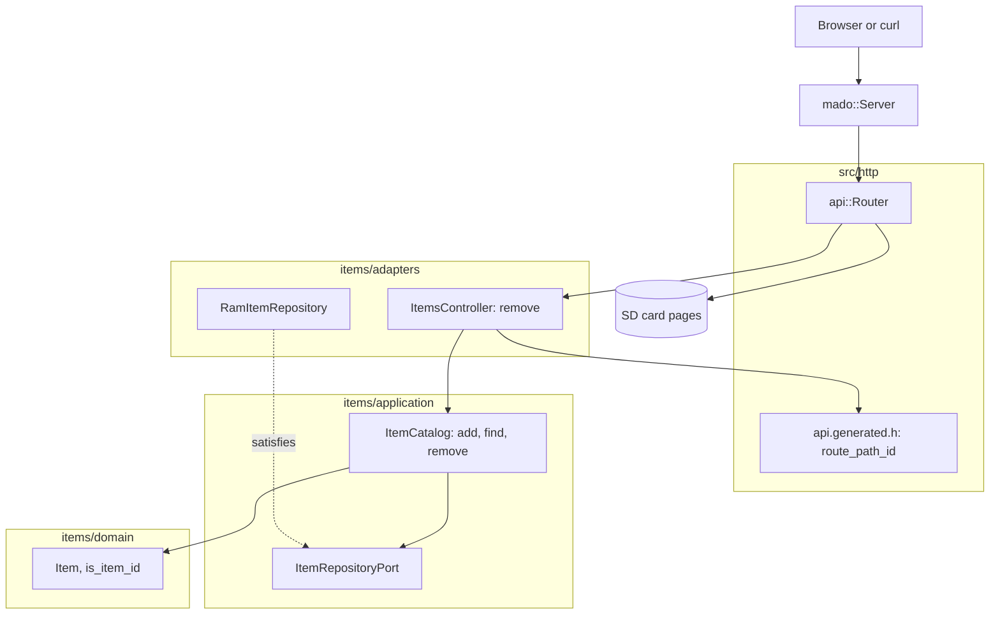

# RestDelete

REST endpoint that deletes items from a fixed table of four, served by an Arduino Uno R4 Minima with an Ethernet shield. `DELETE /api/items/{id}` answers `204 No Content` once and `404` after that.

English | [日本語](README.ja.md) | [简体中文](README.zh-Hans.md) | [繁體中文（香港）](README.zh-HK.md)

## What this example covers

| Area | What is built |
|:-----|:--------------|
| Layers | One bounded context, `items`, split into `domain`, `application` and `adapters`. The domain includes no Arduino header. |
| Ports | `ItemRepositoryPort` names `insert`, `find` and `erase`. |
| Use case | `ItemCatalog::remove` answers `kRemoved` or `kMissing`; a freed id is the next one `add` hands out. |
| Adapters | `RamItemRepository` on a `mado::SlotTable`; `ItemsController` maps the outcome to `204` or `404`. |
| Composition root | [`RestDelete.ino`](RestDelete.ino) seeds "lamp" and "fan", mounts the card and attaches both to the router. |
| Contract | [`openapi.json`](openapi.json) generates the route and the path id parser in [`api.generated.h`](src/http/api.generated.h). |
| Tests | 23 host tests in four files and 2 page tests with 100 percent coverage. |
| Rules | JPL D-60411 and the Power of Ten: no heap, no virtual functions, no function pointers, 2.06 assertions per function. |

## Architecture



The controller writes no JSON, so it carries no mapping to a wire struct.

## Project structure

```text
RestDelete/
  RestDelete.ino                           composition root
  openapi.json                             API contract
  src/http/api.generated.h                 generated
  src/http/api.router.h                    the delete route, card pages for every other path
  src/items/domain/item.entity.h           Item, ItemDraft, id range and name rules
  src/items/application/item_repository.port.h
  src/items/application/item_catalog.service.h   add, find, remove
  src/items/adapters/ram_item.repository.h
  src/items/adapters/items.controller.h
  tests/                                   host tests
  SD Card/                                 the pages
```

## API endpoints

| Method | Endpoint | Description |
|:-------|:---------|:------------|
| DELETE | `/api/items/{id}` | Delete item 1 to 4; answers `204` with no body |
| GET | `/api/openapi.json` | The OpenAPI document, read from the card |
| GET | any other path | A page from the card |

| Error condition | Status | Detail |
|:----------------|:------:|:-------|
| The id is free, 0, above 4, has a leading zero or is not a number | 404 | `no item has this id` |
| DELETE on `/api/items` | 405 | `Allow` lists the methods that path takes |

## Design decisions

### Deleting twice is a 404, not an error

DELETE is idempotent in effect: the second call leaves the table as the first did. It still answers `404`, because the item is gone and the client asked for a specific id. The test `AnswersNotFoundTheSecondTime` holds that line.

### The port names erase and nothing else new

This example's use cases call `insert` for the seeds, `find` after an insert, and `erase`. The port lists those three, so a repository built for RestDelete does not have to offer `store`.

### The id is checked twice on purpose

`requested_id` in the controller refuses a malformed path, and `ItemCatalog::remove` checks the range again. The second check costs one comparison and keeps the use case safe for a caller that is not the HTTP adapter, such as a test.

## Trade-offs

| What could be done | Why it is not done | Risk as shipped |
|:-------------------|:-------------------|:----------------|
| Soft delete with a restore route | Out of scope for a verb example | A deleted item is gone until the next boot |
| Keep the table on the card | RestApi shows persistence | Deleted seeds return on every boot |
| Authentication on DELETE | RestApi shows bearer tokens | Anyone on the network can delete |

## Assumptions

- The network is trusted: there is no authentication and no TLS.
- One client at a time.

## Testing

```bash
cmake -S ../../tests -B build && cmake --build build --target mado_example_restdelete
ctest --test-dir build -R '^RestDelete\.' --output-on-failure
```

| File | Tests | Covers |
|:-----|------:|:-------|
| [`item.entity.test.cpp`](tests/item.entity.test.cpp) | 9 | name rules, the id range, building an item |
| [`item_catalog.service.test.cpp`](tests/item_catalog.service.test.cpp) | 6 | add, a full table, find |
| [`item_removal.test.cpp`](tests/item_removal.test.cpp) | 4 | remove, a second remove, an id past the range, the freed id reused |
| [`items.api.test.cpp`](tests/items.api.test.cpp) | 4 | `204`, `404` the second time, a malformed id, `405` on the collection |

`cd "SD Card" && pnpm run test` runs 2 page tests at 100 percent coverage.

## Prerequisites

| Tool | Version | Required for |
|:-----|:--------|:-------------|
| Arduino Uno R4 Minima | | the board |
| W5100, W5500 or ENC28J60 shield with a microSD slot | | network and card |
| arduino-cli | 1.5.1 | building the sketch |
| arduino:renesas_uno core | 1.6.0 | the board package |
| Ethernet and SdFat | 2.0.2 and 2.3.0 | network and card libraries |
| Node.js and pnpm | 24 and 12.15.0 | building the pages |

## Getting started

```bash
arduino-cli lib install Ethernet@2.0.2 SdFat@2.3.0
arduino-cli compile --fqbn arduino:renesas_uno:minima --library ../.. .
arduino-cli upload --fqbn arduino:renesas_uno:minima --port /dev/cu.usbmodem1101 .
cd "SD Card" && pnpm install && pnpm run build
```

Copy `SD Card/dist` to the card, then:

```bash
curl -i -X DELETE http://192.168.1.177/api/items/2
```

## Tech stack

| Category | Technology |
|:---------|:-----------|
| Board | Arduino Uno R4 Minima: 73,856 of 262,144 bytes of flash, 5,904 of 32,768 bytes of RAM |
| HTTP | Madoguchi, heap-free C++11 |
| Card | SdFat 2.3.0 |
| Network | Ethernet 2.0.2 |
| Host tests | googletest 1.18.0, CMake |
| Pages | TypeScript 7.0.2, Vite 8.3.5, Pico CSS 2.1.1 from a CDN, Vitest 5.0.5 |
| Analysis | clang-tidy 23.1.3, cppcheck 2.22.0, clang-format 23.1.3, Biome 2.6.3 |
