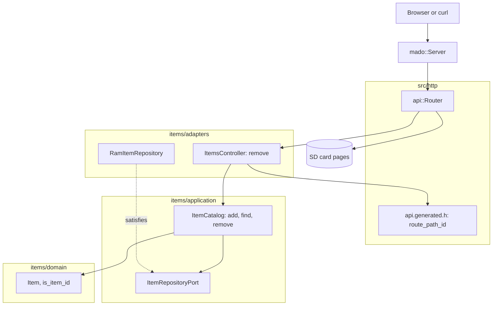

# RestDelete

從固定四項表中刪除項目的 REST 端點，由裝有以太網擴充板的 Arduino Uno R4 Minima 提供。`DELETE /api/items/{id}` 第一次回應 `204 No Content`，之後回應 `404`。

[English](README.md) | [日本語](README.ja.md) | [简体中文](README.zh-Hans.md) | 繁體中文（香港）

## 本範例涵蓋的內容

| 範疇 | 實作內容 |
|:-----|:---------|
| 分層 | 一個限界上下文 `items`，分為 `domain`、`application` 及 `adapters`。領域層不包含任何 Arduino 標頭檔。 |
| 端口 | `ItemRepositoryPort` 列出 `insert`、`find` 及 `erase`。 |
| 用例 | `ItemCatalog::remove` 回傳 `kRemoved` 或 `kMissing`；空出的 id 就是 `add` 下一次分配的 id。 |
| 轉接器 | 建基於 `mado::SlotTable` 的 `RamItemRepository`；`ItemsController` 把結果對應為 `204` 或 `404`。 |
| 組合根 | [`RestDelete.ino`](RestDelete.ino) 寫入 `lamp` 及 `fan`，掛載記憶卡，再把兩者交給路由器。 |
| 契約 | [`openapi.json`](openapi.json) 產生 [`api.generated.h`](src/http/api.generated.h) 中的路由及路徑 id 剖析器。 |
| 測試 | 四個檔案中的 23 個主機測試，以及覆蓋率 100% 的 2 個頁面測試。 |
| 規則 | JPL D-60411 及 Power of Ten：不用堆積、不用虛擬函式、不用函式指標，每個函式平均 2.06 個斷言。 |

## 架構



控制器不寫 JSON，所以不需要對應到線上結構。

## 項目結構

```text
RestDelete/
  RestDelete.ino                           組合根
  openapi.json                             API 契約
  src/http/api.generated.h                 由工具產生
  src/http/api.router.h                    刪除路由，其餘路徑交給記憶卡上的頁面
  src/items/domain/item.entity.h           Item、ItemDraft、id 範圍及名稱規則
  src/items/application/item_repository.port.h
  src/items/application/item_catalog.service.h   add、find、remove
  src/items/adapters/ram_item.repository.h
  src/items/adapters/items.controller.h
  tests/                                   主機測試
  SD Card/                                 頁面
```

## API 端點

| 方法 | 端點 | 說明 |
|:-----|:-----|:-----|
| DELETE | `/api/items/{id}` | 刪除項目 1 至 4，回應不附請求主體的 `204` |
| GET | `/api/openapi.json` | 從記憶卡讀取的 OpenAPI 文件 |
| GET | 其他路徑 | 記憶卡上的頁面 |

| 錯誤條件 | 狀態 | 詳情 |
|:---------|:----:|:-----|
| id 空置、為 0、大於 4、帶前導零或不是數字 | 404 | `no item has this id` |
| 對 `/api/items` 的 DELETE | 405 | `Allow` 列出該路徑接受的方法 |

## 設計決定

### 第二次刪除是 404，而不是錯誤

DELETE 的效果是冪等的：第二次呼叫令表保持第一次之後的狀態。它仍然回應 `404`，因為項目已經不在，而客戶端要求的是一個特定的 id。測試 `AnswersNotFoundTheSecondTime` 守住這一點。

### 端口新增的只有 erase

本範例的用例為初始資料呼叫 `insert`，插入後呼叫 `find`，再呼叫 `erase`。端口只列出這三個，所以為 RestDelete 建構的儲存庫不必提供 `store`。

### 刻意檢查兩次 id

控制器中的 `requested_id` 拒絕格式錯誤的路徑，`ItemCatalog::remove` 再檢查一次範圍。第二次檢查只多一次比較，卻能令用例面對 HTTP 轉接器以外的呼叫者（例如測試）時同樣安全。

## 取捨

| 可以做的事 | 現在不做的原因 | 照現狀發佈的風險 |
|:-----------|:---------------|:-----------------|
| 附還原路由的軟刪除 | 超出動詞範例的範圍 | 刪除的項目在下次啟動前都不會回來 |
| 把表保存在記憶卡上 | 持久化由 RestApi 示範 | 刪除的初始資料每次啟動都會回來 |
| DELETE 的認證 | 持有人權杖由 RestApi 示範 | 網絡上任何人都能刪除 |

## 假設

- 網絡是可信的：沒有認證，亦沒有 TLS。
- 一次一個客戶端。

## 測試

```bash
cmake -S ../../tests -B build && cmake --build build --target mado_example_restdelete
ctest --test-dir build -R '^RestDelete\.' --output-on-failure
```

| 檔案 | 測試數目 | 涵蓋內容 |
|:-----|------:|:---------|
| [`item.entity.test.cpp`](tests/item.entity.test.cpp) | 9 | 名稱規則、id 範圍、產生項目 |
| [`item_catalog.service.test.cpp`](tests/item_catalog.service.test.cpp) | 6 | add、表已滿、find |
| [`item_removal.test.cpp`](tests/item_removal.test.cpp) | 4 | 刪除、第二次刪除、超出範圍的 id、空出 id 的重用 |
| [`items.api.test.cpp`](tests/items.api.test.cpp) | 4 | `204`、第二次的 `404`、格式錯誤的 id、對集合的 `405` |

`cd "SD Card" && pnpm run test` 以 100% 覆蓋率執行 2 個頁面測試。

## 先決條件

| 工具 | 版本 | 用途 |
|:-----|:-----|:-----|
| Arduino Uno R4 Minima | | 開發板 |
| 附 microSD 插槽的 W5100、W5500 或 ENC28J60 擴充板 | | 網絡及記憶卡 |
| arduino-cli | 1.5.1 | 建置草稿碼 |
| arduino:renesas_uno 核心 | 1.6.0 | 開發板套件 |
| Ethernet 及 SdFat | 2.0.2 及 2.3.0 | 網絡及記憶卡程式庫 |
| Node.js 及 pnpm | 24 及 12.15.0 | 建置頁面 |

## 開始使用

```bash
arduino-cli lib install Ethernet@2.0.2 SdFat@2.3.0
arduino-cli compile --fqbn arduino:renesas_uno:minima --library ../.. .
arduino-cli upload --fqbn arduino:renesas_uno:minima --port /dev/cu.usbmodem1101 .
cd "SD Card" && pnpm install && pnpm run build
```

把 `SD Card/dist` 複製到記憶卡上，然後：

```bash
curl -i -X DELETE http://192.168.1.177/api/items/2
```

## 技術棧

| 類別 | 技術 |
|:-----|:-----|
| 開發板 | Arduino Uno R4 Minima：快閃記憶體 262,144 位元組中用 73,856 位元組，RAM 32,768 位元組中用 5,904 位元組 |
| HTTP | Madoguchi，不用堆積的 C++11 |
| 記憶卡 | SdFat 2.3.0 |
| 網絡 | Ethernet 2.0.2 |
| 主機測試 | googletest 1.18.0、CMake |
| 頁面 | TypeScript 7.0.2、Vite 8.3.5、從 CDN 載入的 Pico CSS 2.1.1、Vitest 5.0.5 |
| 分析 | clang-tidy 23.1.3、cppcheck 2.22.0、clang-format 23.1.3、Biome 2.6.3 |
