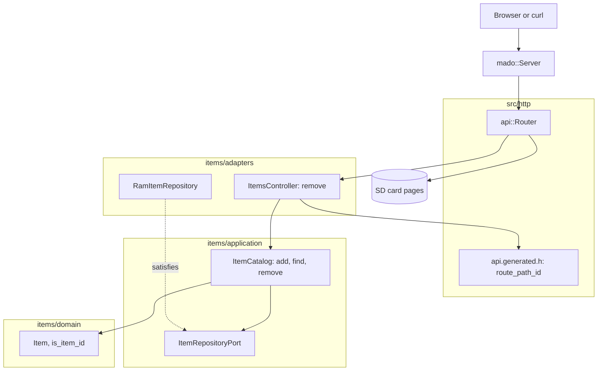

# RestDelete

从固定四项表中删除条目的 REST 端点，由装有以太网扩展板的 Arduino Uno R4 Minima 提供。`DELETE /api/items/{id}` 第一次应答 `204 No Content`，之后应答 `404`。

[English](README.md) | [日本語](README.ja.md) | 简体中文 | [繁體中文（香港）](README.zh-HK.md)

## 本示例涵盖的内容

| 方面 | 实现内容 |
|:-----|:---------|
| 分层 | 一个限界上下文 `items`，分为 `domain`、`application` 和 `adapters`。领域层不包含任何 Arduino 头文件。 |
| 端口 | `ItemRepositoryPort` 列出 `insert`、`find` 和 `erase`。 |
| 用例 | `ItemCatalog::remove` 返回 `kRemoved` 或 `kMissing`；空出的 id 就是 `add` 下一次分配的 id。 |
| 适配器 | 基于 `mado::SlotTable` 的 `RamItemRepository`；`ItemsController` 把结果映射为 `204` 或 `404`。 |
| 组合根 | [`RestDelete.ino`](RestDelete.ino) 写入 `lamp` 和 `fan`，挂载卡，并把两者交给路由器。 |
| 契约 | [`openapi.json`](openapi.json) 生成 [`api.generated.h`](src/http/api.generated.h) 中的路由和路径 id 解析器。 |
| 测试 | 六个文件中的 44 个主机测试，以及覆盖率 100% 的 2 个页面测试。 |
| 规则 | JPL D-60411 与 Power of Ten：不用堆、不用虚函数、不用函数指针，每个函数平均 2.05 个断言。 |

## 架构



控制器不写 JSON，所以不需要映射到线上结构。

## 项目结构

```text
RestDelete/
  RestDelete.ino                           组合根
  openapi.json                             API 契约
  src/http/api.generated.h                 由工具生成
  src/http/api.router.h                    删除路由，其余路径交给卡上的页面
  src/identity/...                         登录，与 RestAuth 相同的代码
  src/items/domain/item.entity.h           Item、ItemDraft、id 范围和名称规则
  src/items/application/item_repository.port.h
  src/items/application/item_catalog.service.h   add、find、remove
  src/items/adapters/ram_item.repository.h
  src/items/adapters/items.controller.h
  tests/                                   主机测试
  SD Card/                                 页面
```

## API 端点

| 方法 | 端点 | 说明 |
|:-----|:-----|:-----|
| DELETE | `/api/items/{id}` | 删除条目 1 到 4，应答不带请求体的 `204` |
| GET | `/api/openapi.json` | 从卡上读取的 OpenAPI 文档 |
| GET | 其他路径 | 卡上的页面 |

| 错误条件 | 状态 | 详情 |
|:---------|:----:|:-----|
| id 空闲、为 0、大于 4、带前导零或不是数字 | 404 | `no item has this id` |
| 对 `/api/items` 的 DELETE | 405 | `Allow` 列出该路径接受的方法 |

## 设计决策

### 第二次删除是 404，而不是错误

DELETE 的效果是幂等的：第二次调用让表保持第一次之后的状态。它仍然应答 `404`，因为条目已经不在，而客户端请求的是一个具体的 id。测试 `AnswersNotFoundTheSecondTime` 守住这一点。

### 端口新增的只有 erase

本示例的用例为初始数据调用 `insert`，插入后调用 `find`，再调用 `erase`。端口只列这三个，所以为 RestDelete 构建的仓储不必提供 `store`。

### 有意检查两次 id

控制器中的 `requested_id` 拒绝格式错误的路径，`ItemCatalog::remove` 再检查一次范围。第二次检查只多一次比较，却能让用例面对 HTTP 适配器以外的调用者（例如测试）时同样安全。

## 权衡

| 可以做的事 | 现在不做的原因 | 照现状发布的风险 |
|:-----------|:---------------|:-----------------|
| 带恢复路由的软删除 | 超出动词示例的范围 | 删除的条目在下次启动前都不会回来 |
| 把表保存在卡上 | 持久化由 RestApi 演示 | 删除的初始数据每次启动都会回来 |

## 假设

- 网络足够可信，可以传输明文密码和令牌：没有 TLS。
- 一次一个客户端。

## 登录与安全写入

除 `POST /api/auth/login` 外，每个 `/api` 路由都需要持有者令牌。用 `{"username":"admin","password":"..."}` 登录，得到 15 分钟内且开发板重启前有效的令牌；缺少令牌、签名错误或令牌过时都会应答带 `WWW-Authenticate: Bearer` 的 `401`。

同一客户端地址登录失败五次，该地址会以 `429` 和 `Retry-After` 锁定 15 分钟，其他地址仍可登录。表中保存四个地址，四个都被锁定时新地址也被锁定，所以轮换地址无法解除锁定。 每个地址的次数写入 `/LOGIN.TXT`，所以锁定在重启后依然有效。

构建前用 `python3 -m tools.madogen secrets examples/RestDelete --user admin` 把账户写入 [`arduino_secrets.h`](arduino_secrets.h)；提交的文件是全零的占位值，对每次登录都应答 `503`。

## 测试

```bash
cmake -S ../../tests -B build && cmake --build build --target mado_example_restdelete
ctest --test-dir build -R '^RestDelete\.' --output-on-failure
```

| 文件 | 测试数 | 覆盖内容 |
|:-----|------:|:---------|
| [`item.entity.test.cpp`](tests/item.entity.test.cpp) | 9 | 名称规则、id 范围、生成条目 |
| [`item_catalog.service.test.cpp`](tests/item_catalog.service.test.cpp) | 6 | add、表已满、find |
| [`item_removal.test.cpp`](tests/item_removal.test.cpp) | 4 | 删除、第二次删除、超出范围的 id、空出 id 的重用 |
| [`items.api.test.cpp`](tests/items.api.test.cpp) | 6 | `204`、第二次的 `404`、格式错误的 id、对集合的 `405` |
| [`identity.adapters.test.cpp`](tests/identity.adapters.test.cpp) | 9 | EEPROM 计数器、登录、卡上按地址记录的失败次数、跨重启的锁定、令牌检查 |
| [`identity.domain.test.cpp`](tests/identity.domain.test.cpp) | 10 | 凭据规则、会话计数器、令牌结束时间 |

`cd "SD Card" && pnpm run test` 以 100% 覆盖率运行 2 个页面测试。

## 前提条件

| 工具 | 版本 | 用途 |
|:-----|:-----|:-----|
| Arduino Uno R4 Minima | | 开发板 |
| 带 microSD 插槽的 W5100、W5500 或 ENC28J60 扩展板 | | 网络和卡 |
| arduino-cli | 1.5.1 | 构建程序 |
| arduino:renesas_uno 核心 | 1.6.0 | 开发板软件包 |
| Ethernet 和 SdFat | 2.0.2 和 2.3.0 | 网络和卡的库 |
| Node.js 和 pnpm | 24 和 12.15.0 | 构建页面 |

## 快速开始

```bash
cd ../.. && python3 -m tools.madogen secrets examples/RestDelete --user admin && cd examples/RestDelete
arduino-cli lib install Ethernet@2.0.2 SdFat@2.3.0
arduino-cli compile --fqbn arduino:renesas_uno:minima --library ../.. .
arduino-cli upload --fqbn arduino:renesas_uno:minima --port /dev/cu.usbmodem1101 .
cd "SD Card" && pnpm install && pnpm run build
```

把 `SD Card/dist` 复制到卡上，然后：

```bash
TOKEN=$(curl -s -H 'Content-Type: application/json' -d '{"username":"admin","password":"your password"}' http://192.168.1.177/api/auth/login | python3 -c 'import json,sys; print(json.load(sys.stdin)["access_token"])')
curl -H "Authorization: Bearer $TOKEN" -i -X DELETE http://192.168.1.177/api/items/2
```

## 技术栈

| 类别 | 技术 |
|:-----|:-----|
| 开发板 | Arduino Uno R4 Minima：闪存 262,144 字节中用 89,076 字节，RAM 32,768 字节中用 6,312 字节 |
| HTTP | Madoguchi，不用堆的 C++11 |
| 卡 | SdFat 2.3.0 |
| 网络 | Ethernet 2.0.2 |
| 主机测试 | googletest 1.18.0、CMake |
| 页面 | TypeScript 7.0.2、Vite 8.3.5、从 CDN 加载的 Pico CSS 2.1.1、Vitest 5.0.5 |
| 分析 | clang-tidy 23.1.3、cppcheck 2.22.0、clang-format 23.1.3、Biome 2.6.3 |
