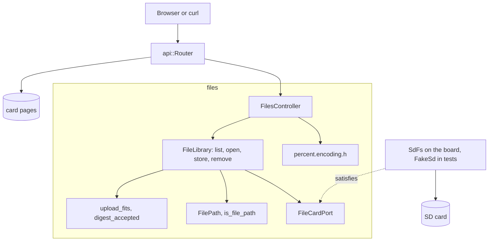

# RestFiles

Ethernetシールドを載せたArduino Uno R4 MinimaのSDカード用ファイルマネージャーです。ルートフォルダーを一覧し、ファイル全体または1つのバイト範囲をダウンロードし、`Repr-Digest`の検査付きで最大8 MiBをアップロードし、ファイルを削除します。どれも長いファイル名に対応します。

[English](README.md) | 日本語 | [简体中文](README.zh-Hans.md) | [繁體中文（香港）](README.zh-HK.md)

## このサンプルの内容

| 領域 | 作ったもの |
|:-----|:-----------|
| 境界づけられたコンテキスト | `files`を`domain`、`application`、`adapters`に分けています。 |
| ドメイン | 1から64文字の長い名前のための`FilePath`と`is_file_path`、8 MiBの上限のための`upload_fits`、`Repr-Digest`のための`DigestClaim`と`digest_accepted`。 |
| ポート | `FileCardPort`はユースケースが使うカードとファイルの呼び出しを名指しします。`begin`、`exists`、`remove`、`open`、`openNextFile`、`getName`です。ボードでは`SdFs`が、テストでは`FakeSd`がこれを満たします。 |
| ユースケース | `FileLibrary`は必要に応じてカードをマウントし、一覧し、開き、SHA-256を計算しながら一時ファイルを通して保存し、削除します。書き込みのたびに変わるバージョン番号がETagの元になります。 |
| アダプター | `FilesController`はHTTP、範囲、ETag、ダウンロードをユースケースに対応づけ、`percent.encoding.h`は新しいファイルの`Location`を書きます。 |
| コンポジションルート | [`RestFiles.ino`](RestFiles.ino)がアナログノイズでバージョンの種を作り、ライブラリを組み立て、DHCPと`madofiles.local`のmDNSを始めます。 |
| テスト | 2ファイルのホストテスト29件、libFuzzerのターゲット、分岐カバレッジ96パーセントのページテスト20件。 |
| ルール | JPL D-60411とPower of Ten。ヒープなし、仮想関数なし、関数ポインターなし、関数あたり2.03個のアサーション。 |

## アーキテクチャ



ライブラリはストリームで扱います。アップロードはリクエストから512バイトずつ読み、ハッシュを計算しながら`/UPLOAD.TMP`に書き、ボディがそろってダイジェストが一致したときだけ対象の上にコピーします。ルーターはリクエストのたびにマウント済みのカードをライブラリに尋ねるので、起動後に挿したカードも見つかります。

## プロジェクト構成

```text
RestFiles/
  RestFiles.ino                                コンポジションルート、ネットワークとmDNS
  openapi.json                                 API契約
  src/http/api.generated.h                     生成
  src/http/api.router.h                        4つのファイルのルート、カードのページ
  src/files/domain/file_path.value.h           FilePath、is_file_path
  src/files/domain/upload.policy.h             upload_fits、DigestClaim、digest_accepted
  src/files/application/file_card.port.h       FileCardPort
  src/files/application/file_library.service.h FileLibrary
  src/files/adapters/files.controller.h        HTTP、範囲、ETag、ダウンロード
  src/files/adapters/percent.encoding.h        Locationのエンコード
  tests/                                       ホストテスト
  SD Card/                                     ページ
```

## APIエンドポイント

認証が必要なルートはありません。

| メソッド | エンドポイント | 説明 |
|:---------|:---------------|:-----|
| GET | `/api/files` | ルートフォルダーの最大32件 |
| GET | `/api/files/{name}` | ファイル全体、または`Range: bytes=...`の範囲。`?download=1`で`Content-Disposition`を付ける |
| PUT | `/api/files/{name}` | ファイルを作る（`Location`付きの`201`）か置き換える（`204`） |
| DELETE | `/api/files/{name}` | ファイルを削除する |
| GET | その他のパス | カード上のページ |

`GET /api/files`の応答：

```json
[{"name":"holiday photo (2).jpeg","size":2048,"directory":false}]
```

| エラーの条件 | ステータス | 詳細 |
|:-------------|:----------:|:-----|
| 名前がカードの規則に合わない | 400 | `file names are 1 to 64 printable ASCII characters without \ / : * ? " < > \| %` |
| その名前のファイルがない | 404 | `no file has this name` |
| 範囲が末尾を越える | 416 | |
| `Content-Length`が8 MiBを超える | 413 | `files are at most 8 MiB` |
| ボディが`Repr-Digest`と一致しない | 422 | `the body does not match Repr-Digest` |
| ボディが途中で終わった | 400 | `the body ended early or the card refused the write` |
| カードが書き込みや削除を拒否した | 507 | `the card refused the write`または`the card refused the delete` |
| カードがない | 503 | `the SD card is not available` |

## 設計上の判断

### SdFatがアダプター

`FileCardPort`は`FileLibrary`が使う呼び出しをカードの型と照合します。`SdFs`はすでにそれを備え、テスト用の偽物も同じなので、呼び出しを転送するだけのラッパークラスはありません。ポートが継ぎ目で、2つのカードの型がその2つのアダプターです。

### 一時ファイルを通して置き換える

アップロードはまず`/UPLOAD.TMP`に入り、途中でSHA-256を計算します。ボディがそろい、ダイジェストが一致したときだけ、`install`がそれを対象の上にコピーします。接続が切れたりダイジェストが違ったりしても、古いファイルはそのまま残ります。

### バージョンはユースケースに置く

書き込み、削除、再マウントが成功するたびに`FileLibrary`のバージョンが上がります。`open`はそれを`mado::FileStamp`に入れて返し、コントローラーはサイズとバージョンから弱いETagを作ります。種は起動時のアナログノイズから作るので、ボードの電源が切れている間に変わったファイルに再起動前のタグが一致することはありません。

### 長い名前を1か所で確かめる

`is_file_path`は`mado::valid_card_name`に尋ね、先頭のスラッシュを確かめます。コントローラーはURLを`FilePath`にデコードしてドメインに尋ねるだけで、名前を自分で判断することはありません。一覧はボードが配信し返せない名前を飛ばすので、ページが開けないファイルを表示することはありません。

## トレードオフ

| できること | 今はしない理由 | このままのリスク |
|:-----------|:---------------|:-----------------|
| 認証 | RestApiとRestAuthが示す | ネットワーク上の誰でもファイルを読み、置き換え、削除できる |
| ルート以下のフォルダー | 一覧と名前は平らな構造 | サブフォルダーのファイルにはページからしか届かない |
| 一覧の33件目以降 | 上限があるからループの停止を証明できる | 33件目以降は一覧に出ない |

## 前提

- ネットワークは信頼できる。認証もTLSもない。
- カードはSdFatが読めるFAT16、FAT32、exFATのいずれか。
- アップロードは`Repr-Digest`を計算するページから来る。それなしのcurlのアップロードは検査なしで受け付ける。

## テスト

```bash
cmake -S ../../tests -B build && cmake --build build --target mado_example_restfiles
ctest --test-dir build -R '^RestFiles\.' --output-on-failure
```

| ファイル | テスト数 | 対象 |
|:---------|---------:|:-----|
| [`files.domain.test.cpp`](tests/files.domain.test.cpp) | 7 | 長い名前、予約文字、8 MiBの上限、ダイジェスト、`Location`のエンコード |
| [`files.api.test.cpp`](tests/files.api.test.cpp) | 22 | 一覧、範囲、ETagと`304`、ダウンロード、ダイジェストありとなしのアップロード、拒否された書き込みと削除、後から挿したカード |

ファズターゲット[`files_fuzz.cpp`](../../tests/fuzz/files_fuzz.cpp)は同じルーターにランダムなリクエストを送ります。`cd "SD Card" && pnpm run test`は20件のページテストを実行します。

## 前提条件

| ツール | バージョン | 用途 |
|:-------|:-----------|:-----|
| Arduino Uno R4 Minima | | ボード |
| microSDスロット付きのW5100、W5500、ENC28J60シールド | | ネットワークとカード |
| arduino-cli | 1.5.1 | スケッチのビルド |
| arduino:renesas_unoコア | 1.6.0 | ボードパッケージ |
| EthernetとSdFat | 2.0.2と2.3.0 | ネットワークとカードのライブラリ |
| Node.jsとpnpm | 24と12.15.0 | ページのビルド |

## はじめに

```bash
arduino-cli lib install Ethernet@2.0.2 SdFat@2.3.0
arduino-cli compile --fqbn arduino:renesas_uno:minima --library ../.. .
arduino-cli upload --fqbn arduino:renesas_uno:minima --port /dev/cu.usbmodem1101 .
cd "SD Card" && pnpm install && pnpm run build
```

ボードはDHCPにアドレスを求め、得られなければ`192.168.1.178`を使います。`madofiles.local`として応答します。

```bash
curl -T notes.txt http://madofiles.local/api/files/notes.txt
curl http://madofiles.local/api/files
```

## 技術スタック

| 分類 | 技術 |
|:-----|:-----|
| ボード | Arduino Uno R4 Minima：フラッシュ262,144バイト中94,472バイト、RAM 32,768バイト中6,944バイト |
| HTTP | Madoguchi：範囲、ETag、SHA-256、mDNS、DHCPの代替アドレス |
| カード | 長い名前に対応したSdFat 2.3.0 |
| ネットワーク | Ethernet 2.0.2 |
| ホストテスト | googletest 1.18.0、CMake、libFuzzer |
| ページ | TypeScript 7.0.2、Vite 8.3.5、CDNから読み込むPico CSS 2.1.1、Vitest 5.0.5 |
| 解析 | clang-tidy 23.1.3、cppcheck 2.22.0、clang-format 23.1.3、Biome 2.6.3 |
