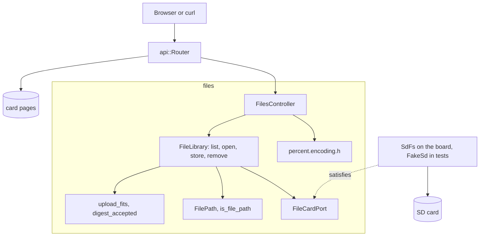

# RestFiles

File manager for the SD card of an Arduino Uno R4 Minima with an Ethernet shield. It lists the root folder, downloads a whole file or one byte range, uploads up to 8 MiB with a `Repr-Digest` check, and deletes files, all with long names.

English | [日本語](README.ja.md) | [简体中文](README.zh-Hans.md) | [繁體中文（香港）](README.zh-HK.md)

## What this example covers

| Area | What is built |
|:-----|:--------------|
| Bounded context | `files`, split into `domain`, `application` and `adapters`. |
| Domain | `FilePath` and `is_file_path` for long names of 1 to 64 characters; `upload_fits` for the 8 MiB limit; `DigestClaim` and `digest_accepted` for `Repr-Digest`. |
| Port | `FileCardPort` names the card and file calls the use cases make: `begin`, `exists`, `remove`, `open`, `openNextFile`, `getName`. `SdFs` satisfies it on the board and `FakeSd` in the tests. |
| Use cases | `FileLibrary` mounts the card on demand, lists, opens, stores through a temporary file with SHA-256, and removes. A version number changes with every write and feeds the ETags. |
| Adapters | `FilesController` maps HTTP, ranges, ETags and downloads to the use cases; `percent.encoding.h` writes the `Location` of a new file. |
| Composition root | [`RestFiles.ino`](RestFiles.ino) seeds the version from analog noise, builds the library, starts DHCP and mDNS as `madofiles.local`. |
| Tests | 29 host tests in two files, a libFuzzer target, and 20 page tests at 96 percent branch coverage. |
| Rules | JPL D-60411 and the Power of Ten: no heap, no virtual functions, no function pointers, 2.03 assertions per function. |

## Architecture



The library streams: an upload is read from the request in 512-byte chunks, hashed and written to `/UPLOAD.TMP`, and only a complete body whose digest matches is copied over the target. The router asks the library for the mounted card before every request, so a card inserted after boot is found.

## Project structure

```text
RestFiles/
  RestFiles.ino                                composition root, network and mDNS
  openapi.json                                 API contract
  src/http/api.generated.h                     generated
  src/http/api.router.h                        four file routes, card pages
  src/files/domain/file_path.value.h           FilePath, is_file_path
  src/files/domain/upload.policy.h             upload_fits, DigestClaim, digest_accepted
  src/files/application/file_card.port.h       FileCardPort
  src/files/application/file_library.service.h FileLibrary
  src/files/adapters/files.controller.h        HTTP, ranges, ETags, downloads
  src/files/adapters/percent.encoding.h        Location encoding
  tests/                                       host tests
  SD Card/                                     the pages
```

## API endpoints

No route needs authentication.

| Method | Endpoint | Description |
|:-------|:---------|:------------|
| GET | `/api/files` | Up to 32 entries of the root folder |
| GET | `/api/files/{name}` | A file, whole or with `Range: bytes=...`; `?download=1` adds `Content-Disposition` |
| PUT | `/api/files/{name}` | Create (`201` with `Location`) or replace (`204`) a file |
| DELETE | `/api/files/{name}` | Delete a file |
| GET | any other path | A page from the card |

`GET /api/files` answers:

```json
[{"name":"holiday photo (2).jpeg","size":2048,"directory":false}]
```

| Error condition | Status | Detail |
|:----------------|:------:|:-------|
| The name breaks the card rules | 400 | `file names are 1 to 64 printable ASCII characters without \ / : * ? " < > \| %` |
| No file has the name | 404 | `no file has this name` |
| The range is past the end | 416 | |
| `Content-Length` over 8 MiB | 413 | `files are at most 8 MiB` |
| The body does not match `Repr-Digest` | 422 | `the body does not match Repr-Digest` |
| The body ended early | 400 | `the body ended early or the card refused the write` |
| The card refused a write or a delete | 507 | `the card refused the write` or `the card refused the delete` |
| The card is missing | 503 | `the SD card is not available` |

## Design decisions

### SdFat is the adapter

`FileCardPort` checks the calls `FileLibrary` makes against the card type. `SdFs` already offers them, and so does the test fake, so there is no wrapper class that would only forward calls. The port is the seam; the two card types are its two adapters.

### Replace through a temporary file

An upload goes to `/UPLOAD.TMP` first, with a SHA-256 computed on the way. Only when the body is complete and its digest matches does `install` copy it over the target. A cut connection or a wrong digest leaves the old file untouched.

### The version lives in the use case

Every successful write, delete or remount bumps `FileLibrary`'s version. `open` returns it inside a `mado::FileStamp`, and the controller turns size and version into a weak ETag. The seed comes from analog noise at boot, so a tag from before a restart does not match a file that changed while the board was off.

### Long names, checked in one place

`is_file_path` asks `mado::valid_card_name` and checks the leading slash. The controller decodes the URL into a `FilePath` and asks the domain; it never judges a name itself. Listing skips names the board could not serve back, so the page never shows a file it cannot open.

## Trade-offs

| What could be done | Why it is not done | Risk as shipped |
|:-------------------|:-------------------|:----------------|
| Authentication | RestApi and RestAuth show it | Anyone on the network can read, replace and delete files |
| Folders below the root | The listing and names are flat | Files in subfolders are reachable only by pages |
| More than 32 entries in a listing | The bound keeps the loop provable | Entry 33 and later are not listed |

## Assumptions

- The network is trusted: there is no authentication and no TLS.
- The card is FAT16, FAT32 or exFAT, as SdFat reads.
- Uploads come from the page, which computes `Repr-Digest`; curl uploads without it are accepted unchecked.

## Testing

```bash
cmake -S ../../tests -B build && cmake --build build --target mado_example_restfiles
ctest --test-dir build -R '^RestFiles\.' --output-on-failure
```

| File | Tests | Covers |
|:-----|------:|:-------|
| [`files.domain.test.cpp`](tests/files.domain.test.cpp) | 7 | long names, a reserved character, the 8 MiB limit, digests, `Location` encoding |
| [`files.api.test.cpp`](tests/files.api.test.cpp) | 22 | listing, ranges, ETags and `304`, downloads, uploads with and without a digest, refused writes and deletes, a card inserted late |

The fuzz target [`files_fuzz.cpp`](../../tests/fuzz/files_fuzz.cpp) feeds random requests to the same router. `cd "SD Card" && pnpm run test` runs 20 page tests.

## Prerequisites

| Tool | Version | Required for |
|:-----|:--------|:-------------|
| Arduino Uno R4 Minima | | the board |
| W5100, W5500 or ENC28J60 shield with a microSD slot | | network and card |
| arduino-cli | 1.5.1 | building the sketch |
| arduino:renesas_uno core | 1.6.0 | the board package |
| Ethernet and SdFat | 2.0.2 and 2.3.0 | network and card libraries |
| Node.js and pnpm | 24 and 12.15.0 | building the pages |

## Getting started

```bash
arduino-cli lib install Ethernet@2.0.2 SdFat@2.3.0
arduino-cli compile --fqbn arduino:renesas_uno:minima --library ../.. .
arduino-cli upload --fqbn arduino:renesas_uno:minima --port /dev/cu.usbmodem1101 .
cd "SD Card" && pnpm install && pnpm run build
```

The board asks DHCP for an address and falls back to `192.168.1.178`. It answers as `madofiles.local`:

```bash
curl -T notes.txt http://madofiles.local/api/files/notes.txt
curl http://madofiles.local/api/files
```

## Tech stack

| Category | Technology |
|:---------|:-----------|
| Board | Arduino Uno R4 Minima: 94,472 of 262,144 bytes of flash, 6,944 of 32,768 bytes of RAM |
| HTTP | Madoguchi: ranges, ETags, SHA-256, mDNS, DHCP fallback |
| Card | SdFat 2.3.0 with long names |
| Network | Ethernet 2.0.2 |
| Host tests | googletest 1.18.0, CMake, libFuzzer |
| Pages | TypeScript 7.0.2, Vite 8.3.5, Pico CSS 2.1.1 from a CDN, Vitest 5.0.5 |
| Analysis | clang-tidy 23.1.3, cppcheck 2.22.0, clang-format 23.1.3, Biome 2.6.3 |
