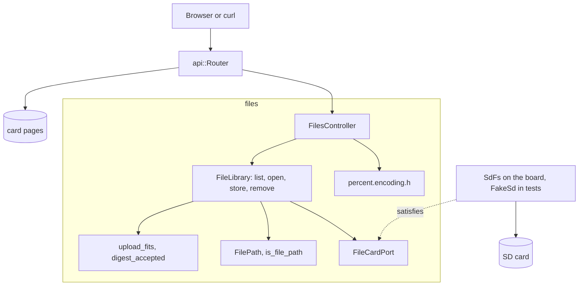

# RestFiles

裝有以太網擴充板的 Arduino Uno R4 Minima 上的 SD 卡檔案管理器。它列出根資料夾，下載整個檔案或一個位元組範圍，在 `Repr-Digest` 驗證下上載最多 8 MiB，並刪除檔案，全部支援長檔案名稱。

[English](README.md) | [日本語](README.ja.md) | [简体中文](README.zh-Hans.md) | 繁體中文（香港）

## 本範例涵蓋的內容

| 範疇 | 實作內容 |
|:-----|:---------|
| 限界上下文 | `files`，分為 `domain`、`application` 及 `adapters`。 |
| 領域 | 用於 1 至 64 個字元長檔案名稱的 `FilePath` 及 `is_file_path`；用於 8 MiB 上限的 `upload_fits`；用於 `Repr-Digest` 的 `DigestClaim` 及 `digest_accepted`。 |
| 端口 | `FileCardPort` 列出用例呼叫的記憶卡及檔案函式：`begin`、`exists`、`remove`、`open`、`openNextFile`、`getName`。開發板上由 `SdFs` 滿足，測試中由 `FakeSd` 滿足。 |
| 用例 | `FileLibrary` 按需掛載記憶卡，列出、打開檔案，透過暫存檔並計算 SHA-256 來保存，以及刪除。每次寫入都會改變的版本號是 ETag 的來源。 |
| 轉接器 | `FilesController` 把 HTTP、範圍請求、ETag 及下載對應到用例；`percent.encoding.h` 寫出新檔案的 `Location`。 |
| 組合根 | [`RestFiles.ino`](RestFiles.ino) 以類比雜訊產生版本種子，建構檔案庫，並啟動 DHCP 及 `madofiles.local` 的 mDNS。 |
| 測試 | 四個檔案中的 55 個主機測試、一個 libFuzzer 目標，以及分支覆蓋率 96% 的 21 個頁面測試。 |
| 規則 | JPL D-60411 及 Power of Ten：不用堆積、不用虛擬函式、不用函式指標，每個函式平均 2.05 個斷言。 |

## 架構



檔案庫以串流方式運作：上載以 512 位元組為一塊從請求中讀取，邊計雜湊邊寫入 `/UPLOAD.TMP`，只有完整且摘要相符的請求主體才會複製到目標檔案上。路由器在每個請求前向檔案庫查詢已掛載的記憶卡，所以啟動後插入的記憶卡亦能被找到。

## 項目結構

```text
RestFiles/
  RestFiles.ino                                組合根、網絡及 mDNS
  openapi.json                                 API 契約
  src/http/api.generated.h                     由工具產生
  src/http/api.router.h                        四個檔案路由、記憶卡上的頁面
  src/identity/...                             登入，與 RestAuth 相同的程式碼
  src/files/domain/file_path.value.h           FilePath、is_file_path
  src/files/domain/upload.policy.h             upload_fits、DigestClaim、digest_accepted
  src/files/application/file_card.port.h       FileCardPort
  src/files/application/file_library.service.h FileLibrary
  src/files/adapters/files.controller.h        HTTP、範圍請求、ETag、下載
  src/files/adapters/percent.encoding.h        Location 編碼
  tests/                                       主機測試
  SD Card/                                     頁面
```

## API 端點

列出及下載是公開的；上載及刪除需要持有人權杖，見「登入及安全寫入」一節。

| 方法 | 端點 | 說明 |
|:-----|:-----|:-----|
| GET | `/api/files` | 根資料夾中最多 32 個項目 |
| GET | `/api/files/{name}` | 整個檔案，或附 `Range: bytes=...` 的範圍；`?download=1` 會加上 `Content-Disposition` |
| PUT | `/api/files/{name}` | 建立（附 `Location` 的 `201`）或替換（`204`）檔案 |
| DELETE | `/api/files/{name}` | 刪除檔案 |
| GET | 其他路徑 | 記憶卡上的頁面 |

`GET /api/files` 的回應：

```json
[{"name":"holiday photo (2).jpeg","size":2048,"directory":false}]
```

| 錯誤條件 | 狀態 | 詳情 |
|:---------|:----:|:-----|
| 名稱不符合記憶卡的規則 | 400 | `file names are 1 to 64 printable ASCII characters without \ / : * ? " < > \| %` |
| 沒有該名稱的檔案 | 404 | `no file has this name` |
| 範圍超出檔案末端 | 416 | |
| `Content-Length` 超過 8 MiB | 413 | `files are at most 8 MiB` |
| 請求主體與 `Repr-Digest` 不符 | 422 | `the body does not match Repr-Digest` |
| 請求主體提早結束 | 400 | `the body ended early or the card refused the write` |
| 記憶卡拒絕寫入或刪除 | 507 | `the card refused the write` 或 `the card refused the delete` |
| 沒有記憶卡 | 503 | `the SD card is not available` |

## 設計決定

### SdFat 本身就是轉接器

`FileCardPort` 把 `FileLibrary` 發出的呼叫與記憶卡的型別對照。`SdFs` 已經提供這些呼叫，測試用的假記憶卡亦一樣，所以不需要只會轉發呼叫的包裝類別。端口就是接縫，兩種記憶卡型別就是它的兩個轉接器。

### 透過暫存檔替換

上載先寫入 `/UPLOAD.TMP`，同時計算 SHA-256。只有請求主體完整且摘要相符時，`install` 才把它複製到目標檔案上。連線中斷或摘要錯誤時，舊檔案保持不變。

### 版本放在用例中

每次寫入、刪除或重新掛載成功，`FileLibrary` 的版本都會增加。`open` 把它放在 `mado::FileStamp` 中回傳，控制器以大小及版本產生強 ETag。種子來自啟動時的類比雜訊，所以在開發板斷電期間被修改的檔案，不會與重啟前的標籤相符。

### 長檔案名稱只在一處檢查

`is_file_path` 查詢 `mado::valid_card_name` 並檢查開頭的斜線。控制器只是把 URL 解碼為 `FilePath` 再查詢領域層，從不自行判斷名稱。列表會略過開發板無法再提供的名稱，所以頁面從不顯示打不開的檔案。

## 取捨

| 可以做的事 | 現在不做的原因 | 照現狀發佈的風險 |
|:-----------|:---------------|:-----------------|
| 根目錄以下的資料夾 | 列表及名稱都是扁平的 | 子資料夾中的檔案只能透過頁面存取 |
| 列表中超過 32 個項目 | 上限令迴圈的終止可以證明 | 第 33 個及之後的項目不會列出 |

## 假設

- 網絡足夠可信，可以傳送明文密碼及權杖：沒有 TLS。
- 記憶卡是 SdFat 能讀取的 FAT16、FAT32 或 exFAT。
- 每次上載都附 `Repr-Digest`；頁面會自動計算，curl 需要手動計算。

## 登入及安全寫入

列出及下載保持公開，所以頁面的下載連結照常可用。`PUT` 及 `DELETE` 需要持有人權杖：以 `{"username":"admin","password":"..."}` 登入，取得 15 分鐘內及開發板重啟前有效的權杖；沒有權杖時回應附 `WWW-Authenticate: Bearer` 的 `401`。

同一客戶端位址登入失敗五次，該位址會以 `429` 及 `Retry-After` 鎖定 15 分鐘，其他位址仍可登入。表中保存四個位址，四個都被鎖定時新位址亦被鎖定，所以輪換位址無法解除鎖定。 每個位址的次數寫入 `/LOGIN.TXT`，所以鎖定在重啟後依然有效。

建置前以 `python3 -m tools.madogen secrets examples/RestFiles --user admin` 把帳戶寫入 [`arduino_secrets.h`](arduino_secrets.h)；提交的檔案是全零的佔位值，對每次登入都回應 `503`。

`GET` 傳送由名稱、大小及版本組成的強 `ETag`，版本在每次寫入、刪除及重新掛載時增加，所以 `If-Range` 現在可以續傳下載。在 `PUT` 的 `If-Match` 中傳送該標籤，如果檔案之後被改過，上載會回應 `412`。沒有 `Repr-Digest: sha-256=:<base64>:` 的上載回應 `400`。

## 測試

```bash
cmake -S ../../tests -B build && cmake --build build --target mado_example_restfiles
ctest --test-dir build -R '^RestFiles\.' --output-on-failure
```

| 檔案 | 測試數目 | 涵蓋內容 |
|:-----|------:|:---------|
| [`files.domain.test.cpp`](tests/files.domain.test.cpp) | 7 | 長檔案名稱、保留字元、8 MiB 上限、摘要、`Location` 編碼 |
| [`files.api.test.cpp`](tests/files.api.test.cpp) | 29 | 列表、範圍請求、ETag 及 `304`、下載、附或不附摘要的上載、被拒絕的寫入及刪除、延後插入的記憶卡 |
| [`identity.adapters.test.cpp`](tests/identity.adapters.test.cpp) | 9 | EEPROM 計數器、登入、記憶卡上按位址記錄的失敗次數、跨重啟的鎖定、權杖檢查 |
| [`identity.domain.test.cpp`](tests/identity.domain.test.cpp) | 10 | 憑證規則、工作階段計數器、權杖結束時間 |

模糊測試目標 [`files_fuzz.cpp`](../../tests/fuzz/files_fuzz.cpp) 向同一個路由器傳送隨機請求。`cd "SD Card" && pnpm run test` 執行 21 個頁面測試。

## 先決條件

| 工具 | 版本 | 用途 |
|:-----|:-----|:-----|
| Arduino Uno R4 Minima | | 開發板 |
| 附 microSD 插槽的 W5100、W5500 或 ENC28J60 擴充板 | | 網絡及記憶卡 |
| arduino-cli | 1.5.1 | 建置草稿碼 |
| arduino:renesas_uno 核心 | 1.6.0 | 開發板套件 |
| Ethernet 及 SdFat | 2.0.2 及 2.3.0 | 網絡及記憶卡程式庫 |
| Node.js 及 pnpm | 24 及 12.15.0 | 建置頁面 |

## 開始使用

```bash
cd ../.. && python3 -m tools.madogen secrets examples/RestFiles --user admin && cd examples/RestFiles
arduino-cli lib install Ethernet@2.0.2 SdFat@2.3.0
arduino-cli compile --fqbn arduino:renesas_uno:minima --library ../.. .
arduino-cli upload --fqbn arduino:renesas_uno:minima --port /dev/cu.usbmodem1101 .
cd "SD Card" && pnpm install && pnpm run build
```

開發板向 DHCP 要求位址，失敗時使用 `192.168.1.178`。它以 `madofiles.local` 回應：

```bash
TOKEN=$(curl -s -H 'Content-Type: application/json' -d '{"username":"admin","password":"your password"}' http://madofiles.local/api/auth/login | python3 -c 'import json,sys; print(json.load(sys.stdin)["access_token"])')
curl -T notes.txt -H "Authorization: Bearer $TOKEN" -H "Repr-Digest: sha-256=:$(openssl dgst -sha256 -binary notes.txt | base64):" http://madofiles.local/api/files/notes.txt
curl http://madofiles.local/api/files
```

## 技術棧

| 類別 | 技術 |
|:-----|:-----|
| 開發板 | Arduino Uno R4 Minima：快閃記憶體 262,144 位元組中用 104,108 位元組，RAM 32,768 位元組中用 7,048 位元組 |
| HTTP | Madoguchi：範圍請求、ETag、SHA-256、mDNS、DHCP 後備位址 |
| 記憶卡 | 支援長檔案名稱的 SdFat 2.3.0 |
| 網絡 | Ethernet 2.0.2 |
| 主機測試 | googletest 1.18.0、CMake、libFuzzer |
| 頁面 | TypeScript 7.0.2、Vite 8.3.5、從 CDN 載入的 Pico CSS 2.1.1、Vitest 5.0.5 |
| 分析 | clang-tidy 23.1.3、cppcheck 2.22.0、clang-format 23.1.3、Biome 2.6.3 |
