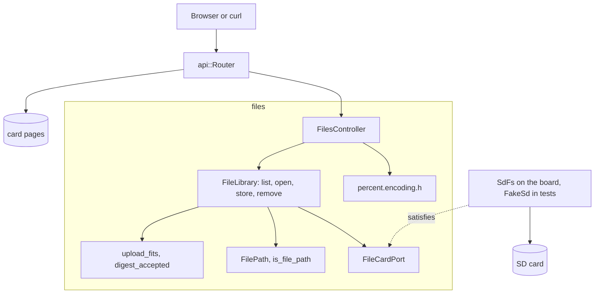

# RestFiles

装有以太网扩展板的 Arduino Uno R4 Minima 上的 SD 卡文件管理器。它列出根文件夹，下载整个文件或一个字节范围，在 `Repr-Digest` 校验下上传最多 8 MiB，并删除文件，全部支持长文件名。

[English](README.md) | [日本語](README.ja.md) | 简体中文 | [繁體中文（香港）](README.zh-HK.md)

## 本示例涵盖的内容

| 方面 | 实现内容 |
|:-----|:---------|
| 限界上下文 | `files`，分为 `domain`、`application` 和 `adapters`。 |
| 领域 | 用于 1 到 64 个字符长文件名的 `FilePath` 和 `is_file_path`；用于 8 MiB 上限的 `upload_fits`；用于 `Repr-Digest` 的 `DigestClaim` 和 `digest_accepted`。 |
| 端口 | `FileCardPort` 列出用例调用的卡和文件函数：`begin`、`exists`、`remove`、`open`、`openNextFile`、`getName`。开发板上由 `SdFs` 满足，测试中由 `FakeSd` 满足。 |
| 用例 | `FileLibrary` 按需挂载卡，列出、打开文件，通过临时文件并计算 SHA-256 来保存，以及删除。每次写入都会改变的版本号是 ETag 的来源。 |
| 适配器 | `FilesController` 把 HTTP、范围请求、ETag 和下载映射到用例；`percent.encoding.h` 写出新文件的 `Location`。 |
| 组合根 | [`RestFiles.ino`](RestFiles.ino) 用模拟噪声生成版本种子，构建文件库，并启动 DHCP 和 `madofiles.local` 的 mDNS。 |
| 测试 | 两个文件中的 29 个主机测试、一个 libFuzzer 目标，以及分支覆盖率 96% 的 20 个页面测试。 |
| 规则 | JPL D-60411 与 Power of Ten：不用堆、不用虚函数、不用函数指针，每个函数平均 2.03 个断言。 |

## 架构



文件库以流的方式工作：上传以 512 字节为一块从请求中读取，边算哈希边写入 `/UPLOAD.TMP`，只有完整且摘要匹配的请求体才会复制到目标文件上。路由器在每个请求前向文件库询问已挂载的卡，所以启动后插入的卡也能被发现。

## 项目结构

```text
RestFiles/
  RestFiles.ino                                组合根、网络和 mDNS
  openapi.json                                 API 契约
  src/http/api.generated.h                     由工具生成
  src/http/api.router.h                        四个文件路由、卡上的页面
  src/files/domain/file_path.value.h           FilePath、is_file_path
  src/files/domain/upload.policy.h             upload_fits、DigestClaim、digest_accepted
  src/files/application/file_card.port.h       FileCardPort
  src/files/application/file_library.service.h FileLibrary
  src/files/adapters/files.controller.h        HTTP、范围请求、ETag、下载
  src/files/adapters/percent.encoding.h        Location 编码
  tests/                                       主机测试
  SD Card/                                     页面
```

## API 端点

所有路由都不需要认证。

| 方法 | 端点 | 说明 |
|:-----|:-----|:-----|
| GET | `/api/files` | 根文件夹中最多 32 个条目 |
| GET | `/api/files/{name}` | 整个文件，或带 `Range: bytes=...` 的范围；`?download=1` 会加上 `Content-Disposition` |
| PUT | `/api/files/{name}` | 创建（带 `Location` 的 `201`）或替换（`204`）文件 |
| DELETE | `/api/files/{name}` | 删除文件 |
| GET | 其他路径 | 卡上的页面 |

`GET /api/files` 的应答：

```json
[{"name":"holiday photo (2).jpeg","size":2048,"directory":false}]
```

| 错误条件 | 状态 | 详情 |
|:---------|:----:|:-----|
| 名称不符合卡的规则 | 400 | `file names are 1 to 64 printable ASCII characters without \ / : * ? " < > \| %` |
| 没有该名称的文件 | 404 | `no file has this name` |
| 范围超出文件末尾 | 416 | |
| `Content-Length` 超过 8 MiB | 413 | `files are at most 8 MiB` |
| 请求体与 `Repr-Digest` 不符 | 422 | `the body does not match Repr-Digest` |
| 请求体提前结束 | 400 | `the body ended early or the card refused the write` |
| 卡拒绝写入或删除 | 507 | `the card refused the write` 或 `the card refused the delete` |
| 没有卡 | 503 | `the SD card is not available` |

## 设计决策

### SdFat 本身就是适配器

`FileCardPort` 把 `FileLibrary` 发出的调用与卡的类型对照。`SdFs` 已经提供这些调用，测试用的假卡也一样，所以不需要只会转发调用的包装类。端口就是接缝，两种卡类型就是它的两个适配器。

### 通过临时文件替换

上传先写入 `/UPLOAD.TMP`，同时计算 SHA-256。只有请求体完整且摘要匹配时，`install` 才把它复制到目标文件上。连接中断或摘要错误时，旧文件保持不变。

### 版本放在用例中

每次写入、删除或重新挂载成功，`FileLibrary` 的版本都会增加。`open` 把它放在 `mado::FileStamp` 中返回，控制器用大小和版本生成弱 ETag。种子来自启动时的模拟噪声，所以在开发板断电期间被修改的文件，不会与重启前的标签匹配。

### 长文件名只在一处检查

`is_file_path` 询问 `mado::valid_card_name` 并检查开头的斜杠。控制器只是把 URL 解码为 `FilePath` 再询问领域层，从不自己判断名称。列表会跳过开发板无法再提供的名称，所以页面从不显示打不开的文件。

## 权衡

| 可以做的事 | 现在不做的原因 | 照现状发布的风险 |
|:-----------|:---------------|:-----------------|
| 认证 | RestApi 和 RestAuth 演示了认证 | 网络上任何人都能读取、替换和删除文件 |
| 根目录以下的文件夹 | 列表和名称都是扁平的 | 子文件夹中的文件只能通过页面访问 |
| 列表中超过 32 个条目 | 上限让循环的终止可以证明 | 第 33 个及以后的条目不会列出 |

## 假设

- 网络是可信的：没有认证，也没有 TLS。
- 卡是 SdFat 能读取的 FAT16、FAT32 或 exFAT。
- 上传来自会计算 `Repr-Digest` 的页面；不带它的 curl 上传会不经校验地被接受。

## 测试

```bash
cmake -S ../../tests -B build && cmake --build build --target mado_example_restfiles
ctest --test-dir build -R '^RestFiles\.' --output-on-failure
```

| 文件 | 测试数 | 覆盖内容 |
|:-----|------:|:---------|
| [`files.domain.test.cpp`](tests/files.domain.test.cpp) | 7 | 长文件名、保留字符、8 MiB 上限、摘要、`Location` 编码 |
| [`files.api.test.cpp`](tests/files.api.test.cpp) | 22 | 列表、范围请求、ETag 与 `304`、下载、带或不带摘要的上传、被拒绝的写入和删除、延后插入的卡 |

模糊测试目标 [`files_fuzz.cpp`](../../tests/fuzz/files_fuzz.cpp) 向同一个路由器发送随机请求。`cd "SD Card" && pnpm run test` 运行 20 个页面测试。

## 前提条件

| 工具 | 版本 | 用途 |
|:-----|:-----|:-----|
| Arduino Uno R4 Minima | | 开发板 |
| 带 microSD 插槽的 W5100、W5500 或 ENC28J60 扩展板 | | 网络和卡 |
| arduino-cli | 1.5.1 | 构建程序 |
| arduino:renesas_uno 核心 | 1.6.0 | 开发板软件包 |
| Ethernet 和 SdFat | 2.0.2 和 2.3.0 | 网络和卡的库 |
| Node.js 和 pnpm | 24 和 12.15.0 | 构建页面 |

## 快速开始

```bash
arduino-cli lib install Ethernet@2.0.2 SdFat@2.3.0
arduino-cli compile --fqbn arduino:renesas_uno:minima --library ../.. .
arduino-cli upload --fqbn arduino:renesas_uno:minima --port /dev/cu.usbmodem1101 .
cd "SD Card" && pnpm install && pnpm run build
```

开发板向 DHCP 请求地址，失败时使用 `192.168.1.178`。它以 `madofiles.local` 应答：

```bash
curl -T notes.txt http://madofiles.local/api/files/notes.txt
curl http://madofiles.local/api/files
```

## 技术栈

| 类别 | 技术 |
|:-----|:-----|
| 开发板 | Arduino Uno R4 Minima：闪存 262,144 字节中用 94,472 字节，RAM 32,768 字节中用 6,944 字节 |
| HTTP | Madoguchi：范围请求、ETag、SHA-256、mDNS、DHCP 备用地址 |
| 卡 | 支持长文件名的 SdFat 2.3.0 |
| 网络 | Ethernet 2.0.2 |
| 主机测试 | googletest 1.18.0、CMake、libFuzzer |
| 页面 | TypeScript 7.0.2、Vite 8.3.5、从 CDN 加载的 Pico CSS 2.1.1、Vitest 5.0.5 |
| 分析 | clang-tidy 23.1.3、cppcheck 2.22.0、clang-format 23.1.3、Biome 2.6.3 |
