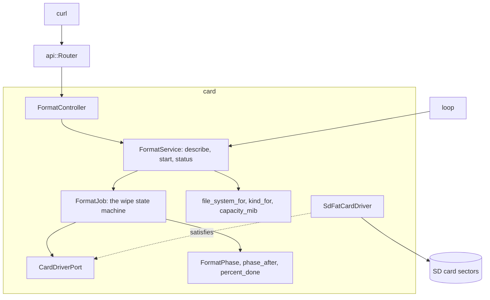

# RestFormat

Arduino Uno R4 Minimaで動く、SDカードを消去してSdFat用にフォーマットするJSON APIです。すべてのセクターを`0x00`で埋めて読み戻し、`0xFF`で埋めて読み戻し、容量に応じてFAT16、FAT32、exFATを作り、結果をマウントして確かめます。

[English](README.md) | 日本語 | [简体中文](README.zh-Hans.md) | [繁體中文（香港）](README.zh-HK.md)

## このサンプルの内容

| 領域 | 作ったもの |
|:-----|:-----------|
| 境界づけられたコンテキスト | `card`を`domain`、`application`、`adapters`に分けています。 |
| ドメイン | `file_system_for`は4,194,304セクター未満でFAT16、67,108,864まででFAT32、それより上でexFATを選び、`kind_for`はSDSC、SDHC、SDXCを名付けます。`FormatPhase`と`FormatFailure`がジョブの状態で、`phase_after`、`pass_of`、`pattern_of`、`percent_done`がジョブを進めます。 |
| ポート | `CardDriverPort`は`open`、`format`、`mounted`と、デバイスの`sectorCount`、`readSectors`、`writeSectors`を名指しします。 |
| ユースケース | `FormatJob`は`loop`から1ステップ8セクターずつ状態機械を動かします。`FormatService`はカードを説明し、クライアントが確かめた容量のときだけジョブを始め、進み具合を報告します。 |
| アダプター | `SdFatCardDriver`は`SdCardFactory`、`FatFormatter`、`ExFatFormatter`、`FsVolume`を包み、`FormatController`はフラッシュの表で列挙値を名前にします。 |
| コンポジションルート | [`RestFormat.ino`](RestFormat.ino)がサービスを組み立ててルーターにつなぎ、`loop`ごとに`step`を1回呼びます。 |
| ページ | ありません。APIはJSONだけを返します。 |
| テスト | 偽のセクターデバイスを相手にした2ファイルのホストテスト34件。 |
| ルール | JPL D-60411とPower of Ten。ヒープなし、仮想関数なし、関数ポインターなし、関数あたり2.07個のアサーション。 |

## アーキテクチャ



HTTPリクエストはジョブを始めるだけです。`loop`が1バッチずつ進めるので、消去中もボードは`GET /api/card/format`に応答し続けます。

## プロジェクト構成

```text
RestFormat/
  RestFormat.ino                               コンポジションルート
  openapi.json                                 API契約、x-mado-cardはfalse
  src/http/api.generated.h                     生成
  src/http/api.router.h                        3つのルート、カードのページなし
  src/card/domain/file_system.policy.h         ファイルシステム、カードの種類、容量
  src/card/domain/format_phase.entity.h        段階、失敗、進み具合
  src/card/application/card_driver.port.h      CardDriverPort
  src/card/application/format_job.service.h    FormatJob
  src/card/application/format.service.h        FormatService
  src/card/adapters/sdfat_card.driver.h        SdFatのフォーマッターとボリューム
  src/card/adapters/format.controller.h        HTTPと名前の表
  tests/                                       ホストテスト
```

## APIエンドポイント

認証が必要なルートはありません。

| メソッド | エンドポイント | 説明 |
|:---------|:---------------|:-----|
| GET | `/api/card` | 容量、種類、カードに作るファイルシステム |
| POST | `/api/card/format` | `{"capacity_mib":1024}`で消去を始める。`202`と`Location: /api/card/format`を返す |
| GET | `/api/card/format` | ジョブの段階、パーセント、詳細 |

`GET /api/card`の応答：

```json
{"capacity_mib":1024,"kind":"SDSC","file_system":"FAT16"}
```

ジョブの後、`GET /api/card/format`の応答：

```json
{"phase":"done","percent":100,"capacity_mib":1024,"file_system":"FAT16","detail":"the card holds a fresh FAT16 volume"}
```

| エラーの条件 | ステータス | 詳細 |
|:-------------|:----------:|:-----|
| カードが応答しない | 503 | `no SD card answers` |
| 消去が実行中 | 409 | `a wipe is already running` |
| `capacity_mib`がこのカードのものではない | 422 | `the capacity does not match this card` |
| `capacity_mib`がない | 422 | `missing required property: capacity_mib` |
| カードがセクター数0を報告する | 422 | `the card reports no sectors` |

失敗したジョブは`"phase":"failed"`と、`the card read back a byte it was not given`や`the card changed during the wipe`のような詳細を報告します。

## 設計上の判断

### クライアントは容量を繰り返す

消去はすべてを壊します。ボディには`GET /api/card`が報告した容量を書く必要があるので、あるカード向けのリクエストは、その後に差し替えた別のカードには何もしません。`FormatService::start`がジョブの前にそれを確かめます。

### 逆のパターンで2回

`0x00`を読み戻すセクターは0に固着しているかもしれません。`0xFF`も書いて読むことで、どちら向きに固着したビットも見つかります。`compare`はバッチごとに`sectorCount`も確かめます。読み出し時間の約2から3パーセントを使い、消去中に差し替えたカードを見つけます。

### 失敗はドメインの値

ジョブは列挙値`FormatFailure`を記録します。クライアントが読む文はコントローラーのフラッシュの表にあるので、ドメインには`F()`もArduinoのヘッダーも要らず、新しい言語は1ファイルだけに触れます。

### switchではなく表で名前にする

段階、種類、ファイルシステム、失敗は、`mado::name_at`で読む`PROGMEM`の表で文になります。確かめ付きの1回の参照が、どれもアサーションを持たない5つのswitch関数の代わりになります。

### ハードウェアのファイルはSdFatドライバーだけ

`<SdFat.h>`をインクルードするヘッダーは`sdfat_card.driver.h`だけで、スケッチはそれを最後にインクルードします。このコアではSdFatが`F()`を定義し直すからです。テストは同じポートを満たす偽のドライバーを使います。

## トレードオフ

| できること | 今はしない理由 | このままのリスク |
|:-----------|:---------------|:-----------------|
| 認証 | このサンプルは消去を示し、トークンはRestApiが示す | ネットワーク上の誰でもカードを消せる |
| 取り消しのルート | 途中まで消したカードはどのみち使えない | 始めた消去は最後か失敗まで続く |
| 消去時間の測定 | 本物のSDSC、SDHC、SDXCのカードが要る | 消去にかかる時間はわからない |

## 前提

- ネットワークは信頼できる。認証もTLSもない。
- カードはシールドのSPIバスにあり、チップセレクトは4番ピン。

## テスト

```bash
cmake -S ../../tests -B build && cmake --build build --target mado_example_restformat
ctest --test-dir build -R '^RestFormat\.' --output-on-failure
```

| ファイル | テスト数 | 対象 |
|:---------|---------:|:-----|
| [`card.domain.test.cpp`](tests/card.domain.test.cpp) | 8 | 段階の順序、両方のパターン、1回目の途中のパーセント、迷い込んだバイト、カードの種類、容量 |
| [`format.api.test.cpp`](tests/format.api.test.cpp) | 26 | ファイルシステムの境界、カードの説明、後から挿したカード、拒否された開始、消去全体、進み具合、すべての失敗 |

## 前提条件

| ツール | バージョン | 用途 |
|:-------|:-----------|:-----|
| Arduino Uno R4 Minima | | ボード |
| microSDスロット付きのW5100、W5500、ENC28J60シールド | | ネットワークとカード |
| arduino-cli | 1.5.1 | スケッチのビルド |
| arduino:renesas_unoコア | 1.6.0 | ボードパッケージ |
| EthernetとSdFat | 2.0.2と2.3.0 | ネットワークとカードのライブラリ |

## はじめに

```bash
arduino-cli lib install Ethernet@2.0.2 SdFat@2.3.0
arduino-cli compile --fqbn arduino:renesas_uno:minima --library ../.. .
arduino-cli upload --fqbn arduino:renesas_uno:minima --port /dev/cu.usbmodem1101 .
curl http://192.168.1.177/api/card
curl -X POST -H 'Content-Type: application/json' -d '{"capacity_mib":1024}' http://192.168.1.177/api/card/format
```

## 技術スタック

| 分類 | 技術 |
|:-----|:-----|
| ボード | Arduino Uno R4 Minima：フラッシュ262,144バイト中71,852バイト、RAM 32,768バイト中9,936バイト、うち4 KiBがセクターバッファー |
| HTTP | Madoguchi、ヒープを使わないC++11 |
| カード | SdFat 2.3.0：`SdCardFactory`、`FatFormatter`、`ExFatFormatter`、`FsVolume` |
| ネットワーク | Ethernet 2.0.2 |
| ホストテスト | googletest 1.18.0、CMake |
| 解析 | clang-tidy 23.1.3、cppcheck 2.22.0、clang-format 23.1.3 |
