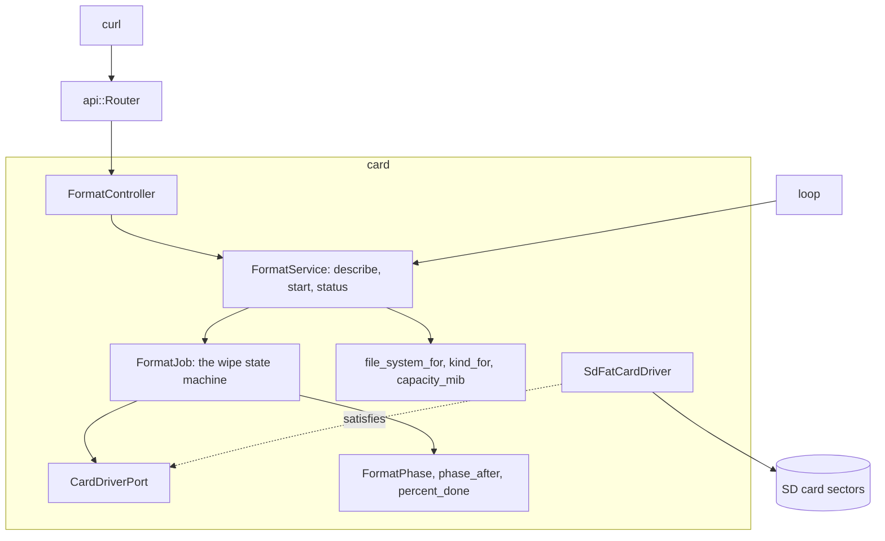

# RestFormat

JSON API on an Arduino Uno R4 Minima that wipes an SD card and formats it for SdFat. It fills every sector with `0x00`, reads them back, fills them with `0xFF`, reads them back, then lays down FAT16, FAT32 or exFAT by capacity and mounts the result to confirm.

English | [日本語](README.ja.md) | [简体中文](README.zh-Hans.md) | [繁體中文（香港）](README.zh-HK.md)

## What this example covers

| Area | What is built |
|:-----|:--------------|
| Bounded context | `card`, split into `domain`, `application` and `adapters`. |
| Domain | `file_system_for` picks FAT16 below 4,194,304 sectors, FAT32 up to 67,108,864 and exFAT above; `kind_for` names SDSC, SDHC or SDXC; `FormatPhase` and `FormatFailure` are the job's states; `phase_after`, `pass_of`, `pattern_of` and `percent_done` drive it. |
| Port | `CardDriverPort` names `open`, `format`, `mounted` and the device's `sectorCount`, `readSectors` and `writeSectors`. |
| Use cases | `FormatJob` runs the state machine eight sectors per step from `loop`; `FormatService` describes the card, starts a job only for the capacity the client confirms and reports progress. |
| Adapters | `SdFatCardDriver` wraps `SdCardFactory`, `FatFormatter`, `ExFatFormatter` and `FsVolume`; `FormatController` turns enums into names through flash tables. |
| Composition root | [`RestFormat.ino`](RestFormat.ino) builds the service, attaches it to the router and calls `step` once per `loop`. |
| Pages | None. The API answers JSON only. |
| Tests | 55 host tests in four files against a fake sector device. |
| Rules | JPL D-60411 and the Power of Ten: no heap, no virtual functions, no function pointers, 2.06 assertions per function. |

## Architecture



The HTTP request only starts the job. `loop` advances it one batch at a time, so the board keeps answering `GET /api/card/format` while it wipes.

## Project structure

```text
RestFormat/
  RestFormat.ino                               composition root
  openapi.json                                 API contract, x-mado-card false
  src/http/api.generated.h                     generated
  src/http/api.router.h                        three routes, no card pages
  src/identity/...                             sign-in, the same code as RestAuth
  src/card/domain/file_system.policy.h         file system, card kind, capacity
  src/card/domain/format_phase.entity.h        phases, failures, progress
  src/card/application/card_driver.port.h      CardDriverPort
  src/card/application/format_job.service.h    FormatJob
  src/card/application/format.service.h        FormatService
  src/card/adapters/sdfat_card.driver.h        SdFat formatters and volume
  src/card/adapters/format.controller.h        HTTP and name tables
  tests/                                       host tests
```

## API endpoints

Every `/api` route except the login needs a bearer token; see Sign-in and safe writes.

| Method | Endpoint | Description |
|:-------|:---------|:------------|
| GET | `/api/card` | Capacity, kind and the file system the card will get |
| POST | `/api/card/format` | Start a wipe with `{"capacity_mib":1024}`; answers `202` and `Location: /api/card/format` |
| GET | `/api/card/format` | The phase, percent and detail of the job |

`GET /api/card` answers:

```json
{"capacity_mib":1024,"kind":"SDSC","file_system":"FAT16"}
```

After the job, `GET /api/card/format` answers:

```json
{"phase":"done","percent":100,"capacity_mib":1024,"file_system":"FAT16","detail":"the card holds a fresh FAT16 volume"}
```

| Error condition | Status | Detail |
|:----------------|:------:|:-------|
| No card answers | 503 | `no SD card answers` |
| A wipe is running | 409 | `a wipe is already running` |
| `capacity_mib` is not this card's | 422 | `the capacity does not match this card` |
| `capacity_mib` is missing | 422 | `missing required property: capacity_mib` |
| The card reports no sectors | 422 | `the card reports no sectors` |

A failed job reports `"phase":"failed"` with a detail such as `the card read back a byte it was not given` or `the card changed during the wipe`.

## Design decisions

### The client must repeat the capacity

A wipe destroys everything. The body has to name the capacity that `GET /api/card` reported, so a request written for one card does nothing to another card swapped in since. `FormatService::start` checks it before the job starts.

### Two passes with opposite patterns

A sector that reads back `0x00` might be stuck at zero. Writing and reading `0xFF` as well catches bits stuck either way. `compare` also checks `sectorCount` on every batch, which costs about 2 to 3 percent of read time and catches a card swapped mid-wipe.

### Failures are domain values

The job records a `FormatFailure` enum. The text a client reads lives in the controller's flash tables, so the domain needs no `F()` and no Arduino header, and a new language would touch one file.

### Names through tables, not switches

Phases, kinds, file systems and failures map to text through `PROGMEM` tables read with `mado::name_at`. One checked lookup replaces five switch functions that would each carry no assertion.

### The SdFat driver is the only hardware file

`sdfat_card.driver.h` is the one header that includes `<SdFat.h>`, and the sketch includes it last, because SdFat redefines `F()` on this core. The tests use a fake driver that satisfies the same port.

## Trade-offs

| What could be done | Why it is not done | Risk as shipped |
|:-------------------|:-------------------|:----------------|
| A cancel route | A half-wiped card is unusable either way | A started wipe runs to the end or to a failure |
| Measured wipe times | Needs real SDSC, SDHC and SDXC cards | The time a wipe takes is unknown |

## Assumptions

- The network is trusted enough for clear-text passwords and tokens: there is no TLS.
- The card sits on the shield's SPI bus with chip select on pin 4.

## Sign-in and safe writes

Every `/api` route except `POST /api/auth/login` needs a bearer token. Sign in with `{"username":"admin","password":"..."}` for a token valid for 15 minutes and until the board restarts; a missing, wrongly signed or stale token answers `401` with `WWW-Authenticate: Bearer`.

Five failed sign-ins from one client address lock that address for 15 minutes with `429` and `Retry-After`; other addresses keep signing in. The table holds four addresses, and while all four are locked a new address is locked too, so cycling addresses cannot clear a lock. The counts stay in RAM, because the card is the device this example erases.

Write the account into [`arduino_secrets.h`](arduino_secrets.h) before building with `python3 -m tools.madogen secrets examples/RestFormat --user admin`; the committed file is an all-zero placeholder that answers `503` to every sign-in.

## Testing

```bash
cmake -S ../../tests -B build && cmake --build build --target mado_example_restformat
ctest --test-dir build -R '^RestFormat\.' --output-on-failure
```

| File | Tests | Covers |
|:-----|------:|:-------|
| [`card.domain.test.cpp`](tests/card.domain.test.cpp) | 8 | the phase order, both patterns, percent halfway through the first pass, a stray byte, card kinds, capacity |
| [`format.api.test.cpp`](tests/format.api.test.cpp) | 28 | file system boundaries, card descriptions, a late card, refused starts, a full wipe, progress, every failure |
| [`identity.adapters.test.cpp`](tests/identity.adapters.test.cpp) | 9 | the EEPROM counter, sign-in, failures per address on the card, a lockout across a restart, token checks |
| [`identity.domain.test.cpp`](tests/identity.domain.test.cpp) | 10 | credential rules, the session counter, token end times |

## Prerequisites

| Tool | Version | Required for |
|:-----|:--------|:-------------|
| Arduino Uno R4 Minima | | the board |
| W5100, W5500 or ENC28J60 shield with a microSD slot | | network and card |
| arduino-cli | 1.5.1 | building the sketch |
| arduino:renesas_uno core | 1.6.0 | the board package |
| Ethernet and SdFat | 2.0.2 and 2.3.0 | network and card libraries |

## Getting started

```bash
cd ../.. && python3 -m tools.madogen secrets examples/RestFormat --user admin && cd examples/RestFormat
arduino-cli lib install Ethernet@2.0.2 SdFat@2.3.0
arduino-cli compile --fqbn arduino:renesas_uno:minima --library ../.. .
arduino-cli upload --fqbn arduino:renesas_uno:minima --port /dev/cu.usbmodem1101 .
TOKEN=$(curl -s -H 'Content-Type: application/json' -d '{"username":"admin","password":"your password"}' http://192.168.1.177/api/auth/login | python3 -c 'import json,sys; print(json.load(sys.stdin)["access_token"])')
curl -H "Authorization: Bearer $TOKEN" http://192.168.1.177/api/card
curl -H "Authorization: Bearer $TOKEN" -X POST -H 'Content-Type: application/json' -d '{"capacity_mib":1024}' http://192.168.1.177/api/card/format
```

## Tech stack

| Category | Technology |
|:---------|:-----------|
| Board | Arduino Uno R4 Minima: 92,456 of 262,144 bytes of flash, 10,344 of 32,768 bytes of RAM, 4 KiB of it the sector buffer |
| HTTP | Madoguchi, heap-free C++11 |
| Card | SdFat 2.3.0: `SdCardFactory`, `FatFormatter`, `ExFatFormatter`, `FsVolume` |
| Network | Ethernet 2.0.2 |
| Host tests | googletest 1.18.0, CMake |
| Analysis | clang-tidy 23.1.3, cppcheck 2.22.0, clang-format 23.1.3 |
