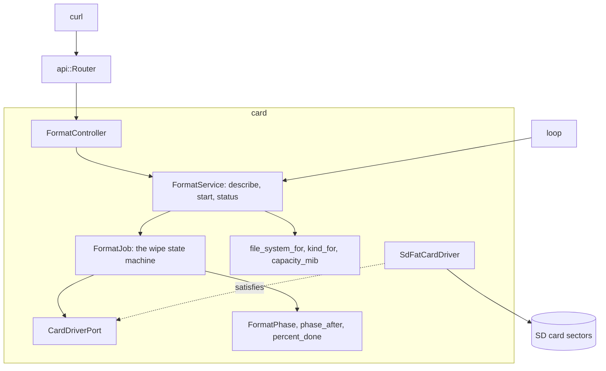

# RestFormat

Arduino Uno R4 Minima 上擦除 SD 卡並為 SdFat 格式化的 JSON API。它以 `0x00` 填滿每個磁區並讀回，再以 `0xFF` 填滿並讀回，然後按容量建立 FAT16、FAT32 或 exFAT，最後掛載結果加以確認。

[English](README.md) | [日本語](README.ja.md) | [简体中文](README.zh-Hans.md) | 繁體中文（香港）

## 本範例涵蓋的內容

| 範疇 | 實作內容 |
|:-----|:---------|
| 限界上下文 | `card`，分為 `domain`、`application` 及 `adapters`。 |
| 領域 | `file_system_for` 在少於 4,194,304 個磁區時選 FAT16，67,108,864 以內選 FAT32，超過則選 exFAT；`kind_for` 給出 SDSC、SDHC 或 SDXC；`FormatPhase` 及 `FormatFailure` 是工作的狀態；`phase_after`、`pass_of`、`pattern_of` 及 `percent_done` 推動工作。 |
| 端口 | `CardDriverPort` 列出 `open`、`format`、`mounted`，以及裝置的 `sectorCount`、`readSectors` 及 `writeSectors`。 |
| 用例 | `FormatJob` 在 `loop` 中每步處理八個磁區來運行狀態機；`FormatService` 描述記憶卡，只在客戶端確認的容量下開始工作，並報告進度。 |
| 轉接器 | `SdFatCardDriver` 包裝 `SdCardFactory`、`FatFormatter`、`ExFatFormatter` 及 `FsVolume`；`FormatController` 透過快閃記憶體表把列舉值轉為名稱。 |
| 組合根 | [`RestFormat.ino`](RestFormat.ino) 建構服務、把它接到路由器上，並在每次 `loop` 中呼叫一次 `step`。 |
| 頁面 | 沒有。API 只回應 JSON。 |
| 測試 | 兩個檔案中針對假磁區裝置的 34 個主機測試。 |
| 規則 | JPL D-60411 及 Power of Ten：不用堆積、不用虛擬函式、不用函式指標，每個函式平均 2.07 個斷言。 |

## 架構



HTTP 請求只負責開始工作。`loop` 每次推進一批，所以擦除期間開發板仍能回應 `GET /api/card/format`。

## 項目結構

```text
RestFormat/
  RestFormat.ino                               組合根
  openapi.json                                 API 契約，x-mado-card 為 false
  src/http/api.generated.h                     由工具產生
  src/http/api.router.h                        三個路由，沒有記憶卡上的頁面
  src/card/domain/file_system.policy.h         檔案系統、記憶卡類型、容量
  src/card/domain/format_phase.entity.h        階段、失敗、進度
  src/card/application/card_driver.port.h      CardDriverPort
  src/card/application/format_job.service.h    FormatJob
  src/card/application/format.service.h        FormatService
  src/card/adapters/sdfat_card.driver.h        SdFat 的格式化器及磁碟區
  src/card/adapters/format.controller.h        HTTP 及名稱表
  tests/                                       主機測試
```

## API 端點

所有路由都不需要認證。

| 方法 | 端點 | 說明 |
|:-----|:-----|:-----|
| GET | `/api/card` | 容量、類型及記憶卡將獲得的檔案系統 |
| POST | `/api/card/format` | 以 `{"capacity_mib":1024}` 開始擦除；回應 `202` 及 `Location: /api/card/format` |
| GET | `/api/card/format` | 工作的階段、百分比及詳情 |

`GET /api/card` 的回應：

```json
{"capacity_mib":1024,"kind":"SDSC","file_system":"FAT16"}
```

工作完成後，`GET /api/card/format` 的回應：

```json
{"phase":"done","percent":100,"capacity_mib":1024,"file_system":"FAT16","detail":"the card holds a fresh FAT16 volume"}
```

| 錯誤條件 | 狀態 | 詳情 |
|:---------|:----:|:-----|
| 沒有記憶卡回應 | 503 | `no SD card answers` |
| 擦除正在進行 | 409 | `a wipe is already running` |
| `capacity_mib` 不是這張記憶卡的 | 422 | `the capacity does not match this card` |
| 缺少 `capacity_mib` | 422 | `missing required property: capacity_mib` |
| 記憶卡報告沒有磁區 | 422 | `the card reports no sectors` |

失敗的工作報告 `"phase":"failed"`，以及 `the card read back a byte it was not given` 或 `the card changed during the wipe` 之類的詳情。

## 設計決定

### 客戶端必須重複容量

擦除會毀掉一切。請求主體必須寫明 `GET /api/card` 報告的容量，所以為一張記憶卡寫的請求，對之後換上的另一張記憶卡不起作用。`FormatService::start` 在工作開始前檢查它。

### 兩遍相反的模式

讀回 `0x00` 的磁區可能卡在 0。再寫入並讀回 `0xFF`，就能發現卡在任一方向的位元。`compare` 在每一批中亦會檢查 `sectorCount`，這大約佔讀取時間的 2% 至 3%，能發現擦除中途被換掉的記憶卡。

### 失敗是領域值

工作記錄一個 `FormatFailure` 列舉值。客戶端讀到的文字放在控制器的快閃記憶體表中，所以領域層不需要 `F()`，亦不需要 Arduino 標頭檔，增加一種語言只涉及一個檔案。

### 以表而不是 switch 轉為名稱

階段、類型、檔案系統及失敗透過以 `mado::name_at` 讀取的 `PROGMEM` 表轉為文字。一次附檢查的查找取代了五個各自沒有斷言的 switch 函式。

### SdFat 驅動程式是唯一的硬件檔案

`sdfat_card.driver.h` 是唯一包含 `<SdFat.h>` 的標頭檔，草稿碼最後才包含它，因為在這個核心上 SdFat 會重新定義 `F()`。測試使用滿足同一端口的假驅動程式。

## 取捨

| 可以做的事 | 現在不做的原因 | 照現狀發佈的風險 |
|:-----------|:---------------|:-----------------|
| 認證 | 本範例示範擦除；權杖由 RestApi 示範 | 網絡上任何人都能擦除記憶卡 |
| 取消路由 | 擦了一半的記憶卡無論如何都不能用 | 已開始的擦除會進行到完結或失敗 |
| 實測擦除時間 | 需要真實的 SDSC、SDHC 及 SDXC 記憶卡 | 擦除所需的時間未知 |

## 假設

- 網絡是可信的：沒有認證，亦沒有 TLS。
- 記憶卡位於擴充板的 SPI 匯流排上，晶片選擇為 4 號針腳。

## 測試

```bash
cmake -S ../../tests -B build && cmake --build build --target mado_example_restformat
ctest --test-dir build -R '^RestFormat\.' --output-on-failure
```

| 檔案 | 測試數目 | 涵蓋內容 |
|:-----|------:|:---------|
| [`card.domain.test.cpp`](tests/card.domain.test.cpp) | 8 | 階段順序、兩種模式、第一遍中途的百分比、一個錯誤位元組、記憶卡類型、容量 |
| [`format.api.test.cpp`](tests/format.api.test.cpp) | 26 | 檔案系統邊界、記憶卡描述、延後插入的記憶卡、被拒絕的開始、完整擦除、進度、每種失敗 |

## 先決條件

| 工具 | 版本 | 用途 |
|:-----|:-----|:-----|
| Arduino Uno R4 Minima | | 開發板 |
| 附 microSD 插槽的 W5100、W5500 或 ENC28J60 擴充板 | | 網絡及記憶卡 |
| arduino-cli | 1.5.1 | 建置草稿碼 |
| arduino:renesas_uno 核心 | 1.6.0 | 開發板套件 |
| Ethernet 及 SdFat | 2.0.2 及 2.3.0 | 網絡及記憶卡程式庫 |

## 開始使用

```bash
arduino-cli lib install Ethernet@2.0.2 SdFat@2.3.0
arduino-cli compile --fqbn arduino:renesas_uno:minima --library ../.. .
arduino-cli upload --fqbn arduino:renesas_uno:minima --port /dev/cu.usbmodem1101 .
curl http://192.168.1.177/api/card
curl -X POST -H 'Content-Type: application/json' -d '{"capacity_mib":1024}' http://192.168.1.177/api/card/format
```

## 技術棧

| 類別 | 技術 |
|:-----|:-----|
| 開發板 | Arduino Uno R4 Minima：快閃記憶體 262,144 位元組中用 71,852 位元組，RAM 32,768 位元組中用 9,936 位元組，其中 4 KiB 是磁區緩衝區 |
| HTTP | Madoguchi，不用堆積的 C++11 |
| 記憶卡 | SdFat 2.3.0：`SdCardFactory`、`FatFormatter`、`ExFatFormatter`、`FsVolume` |
| 網絡 | Ethernet 2.0.2 |
| 主機測試 | googletest 1.18.0、CMake |
| 分析 | clang-tidy 23.1.3、cppcheck 2.22.0、clang-format 23.1.3 |
