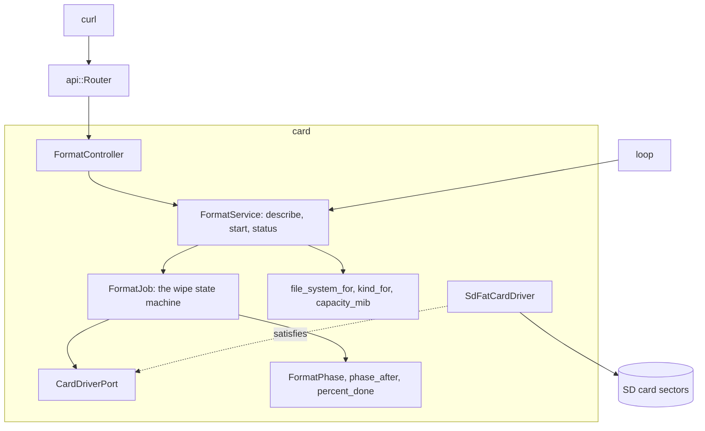

# RestFormat

Arduino Uno R4 Minima 上擦除 SD 卡并为 SdFat 格式化的 JSON API。它用 `0x00` 填满每个扇区并读回，再用 `0xFF` 填满并读回，然后按容量建立 FAT16、FAT32 或 exFAT，最后挂载结果加以确认。

[English](README.md) | [日本語](README.ja.md) | 简体中文 | [繁體中文（香港）](README.zh-HK.md)

## 本示例涵盖的内容

| 方面 | 实现内容 |
|:-----|:---------|
| 限界上下文 | `card`，分为 `domain`、`application` 和 `adapters`。 |
| 领域 | `file_system_for` 在少于 4,194,304 个扇区时选 FAT16，67,108,864 以内选 FAT32，超过则选 exFAT；`kind_for` 给出 SDSC、SDHC 或 SDXC；`FormatPhase` 和 `FormatFailure` 是任务的状态；`phase_after`、`pass_of`、`pattern_of` 和 `percent_done` 推动任务。 |
| 端口 | `CardDriverPort` 列出 `open`、`format`、`mounted`，以及设备的 `sectorCount`、`readSectors` 和 `writeSectors`。 |
| 用例 | `FormatJob` 在 `loop` 中每步处理八个扇区来运行状态机；`FormatService` 描述卡，只在客户端确认的容量下启动任务，并报告进度。 |
| 适配器 | `SdFatCardDriver` 封装 `SdCardFactory`、`FatFormatter`、`ExFatFormatter` 和 `FsVolume`；`FormatController` 通过闪存表把枚举值转为名称。 |
| 组合根 | [`RestFormat.ino`](RestFormat.ino) 构建服务、把它接到路由器上，并在每次 `loop` 中调用一次 `step`。 |
| 页面 | 没有。API 只应答 JSON。 |
| 测试 | 两个文件中针对假扇区设备的 34 个主机测试。 |
| 规则 | JPL D-60411 与 Power of Ten：不用堆、不用虚函数、不用函数指针，每个函数平均 2.07 个断言。 |

## 架构



HTTP 请求只负责启动任务。`loop` 每次推进一批，所以擦除期间开发板仍能应答 `GET /api/card/format`。

## 项目结构

```text
RestFormat/
  RestFormat.ino                               组合根
  openapi.json                                 API 契约，x-mado-card 为 false
  src/http/api.generated.h                     由工具生成
  src/http/api.router.h                        三个路由，没有卡上的页面
  src/card/domain/file_system.policy.h         文件系统、卡的类型、容量
  src/card/domain/format_phase.entity.h        阶段、失败、进度
  src/card/application/card_driver.port.h      CardDriverPort
  src/card/application/format_job.service.h    FormatJob
  src/card/application/format.service.h        FormatService
  src/card/adapters/sdfat_card.driver.h        SdFat 的格式化器和卷
  src/card/adapters/format.controller.h        HTTP 和名称表
  tests/                                       主机测试
```

## API 端点

所有路由都不需要认证。

| 方法 | 端点 | 说明 |
|:-----|:-----|:-----|
| GET | `/api/card` | 容量、类型以及卡将获得的文件系统 |
| POST | `/api/card/format` | 用 `{"capacity_mib":1024}` 开始擦除；应答 `202` 和 `Location: /api/card/format` |
| GET | `/api/card/format` | 任务的阶段、百分比和详情 |

`GET /api/card` 的应答：

```json
{"capacity_mib":1024,"kind":"SDSC","file_system":"FAT16"}
```

任务结束后，`GET /api/card/format` 的应答：

```json
{"phase":"done","percent":100,"capacity_mib":1024,"file_system":"FAT16","detail":"the card holds a fresh FAT16 volume"}
```

| 错误条件 | 状态 | 详情 |
|:---------|:----:|:-----|
| 没有卡应答 | 503 | `no SD card answers` |
| 擦除正在进行 | 409 | `a wipe is already running` |
| `capacity_mib` 不是这张卡的 | 422 | `the capacity does not match this card` |
| 缺少 `capacity_mib` | 422 | `missing required property: capacity_mib` |
| 卡报告没有扇区 | 422 | `the card reports no sectors` |

失败的任务报告 `"phase":"failed"`，以及 `the card read back a byte it was not given` 或 `the card changed during the wipe` 之类的详情。

## 设计决策

### 客户端必须重复容量

擦除会毁掉一切。请求体必须写明 `GET /api/card` 报告的容量，所以为一张卡写的请求，对之后换上的另一张卡不起作用。`FormatService::start` 在任务开始前检查它。

### 两遍相反的模式

读回 `0x00` 的扇区可能卡在 0。再写入并读回 `0xFF`，就能发现卡在任一方向的位。`compare` 在每一批中还会检查 `sectorCount`，这大约占读取时间的 2% 到 3%，能发现擦除中途被换掉的卡。

### 失败是领域值

任务记录一个 `FormatFailure` 枚举值。客户端读到的文字放在控制器的闪存表中，所以领域层不需要 `F()`，也不需要 Arduino 头文件，增加一种语言只涉及一个文件。

### 用表而不是 switch 转为名称

阶段、类型、文件系统和失败通过用 `mado::name_at` 读取的 `PROGMEM` 表转为文字。一次带检查的查找取代了五个各自没有断言的 switch 函数。

### SdFat 驱动是唯一的硬件文件

`sdfat_card.driver.h` 是唯一包含 `<SdFat.h>` 的头文件，程序最后才包含它，因为在这个核心上 SdFat 会重新定义 `F()`。测试使用满足同一端口的假驱动。

## 权衡

| 可以做的事 | 现在不做的原因 | 照现状发布的风险 |
|:-----------|:---------------|:-----------------|
| 认证 | 本示例演示擦除；令牌由 RestApi 演示 | 网络上任何人都能擦除卡 |
| 取消路由 | 擦了一半的卡无论如何都不能用 | 已开始的擦除会进行到结束或失败 |
| 实测擦除时间 | 需要真实的 SDSC、SDHC 和 SDXC 卡 | 擦除所需的时间未知 |

## 假设

- 网络是可信的：没有认证，也没有 TLS。
- 卡位于扩展板的 SPI 总线上，片选为 4 号引脚。

## 测试

```bash
cmake -S ../../tests -B build && cmake --build build --target mado_example_restformat
ctest --test-dir build -R '^RestFormat\.' --output-on-failure
```

| 文件 | 测试数 | 覆盖内容 |
|:-----|------:|:---------|
| [`card.domain.test.cpp`](tests/card.domain.test.cpp) | 8 | 阶段顺序、两种模式、第一遍中途的百分比、一个错误字节、卡的类型、容量 |
| [`format.api.test.cpp`](tests/format.api.test.cpp) | 26 | 文件系统边界、卡的描述、延后插入的卡、被拒绝的启动、完整擦除、进度、每种失败 |

## 前提条件

| 工具 | 版本 | 用途 |
|:-----|:-----|:-----|
| Arduino Uno R4 Minima | | 开发板 |
| 带 microSD 插槽的 W5100、W5500 或 ENC28J60 扩展板 | | 网络和卡 |
| arduino-cli | 1.5.1 | 构建程序 |
| arduino:renesas_uno 核心 | 1.6.0 | 开发板软件包 |
| Ethernet 和 SdFat | 2.0.2 和 2.3.0 | 网络和卡的库 |

## 快速开始

```bash
arduino-cli lib install Ethernet@2.0.2 SdFat@2.3.0
arduino-cli compile --fqbn arduino:renesas_uno:minima --library ../.. .
arduino-cli upload --fqbn arduino:renesas_uno:minima --port /dev/cu.usbmodem1101 .
curl http://192.168.1.177/api/card
curl -X POST -H 'Content-Type: application/json' -d '{"capacity_mib":1024}' http://192.168.1.177/api/card/format
```

## 技术栈

| 类别 | 技术 |
|:-----|:-----|
| 开发板 | Arduino Uno R4 Minima：闪存 262,144 字节中用 71,852 字节，RAM 32,768 字节中用 9,936 字节，其中 4 KiB 是扇区缓冲区 |
| HTTP | Madoguchi，不用堆的 C++11 |
| 卡 | SdFat 2.3.0：`SdCardFactory`、`FatFormatter`、`ExFatFormatter`、`FsVolume` |
| 网络 | Ethernet 2.0.2 |
| 主机测试 | googletest 1.18.0、CMake |
| 分析 | clang-tidy 23.1.3、cppcheck 2.22.0、clang-format 23.1.3 |
