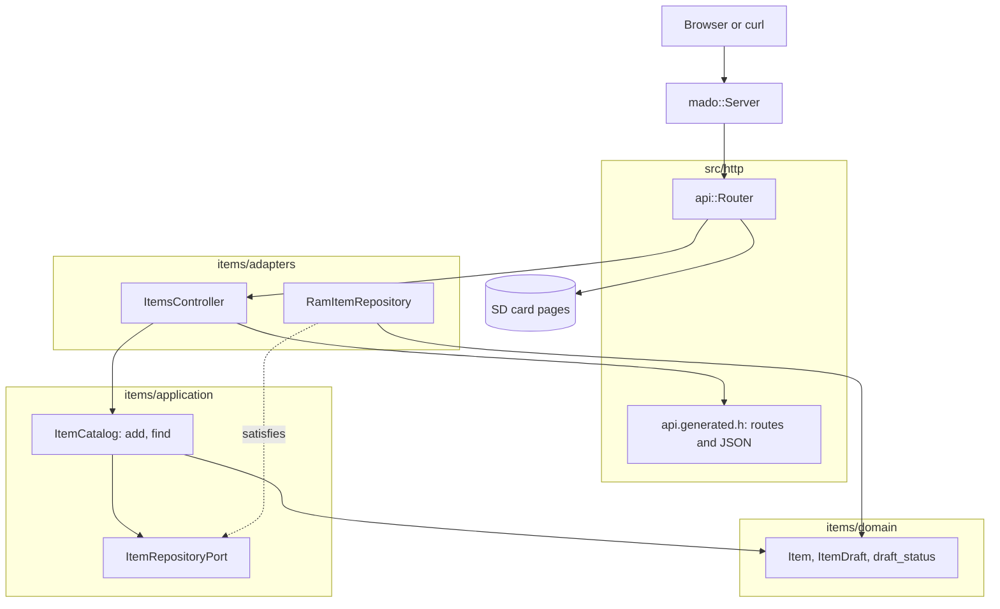

# RestGet

4件の項目を収めた固定テーブルを読むだけのREST APIで、Ethernetシールドを載せたArduino Uno R4 Minimaが応答します。ボードは`GET /api/items`と`GET /api/items/{id}`にJSONで応答し、ページ、OpenAPIドキュメント、Swagger UIをSDカードから配信します。

[English](README.md) | 日本語 | [简体中文](README.zh-Hans.md) | [繁體中文（香港）](README.zh-HK.md)

## このサンプルの内容

| 領域 | 作ったもの |
|:-----|:-----------|
| レイヤー | 境界づけられたコンテキスト`items`を1つ持ち、`domain`、`application`、`adapters`に分けています。ドメインはArduinoのヘッダーを一切インクルードしません。 |
| ポート | `ItemRepositoryPort`はユースケースが使う2つの呼び出し`insert`と`find`を名指しし、戻り値の型を`static_assert`でコンパイル時に検査します。 |
| アダプター | `RamItemRepository`は項目を`mado::SlotTable`に保持します。`ItemsController`はHTTPをユースケースに、生成されたJSON構造体をドメインのエンティティに対応づけます。 |
| コンポジションルート | [`RestGet.ino`](RestGet.ino)がリポジトリを作り、2件の項目を投入し、カードをマウントして、両方をルーターに渡します。 |
| 契約 | [`openapi.json`](openapi.json)が[`api.generated.h`](src/http/api.generated.h)のルート、ワイヤー構造体、JSON書き出しの元になります。 |
| エラー | 存在しないidはRFC 9457のproblemで`404`を返します。カードがなければ`503`を返します。 |
| ページ | `SD Card`はViteとTypeScriptのプロジェクトで、同じ分け方をしています。`domain`、ポートを持つ`application`、`adapters/http`、`adapters/dom`です。 |
| テスト | 5ファイルのホストテスト47件と、カバレッジ100パーセントのページテスト9件。 |
| ルール | JPL D-60411とPower of Ten。ヒープなし、仮想関数なし、関数ポインターなし、すべてのループに上限あり、関数あたり2.02個のアサーション。 |

## アーキテクチャ



依存は内側を向きます。ドメインはHTTPもストレージも知りません。アプリケーションはドメインとポートを知っています。アダプターはその両方とライブラリを知っています。Ethernet、SdFat、具体的なリポジトリを名指しするのは[`RestGet.ino`](RestGet.ino)だけです。

## プロジェクト構成

```text
RestGet/
  RestGet.ino                              コンポジションルート：ハードウェア、配線、setupとloop
  openapi.json                             API契約、tools/madogenの入力
  src/
    http/
      api.generated.h                      ルート、上限、ワイヤー構造体、JSON書き出し（生成）
      api.router.h                         ルートidからコントローラーへ、それ以外のパスはカードのページ
    identity/                              ログイン。RestAuthと同じコード
    items/
      domain/item.entity.h                 Item、ItemDraft、idの範囲と名前のルール
      application/item_repository.port.h   リポジトリが備えるべき呼び出し
      application/item_catalog.service.h   ユースケース：add、find
      adapters/ram_item.repository.h       固定スロットテーブル上のリポジトリ
      adapters/items.controller.h          HTTPからユースケースへ、エンティティからワイヤー構造体へ
  tests/                                   ホストテスト、このサンプル専用のバイナリ
  SD Card/                                 ページ、独立したWebプロジェクト
```

ファイル名は`name.type.h`の形です。`item.entity.h`、`item_catalog.service.h`、`ram_item.repository.h`のように、開く前に接尾辞で中身がわかります。

## APIエンドポイント

ログインを除くすべての`/api`ルートにベアラートークンが必要です。ログインと安全な書き込みの節を参照してください。

| メソッド | エンドポイント | 説明 |
|:---------|:---------------|:-----|
| GET | `/api/items` | すべての項目をid順に |
| GET | `/api/items/{id}` | 1件の項目、idは1から4 |
| GET | `/api/openapi.json` | カードから読んだOpenAPIドキュメント |
| GET | `/docs/` | カードとCDNから読み込むSwagger UI |
| GET | その他のパス | カード上のページ |

`GET /api/items`の応答：

```json
[{"id":1,"name":"lamp","on":true},{"id":2,"name":"fan","on":false}]
```

| エラーの条件 | ステータス | 詳細 |
|:-------------|:----------:|:-----|
| idが0、4より大きい、数値でない、または空き | 404 | `no item has this id` |
| メソッドがGETでもHEADでもない | 405 | `Allow: GET, HEAD` |
| カードがマウントされなかった | 503 | `the SD card is not available` |

エラーは`application/problem+json`を使います。例：`{"title":"Not Found","status":404,"detail":"no item has this id"}`。

## 設計上の判断

### コンパイル時の検査として書いたポート

コーディングルールが仮想関数を禁じているため、リポジトリはテンプレート引数です。テンプレートだけではどんな型も受け入れてしまい、カタログの奥深くで長いエラーを出して失敗します。[`item_repository.port.h`](src/items/application/item_repository.port.h)は各呼び出しを`decltype`で名指しし、戻り値の型を`mado::same_type`で検査します。そのため、合わないアダプターは「find(id, Item&) copies the item out and returns whether the id holds one」のような1文で失敗します。このサンプルが使う呼び出しは`insert`と`find`だけなので、ポートもその2つだけを並べます。

### エンティティはワイヤー構造体ではない

生成されたヘッダーは`rest_get::Item`を`int32_t id`で宣言します。JSONの数値がそこでは32ビットだからです。ドメインの`items::Item`はidを`uint8_t`で持ち、ルールを持ちます。idは1から4、名前は1から16文字です。コントローラーは`to_dto`で一方をもう一方にコピーし、スキーマとエンティティの名前の長さがずれると`static_assert`がビルドを失敗させます。このコピーには、書き出す項目1件あたり約25バイトのスタックがかかります。

### 状態を持たないユースケース

`ItemCatalog`はデータを持ちません。各呼び出しが扱うリポジトリを受け取るので、ルーターはポインターを1つ持つだけで済み、各テストは新しいリポジトリを作ります。コンストラクターがないので、アサーションを持たない関数も増えません。

### 初期データはコンポジションルートの役目

「lamp」と「fan」はサンプルのデータでありルールではないので、スケッチが`seed_items`で`ItemCatalog::add`を通して追加します。テストはシード付きの生成器から自分の名前を作り、スケッチのデータには依存しません。

### カードはなくてもよい

カードがマウントできないとき、`setup`はルーターに`nullptr`を渡します。APIはRAMから応答を続け、`503`を返すのはカードのルートだけです。カードのないボードでもcurlで使えます。

## トレードオフ

| できること | 今はしない理由 | このままのリスク |
|:-----------|:---------------|:-----------------|
| 再起動をまたいで項目をカードに保存する | このサンプルはGETを示し、永続化はRestApiが示す | 起動のたびに項目は2件の初期データに戻る |
| 一覧のカーソルやページング | 4スロットは1つの応答に収まる | 4件ならなし |
| 項目の`ETag`と`304` | このサンプルでは項目が変わらない | クライアントはポーリングのたびに約70バイトを読み直す |

## 前提

- ネットワークは平文のパスワードとトークンを送れる程度に信頼できる。TLSはない。
- 同時に扱うクライアントは1つ。`mado::Server`は`loop`ごとに1つの接続に応答する。
- SDカードには`pnpm run build`が`SD Card/dist`に書き出したファイルが入っている。

## ログインと安全な書き込み

`POST /api/auth/login`を除くすべての`/api`ルートにベアラートークンが必要です。`{"username":"admin","password":"..."}`でログインすると、15分間かつボードが再起動するまで有効なトークンが返ります。トークンがない、署名が違う、古い場合は`WWW-Authenticate: Bearer`付きの`401`を返します。

1つのクライアントアドレスからログインに5回失敗すると、そのアドレスは`429`と`Retry-After`で15分間ロックされ、ほかのアドレスはログインを続けられます。表は4つのアドレスを持ち、4つすべてがロック中の間は新しいアドレスもロックされるので、アドレスを替えてもロックは解けません。 アドレスごとの回数は`/LOGIN.TXT`に書き込まれるので、ロックは再起動後も残ります。

ビルドの前に`python3 -m tools.madogen secrets examples/RestGet --user admin`でアカウントを[`arduino_secrets.h`](arduino_secrets.h)に書き込みます。コミットされているファイルはすべてゼロの仮の値で、ログインには必ず`503`を返します。

## テスト

ホストテストはCMakeとgoogletestでビルドし、偽のクライアントと偽のSDカードを相手に実行します。テストデータはシード付きの生成器から作るので、失敗した実行は再現します。

```bash
cmake -S ../../tests -B build && cmake --build build --target mado_example_restget
ctest --test-dir build -R '^RestGet\.' --output-on-failure
```

| ファイル | テスト数 | 対象 |
|:---------|---------:|:-----|
| [`item.entity.test.cpp`](tests/item.entity.test.cpp) | 9 | 名前のルール、idの範囲、ドラフトからの項目の生成 |
| [`item_catalog.service.test.cpp`](tests/item_catalog.service.test.cpp) | 6 | add、満杯のテーブル、範囲内と範囲外のfind |
| [`items.api.test.cpp`](tests/items.api.test.cpp) | 13 | 一覧、読み出し、HEAD、3種類の存在しないid、405、仕様書、ページ、カードなし |
| [`identity.adapters.test.cpp`](tests/identity.adapters.test.cpp) | 9 | EEPROMカウンター、ログイン、カード上のアドレスごとの失敗回数、再起動をまたぐロックアウト、トークンの確認 |
| [`identity.domain.test.cpp`](tests/identity.domain.test.cpp) | 10 | 認証情報の規則、セッションカウンター、トークンの終了時刻 |

ページテストはVitestとhappy-domで動きます。`cd "SD Card" && pnpm run test`は9件のテストを、文、分岐、関数、行のカバレッジ100パーセントで実行します。

## 前提条件

| ツール | バージョン | 用途 |
|:-------|:-----------|:-----|
| Arduino Uno R4 Minima | | ボード |
| microSDスロット付きのW5100、W5500、ENC28J60シールド | | ネットワークとカード |
| arduino-cli | 1.5.1 | スケッチのビルド |
| arduino:renesas_unoコア | 1.6.0 | ボードパッケージ |
| EthernetとSdFat | 2.0.2と2.3.0 | ネットワークとカードのライブラリ |
| Node.jsとpnpm | 24と12.15.0 | ページのビルド |

## はじめに

```bash
cd ../.. && python3 -m tools.madogen secrets examples/RestGet --user admin && cd examples/RestGet
arduino-cli lib install Ethernet@2.0.2 SdFat@2.3.0
arduino-cli compile --fqbn arduino:renesas_uno:minima --library ../.. .
arduino-cli upload --fqbn arduino:renesas_uno:minima --port /dev/cu.usbmodem1101 .
cd "SD Card" && pnpm install && pnpm run build
```

`SD Card/dist`の中身をFAT32またはexFATのカードのルートにコピーし、シールドに挿して`http://192.168.1.177/`を開きます。

```bash
TOKEN=$(curl -s -H 'Content-Type: application/json' -d '{"username":"admin","password":"your password"}' http://192.168.1.177/api/auth/login | python3 -c 'import json,sys; print(json.load(sys.stdin)["access_token"])')
curl -H "Authorization: Bearer $TOKEN" http://192.168.1.177/api/items/1
```

```json
{"id":1,"name":"lamp","on":true}
```

## 技術スタック

| 分類 | 技術 |
|:-----|:-----|
| ボード | Arduino Uno R4 Minima：フラッシュ262,144バイト中89,612バイト、RAM 32,768バイト中6,312バイト |
| HTTP | Madoguchi、ヒープを使わないC++11 |
| カード | SdFat 2.3.0 |
| ネットワーク | Ethernet 2.0.2 |
| ホストテスト | googletest 1.18.0、CMake |
| ページ | TypeScript 7.0.2、Vite 8.3.5、CDNから読み込むPico CSS 2.1.1、Vitest 5.0.5 |
| 解析 | clang-tidy 23.1.3、cppcheck 2.22.0、clang-format 23.1.3、Biome 2.6.3 |
