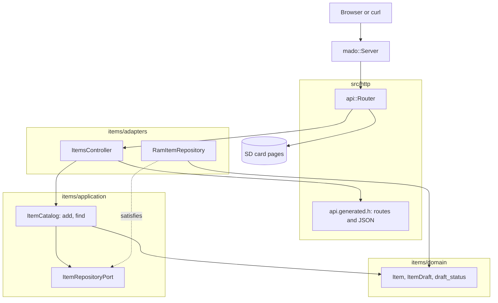

# RestGet

Read-only REST API for a fixed table of four items, served by an Arduino Uno R4 Minima with an Ethernet shield. The board answers `GET /api/items` and `GET /api/items/{id}` as JSON and serves its pages, its OpenAPI document and Swagger UI from the SD card.

English | [日本語](README.ja.md) | [简体中文](README.zh-Hans.md) | [繁體中文（香港）](README.zh-HK.md)

## What this example covers

| Area | What is built |
|:-----|:--------------|
| Layers | One bounded context, `items`, split into `domain`, `application` and `adapters`. The domain includes no Arduino header. |
| Ports | `ItemRepositoryPort` names the two calls the use cases make, `insert` and `find`, and checks their return types at compile time with `static_assert`. |
| Adapters | `RamItemRepository` keeps items in a `mado::SlotTable`. `ItemsController` maps HTTP to the use cases and the generated JSON structs to the domain entity. |
| Composition root | [`RestGet.ino`](RestGet.ino) builds the repository, seeds two items, mounts the card and attaches both to the router. |
| Contract | [`openapi.json`](openapi.json) is the source of the routes, the wire structs and the JSON writers in [`api.generated.h`](src/http/api.generated.h). |
| Errors | Unknown ids answer `404` with an RFC 9457 problem. A missing card answers `503`. |
| Pages | `SD Card` is a Vite and TypeScript project with the same split: `domain`, `application` with its ports, `adapters/http` and `adapters/dom`. |
| Tests | 26 host tests in three files and 9 page tests with 100 percent coverage. |
| Rules | JPL D-60411 and the Power of Ten: no heap, no virtual functions, no function pointers, every loop bounded, 2.06 assertions per function. |

## Architecture



Dependencies point inward. The domain knows nothing about HTTP or storage. The application knows the domain and its port. The adapters know both and the library. [`RestGet.ino`](RestGet.ino) is the only file that names Ethernet, SdFat and the concrete repository.

## Project structure

```text
RestGet/
  RestGet.ino                              composition root: hardware, wiring, setup and loop
  openapi.json                             API contract, input of tools/madogen
  src/
    http/
      api.generated.h                      routes, limits, wire structs and JSON writers, generated
      api.router.h                         route id to controller, card pages for every other path
    items/
      domain/item.entity.h                 Item, ItemDraft, id range and name rules
      application/item_repository.port.h   the calls a repository must offer
      application/item_catalog.service.h   use cases: add, find
      adapters/ram_item.repository.h       repository on a fixed slot table
      adapters/items.controller.h          HTTP to use cases, entity to wire struct
  tests/                                   host tests, one binary for this example
  SD Card/                                 the pages, a separate web project
```

Files use `name.type.h`: `item.entity.h`, `item_catalog.service.h`, `ram_item.repository.h`. The suffix says what a file holds before you open it.

## API endpoints

No route needs authentication.

| Method | Endpoint | Description |
|:-------|:---------|:------------|
| GET | `/api/items` | Every item, in id order |
| GET | `/api/items/{id}` | One item, id 1 to 4 |
| GET | `/api/openapi.json` | The OpenAPI document, read from the card |
| GET | `/docs/` | Swagger UI, loaded from the card and a CDN |
| GET | any other path | A page from the card |

`GET /api/items` answers:

```json
[{"id":1,"name":"lamp","on":true},{"id":2,"name":"fan","on":false}]
```

| Error condition | Status | Detail |
|:----------------|:------:|:-------|
| The id is 0, above 4, not a number or free | 404 | `no item has this id` |
| The method is not GET or HEAD | 405 | `Allow: GET, HEAD` |
| The card did not mount | 503 | `the SD card is not available` |

Errors use `application/problem+json`: `{"title":"Not Found","status":404,"detail":"no item has this id"}`.

## Design decisions

### A port written down as compile-time checks

The repository is a template parameter, because the coding rules ban virtual functions. A template alone would accept any type and fail deep inside the catalog with a long error. [`item_repository.port.h`](src/items/application/item_repository.port.h) names each call with `decltype` and checks its return type with `mado::same_type`, so a wrong adapter fails with one sentence such as "find(id, Item&) copies the item out and returns whether the id holds one". The port lists only `insert` and `find`, because those are the only calls this example makes.

### The entity is not the wire struct

The generated header declares `rest_get::Item` with an `int32_t id`, because JSON numbers are 32-bit there. The domain `items::Item` keeps the id as `uint8_t` and owns the rules: an id runs from 1 to 4 and a name has 1 to 16 characters. The controller copies one into the other in `to_dto`, and a `static_assert` fails the build if the schema's name length and the entity's drift apart. The copy costs about 25 bytes of stack per item written.

### Use cases without state

`ItemCatalog` holds no data. Each call takes the repository it works on, so the router keeps one pointer and each test builds a fresh repository. Without a constructor, the class also adds no function that would carry no assertion.

### Seeding belongs to the composition root

"lamp" and "fan" are example data, not a rule, so the sketch adds them through `ItemCatalog::add` in `seed_items`. The tests seed their own names from a seeded generator and never depend on the sketch's data.

### The card is optional

`setup` passes `nullptr` to the router when the card does not mount. The API keeps answering from RAM, and only the card routes answer `503`. A board without a card stays useful for curl.

## Trade-offs

| What could be done | Why it is not done | Risk as shipped |
|:-------------------|:-------------------|:----------------|
| Keep items on the card across restarts | This example shows GET; RestApi shows persistence | Items reset to the two seeds on every boot |
| A list cursor or paging | Four slots fit in one response | None at four items |
| `ETag` and `304` on items | Items never change in this example | A client re-reads about 70 bytes per poll |

## Assumptions

- The network is trusted: there is no authentication and no TLS.
- One client at a time: `mado::Server` answers one connection per `loop`.
- The SD card holds the files that `pnpm run build` writes into `SD Card/dist`.

## Testing

Host tests build with CMake and googletest against a fake client and a fake SD card. Test data comes from a seeded generator, so a failing run repeats.

```bash
cmake -S ../../tests -B build && cmake --build build --target mado_example_restget
ctest --test-dir build -R '^RestGet\.' --output-on-failure
```

| File | Tests | Covers |
|:-----|------:|:-------|
| [`item.entity.test.cpp`](tests/item.entity.test.cpp) | 9 | name rules, the id range, building an item from a draft |
| [`item_catalog.service.test.cpp`](tests/item_catalog.service.test.cpp) | 6 | add, a full table, find inside and outside the range |
| [`items.api.test.cpp`](tests/items.api.test.cpp) | 11 | list, read, HEAD, three kinds of missing id, 405, the spec, a page, a missing card |

The page tests run in Vitest with happy-dom: `cd "SD Card" && pnpm run test` runs 9 tests at 100 percent statement, branch, function and line coverage.

## Prerequisites

| Tool | Version | Required for |
|:-----|:--------|:-------------|
| Arduino Uno R4 Minima | | the board |
| W5100, W5500 or ENC28J60 shield with a microSD slot | | network and card |
| arduino-cli | 1.5.1 | building the sketch |
| arduino:renesas_uno core | 1.6.0 | the board package |
| Ethernet and SdFat | 2.0.2 and 2.3.0 | network and card libraries |
| Node.js and pnpm | 24 and 12.15.0 | building the pages |

## Getting started

```bash
arduino-cli lib install Ethernet@2.0.2 SdFat@2.3.0
arduino-cli compile --fqbn arduino:renesas_uno:minima --library ../.. .
arduino-cli upload --fqbn arduino:renesas_uno:minima --port /dev/cu.usbmodem1101 .
cd "SD Card" && pnpm install && pnpm run build
```

Copy the contents of `SD Card/dist` to the root of a FAT32 or exFAT card, put it in the shield and open `http://192.168.1.177/`.

```bash
curl http://192.168.1.177/api/items/1
```

```json
{"id":1,"name":"lamp","on":true}
```

## Tech stack

| Category | Technology |
|:---------|:-----------|
| Board | Arduino Uno R4 Minima: 74,764 of 262,144 bytes of flash, 5,904 of 32,768 bytes of RAM |
| HTTP | Madoguchi, heap-free C++11 |
| Card | SdFat 2.3.0 |
| Network | Ethernet 2.0.2 |
| Host tests | googletest 1.18.0, CMake |
| Pages | TypeScript 7.0.2, Vite 8.3.5, Pico CSS 2.1.1 from a CDN, Vitest 5.0.5 |
| Analysis | clang-tidy 23.1.3, cppcheck 2.22.0, clang-format 23.1.3, Biome 2.6.3 |
