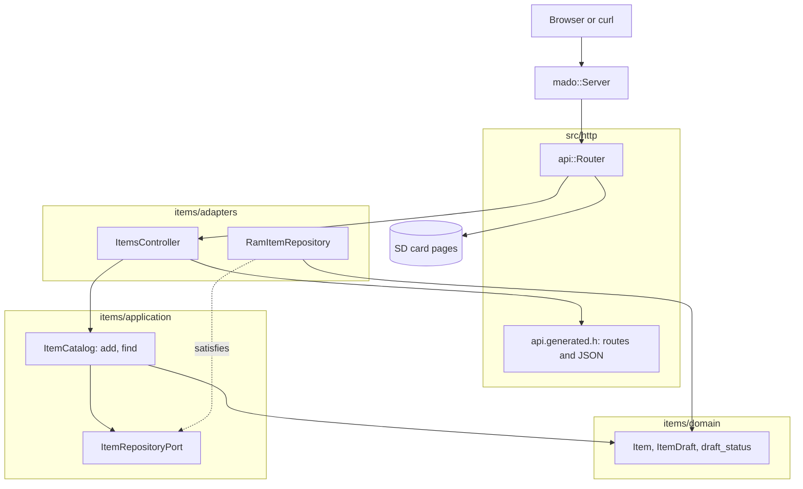

# RestGet

唯讀的 REST API，管理一張固定的四項表，由裝有以太網擴充板的 Arduino Uno R4 Minima 提供。開發板以 JSON 回應 `GET /api/items` 及 `GET /api/items/{id}`，並從 SD 卡提供頁面、OpenAPI 文件及 Swagger UI。

[English](README.md) | [日本語](README.ja.md) | [简体中文](README.zh-Hans.md) | 繁體中文（香港）

## 本範例涵蓋的內容

| 範疇 | 實作內容 |
|:-----|:---------|
| 分層 | 一個限界上下文 `items`，分為 `domain`、`application` 及 `adapters`。領域層不包含任何 Arduino 標頭檔。 |
| 端口 | `ItemRepositoryPort` 列出用例呼叫的兩個函式 `insert` 及 `find`，並以 `static_assert` 在編譯時檢查其回傳型別。 |
| 轉接器 | `RamItemRepository` 把項目放在 `mado::SlotTable` 中。`ItemsController` 把 HTTP 對應到用例，把產生的 JSON 結構對應到領域實體。 |
| 組合根 | [`RestGet.ino`](RestGet.ino) 建立儲存庫，寫入兩個初始項目，掛載記憶卡，再把兩者交給路由器。 |
| 契約 | [`openapi.json`](openapi.json) 是 [`api.generated.h`](src/http/api.generated.h) 中路由、線上結構及 JSON 寫入函式的來源。 |
| 錯誤 | 未知的 id 以 RFC 9457 問題詳情回應 `404`。沒有記憶卡時回應 `503`。 |
| 頁面 | `SD Card` 是一個 Vite 及 TypeScript 項目，採用相同的劃分：`domain`、附端口的 `application`、`adapters/http` 及 `adapters/dom`。 |
| 測試 | 三個檔案中的 26 個主機測試，以及覆蓋率 100% 的 9 個頁面測試。 |
| 規則 | JPL D-60411 及 Power of Ten：不用堆積、不用虛擬函式、不用函式指標，每個迴圈都有上限，每個函式平均 2.06 個斷言。 |

## 架構



依賴指向內層。領域層既不知道 HTTP，也不知道儲存。應用層知道領域層及其端口。轉接器知道這兩者以及程式庫。只有 [`RestGet.ino`](RestGet.ino) 會提到 Ethernet、SdFat 及具體的儲存庫。

## 項目結構

```text
RestGet/
  RestGet.ino                              組合根：硬件、連接、setup 及 loop
  openapi.json                             API 契約，tools/madogen 的輸入
  src/
    http/
      api.generated.h                      路由、上限、線上結構及 JSON 寫入，由工具產生
      api.router.h                         路由 id 到控制器，其餘路徑交給記憶卡上的頁面
    items/
      domain/item.entity.h                 Item、ItemDraft、id 範圍及名稱規則
      application/item_repository.port.h   儲存庫必須提供的呼叫
      application/item_catalog.service.h   用例：add、find
      adapters/ram_item.repository.h       建基於固定槽位表的儲存庫
      adapters/items.controller.h          HTTP 到用例，實體到線上結構
  tests/                                   主機測試，本範例獨有的二進位檔
  SD Card/                                 頁面，一個獨立的網頁項目
```

檔案名稱採用 `name.type.h`：`item.entity.h`、`item_catalog.service.h`、`ram_item.repository.h`。打開之前，後綴已說明檔案裏放的是甚麼。

## API 端點

所有路由都不需要認證。

| 方法 | 端點 | 說明 |
|:-----|:-----|:-----|
| GET | `/api/items` | 按 id 次序回傳所有項目 |
| GET | `/api/items/{id}` | 一個項目，id 為 1 至 4 |
| GET | `/api/openapi.json` | 從記憶卡讀取的 OpenAPI 文件 |
| GET | `/docs/` | 從記憶卡及 CDN 載入的 Swagger UI |
| GET | 其他路徑 | 記憶卡上的頁面 |

`GET /api/items` 的回應：

```json
[{"id":1,"name":"lamp","on":true},{"id":2,"name":"fan","on":false}]
```

| 錯誤條件 | 狀態 | 詳情 |
|:---------|:----:|:-----|
| id 為 0、大於 4、不是數字或空置 | 404 | `no item has this id` |
| 方法不是 GET 或 HEAD | 405 | `Allow: GET, HEAD` |
| 記憶卡沒有掛載 | 503 | `the SD card is not available` |

錯誤使用 `application/problem+json`：`{"title":"Not Found","status":404,"detail":"no item has this id"}`。

## 設計決定

### 以編譯時檢查寫下的端口

編碼規則禁止虛擬函式，所以儲存庫是範本參數。單靠範本會接受任何型別，然後在目錄深處以冗長的錯誤失敗。[`item_repository.port.h`](src/items/application/item_repository.port.h) 以 `decltype` 寫出每個呼叫，並以 `mado::same_type` 檢查回傳型別，所以不合適的轉接器會以一句話失敗，例如 `find(id, Item&) copies the item out and returns whether the id holds one`。本範例只呼叫 `insert` 及 `find`，所以端口亦只列出這兩個。

### 實體不是線上結構

產生的標頭檔把 `rest_get::Item` 宣告為附 `int32_t id`，因為那裏的 JSON 數字是 32 位元。領域的 `items::Item` 把 id 存為 `uint8_t`，並掌握規則：id 由 1 至 4，名稱有 1 至 16 個字元。控制器在 `to_dto` 中把一個複製到另一個；若結構描述與實體的名稱長度出現偏差，`static_assert` 會令建置失敗。每寫出一個項目，這次複製大約佔用 25 位元組堆疊空間。

### 沒有狀態的用例

`ItemCatalog` 不保存任何資料。每次呼叫都接收它要操作的儲存庫，所以路由器只保存一個指標，每個測試都新建一個儲存庫。沒有建構函式，這個類別亦不會多出一個不帶斷言的函式。

### 初始資料屬於組合根

`lamp` 及 `fan` 是範例資料，不是規則，所以由草稿碼在 `seed_items` 中透過 `ItemCatalog::add` 加入。測試以附種子的產生器製作自己的名稱，從不依賴草稿碼裏的資料。

### 記憶卡是可選的

記憶卡掛載失敗時，`setup` 把 `nullptr` 交給路由器。API 繼續從 RAM 回應，只有記憶卡上的路由回應 `503`。沒有記憶卡的開發板依然可以用 curl 存取。

## 取捨

| 可以做的事 | 現在不做的原因 | 照現狀發佈的風險 |
|:-----------|:---------------|:-----------------|
| 在記憶卡上保存項目，重啟後保留 | 本範例示範 GET，持久化由 RestApi 示範 | 每次啟動項目都回復為兩個初始值 |
| 列表游標或分頁 | 四個槽位放得進一個回應 | 四個項目時沒有風險 |
| 項目的 `ETag` 及 `304` | 本範例中項目從不改變 | 客戶端每次輪詢都重新讀取約 70 位元組 |

## 假設

- 網絡是可信的：沒有認證，亦沒有 TLS。
- 一次一個客戶端：`mado::Server` 每次 `loop` 只回應一個連線。
- SD 卡裏放的是 `pnpm run build` 寫到 `SD Card/dist` 的檔案。

## 測試

主機測試以 CMake 及 googletest 建置，針對一個假的客戶端及一張假的 SD 卡執行。測試資料來自附種子的產生器，所以失敗的執行可以重現。

```bash
cmake -S ../../tests -B build && cmake --build build --target mado_example_restget
ctest --test-dir build -R '^RestGet\.' --output-on-failure
```

| 檔案 | 測試數目 | 涵蓋內容 |
|:-----|------:|:---------|
| [`item.entity.test.cpp`](tests/item.entity.test.cpp) | 9 | 名稱規則、id 範圍、由草稿產生項目 |
| [`item_catalog.service.test.cpp`](tests/item_catalog.service.test.cpp) | 6 | add、表已滿、範圍內外的 find |
| [`items.api.test.cpp`](tests/items.api.test.cpp) | 11 | 列表、讀取、HEAD、三種不存在的 id、405、規格文件、頁面、沒有記憶卡 |

頁面測試在 Vitest 及 happy-dom 中執行：`cd "SD Card" && pnpm run test` 執行 9 個測試，陳述式、分支、函式及行的覆蓋率都是 100%。

## 先決條件

| 工具 | 版本 | 用途 |
|:-----|:-----|:-----|
| Arduino Uno R4 Minima | | 開發板 |
| 附 microSD 插槽的 W5100、W5500 或 ENC28J60 擴充板 | | 網絡及記憶卡 |
| arduino-cli | 1.5.1 | 建置草稿碼 |
| arduino:renesas_uno 核心 | 1.6.0 | 開發板套件 |
| Ethernet 及 SdFat | 2.0.2 及 2.3.0 | 網絡及記憶卡程式庫 |
| Node.js 及 pnpm | 24 及 12.15.0 | 建置頁面 |

## 開始使用

```bash
arduino-cli lib install Ethernet@2.0.2 SdFat@2.3.0
arduino-cli compile --fqbn arduino:renesas_uno:minima --library ../.. .
arduino-cli upload --fqbn arduino:renesas_uno:minima --port /dev/cu.usbmodem1101 .
cd "SD Card" && pnpm install && pnpm run build
```

把 `SD Card/dist` 的內容複製到一張 FAT32 或 exFAT 記憶卡的根目錄，插入擴充板，然後打開 `http://192.168.1.177/`。

```bash
curl http://192.168.1.177/api/items/1
```

```json
{"id":1,"name":"lamp","on":true}
```

## 技術棧

| 類別 | 技術 |
|:-----|:-----|
| 開發板 | Arduino Uno R4 Minima：快閃記憶體 262,144 位元組中用 74,764 位元組，RAM 32,768 位元組中用 5,904 位元組 |
| HTTP | Madoguchi，不用堆積的 C++11 |
| 記憶卡 | SdFat 2.3.0 |
| 網絡 | Ethernet 2.0.2 |
| 主機測試 | googletest 1.18.0、CMake |
| 頁面 | TypeScript 7.0.2、Vite 8.3.5、從 CDN 載入的 Pico CSS 2.1.1、Vitest 5.0.5 |
| 分析 | clang-tidy 23.1.3、cppcheck 2.22.0、clang-format 23.1.3、Biome 2.6.3 |
