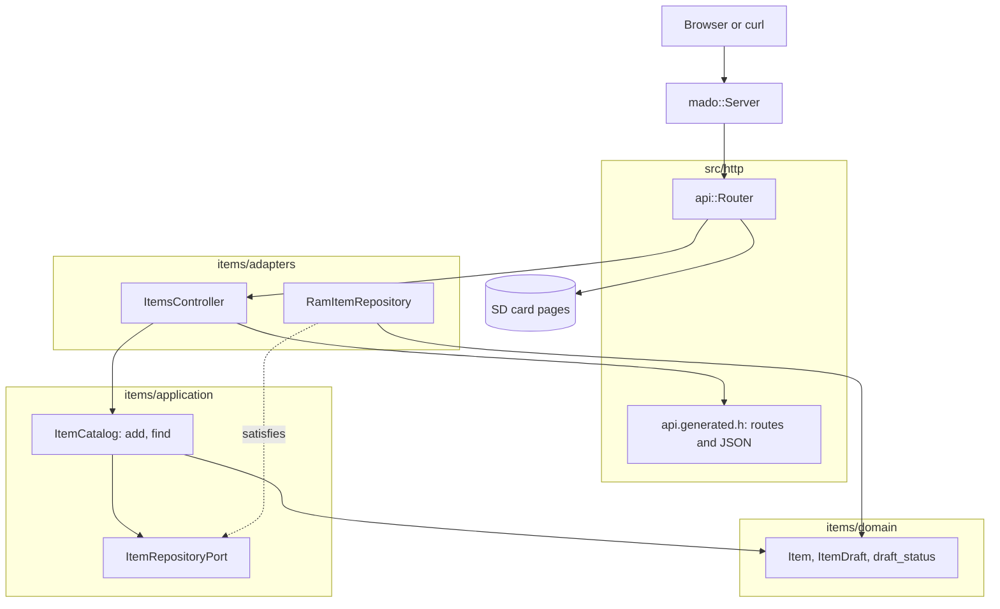

# RestGet

只读的 REST API，管理一张固定的四项表，由装有以太网扩展板的 Arduino Uno R4 Minima 提供。开发板以 JSON 应答 `GET /api/items` 和 `GET /api/items/{id}`，并从 SD 卡提供页面、OpenAPI 文档和 Swagger UI。

[English](README.md) | [日本語](README.ja.md) | 简体中文 | [繁體中文（香港）](README.zh-HK.md)

## 本示例涵盖的内容

| 方面 | 实现内容 |
|:-----|:---------|
| 分层 | 一个限界上下文 `items`，分为 `domain`、`application` 和 `adapters`。领域层不包含任何 Arduino 头文件。 |
| 端口 | `ItemRepositoryPort` 列出用例调用的两个函数 `insert` 和 `find`，并用 `static_assert` 在编译时检查它们的返回类型。 |
| 适配器 | `RamItemRepository` 把条目放在 `mado::SlotTable` 中。`ItemsController` 把 HTTP 映射到用例，把生成的 JSON 结构映射到领域实体。 |
| 组合根 | [`RestGet.ino`](RestGet.ino) 创建仓储，写入两个初始条目，挂载卡，并把两者交给路由器。 |
| 契约 | [`openapi.json`](openapi.json) 是 [`api.generated.h`](src/http/api.generated.h) 中路由、线上结构和 JSON 写入函数的来源。 |
| 错误 | 未知的 id 以 RFC 9457 问题详情应答 `404`。没有卡时应答 `503`。 |
| 页面 | `SD Card` 是一个 Vite 和 TypeScript 项目，采用相同的划分：`domain`、带端口的 `application`、`adapters/http` 和 `adapters/dom`。 |
| 测试 | 三个文件中的 26 个主机测试，以及覆盖率 100% 的 9 个页面测试。 |
| 规则 | JPL D-60411 与 Power of Ten：不用堆、不用虚函数、不用函数指针，每个循环都有上限，每个函数平均 2.06 个断言。 |

## 架构



依赖指向内层。领域层既不知道 HTTP，也不知道存储。应用层知道领域层和它的端口。适配器知道这两者以及库。只有 [`RestGet.ino`](RestGet.ino) 会提到 Ethernet、SdFat 和具体的仓储。

## 项目结构

```text
RestGet/
  RestGet.ino                              组合根：硬件、连接、setup 和 loop
  openapi.json                             API 契约，tools/madogen 的输入
  src/
    http/
      api.generated.h                      路由、上限、线上结构和 JSON 写入，由工具生成
      api.router.h                         路由 id 到控制器，其余路径交给卡上的页面
    items/
      domain/item.entity.h                 Item、ItemDraft、id 范围和名称规则
      application/item_repository.port.h   仓储必须提供的调用
      application/item_catalog.service.h   用例：add、find
      adapters/ram_item.repository.h       基于固定槽位表的仓储
      adapters/items.controller.h          HTTP 到用例，实体到线上结构
  tests/                                   主机测试，本示例独有的二进制
  SD Card/                                 页面，一个独立的 Web 项目
```

文件名采用 `name.type.h`：`item.entity.h`、`item_catalog.service.h`、`ram_item.repository.h`。打开之前，后缀就说明了文件里放的是什么。

## API 端点

所有路由都不需要认证。

| 方法 | 端点 | 说明 |
|:-----|:-----|:-----|
| GET | `/api/items` | 按 id 顺序返回所有条目 |
| GET | `/api/items/{id}` | 一个条目，id 为 1 到 4 |
| GET | `/api/openapi.json` | 从卡上读取的 OpenAPI 文档 |
| GET | `/docs/` | 从卡和 CDN 加载的 Swagger UI |
| GET | 其他路径 | 卡上的页面 |

`GET /api/items` 的应答：

```json
[{"id":1,"name":"lamp","on":true},{"id":2,"name":"fan","on":false}]
```

| 错误条件 | 状态 | 详情 |
|:---------|:----:|:-----|
| id 为 0、大于 4、不是数字或空闲 | 404 | `no item has this id` |
| 方法不是 GET 或 HEAD | 405 | `Allow: GET, HEAD` |
| 卡没有挂载 | 503 | `the SD card is not available` |

错误使用 `application/problem+json`：`{"title":"Not Found","status":404,"detail":"no item has this id"}`。

## 设计决策

### 以编译时检查写下的端口

编码规则禁止虚函数，所以仓储是模板参数。单靠模板会接受任何类型，然后在目录深处以冗长的错误失败。[`item_repository.port.h`](src/items/application/item_repository.port.h) 用 `decltype` 写出每个调用，并用 `mado::same_type` 检查返回类型，所以不合适的适配器会以一句话失败，例如 `find(id, Item&) copies the item out and returns whether the id holds one`。本示例只调用 `insert` 和 `find`，所以端口也只列这两个。

### 实体不是线上结构

生成的头文件把 `rest_get::Item` 声明为带 `int32_t id`，因为那里的 JSON 数字是 32 位的。领域的 `items::Item` 把 id 存为 `uint8_t`，并掌握规则：id 从 1 到 4，名称有 1 到 16 个字符。控制器在 `to_dto` 中把一个复制到另一个；如果模式与实体的名称长度出现偏差，`static_assert` 会让构建失败。每写出一个条目，这次复制大约占用 25 字节栈空间。

### 没有状态的用例

`ItemCatalog` 不保存任何数据。每次调用都接收它要操作的仓储，所以路由器只保存一个指针，每个测试都新建一个仓储。没有构造函数，这个类也就不会多出一个不带断言的函数。

### 初始数据属于组合根

`lamp` 和 `fan` 是示例数据，不是规则，所以由程序在 `seed_items` 中通过 `ItemCatalog::add` 加入。测试用带种子的生成器产生自己的名称，从不依赖程序里的数据。

### 卡是可选的

卡挂载失败时，`setup` 把 `nullptr` 交给路由器。API 继续从 RAM 应答，只有卡上的路由应答 `503`。没有卡的开发板依然可以用 curl 访问。

## 权衡

| 可以做的事 | 现在不做的原因 | 照现状发布的风险 |
|:-----------|:---------------|:-----------------|
| 在卡上保存条目，重启后保留 | 本示例演示 GET，持久化由 RestApi 演示 | 每次启动条目都恢复为两个初始值 |
| 列表游标或分页 | 四个槽位放得进一个应答 | 四个条目时没有风险 |
| 条目的 `ETag` 和 `304` | 本示例中条目从不改变 | 客户端每次轮询都重新读取约 70 字节 |

## 假设

- 网络是可信的：没有认证，也没有 TLS。
- 一次一个客户端：`mado::Server` 每次 `loop` 只应答一个连接。
- SD 卡里放的是 `pnpm run build` 写到 `SD Card/dist` 的文件。

## 测试

主机测试用 CMake 和 googletest 构建，针对一个假的客户端和一张假的 SD 卡运行。测试数据来自带种子的生成器，所以失败的运行可以重现。

```bash
cmake -S ../../tests -B build && cmake --build build --target mado_example_restget
ctest --test-dir build -R '^RestGet\.' --output-on-failure
```

| 文件 | 测试数 | 覆盖内容 |
|:-----|------:|:---------|
| [`item.entity.test.cpp`](tests/item.entity.test.cpp) | 9 | 名称规则、id 范围、从草稿生成条目 |
| [`item_catalog.service.test.cpp`](tests/item_catalog.service.test.cpp) | 6 | add、表已满、范围内外的 find |
| [`items.api.test.cpp`](tests/items.api.test.cpp) | 11 | 列表、读取、HEAD、三种不存在的 id、405、规范文档、页面、没有卡 |

页面测试在 Vitest 和 happy-dom 中运行：`cd "SD Card" && pnpm run test` 运行 9 个测试，语句、分支、函数和行覆盖率都是 100%。

## 前提条件

| 工具 | 版本 | 用途 |
|:-----|:-----|:-----|
| Arduino Uno R4 Minima | | 开发板 |
| 带 microSD 插槽的 W5100、W5500 或 ENC28J60 扩展板 | | 网络和卡 |
| arduino-cli | 1.5.1 | 构建程序 |
| arduino:renesas_uno 核心 | 1.6.0 | 开发板软件包 |
| Ethernet 和 SdFat | 2.0.2 和 2.3.0 | 网络和卡的库 |
| Node.js 和 pnpm | 24 和 12.15.0 | 构建页面 |

## 快速开始

```bash
arduino-cli lib install Ethernet@2.0.2 SdFat@2.3.0
arduino-cli compile --fqbn arduino:renesas_uno:minima --library ../.. .
arduino-cli upload --fqbn arduino:renesas_uno:minima --port /dev/cu.usbmodem1101 .
cd "SD Card" && pnpm install && pnpm run build
```

把 `SD Card/dist` 的内容复制到一张 FAT32 或 exFAT 卡的根目录，插入扩展板，然后打开 `http://192.168.1.177/`。

```bash
curl http://192.168.1.177/api/items/1
```

```json
{"id":1,"name":"lamp","on":true}
```

## 技术栈

| 类别 | 技术 |
|:-----|:-----|
| 开发板 | Arduino Uno R4 Minima：闪存 262,144 字节中用 74,764 字节，RAM 32,768 字节中用 5,904 字节 |
| HTTP | Madoguchi，不用堆的 C++11 |
| 卡 | SdFat 2.3.0 |
| 网络 | Ethernet 2.0.2 |
| 主机测试 | googletest 1.18.0、CMake |
| 页面 | TypeScript 7.0.2、Vite 8.3.5、从 CDN 加载的 Pico CSS 2.1.1、Vitest 5.0.5 |
| 分析 | clang-tidy 23.1.3、cppcheck 2.22.0、clang-format 23.1.3、Biome 2.6.3 |
