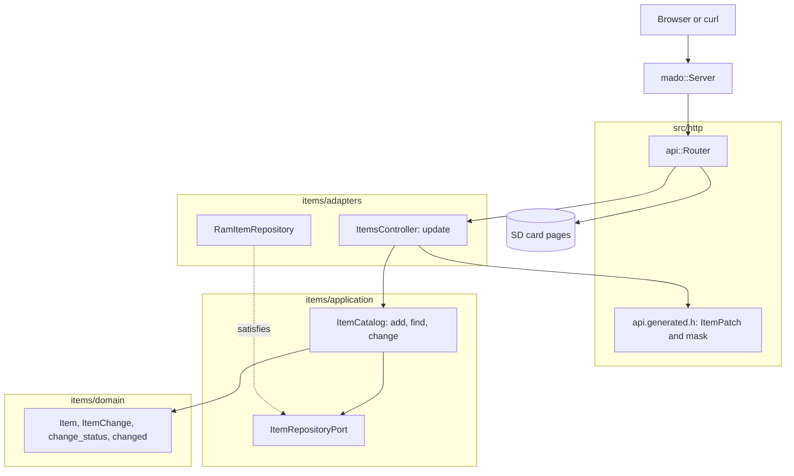

# RestPatch

クライアントが送ったフィールドだけを変えるRESTエンドポイントで、Ethernetシールドを載せたArduino Uno R4 Minimaが応答します。`PATCH /api/items/{id}`は`name`、`on`、またはその両方を受け付け、何も変えないボディは拒否します。

[English](README.md) | 日本語 | [简体中文](README.zh-Hans.md) | [繁體中文（香港）](README.zh-HK.md)

## このサンプルの内容

| 領域 | 作ったもの |
|:-----|:-----------|
| レイヤー | 境界づけられたコンテキスト`items`を1つ持ち、`domain`、`application`、`adapters`に分けています。ドメインはArduinoのヘッダーを一切インクルードしません。 |
| ドメインのルール | `ItemChange`はクライアントが送ったフィールドを記録します。`change_status`はフィールドのない変更と空の名前を拒否し、`changed`は送られたフィールドだけを適用します。 |
| ポート | `ItemRepositoryPort`は`insert`、`find`、`store`を名指しします。 |
| ユースケース | `ItemCatalog::change`は`kChanged`、`kMissing`、`kNothing`、`kInvalid`のいずれかを返します。 |
| アダプター | `mado::SlotTable`上の`RamItemRepository`。`ItemsController`は生成された有無のマスクを`ItemChange`に変えます。 |
| コンポジションルート | [`RestPatch.ino`](RestPatch.ino)が「lamp」と「fan」を投入し、カードをマウントし、両方をルーターに渡します。 |
| 契約 | [`openapi.json`](openapi.json)は必須フィールドのない`ItemPatch`を宣言し、[`api.generated.h`](src/http/api.generated.h)がそれを構造体とビットマスクに読み込みます。 |
| テスト | 6ファイルのホストテスト56件と、カバレッジ100パーセントのページテスト15件。 |
| ルール | JPL D-60411とPower of Ten。ヒープなし、仮想関数なし、関数ポインターなし、関数あたり2.08個のアサーション。 |

## アーキテクチャ



ページも同じルールを共有します。ページのドメインの`ItemPatch.from`は空のフィールドを落とし、`ItemPatch.changesNothing`はリクエストがブラウザーを出る前に止めます。

## プロジェクト構成

```text
RestPatch/
  RestPatch.ino                            コンポジションルート
  openapi.json                             API契約
  src/http/api.generated.h                 生成
  src/http/api.router.h                    更新のルート、それ以外のパスはカードのページ
  src/identity/...                         ログイン。RestAuthと同じコード
  src/items/domain/item.entity.h           Item、ItemChange、change_status、changed
  src/items/application/item_repository.port.h
  src/items/application/item_catalog.service.h   add、find、change
  src/items/adapters/ram_item.repository.h
  src/items/adapters/items.controller.h
  tests/                                   ホストテスト
  SD Card/                                 ページ
```

## APIエンドポイント

| メソッド | エンドポイント | 説明 |
|:---------|:---------------|:-----|
| PATCH | `/api/items/{id}` | 項目1から4を`{"on":false}`、`{"name":"fan"}`、またはその両方で変える |
| GET | `/api/openapi.json` | カードから読んだOpenAPIドキュメント |
| GET | その他のパス | カード上のページ |

`PATCH /api/items/1`に`{"on":false}`を送ると`200 OK`を返します。

```json
{"id":1,"name":"lamp","on":false}
```

| エラーの条件 | ステータス | 詳細 |
|:-------------|:----------:|:-----|
| idが空き、0、4より大きい、または数値でない | 404 | `no item has this id` |
| ボディが空 | 400 | `a JSON body is required` |
| ボディがJSONでない | 400 | `the body is not valid JSON` |
| ボディが256バイトを超える | 413 | `the body is larger than this operation accepts` |
| `Content-Type`がJSONでない | 415 | `Content-Type must be application/json` |
| 未知のフィールド、または`id`を送った | 422 | `a property is unknown, read-only or repeated` |
| `name`が16文字を超える | 422 | `a string is longer than its maxLength` |
| ボディが`{}` | 422 | `the body changes no property` |
| 新しい名前が空 | 422 | `a string is shorter than its minLength` |

## 設計上の判断

### 有無も値の一部

PATCHのボディには必須フィールドがないので、「送られていない」と「falseとして送られた」を区別しなければなりません。生成されたリーダーは構造体と一緒にビットマスクを返し、`change_of`がそれを`renames`と`switches`のフラグを持つ`ItemChange`に変えます。ドメインはマスクを見ることがなく、HTTP層は変更の意味を決めることがありません。

### 「何も変えない」はドメインのルール

空の変更を拒否するのはコントローラーではなく`change_status`なので、このルールは`ItemCatalog::change`のどの呼び出し元にも効きます。コントローラーは`kNothing`を、以前のスケッチが使っていた`422`の文言に対応づけるだけです。

### 名前のルールは1つで、使い回す

`change_status`は新しい名前を、`ItemDraft`を作って`draft_status`に尋ねることで確かめます。`add`と同じルールです。このサンプルでは有効な名前の定義は1か所だけです。

### ポートが呼び出しを1つ増やす

ユースケースはRestGetの`insert`と`find`に加えて`store(const Item&)`を必要とします。`store`の`false`は「存在しない」と読むので、`find`と`store`の間で消えた項目が作り直されることはありません。

## トレードオフ

| できること | 今はしない理由 | このままのリスク |
|:-----------|:---------------|:-----------------|
| `null`でフィールドを消すJSON Merge Patch | ここには消せるフィールドがない | `null`は`422`になる |
| 項目をカードに保存する | 永続化はRestApiが示す | 起動のたびに項目は初期データに戻る |

## 前提

- ネットワークは平文のパスワードとトークンを送れる程度に信頼できる。TLSはない。
- 同時に扱うクライアントは1つ。

## ログインと安全な書き込み

`POST /api/auth/login`を除くすべての`/api`ルートにベアラートークンが必要です。`{"username":"admin","password":"..."}`でログインすると、15分間かつボードが再起動するまで有効なトークンが返ります。トークンがない、署名が違う、古い場合は`WWW-Authenticate: Bearer`付きの`401`を返します。

1つのクライアントアドレスからログインに5回失敗すると、そのアドレスは`429`と`Retry-After`で15分間ロックされ、ほかのアドレスはログインを続けられます。表は4つのアドレスを持ち、4つすべてがロック中の間は新しいアドレスもロックされるので、アドレスを替えてもロックは解けません。 アドレスごとの回数は`/LOGIN.TXT`に書き込まれるので、ロックは再起動後も残ります。

ビルドの前に`python3 -m tools.madogen secrets examples/RestPatch --user admin`でアカウントを[`arduino_secrets.h`](arduino_secrets.h)に書き込みます。コミットされているファイルはすべてゼロの仮の値で、ログインには必ず`503`を返します。

項目を返す応答は、起動ごとの乱数、id、書き込みのたびに上がるリビジョンから作る強い`ETag`を送ります。それを`If-Match`で送り返すと、その後に誰かが項目を変えていた場合、書き込みは変更を上書きせずに`412 Precondition Failed`を返します。

## テスト

```bash
cmake -S ../../tests -B build && cmake --build build --target mado_example_restpatch
ctest --test-dir build -R '^RestPatch\.' --output-on-failure
```

| ファイル | テスト数 | 対象 |
|:---------|---------:|:-----|
| [`item.entity.test.cpp`](tests/item.entity.test.cpp) | 9 | 名前のルール、idの範囲、項目の生成 |
| [`item_catalog.service.test.cpp`](tests/item_catalog.service.test.cpp) | 6 | add、満杯のテーブル、find |
| [`item_change.test.cpp`](tests/item_change.test.cpp) | 7 | 空の変更、空の名前、名前を保つ切り替え、保存される名前変更、空きid |
| [`items.api.test.cpp`](tests/items.api.test.cpp) | 15 | 1フィールド、名前変更、拒否されるボディ、壊れたJSON、空きid、`{}` |
| [`identity.adapters.test.cpp`](tests/identity.adapters.test.cpp) | 9 | EEPROMカウンター、ログイン、カード上のアドレスごとの失敗回数、再起動をまたぐロックアウト、トークンの確認 |
| [`identity.domain.test.cpp`](tests/identity.domain.test.cpp) | 10 | 認証情報の規則、セッションカウンター、トークンの終了時刻 |

`cd "SD Card" && pnpm run test`はカバレッジ100パーセントで15件のページテストを実行します。

## 前提条件

| ツール | バージョン | 用途 |
|:-------|:-----------|:-----|
| Arduino Uno R4 Minima | | ボード |
| microSDスロット付きのW5100、W5500、ENC28J60シールド | | ネットワークとカード |
| arduino-cli | 1.5.1 | スケッチのビルド |
| arduino:renesas_unoコア | 1.6.0 | ボードパッケージ |
| EthernetとSdFat | 2.0.2と2.3.0 | ネットワークとカードのライブラリ |
| Node.jsとpnpm | 24と12.15.0 | ページのビルド |

## はじめに

```bash
cd ../.. && python3 -m tools.madogen secrets examples/RestPatch --user admin && cd examples/RestPatch
arduino-cli lib install Ethernet@2.0.2 SdFat@2.3.0
arduino-cli compile --fqbn arduino:renesas_uno:minima --library ../.. .
arduino-cli upload --fqbn arduino:renesas_uno:minima --port /dev/cu.usbmodem1101 .
cd "SD Card" && pnpm install && pnpm run build
```

`SD Card/dist`をカードにコピーしてから：

```bash
TOKEN=$(curl -s -H 'Content-Type: application/json' -d '{"username":"admin","password":"your password"}' http://192.168.1.177/api/auth/login | python3 -c 'import json,sys; print(json.load(sys.stdin)["access_token"])')
curl -H "Authorization: Bearer $TOKEN" -X PATCH -H 'Content-Type: application/json' -d '{"on":false}' http://192.168.1.177/api/items/1
```

## 技術スタック

| 分類 | 技術 |
|:-----|:-----|
| ボード | Arduino Uno R4 Minima：フラッシュ262,144バイト中91,656バイト、RAM 32,768バイト中6,332バイト |
| HTTP | Madoguchi、ヒープを使わないC++11 |
| カード | SdFat 2.3.0 |
| ネットワーク | Ethernet 2.0.2 |
| ホストテスト | googletest 1.18.0、CMake |
| ページ | TypeScript 7.0.2、Vite 8.3.5、CDNから読み込むPico CSS 2.1.1、Vitest 5.0.5 |
| 解析 | clang-tidy 23.1.3、cppcheck 2.22.0、clang-format 23.1.3、Biome 2.6.3 |
