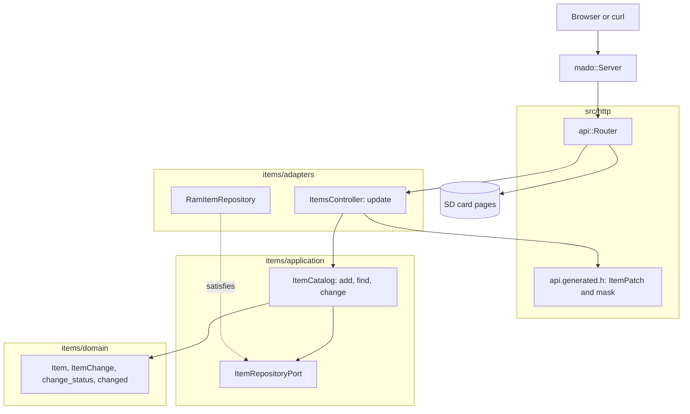

# RestPatch

REST endpoint that changes only the fields a client sends, served by an Arduino Uno R4 Minima with an Ethernet shield. `PATCH /api/items/{id}` accepts `name`, `on`, or both, and refuses a body that changes nothing.

English | [日本語](README.ja.md) | [简体中文](README.zh-Hans.md) | [繁體中文（香港）](README.zh-HK.md)

## What this example covers

| Area | What is built |
|:-----|:--------------|
| Layers | One bounded context, `items`, split into `domain`, `application` and `adapters`. The domain includes no Arduino header. |
| Domain rule | `ItemChange` records which fields a client sent. `change_status` refuses a change with no field or with an empty name; `changed` applies only the sent fields. |
| Ports | `ItemRepositoryPort` names `insert`, `find` and `store`. |
| Use case | `ItemCatalog::change` answers `kChanged`, `kMissing`, `kNothing` or `kInvalid`. |
| Adapters | `RamItemRepository` on a `mado::SlotTable`; `ItemsController` turns the generated presence mask into an `ItemChange`. |
| Composition root | [`RestPatch.ino`](RestPatch.ino) seeds "lamp" and "fan", mounts the card and attaches both to the router. |
| Contract | [`openapi.json`](openapi.json) declares `ItemPatch` with no required field; [`api.generated.h`](src/http/api.generated.h) reads it into a struct plus a bit mask. |
| Tests | 56 host tests in six files and 15 page tests with 100 percent coverage. |
| Rules | JPL D-60411 and the Power of Ten: no heap, no virtual functions, no function pointers, 2.08 assertions per function. |

## Architecture



The page shares the rule: its domain `ItemPatch.from` drops empty fields, and `ItemPatch.changesNothing` stops the request before it leaves the browser.

## Project structure

```text
RestPatch/
  RestPatch.ino                            composition root
  openapi.json                             API contract
  src/http/api.generated.h                 generated
  src/http/api.router.h                    the update route, card pages for every other path
  src/identity/...                         sign-in, the same code as RestAuth
  src/items/domain/item.entity.h           Item, ItemChange, change_status, changed
  src/items/application/item_repository.port.h
  src/items/application/item_catalog.service.h   add, find, change
  src/items/adapters/ram_item.repository.h
  src/items/adapters/items.controller.h
  tests/                                   host tests
  SD Card/                                 the pages
```

## API endpoints

| Method | Endpoint | Description |
|:-------|:---------|:------------|
| PATCH | `/api/items/{id}` | Change item 1 to 4 with `{"on":false}`, `{"name":"fan"}` or both |
| GET | `/api/openapi.json` | The OpenAPI document, read from the card |
| GET | any other path | A page from the card |

`PATCH /api/items/1` with `{"on":false}` answers `200 OK`:

```json
{"id":1,"name":"lamp","on":false}
```

| Error condition | Status | Detail |
|:----------------|:------:|:-------|
| The id is free, 0, above 4 or not a number | 404 | `no item has this id` |
| The body is empty | 400 | `a JSON body is required` |
| The body is not JSON | 400 | `the body is not valid JSON` |
| The body is over 256 bytes | 413 | `the body is larger than this operation accepts` |
| `Content-Type` is not JSON | 415 | `Content-Type must be application/json` |
| A field is unknown or `id` is sent | 422 | `a property is unknown, read-only or repeated` |
| `name` is over 16 characters | 422 | `a string is longer than its maxLength` |
| The body is `{}` | 422 | `the body changes no property` |
| The new name is empty | 422 | `a string is shorter than its minLength` |

## Design decisions

### Presence is part of the value

A PATCH body has no required field, so "not sent" and "sent as false" must differ. The generated reader returns a bit mask next to the struct; `change_of` turns it into `ItemChange` with `renames` and `switches` flags. The domain never sees the mask, and the HTTP layer never decides what a change means.

### "Changes nothing" is a domain rule

An empty change is refused by `change_status`, not by the controller, so the rule holds for any caller of `ItemCatalog::change`. The controller only maps `kNothing` to the `422` text the earlier sketch used.

### One name rule, reused

`change_status` checks a new name by building an `ItemDraft` and asking `draft_status`, the same rule `add` uses. There is one definition of a valid name in the example.

### The port grows by one call

The use case needs `store(const Item&)` on top of RestGet's `insert` and `find`. A `false` from `store` reads as missing, so an item that vanished between `find` and `store` is never recreated.

## Trade-offs

| What could be done | Why it is not done | Risk as shipped |
|:-------------------|:-------------------|:----------------|
| JSON Merge Patch with `null` to clear a field | No field here can be cleared | `null` answers `422` |
| Keep items on the card | RestApi shows persistence | Items reset to the seeds on every boot |

## Assumptions

- The network is trusted enough for clear-text passwords and tokens: there is no TLS.
- One client at a time.

## Sign-in and safe writes

Every `/api` route except `POST /api/auth/login` needs a bearer token. Sign in with `{"username":"admin","password":"..."}` for a token valid for 15 minutes and until the board restarts; a missing, wrongly signed or stale token answers `401` with `WWW-Authenticate: Bearer`.

Five failed sign-ins from one client address lock that address for 15 minutes with `429` and `Retry-After`; other addresses keep signing in. The table holds four addresses, and while all four are locked a new address is locked too, so cycling addresses cannot clear a lock. The counts of each address are written to `/LOGIN.TXT`, so a lock survives a restart.

Write the account into [`arduino_secrets.h`](arduino_secrets.h) before building with `python3 -m tools.madogen secrets examples/RestPatch --user admin`; the committed file is an all-zero placeholder that answers `503` to every sign-in.

Responses that carry an item send a strong `ETag` built from a boot-random base, the id and a revision that every write raises. Send it back in `If-Match` and a write answers `412 Precondition Failed` when someone changed the item since, instead of overwriting their change.

## Testing

```bash
cmake -S ../../tests -B build && cmake --build build --target mado_example_restpatch
ctest --test-dir build -R '^RestPatch\.' --output-on-failure
```

| File | Tests | Covers |
|:-----|------:|:-------|
| [`item.entity.test.cpp`](tests/item.entity.test.cpp) | 9 | name rules, the id range, building an item |
| [`item_catalog.service.test.cpp`](tests/item_catalog.service.test.cpp) | 6 | add, a full table, find |
| [`item_change.test.cpp`](tests/item_change.test.cpp) | 7 | an empty change, an empty name, a switch that keeps the name, a stored rename, a free id |
| [`items.api.test.cpp`](tests/items.api.test.cpp) | 15 | one field, a rename, refused bodies, broken JSON, a free id, `{}` |
| [`identity.adapters.test.cpp`](tests/identity.adapters.test.cpp) | 9 | the EEPROM counter, sign-in, failures per address on the card, a lockout across a restart, token checks |
| [`identity.domain.test.cpp`](tests/identity.domain.test.cpp) | 10 | credential rules, the session counter, token end times |

`cd "SD Card" && pnpm run test` runs 15 page tests at 100 percent coverage.

## Prerequisites

| Tool | Version | Required for |
|:-----|:--------|:-------------|
| Arduino Uno R4 Minima | | the board |
| W5100, W5500 or ENC28J60 shield with a microSD slot | | network and card |
| arduino-cli | 1.5.1 | building the sketch |
| arduino:renesas_uno core | 1.6.0 | the board package |
| Ethernet and SdFat | 2.0.2 and 2.3.0 | network and card libraries |
| Node.js and pnpm | 24 and 12.15.0 | building the pages |

## Getting started

```bash
cd ../.. && python3 -m tools.madogen secrets examples/RestPatch --user admin && cd examples/RestPatch
arduino-cli lib install Ethernet@2.0.2 SdFat@2.3.0
arduino-cli compile --fqbn arduino:renesas_uno:minima --library ../.. .
arduino-cli upload --fqbn arduino:renesas_uno:minima --port /dev/cu.usbmodem1101 .
cd "SD Card" && pnpm install && pnpm run build
```

Copy `SD Card/dist` to the card, then:

```bash
TOKEN=$(curl -s -H 'Content-Type: application/json' -d '{"username":"admin","password":"your password"}' http://192.168.1.177/api/auth/login | python3 -c 'import json,sys; print(json.load(sys.stdin)["access_token"])')
curl -H "Authorization: Bearer $TOKEN" -X PATCH -H 'Content-Type: application/json' -d '{"on":false}' http://192.168.1.177/api/items/1
```

## Tech stack

| Category | Technology |
|:---------|:-----------|
| Board | Arduino Uno R4 Minima: 91,656 of 262,144 bytes of flash, 6,332 of 32,768 bytes of RAM |
| HTTP | Madoguchi, heap-free C++11 |
| Card | SdFat 2.3.0 |
| Network | Ethernet 2.0.2 |
| Host tests | googletest 1.18.0, CMake |
| Pages | TypeScript 7.0.2, Vite 8.3.5, Pico CSS 2.1.1 from a CDN, Vitest 5.0.5 |
| Analysis | clang-tidy 23.1.3, cppcheck 2.22.0, clang-format 23.1.3, Biome 2.6.3 |
