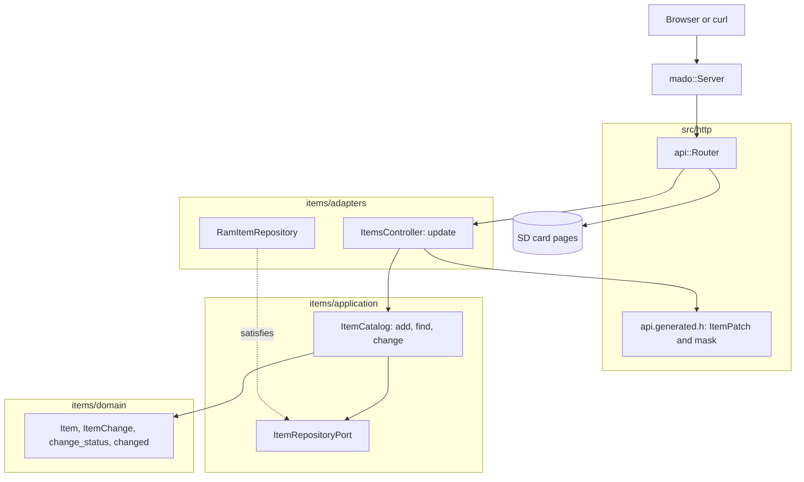

# RestPatch

只修改客戶端所傳送欄位的 REST 端點，由裝有以太網擴充板的 Arduino Uno R4 Minima 提供。`PATCH /api/items/{id}` 接受 `name`、`on` 或兩者，並拒絕甚麼都不改的請求主體。

[English](README.md) | [日本語](README.ja.md) | [简体中文](README.zh-Hans.md) | 繁體中文（香港）

## 本範例涵蓋的內容

| 範疇 | 實作內容 |
|:-----|:---------|
| 分層 | 一個限界上下文 `items`，分為 `domain`、`application` 及 `adapters`。領域層不包含任何 Arduino 標頭檔。 |
| 領域規則 | `ItemChange` 記錄客戶端傳送了哪些欄位。`change_status` 拒絕沒有欄位或名稱為空的修改；`changed` 只套用傳送的欄位。 |
| 端口 | `ItemRepositoryPort` 列出 `insert`、`find` 及 `store`。 |
| 用例 | `ItemCatalog::change` 回傳 `kChanged`、`kMissing`、`kNothing` 或 `kInvalid`。 |
| 轉接器 | 建基於 `mado::SlotTable` 的 `RamItemRepository`；`ItemsController` 把產生的存在性遮罩轉換為 `ItemChange`。 |
| 組合根 | [`RestPatch.ino`](RestPatch.ino) 寫入 `lamp` 及 `fan`，掛載記憶卡，再把兩者交給路由器。 |
| 契約 | [`openapi.json`](openapi.json) 宣告沒有必填欄位的 `ItemPatch`；[`api.generated.h`](src/http/api.generated.h) 把它讀入一個結構及一個位元遮罩。 |
| 測試 | 六個檔案中的 56 個主機測試，以及覆蓋率 100% 的 15 個頁面測試。 |
| 規則 | JPL D-60411 及 Power of Ten：不用堆積、不用虛擬函式、不用函式指標，每個函式平均 2.08 個斷言。 |

## 架構



頁面亦共用這條規則：頁面領域層的 `ItemPatch.from` 去掉空欄位，`ItemPatch.changesNothing` 在請求離開瀏覽器之前已把它攔下。

## 項目結構

```text
RestPatch/
  RestPatch.ino                            組合根
  openapi.json                             API 契約
  src/http/api.generated.h                 由工具產生
  src/http/api.router.h                    更新路由，其餘路徑交給記憶卡上的頁面
  src/identity/...                         登入，與 RestAuth 相同的程式碼
  src/items/domain/item.entity.h           Item、ItemChange、change_status、changed
  src/items/application/item_repository.port.h
  src/items/application/item_catalog.service.h   add、find、change
  src/items/adapters/ram_item.repository.h
  src/items/adapters/items.controller.h
  tests/                                   主機測試
  SD Card/                                 頁面
```

## API 端點

| 方法 | 端點 | 說明 |
|:-----|:-----|:-----|
| PATCH | `/api/items/{id}` | 以 `{"on":false}`、`{"name":"fan"}` 或兩者修改項目 1 至 4 |
| GET | `/api/openapi.json` | 從記憶卡讀取的 OpenAPI 文件 |
| GET | 其他路徑 | 記憶卡上的頁面 |

向 `PATCH /api/items/1` 傳送 `{"on":false}` 時回應 `200 OK`：

```json
{"id":1,"name":"lamp","on":false}
```

| 錯誤條件 | 狀態 | 詳情 |
|:---------|:----:|:-----|
| id 空置、為 0、大於 4 或不是數字 | 404 | `no item has this id` |
| 請求主體為空 | 400 | `a JSON body is required` |
| 請求主體不是 JSON | 400 | `the body is not valid JSON` |
| 請求主體超過 256 位元組 | 413 | `the body is larger than this operation accepts` |
| `Content-Type` 不是 JSON | 415 | `Content-Type must be application/json` |
| 欄位未知或傳送了 `id` | 422 | `a property is unknown, read-only or repeated` |
| `name` 超過 16 個字元 | 422 | `a string is longer than its maxLength` |
| 請求主體是 `{}` | 422 | `the body changes no property` |
| 新名稱為空 | 422 | `a string is shorter than its minLength` |

## 設計決定

### 有沒有出現亦是值的一部分

PATCH 請求主體沒有必填欄位，所以必須分辨 "沒有傳送" 與 "傳送了 false"。產生的讀取器在結構旁邊回傳一個位元遮罩；`change_of` 把它轉換為附 `renames` 及 `switches` 旗標的 `ItemChange`。領域層從不接觸遮罩，HTTP 層亦從不決定一次修改的意思。

### "甚麼都不改" 是領域規則

空修改由 `change_status` 拒絕，而不是控制器，所以這條規則對 `ItemCatalog::change` 的任何呼叫者都成立。控制器只是把 `kNothing` 對應為早前草稿碼使用的 `422` 文字。

### 一條名稱規則，重複使用

`change_status` 檢查新名稱的方式是建構一個 `ItemDraft` 並交給 `draft_status`，與 `add` 使用同一條規則。範例中有效名稱的定義只有一處。

### 端口多了一個呼叫

用例在 RestGet 的 `insert` 及 `find` 之外還需要 `store(const Item&)`。`store` 回傳 `false` 時被視為不存在，所以在 `find` 與 `store` 之間消失的項目絕不會被重新建立。

## 取捨

| 可以做的事 | 現在不做的原因 | 照現狀發佈的風險 |
|:-----------|:---------------|:-----------------|
| 以 `null` 清除欄位的 JSON Merge Patch | 這裏沒有可以清除的欄位 | `null` 回應 `422` |
| 把項目保存在記憶卡上 | 持久化由 RestApi 示範 | 每次啟動項目都回復為初始值 |

## 假設

- 網絡足夠可信，可以傳送明文密碼及權杖：沒有 TLS。
- 一次一個客戶端。

## 登入及安全寫入

除 `POST /api/auth/login` 外，每個 `/api` 路由都需要持有人權杖。以 `{"username":"admin","password":"..."}` 登入，取得 15 分鐘內及開發板重啟前有效的權杖；缺少權杖、簽署錯誤或權杖過時都會回應附 `WWW-Authenticate: Bearer` 的 `401`。

同一客戶端位址登入失敗五次，該位址會以 `429` 及 `Retry-After` 鎖定 15 分鐘，其他位址仍可登入。表中保存四個位址，四個都被鎖定時新位址亦被鎖定，所以輪換位址無法解除鎖定。 每個位址的次數寫入 `/LOGIN.TXT`，所以鎖定在重啟後依然有效。

建置前以 `python3 -m tools.madogen secrets examples/RestPatch --user admin` 把帳戶寫入 [`arduino_secrets.h`](arduino_secrets.h)；提交的檔案是全零的佔位值，對每次登入都回應 `503`。

附項目的回應會傳送強 `ETag`，由每次啟動的隨機基數、id 及每次寫入都會增加的修訂號組成。把它放在 `If-Match` 中傳回，如果之後有人改過該項目，寫入會回應 `412 Precondition Failed`，而不是覆寫對方的修改。

## 測試

```bash
cmake -S ../../tests -B build && cmake --build build --target mado_example_restpatch
ctest --test-dir build -R '^RestPatch\.' --output-on-failure
```

| 檔案 | 測試數目 | 涵蓋內容 |
|:-----|------:|:---------|
| [`item.entity.test.cpp`](tests/item.entity.test.cpp) | 9 | 名稱規則、id 範圍、產生項目 |
| [`item_catalog.service.test.cpp`](tests/item_catalog.service.test.cpp) | 6 | add、表已滿、find |
| [`item_change.test.cpp`](tests/item_change.test.cpp) | 7 | 空修改、空名稱、保留名稱的切換、被保存的改名、空置 id |
| [`items.api.test.cpp`](tests/items.api.test.cpp) | 15 | 單一欄位、改名、被拒絕的請求主體、損壞的 JSON、空置 id、`{}` |
| [`identity.adapters.test.cpp`](tests/identity.adapters.test.cpp) | 9 | EEPROM 計數器、登入、記憶卡上按位址記錄的失敗次數、跨重啟的鎖定、權杖檢查 |
| [`identity.domain.test.cpp`](tests/identity.domain.test.cpp) | 10 | 憑證規則、工作階段計數器、權杖結束時間 |

`cd "SD Card" && pnpm run test` 以 100% 覆蓋率執行 15 個頁面測試。

## 先決條件

| 工具 | 版本 | 用途 |
|:-----|:-----|:-----|
| Arduino Uno R4 Minima | | 開發板 |
| 附 microSD 插槽的 W5100、W5500 或 ENC28J60 擴充板 | | 網絡及記憶卡 |
| arduino-cli | 1.5.1 | 建置草稿碼 |
| arduino:renesas_uno 核心 | 1.6.0 | 開發板套件 |
| Ethernet 及 SdFat | 2.0.2 及 2.3.0 | 網絡及記憶卡程式庫 |
| Node.js 及 pnpm | 24 及 12.15.0 | 建置頁面 |

## 開始使用

```bash
cd ../.. && python3 -m tools.madogen secrets examples/RestPatch --user admin && cd examples/RestPatch
arduino-cli lib install Ethernet@2.0.2 SdFat@2.3.0
arduino-cli compile --fqbn arduino:renesas_uno:minima --library ../.. .
arduino-cli upload --fqbn arduino:renesas_uno:minima --port /dev/cu.usbmodem1101 .
cd "SD Card" && pnpm install && pnpm run build
```

把 `SD Card/dist` 複製到記憶卡上，然後：

```bash
TOKEN=$(curl -s -H 'Content-Type: application/json' -d '{"username":"admin","password":"your password"}' http://192.168.1.177/api/auth/login | python3 -c 'import json,sys; print(json.load(sys.stdin)["access_token"])')
curl -H "Authorization: Bearer $TOKEN" -X PATCH -H 'Content-Type: application/json' -d '{"on":false}' http://192.168.1.177/api/items/1
```

## 技術棧

| 類別 | 技術 |
|:-----|:-----|
| 開發板 | Arduino Uno R4 Minima：快閃記憶體 262,144 位元組中用 91,656 位元組，RAM 32,768 位元組中用 6,332 位元組 |
| HTTP | Madoguchi，不用堆積的 C++11 |
| 記憶卡 | SdFat 2.3.0 |
| 網絡 | Ethernet 2.0.2 |
| 主機測試 | googletest 1.18.0、CMake |
| 頁面 | TypeScript 7.0.2、Vite 8.3.5、從 CDN 載入的 Pico CSS 2.1.1、Vitest 5.0.5 |
| 分析 | clang-tidy 23.1.3、cppcheck 2.22.0、clang-format 23.1.3、Biome 2.6.3 |
