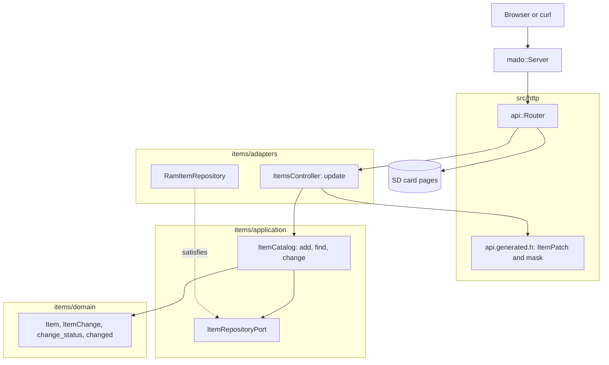

# RestPatch

只修改客户端所发送字段的 REST 端点，由装有以太网扩展板的 Arduino Uno R4 Minima 提供。`PATCH /api/items/{id}` 接受 `name`、`on` 或两者，并拒绝什么都不改的请求体。

[English](README.md) | [日本語](README.ja.md) | 简体中文 | [繁體中文（香港）](README.zh-HK.md)

## 本示例涵盖的内容

| 方面 | 实现内容 |
|:-----|:---------|
| 分层 | 一个限界上下文 `items`，分为 `domain`、`application` 和 `adapters`。领域层不包含任何 Arduino 头文件。 |
| 领域规则 | `ItemChange` 记录客户端发送了哪些字段。`change_status` 拒绝没有字段或名称为空的修改；`changed` 只应用发送的字段。 |
| 端口 | `ItemRepositoryPort` 列出 `insert`、`find` 和 `store`。 |
| 用例 | `ItemCatalog::change` 返回 `kChanged`、`kMissing`、`kNothing` 或 `kInvalid`。 |
| 适配器 | 基于 `mado::SlotTable` 的 `RamItemRepository`；`ItemsController` 把生成的存在性掩码转换为 `ItemChange`。 |
| 组合根 | [`RestPatch.ino`](RestPatch.ino) 写入 `lamp` 和 `fan`，挂载卡，并把两者交给路由器。 |
| 契约 | [`openapi.json`](openapi.json) 声明没有必填字段的 `ItemPatch`；[`api.generated.h`](src/http/api.generated.h) 把它读入一个结构和一个位掩码。 |
| 测试 | 四个文件中的 30 个主机测试，以及覆盖率 100% 的 15 个页面测试。 |
| 规则 | JPL D-60411 与 Power of Ten：不用堆、不用虚函数、不用函数指针，每个函数平均 2.10 个断言。 |

## 架构



页面也共享这条规则：页面领域层的 `ItemPatch.from` 去掉空字段，`ItemPatch.changesNothing` 在请求离开浏览器之前就把它拦下。

## 项目结构

```text
RestPatch/
  RestPatch.ino                            组合根
  openapi.json                             API 契约
  src/http/api.generated.h                 由工具生成
  src/http/api.router.h                    更新路由，其余路径交给卡上的页面
  src/items/domain/item.entity.h           Item、ItemChange、change_status、changed
  src/items/application/item_repository.port.h
  src/items/application/item_catalog.service.h   add、find、change
  src/items/adapters/ram_item.repository.h
  src/items/adapters/items.controller.h
  tests/                                   主机测试
  SD Card/                                 页面
```

## API 端点

| 方法 | 端点 | 说明 |
|:-----|:-----|:-----|
| PATCH | `/api/items/{id}` | 用 `{"on":false}`、`{"name":"fan"}` 或两者修改条目 1 到 4 |
| GET | `/api/openapi.json` | 从卡上读取的 OpenAPI 文档 |
| GET | 其他路径 | 卡上的页面 |

向 `PATCH /api/items/1` 发送 `{"on":false}` 时应答 `200 OK`：

```json
{"id":1,"name":"lamp","on":false}
```

| 错误条件 | 状态 | 详情 |
|:---------|:----:|:-----|
| id 空闲、为 0、大于 4 或不是数字 | 404 | `no item has this id` |
| 请求体为空 | 400 | `a JSON body is required` |
| 请求体不是 JSON | 400 | `the body is not valid JSON` |
| 请求体超过 256 字节 | 413 | `the body is larger than this operation accepts` |
| `Content-Type` 不是 JSON | 415 | `Content-Type must be application/json` |
| 字段未知或发送了 `id` | 422 | `a property is unknown, read-only or repeated` |
| `name` 超过 16 个字符 | 422 | `a string is longer than its maxLength` |
| 请求体是 `{}` | 422 | `the body changes no property` |
| 新名称为空 | 422 | `a string is shorter than its minLength` |

## 设计决策

### 是否出现也是值的一部分

PATCH 请求体没有必填字段，所以必须区分 "没有发送" 和 "发送了 false"。生成的读取器在结构旁边返回一个位掩码；`change_of` 把它转换为带 `renames` 和 `switches` 标志的 `ItemChange`。领域层从不接触掩码，HTTP 层也从不决定一次修改意味着什么。

### "什么都不改" 是领域规则

空修改由 `change_status` 拒绝，而不是控制器，所以这条规则对 `ItemCatalog::change` 的任何调用者都成立。控制器只是把 `kNothing` 映射为早先程序使用的 `422` 文字。

### 一条名称规则，反复使用

`change_status` 检查新名称的方式是构建一个 `ItemDraft` 并交给 `draft_status`，与 `add` 使用同一条规则。示例中有效名称的定义只有一处。

### 端口多了一个调用

用例在 RestGet 的 `insert` 和 `find` 之外还需要 `store(const Item&)`。`store` 返回 `false` 时被视为不存在，所以在 `find` 和 `store` 之间消失的条目绝不会被重新创建。

## 权衡

| 可以做的事 | 现在不做的原因 | 照现状发布的风险 |
|:-----------|:---------------|:-----------------|
| 用 `null` 清除字段的 JSON Merge Patch | 这里没有可以清除的字段 | `null` 应答 `422` |
| 用 ETag 实现 `If-Match` | 一个客户端，四个条目 | 两个客户端可能互相覆盖 |
| 把条目保存在卡上 | 持久化由 RestApi 演示 | 每次启动条目都恢复为初始值 |

## 假设

- 网络是可信的：没有认证，也没有 TLS。
- 一次一个客户端。

## 测试

```bash
cmake -S ../../tests -B build && cmake --build build --target mado_example_restpatch
ctest --test-dir build -R '^RestPatch\.' --output-on-failure
```

| 文件 | 测试数 | 覆盖内容 |
|:-----|------:|:---------|
| [`item.entity.test.cpp`](tests/item.entity.test.cpp) | 9 | 名称规则、id 范围、生成条目 |
| [`item_catalog.service.test.cpp`](tests/item_catalog.service.test.cpp) | 6 | add、表已满、find |
| [`item_change.test.cpp`](tests/item_change.test.cpp) | 5 | 空修改、空名称、保留名称的切换、被保存的改名、空闲 id |
| [`items.api.test.cpp`](tests/items.api.test.cpp) | 10 | 单个字段、改名、被拒绝的请求体、损坏的 JSON、空闲 id、`{}` |

`cd "SD Card" && pnpm run test` 以 100% 覆盖率运行 15 个页面测试。

## 前提条件

| 工具 | 版本 | 用途 |
|:-----|:-----|:-----|
| Arduino Uno R4 Minima | | 开发板 |
| 带 microSD 插槽的 W5100、W5500 或 ENC28J60 扩展板 | | 网络和卡 |
| arduino-cli | 1.5.1 | 构建程序 |
| arduino:renesas_uno 核心 | 1.6.0 | 开发板软件包 |
| Ethernet 和 SdFat | 2.0.2 和 2.3.0 | 网络和卡的库 |
| Node.js 和 pnpm | 24 和 12.15.0 | 构建页面 |

## 快速开始

```bash
arduino-cli lib install Ethernet@2.0.2 SdFat@2.3.0
arduino-cli compile --fqbn arduino:renesas_uno:minima --library ../.. .
arduino-cli upload --fqbn arduino:renesas_uno:minima --port /dev/cu.usbmodem1101 .
cd "SD Card" && pnpm install && pnpm run build
```

把 `SD Card/dist` 复制到卡上，然后：

```bash
curl -X PATCH -H 'Content-Type: application/json' -d '{"on":false}' http://192.168.1.177/api/items/1
```

## 技术栈

| 类别 | 技术 |
|:-----|:-----|
| 开发板 | Arduino Uno R4 Minima：闪存 262,144 字节中用 77,692 字节，RAM 32,768 字节中用 5,904 字节 |
| HTTP | Madoguchi，不用堆的 C++11 |
| 卡 | SdFat 2.3.0 |
| 网络 | Ethernet 2.0.2 |
| 主机测试 | googletest 1.18.0、CMake |
| 页面 | TypeScript 7.0.2、Vite 8.3.5、从 CDN 加载的 Pico CSS 2.1.1、Vitest 5.0.5 |
| 分析 | clang-tidy 23.1.3、cppcheck 2.22.0、clang-format 23.1.3、Biome 2.6.3 |
