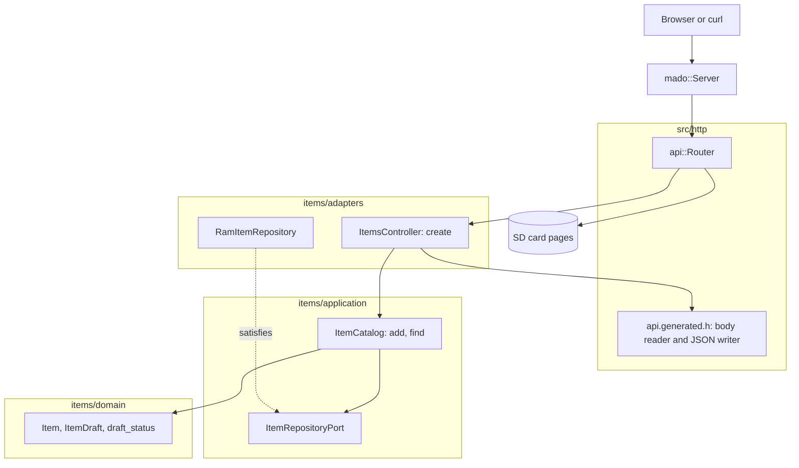

# RestPost

4件の固定テーブルに項目を作るRESTエンドポイントで、Ethernetシールドを載せたArduino Uno R4 Minimaが応答します。`POST /api/items`はJSONボディをRAMにドキュメントを置かずにフィールドごとに読み、項目を保存して、`Location`付きの`201 Created`で応答します。

[English](README.md) | 日本語 | [简体中文](README.zh-Hans.md) | [繁體中文（香港）](README.zh-HK.md)

## このサンプルの内容

| 領域 | 作ったもの |
|:-----|:-----------|
| レイヤー | 境界づけられたコンテキスト`items`を1つ持ち、`domain`、`application`、`adapters`に分けています。ドメインはArduinoのヘッダーを一切インクルードしません。 |
| ポート | `ItemRepositoryPort`はユースケースが使う2つの呼び出し`insert`と`find`を名指しし、戻り値の型を`static_assert`で検査します。 |
| 検証 | 生成されたリーダーがJSONスキーマを強制します。既知のキーだけ、`name`は1から16文字、両フィールド必須、`id`は読み取り専用です。リーダーを通らない呼び出し元のために、ドメインも同じ名前のルールを持ちます。 |
| アダプター | `RamItemRepository`は項目を`mado::SlotTable`に保持します。`ItemsController`はボディを`ItemDraft`に、保存した`Item`をJSONに戻します。 |
| コンポジションルート | [`RestPost.ino`](RestPost.ino)がリポジトリを作り、カードをマウントし、両方をルーターに渡します。 |
| 契約 | [`openapi.json`](openapi.json)から[`api.generated.h`](src/http/api.generated.h)のルート、ボディのリーダー、JSONの書き出しを生成します。 |
| エラー | 拒否はすべてRFC 9457のproblemで、`400`、`413`、`415`、`422`、`507`のいずれかです。 |
| テスト | 5ファイルのホストテスト54件と、カバレッジ100パーセントのページテスト7件。 |
| ルール | JPL D-60411とPower of Ten。ヒープなし、仮想関数なし、関数ポインターなし、関数あたり2.14個のアサーション。 |

## アーキテクチャ



HTTPに関わることはすべてコントローラーが持ちます。256バイトのボディ上限、ステータスコード、`Location`ヘッダーです。カタログは操作の順序を持ちます。ドラフトを検証し、挿入し、読み戻します。ルールはドメインが持ちます。Ethernet、SdFat、具体的なリポジトリを名指しするのは[`RestPost.ino`](RestPost.ino)だけです。

## プロジェクト構成

```text
RestPost/
  RestPost.ino                             コンポジションルート
  openapi.json                             API契約、tools/madogenの入力
  src/
    http/api.generated.h                   ルート、上限、ボディのリーダー、JSONの書き出し（生成）
    http/api.router.h                      作成のルート、それ以外のパスはカードのページ
    identity/...                           ログイン。RestAuthと同じコード
    items/domain/item.entity.h             Item、ItemDraft、idの範囲と名前のルール
    items/application/item_repository.port.h   リポジトリが備えるべき呼び出し
    items/application/item_catalog.service.h   ユースケース：add、find
    items/adapters/ram_item.repository.h   固定スロットテーブル上のリポジトリ
    items/adapters/items.controller.h      ボディからドラフトへ、拒否からproblemへ
  tests/                                   ホストテスト、このサンプル専用のバイナリ
  SD Card/                                 ページ、独立したWebプロジェクト
```

ファイル名は`name.type.h`の形なので、開く前に接尾辞で中身がわかります。

## APIエンドポイント

ログインを除くすべての`/api`ルートにベアラートークンが必要です。ログインと安全な書き込みの節を参照してください。

| メソッド | エンドポイント | 説明 |
|:---------|:---------------|:-----|
| POST | `/api/items` | `{"name":"lamp","on":true}`から項目を作る |
| GET | `/api/openapi.json` | カードから読んだOpenAPIドキュメント |
| GET | その他のパス | カード上のページ |

作成された項目は`Location: /api/items/1`付きの`201 Created`で次を返します。

```json
{"id":1,"name":"lamp","on":true}
```

| エラーの条件 | ステータス | 詳細 |
|:-------------|:----------:|:-----|
| ボディが空 | 400 | `a JSON body is required` |
| ボディがJSONでない | 400 | `the body is not valid JSON` |
| ボディが256バイトを超える | 413 | `the body is larger than this operation accepts` |
| `Content-Type`がJSONでない | 415 | `Content-Type must be application/json` |
| フィールドが足りない | 422 | 例：`missing required property: on` |
| 未知のフィールド、または`id`を送った | 422 | `a property is unknown, read-only or repeated` |
| `name`が16文字を超える | 422 | `a string is longer than its maxLength` |
| `on`が真偽値でない | 422 | `a property has the wrong type` |
| 名前が空 | 422 | `a string is shorter than its minLength` |
| 4スロットがすべて埋まっている | 507 | `every item slot is taken` |

## 設計上の判断

### 役割の違う2つの検証層

生成されたリーダーはボディをスキーマと照合します。キー名、型、`minLength`と`maxLength`、必須フィールドです。ドメインは同じ名前のルールを`draft_status`に持つので、カタログに入るどの経路もそれを通ります。リーダーを通らないスケッチからの初期データの投入も含みます。HTTPではリーダーが先に応答するので、ドメイン自身の拒否はクライアントには見えない第二の防衛線です。

### 挿入してから読み戻す

`ItemCatalog::add`はドラフトを挿入してから新しいidを検索します。idを割り当てるのはリポジトリなので、保存された項目をユースケースが返すには読み戻すしかなく、それが挿入が本当に起きたかの確認も兼ねます。テーブルが満杯のとき`insert`がid 0を返し、それが`507`になります。

### エンティティはワイヤー構造体ではない

`rest_post::Item`はJSONを写して`int32_t id`を持ちます。`items::Item`はそれを`uint8_t`で持ち、コントローラーが両者の間でコピーします。`static_assert`が名前の長さを結び付けるので、名前を切り詰めるようなスキーマの変更はビルドを失敗させます。

### サンプルごとのポート

このサンプルのポートは`insert`と`find`だけを並べます。RestPutは`store`を、RestDeleteは`erase`を加えます。もっと多くを備えるリポジトリも合いますが、ユースケースはポートが名指ししない呼び出しには届きません。

### 検索ルートなしのLocation

このAPIにはidによるGETがないので、ジェネレーターはURLの補助関数を出しません。コントローラーは接頭辞`/api/items/`をフラッシュに置き、`mado::Reply::location`にidを付け足させます。

## トレードオフ

| できること | 今はしない理由 | このままのリスク |
|:-----------|:---------------|:-----------------|
| 項目をカードに保存する | このサンプルはPOSTを示し、永続化はRestApiが示す | 再起動で項目が消える |
| 読み戻し用のGETルート | 動詞ごとのサンプルは1つの動詞だけを示す | クライアントが項目を見られるのは`201`のボディだけ |

## 前提

- ネットワークは平文のパスワードとトークンを送れる程度に信頼できる。TLSはない。
- 同時に扱うクライアントは1つ。`mado::Server`は`loop`ごとに1つの接続に応答する。

## ログインと安全な書き込み

`POST /api/auth/login`を除くすべての`/api`ルートにベアラートークンが必要です。`{"username":"admin","password":"..."}`でログインすると、15分間かつボードが再起動するまで有効なトークンが返ります。トークンがない、署名が違う、古い場合は`WWW-Authenticate: Bearer`付きの`401`を返します。

1つのクライアントアドレスからログインに5回失敗すると、そのアドレスは`429`と`Retry-After`で15分間ロックされ、ほかのアドレスはログインを続けられます。表は4つのアドレスを持ち、4つすべてがロック中の間は新しいアドレスもロックされるので、アドレスを替えてもロックは解けません。 アドレスごとの回数は`/LOGIN.TXT`に書き込まれるので、ロックは再起動後も残ります。

ビルドの前に`python3 -m tools.madogen secrets examples/RestPost --user admin`でアカウントを[`arduino_secrets.h`](arduino_secrets.h)に書き込みます。コミットされているファイルはすべてゼロの仮の値で、ログインには必ず`503`を返します。

`POST`は`Idempotency-Key: "<1から64文字>"`を受け付けます。同じキーと同じボディの再試行は、最初のリクエストが作った項目とともに`201`を返し、同じキーで異なるボディなら`422`を返します。ボードは最後の8つのキーを覚えます。項目と同じくRAMに置きます。

## テスト

```bash
cmake -S ../../tests -B build && cmake --build build --target mado_example_restpost
ctest --test-dir build -R '^RestPost\.' --output-on-failure
```

| ファイル | テスト数 | 対象 |
|:---------|---------:|:-----|
| [`item.entity.test.cpp`](tests/item.entity.test.cpp) | 9 | 名前のルール、idの範囲、項目の生成 |
| [`item_catalog.service.test.cpp`](tests/item_catalog.service.test.cpp) | 6 | add、満杯のテーブル、find |
| [`items.api.test.cpp`](tests/items.api.test.cpp) | 20 | `201`と`Location`、idの順序、`507`、8種類の拒否されるボディ、空の名前 |
| [`identity.adapters.test.cpp`](tests/identity.adapters.test.cpp) | 9 | EEPROMカウンター、ログイン、カード上のアドレスごとの失敗回数、再起動をまたぐロックアウト、トークンの確認 |
| [`identity.domain.test.cpp`](tests/identity.domain.test.cpp) | 10 | 認証情報の規則、セッションカウンター、トークンの終了時刻 |

`cd "SD Card" && pnpm run test`はカバレッジ100パーセントで7件のページテストを実行します。

## 前提条件

| ツール | バージョン | 用途 |
|:-------|:-----------|:-----|
| Arduino Uno R4 Minima | | ボード |
| microSDスロット付きのW5100、W5500、ENC28J60シールド | | ネットワークとカード |
| arduino-cli | 1.5.1 | スケッチのビルド |
| arduino:renesas_unoコア | 1.6.0 | ボードパッケージ |
| EthernetとSdFat | 2.0.2と2.3.0 | ネットワークとカードのライブラリ |
| Node.jsとpnpm | 24と12.15.0 | ページのビルド |

## はじめに

```bash
cd ../.. && python3 -m tools.madogen secrets examples/RestPost --user admin && cd examples/RestPost
arduino-cli lib install Ethernet@2.0.2 SdFat@2.3.0
arduino-cli compile --fqbn arduino:renesas_uno:minima --library ../.. .
arduino-cli upload --fqbn arduino:renesas_uno:minima --port /dev/cu.usbmodem1101 .
cd "SD Card" && pnpm install && pnpm run build
```

`SD Card/dist`をカードにコピーしてから：

```bash
TOKEN=$(curl -s -H 'Content-Type: application/json' -d '{"username":"admin","password":"your password"}' http://192.168.1.177/api/auth/login | python3 -c 'import json,sys; print(json.load(sys.stdin)["access_token"])')
curl -H "Authorization: Bearer $TOKEN" -i -X POST -H 'Content-Type: application/json' -d '{"name":"lamp","on":true}' http://192.168.1.177/api/items
```

## 技術スタック

| 分類 | 技術 |
|:-----|:-----|
| ボード | Arduino Uno R4 Minima：フラッシュ262,144バイト中90,816バイト、RAM 32,768バイト中6,928バイト |
| HTTP | Madoguchi、ヒープを使わないC++11 |
| カード | SdFat 2.3.0 |
| ネットワーク | Ethernet 2.0.2 |
| ホストテスト | googletest 1.18.0、CMake |
| ページ | TypeScript 7.0.2、Vite 8.3.5、CDNから読み込むPico CSS 2.1.1、Vitest 5.0.5 |
| 解析 | clang-tidy 23.1.3、cppcheck 2.22.0、clang-format 23.1.3、Biome 2.6.3 |
