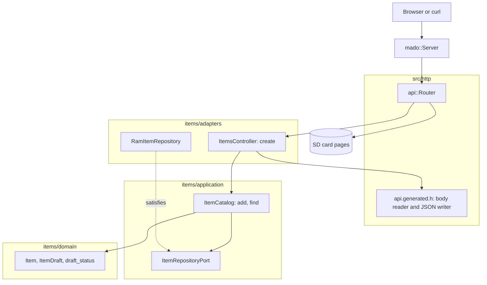

# RestPost

REST endpoint that creates items in a fixed table of four, served by an Arduino Uno R4 Minima with an Ethernet shield. `POST /api/items` reads a JSON body field by field with no document in RAM, stores the item and answers `201 Created` with its `Location`.

English | [日本語](README.ja.md) | [简体中文](README.zh-Hans.md) | [繁體中文（香港）](README.zh-HK.md)

## What this example covers

| Area | What is built |
|:-----|:--------------|
| Layers | One bounded context, `items`, split into `domain`, `application` and `adapters`. The domain includes no Arduino header. |
| Ports | `ItemRepositoryPort` names `insert` and `find`, the two calls the use cases make, and checks their return types with `static_assert`. |
| Validation | The generated reader enforces the JSON schema: known keys only, `name` from 1 to 16 characters, both fields required, `id` read-only. The domain holds the same name rule for callers that skip the reader. |
| Adapters | `RamItemRepository` keeps items in a `mado::SlotTable`. `ItemsController` maps the body to an `ItemDraft` and the stored `Item` back to JSON. |
| Composition root | [`RestPost.ino`](RestPost.ino) builds the repository, mounts the card and attaches both to the router. |
| Contract | [`openapi.json`](openapi.json) generates the route, the body reader and the JSON writer in [`api.generated.h`](src/http/api.generated.h). |
| Errors | Every refusal is an RFC 9457 problem: `400`, `413`, `415`, `422` or `507`. |
| Tests | 29 host tests in three files and 7 page tests with 100 percent coverage. |
| Rules | JPL D-60411 and the Power of Ten: no heap, no virtual functions, no function pointers, 2.14 assertions per function. |

## Architecture



The controller owns everything HTTP: the body limit of 256 bytes, the status codes and the `Location` header. The catalog owns the order of operations: validate the draft, insert it, read it back. The domain owns the rules. [`RestPost.ino`](RestPost.ino) is the only file that names Ethernet, SdFat and the concrete repository.

## Project structure

```text
RestPost/
  RestPost.ino                             composition root
  openapi.json                             API contract, input of tools/madogen
  src/
    http/api.generated.h                   route, limits, body reader, JSON writer, generated
    http/api.router.h                      the create route, card pages for every other path
    items/domain/item.entity.h             Item, ItemDraft, id range and name rules
    items/application/item_repository.port.h   the calls a repository must offer
    items/application/item_catalog.service.h   use cases: add, find
    items/adapters/ram_item.repository.h   repository on a fixed slot table
    items/adapters/items.controller.h      body to draft, refusals to problems
  tests/                                   host tests, one binary for this example
  SD Card/                                 the pages, a separate web project
```

Files use `name.type.h`, so the suffix says what a file holds before you open it.

## API endpoints

No route needs authentication.

| Method | Endpoint | Description |
|:-------|:---------|:------------|
| POST | `/api/items` | Create an item from `{"name":"lamp","on":true}` |
| GET | `/api/openapi.json` | The OpenAPI document, read from the card |
| GET | any other path | A page from the card |

A created item answers `201 Created` with `Location: /api/items/1` and:

```json
{"id":1,"name":"lamp","on":true}
```

| Error condition | Status | Detail |
|:----------------|:------:|:-------|
| The body is empty | 400 | `a JSON body is required` |
| The body is not JSON | 400 | `the body is not valid JSON` |
| The body is over 256 bytes | 413 | `the body is larger than this operation accepts` |
| `Content-Type` is not JSON | 415 | `Content-Type must be application/json` |
| A field is missing | 422 | for example `missing required property: on` |
| A field is unknown or `id` is sent | 422 | `a property is unknown, read-only or repeated` |
| `name` is over 16 characters | 422 | `a string is longer than its maxLength` |
| `on` is not a boolean | 422 | `a property has the wrong type` |
| The name is empty | 422 | `a string is shorter than its minLength` |
| All four slots are taken | 507 | `every item slot is taken` |

## Design decisions

### Two validation layers with different jobs

The generated reader checks the body against the schema: key names, types, `minLength` and `maxLength`, and required fields. The domain holds the same name rule in `draft_status`, so every way into the catalog meets it, including seeding from the sketch, which never passes through the reader. Over HTTP the reader answers first, so the domain's own refusal is a second line that a client never sees.

### Insert, then read back

`ItemCatalog::add` inserts the draft and then finds the new id. The repository assigns the id, so the read-back is the only way the use case can return the stored item, and it doubles as a check that the insert really happened. A `507` comes from `insert` returning id 0 when the table is full.

### The entity is not the wire struct

`rest_post::Item` mirrors JSON with an `int32_t id`. `items::Item` keeps it as `uint8_t`, and the controller copies between them. A `static_assert` ties the name lengths together, so a schema change that would truncate names fails the build.

### A port per example

This example's port lists only `insert` and `find`. RestPut adds `store`, RestDelete adds `erase`. A repository that offers more still fits, and a use case cannot reach a call its port does not name.

### Location without a lookup route

The API has no GET by id, so the generator emits no URL helper. The controller writes the prefix `/api/items/` in flash and lets `mado::Reply::location` append the id.

## Trade-offs

| What could be done | Why it is not done | Risk as shipped |
|:-------------------|:-------------------|:----------------|
| An idempotency key on POST | Four slots in RAM; a retry costs one slot | A retried POST creates a second item |
| Keep items on the card | This example shows POST; RestApi shows persistence | Items vanish on reboot |
| A GET route to read back | Each verb example shows one verb | Clients see the item only in the `201` body |

## Assumptions

- The network is trusted: there is no authentication and no TLS.
- One client at a time: `mado::Server` answers one connection per `loop`.

## Testing

```bash
cmake -S ../../tests -B build && cmake --build build --target mado_example_restpost
ctest --test-dir build -R '^RestPost\.' --output-on-failure
```

| File | Tests | Covers |
|:-----|------:|:-------|
| [`item.entity.test.cpp`](tests/item.entity.test.cpp) | 9 | name rules, the id range, building an item |
| [`item_catalog.service.test.cpp`](tests/item_catalog.service.test.cpp) | 6 | add, a full table, find |
| [`items.api.test.cpp`](tests/items.api.test.cpp) | 14 | `201` and `Location`, id order, `507`, eight refused bodies, the empty name |

`cd "SD Card" && pnpm run test` runs 7 page tests at 100 percent coverage.

## Prerequisites

| Tool | Version | Required for |
|:-----|:--------|:-------------|
| Arduino Uno R4 Minima | | the board |
| W5100, W5500 or ENC28J60 shield with a microSD slot | | network and card |
| arduino-cli | 1.5.1 | building the sketch |
| arduino:renesas_uno core | 1.6.0 | the board package |
| Ethernet and SdFat | 2.0.2 and 2.3.0 | network and card libraries |
| Node.js and pnpm | 24 and 12.15.0 | building the pages |

## Getting started

```bash
arduino-cli lib install Ethernet@2.0.2 SdFat@2.3.0
arduino-cli compile --fqbn arduino:renesas_uno:minima --library ../.. .
arduino-cli upload --fqbn arduino:renesas_uno:minima --port /dev/cu.usbmodem1101 .
cd "SD Card" && pnpm install && pnpm run build
```

Copy `SD Card/dist` to the card, then:

```bash
curl -i -X POST -H 'Content-Type: application/json' -d '{"name":"lamp","on":true}' http://192.168.1.177/api/items
```

## Tech stack

| Category | Technology |
|:---------|:-----------|
| Board | Arduino Uno R4 Minima: 77,032 of 262,144 bytes of flash, 5,904 of 32,768 bytes of RAM |
| HTTP | Madoguchi, heap-free C++11 |
| Card | SdFat 2.3.0 |
| Network | Ethernet 2.0.2 |
| Host tests | googletest 1.18.0, CMake |
| Pages | TypeScript 7.0.2, Vite 8.3.5, Pico CSS 2.1.1 from a CDN, Vitest 5.0.5 |
| Analysis | clang-tidy 23.1.3, cppcheck 2.22.0, clang-format 23.1.3, Biome 2.6.3 |
