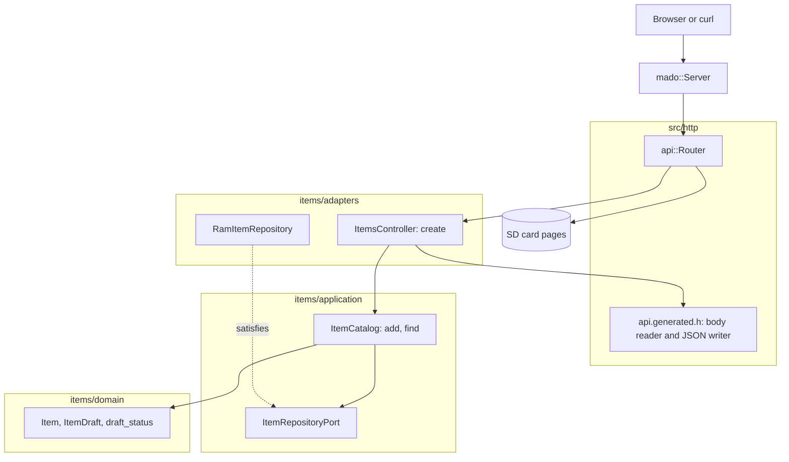

# RestPost

在一張固定的四項表中建立項目的 REST 端點，由裝有以太網擴充板的 Arduino Uno R4 Minima 提供。`POST /api/items` 逐個欄位讀取 JSON 請求主體，不在 RAM 中保存整份文件，保存項目後以附 `Location` 的 `201 Created` 回應。

[English](README.md) | [日本語](README.ja.md) | [简体中文](README.zh-Hans.md) | 繁體中文（香港）

## 本範例涵蓋的內容

| 範疇 | 實作內容 |
|:-----|:---------|
| 分層 | 一個限界上下文 `items`，分為 `domain`、`application` 及 `adapters`。領域層不包含任何 Arduino 標頭檔。 |
| 端口 | `ItemRepositoryPort` 列出用例呼叫的兩個函式 `insert` 及 `find`，並以 `static_assert` 檢查回傳型別。 |
| 驗證 | 產生的讀取器執行 JSON 結構描述：只接受已知的鍵，`name` 為 1 至 16 個字元，兩個欄位都必填，`id` 唯讀。領域層為繞過讀取器的呼叫者保留同樣的名稱規則。 |
| 轉接器 | `RamItemRepository` 把項目放在 `mado::SlotTable` 中。`ItemsController` 把請求主體對應為 `ItemDraft`，再把保存的 `Item` 寫回 JSON。 |
| 組合根 | [`RestPost.ino`](RestPost.ino) 建立儲存庫，掛載記憶卡，再把兩者交給路由器。 |
| 契約 | [`openapi.json`](openapi.json) 產生 [`api.generated.h`](src/http/api.generated.h) 中的路由、請求主體讀取器及 JSON 寫入函式。 |
| 錯誤 | 每次拒絕都是 RFC 9457 問題詳情：`400`、`413`、`415`、`422` 或 `507`。 |
| 測試 | 五個檔案中的 54 個主機測試，以及覆蓋率 100% 的 7 個頁面測試。 |
| 規則 | JPL D-60411 及 Power of Ten：不用堆積、不用虛擬函式、不用函式指標，每個函式平均 2.14 個斷言。 |

## 架構



所有與 HTTP 有關的東西都歸控制器：256 位元組的請求主體上限、狀態碼及 `Location` 標頭。目錄負責操作的次序：驗證草稿、插入、讀回。規則歸領域層。只有 [`RestPost.ino`](RestPost.ino) 會提到 Ethernet、SdFat 及具體的儲存庫。

## 項目結構

```text
RestPost/
  RestPost.ino                             組合根
  openapi.json                             API 契約，tools/madogen 的輸入
  src/
    http/api.generated.h                   路由、上限、請求主體讀取器、JSON 寫入，由工具產生
    http/api.router.h                      建立路由，其餘路徑交給記憶卡上的頁面
    identity/...                           登入，與 RestAuth 相同的程式碼
    items/domain/item.entity.h             Item、ItemDraft、id 範圍及名稱規則
    items/application/item_repository.port.h   儲存庫必須提供的呼叫
    items/application/item_catalog.service.h   用例：add、find
    items/adapters/ram_item.repository.h   建基於固定槽位表的儲存庫
    items/adapters/items.controller.h      請求主體到草稿，拒絕到問題詳情
  tests/                                   主機測試，本範例獨有的二進位檔
  SD Card/                                 頁面，一個獨立的網頁項目
```

檔案名稱採用 `name.type.h`，打開之前，後綴已說明檔案裏放的是甚麼。

## API 端點

除登入外，每個 `/api` 路由都需要持有人權杖，見「登入及安全寫入」一節。

| 方法 | 端點 | 說明 |
|:-----|:-----|:-----|
| POST | `/api/items` | 以 `{"name":"lamp","on":true}` 建立項目 |
| GET | `/api/openapi.json` | 從記憶卡讀取的 OpenAPI 文件 |
| GET | 其他路徑 | 記憶卡上的頁面 |

建立成功時以 `201 Created` 及 `Location: /api/items/1` 回應：

```json
{"id":1,"name":"lamp","on":true}
```

| 錯誤條件 | 狀態 | 詳情 |
|:---------|:----:|:-----|
| 請求主體為空 | 400 | `a JSON body is required` |
| 請求主體不是 JSON | 400 | `the body is not valid JSON` |
| 請求主體超過 256 位元組 | 413 | `the body is larger than this operation accepts` |
| `Content-Type` 不是 JSON | 415 | `Content-Type must be application/json` |
| 缺少欄位 | 422 | 例如 `missing required property: on` |
| 欄位未知或傳送了 `id` | 422 | `a property is unknown, read-only or repeated` |
| `name` 超過 16 個字元 | 422 | `a string is longer than its maxLength` |
| `on` 不是布林值 | 422 | `a property has the wrong type` |
| 名稱為空 | 422 | `a string is shorter than its minLength` |
| 四個槽位都已佔用 | 507 | `every item slot is taken` |

## 設計決定

### 職責不同的兩層驗證

產生的讀取器按結構描述檢查請求主體：鍵名、型別、`minLength` 及 `maxLength`，以及必填欄位。領域層在 `draft_status` 中保留同樣的名稱規則，所以進入目錄的每條路徑都要經過它，包括從草稿碼寫入初始資料，而那條路徑從不經過讀取器。透過 HTTP 時讀取器先回應，所以領域層自己的拒絕是客戶端看不到的第二道防線。

### 先插入，再讀回

`ItemCatalog::add` 插入草稿後再查找新的 id。id 由儲存庫分配，所以用例只有讀回才能回傳保存的項目，這一步同時確認插入確實發生了。表滿時 `insert` 回傳 id 0，於是回應 `507`。

### 實體不是線上結構

`rest_post::Item` 照搬 JSON，附 `int32_t id`。`items::Item` 把它存為 `uint8_t`，由控制器在兩者之間複製。`static_assert` 把名稱長度綁在一起，所以會截斷名稱的結構描述改動會令建置失敗。

### 每個範例一個端口

本範例的端口只列 `insert` 及 `find`。RestPut 加入 `store`，RestDelete 加入 `erase`。提供更多呼叫的儲存庫同樣適用，而用例無法呼叫端口沒有列出的函式。

### 沒有查詢路由的 Location

這個 API 沒有按 id 的 GET，所以產生器不輸出 URL 輔助函式。控制器把前綴 `/api/items/` 放在快閃記憶體中，由 `mado::Reply::location` 附加 id。

## 取捨

| 可以做的事 | 現在不做的原因 | 照現狀發佈的風險 |
|:-----------|:---------------|:-----------------|
| 把項目保存在記憶卡上 | 本範例示範 POST，持久化由 RestApi 示範 | 重啟後項目消失 |
| 用來讀回的 GET 路由 | 每個動詞範例只示範一個動詞 | 客戶端只能在 `201` 的請求主體中看到項目 |

## 假設

- 網絡足夠可信，可以傳送明文密碼及權杖：沒有 TLS。
- 一次一個客戶端：`mado::Server` 每次 `loop` 只回應一個連線。

## 登入及安全寫入

除 `POST /api/auth/login` 外，每個 `/api` 路由都需要持有人權杖。以 `{"username":"admin","password":"..."}` 登入，取得 15 分鐘內及開發板重啟前有效的權杖；缺少權杖、簽署錯誤或權杖過時都會回應附 `WWW-Authenticate: Bearer` 的 `401`。

同一客戶端位址登入失敗五次，該位址會以 `429` 及 `Retry-After` 鎖定 15 分鐘，其他位址仍可登入。表中保存四個位址，四個都被鎖定時新位址亦被鎖定，所以輪換位址無法解除鎖定。 每個位址的次數寫入 `/LOGIN.TXT`，所以鎖定在重啟後依然有效。

建置前以 `python3 -m tools.madogen secrets examples/RestPost --user admin` 把帳戶寫入 [`arduino_secrets.h`](arduino_secrets.h)；提交的檔案是全零的佔位值，對每次登入都回應 `503`。

`POST` 支援 `Idempotency-Key: "<1 至 64 個字元>"`。相同鍵及相同請求主體的重試會回應 `201` 並傳回第一次請求建立的項目；相同鍵但請求主體不同則回應 `422`。開發板記住最近八個鍵，與項目一樣保存在 RAM 中。

## 測試

```bash
cmake -S ../../tests -B build && cmake --build build --target mado_example_restpost
ctest --test-dir build -R '^RestPost\.' --output-on-failure
```

| 檔案 | 測試數目 | 涵蓋內容 |
|:-----|------:|:---------|
| [`item.entity.test.cpp`](tests/item.entity.test.cpp) | 9 | 名稱規則、id 範圍、產生項目 |
| [`item_catalog.service.test.cpp`](tests/item_catalog.service.test.cpp) | 6 | add、表已滿、find |
| [`items.api.test.cpp`](tests/items.api.test.cpp) | 20 | `201` 及 `Location`、id 次序、`507`、八種被拒絕的請求主體、空名稱 |
| [`identity.adapters.test.cpp`](tests/identity.adapters.test.cpp) | 9 | EEPROM 計數器、登入、記憶卡上按位址記錄的失敗次數、跨重啟的鎖定、權杖檢查 |
| [`identity.domain.test.cpp`](tests/identity.domain.test.cpp) | 10 | 憑證規則、工作階段計數器、權杖結束時間 |

`cd "SD Card" && pnpm run test` 以 100% 覆蓋率執行 7 個頁面測試。

## 先決條件

| 工具 | 版本 | 用途 |
|:-----|:-----|:-----|
| Arduino Uno R4 Minima | | 開發板 |
| 附 microSD 插槽的 W5100、W5500 或 ENC28J60 擴充板 | | 網絡及記憶卡 |
| arduino-cli | 1.5.1 | 建置草稿碼 |
| arduino:renesas_uno 核心 | 1.6.0 | 開發板套件 |
| Ethernet 及 SdFat | 2.0.2 及 2.3.0 | 網絡及記憶卡程式庫 |
| Node.js 及 pnpm | 24 及 12.15.0 | 建置頁面 |

## 開始使用

```bash
cd ../.. && python3 -m tools.madogen secrets examples/RestPost --user admin && cd examples/RestPost
arduino-cli lib install Ethernet@2.0.2 SdFat@2.3.0
arduino-cli compile --fqbn arduino:renesas_uno:minima --library ../.. .
arduino-cli upload --fqbn arduino:renesas_uno:minima --port /dev/cu.usbmodem1101 .
cd "SD Card" && pnpm install && pnpm run build
```

把 `SD Card/dist` 複製到記憶卡上，然後：

```bash
TOKEN=$(curl -s -H 'Content-Type: application/json' -d '{"username":"admin","password":"your password"}' http://192.168.1.177/api/auth/login | python3 -c 'import json,sys; print(json.load(sys.stdin)["access_token"])')
curl -H "Authorization: Bearer $TOKEN" -i -X POST -H 'Content-Type: application/json' -d '{"name":"lamp","on":true}' http://192.168.1.177/api/items
```

## 技術棧

| 類別 | 技術 |
|:-----|:-----|
| 開發板 | Arduino Uno R4 Minima：快閃記憶體 262,144 位元組中用 90,816 位元組，RAM 32,768 位元組中用 6,928 位元組 |
| HTTP | Madoguchi，不用堆積的 C++11 |
| 記憶卡 | SdFat 2.3.0 |
| 網絡 | Ethernet 2.0.2 |
| 主機測試 | googletest 1.18.0、CMake |
| 頁面 | TypeScript 7.0.2、Vite 8.3.5、從 CDN 載入的 Pico CSS 2.1.1、Vitest 5.0.5 |
| 分析 | clang-tidy 23.1.3、cppcheck 2.22.0、clang-format 23.1.3、Biome 2.6.3 |
