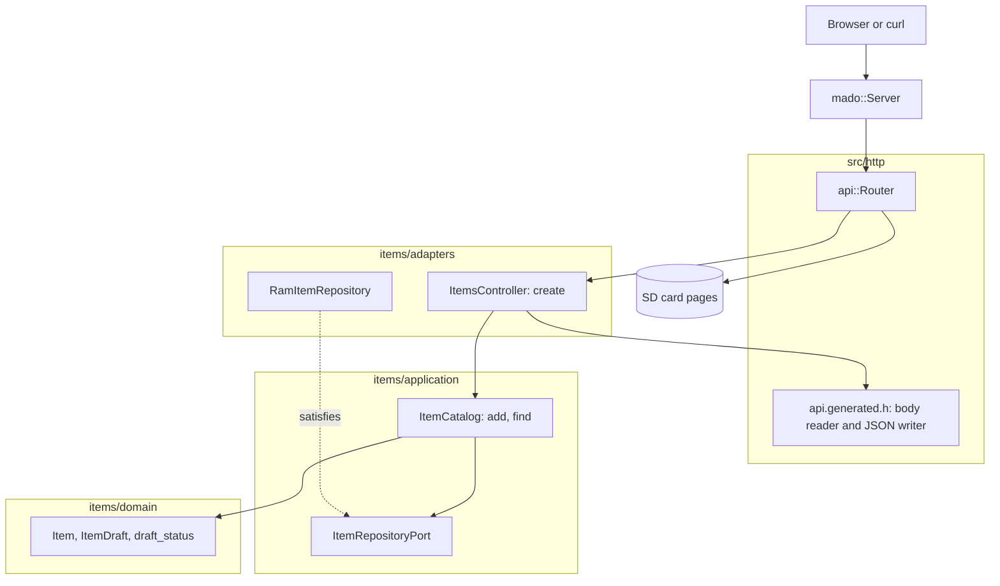

# RestPost

在一张固定的四项表中创建条目的 REST 端点，由装有以太网扩展板的 Arduino Uno R4 Minima 提供。`POST /api/items` 逐字段读取 JSON 请求体，不在 RAM 中保存整个文档，保存条目后以带 `Location` 的 `201 Created` 应答。

[English](README.md) | [日本語](README.ja.md) | 简体中文 | [繁體中文（香港）](README.zh-HK.md)

## 本示例涵盖的内容

| 方面 | 实现内容 |
|:-----|:---------|
| 分层 | 一个限界上下文 `items`，分为 `domain`、`application` 和 `adapters`。领域层不包含任何 Arduino 头文件。 |
| 端口 | `ItemRepositoryPort` 列出用例调用的两个函数 `insert` 和 `find`，并用 `static_assert` 检查返回类型。 |
| 校验 | 生成的读取器执行 JSON 模式：只接受已知的键，`name` 为 1 到 16 个字符，两个字段都必填，`id` 只读。领域层为绕过读取器的调用者保留同样的名称规则。 |
| 适配器 | `RamItemRepository` 把条目放在 `mado::SlotTable` 中。`ItemsController` 把请求体映射为 `ItemDraft`，再把保存的 `Item` 写回 JSON。 |
| 组合根 | [`RestPost.ino`](RestPost.ino) 创建仓储，挂载卡，并把两者交给路由器。 |
| 契约 | [`openapi.json`](openapi.json) 生成 [`api.generated.h`](src/http/api.generated.h) 中的路由、请求体读取器和 JSON 写入函数。 |
| 错误 | 每次拒绝都是 RFC 9457 问题详情：`400`、`413`、`415`、`422` 或 `507`。 |
| 测试 | 三个文件中的 29 个主机测试，以及覆盖率 100% 的 7 个页面测试。 |
| 规则 | JPL D-60411 与 Power of Ten：不用堆、不用虚函数、不用函数指针，每个函数平均 2.14 个断言。 |

## 架构



所有与 HTTP 有关的东西都归控制器：256 字节的请求体上限、状态码和 `Location` 头。目录负责操作的顺序：校验草稿、插入、读回。规则归领域层。只有 [`RestPost.ino`](RestPost.ino) 会提到 Ethernet、SdFat 和具体的仓储。

## 项目结构

```text
RestPost/
  RestPost.ino                             组合根
  openapi.json                             API 契约，tools/madogen 的输入
  src/
    http/api.generated.h                   路由、上限、请求体读取器、JSON 写入，由工具生成
    http/api.router.h                      创建路由，其余路径交给卡上的页面
    items/domain/item.entity.h             Item、ItemDraft、id 范围和名称规则
    items/application/item_repository.port.h   仓储必须提供的调用
    items/application/item_catalog.service.h   用例：add、find
    items/adapters/ram_item.repository.h   基于固定槽位表的仓储
    items/adapters/items.controller.h      请求体到草稿，拒绝到问题详情
  tests/                                   主机测试，本示例独有的二进制
  SD Card/                                 页面，一个独立的 Web 项目
```

文件名采用 `name.type.h`，打开之前，后缀就说明了文件里放的是什么。

## API 端点

所有路由都不需要认证。

| 方法 | 端点 | 说明 |
|:-----|:-----|:-----|
| POST | `/api/items` | 用 `{"name":"lamp","on":true}` 创建条目 |
| GET | `/api/openapi.json` | 从卡上读取的 OpenAPI 文档 |
| GET | 其他路径 | 卡上的页面 |

创建成功时以 `201 Created` 和 `Location: /api/items/1` 应答：

```json
{"id":1,"name":"lamp","on":true}
```

| 错误条件 | 状态 | 详情 |
|:---------|:----:|:-----|
| 请求体为空 | 400 | `a JSON body is required` |
| 请求体不是 JSON | 400 | `the body is not valid JSON` |
| 请求体超过 256 字节 | 413 | `the body is larger than this operation accepts` |
| `Content-Type` 不是 JSON | 415 | `Content-Type must be application/json` |
| 缺少字段 | 422 | 例如 `missing required property: on` |
| 字段未知或发送了 `id` | 422 | `a property is unknown, read-only or repeated` |
| `name` 超过 16 个字符 | 422 | `a string is longer than its maxLength` |
| `on` 不是布尔值 | 422 | `a property has the wrong type` |
| 名称为空 | 422 | `a string is shorter than its minLength` |
| 四个槽位都已占用 | 507 | `every item slot is taken` |

## 设计决策

### 职责不同的两层校验

生成的读取器按模式检查请求体：键名、类型、`minLength` 和 `maxLength`，以及必填字段。领域层在 `draft_status` 中保留同样的名称规则，所以进入目录的每条路径都要经过它，包括从程序写入初始数据，而那条路径从不经过读取器。通过 HTTP 时读取器先应答，所以领域层自己的拒绝是客户端看不到的第二道防线。

### 先插入，再读回

`ItemCatalog::add` 插入草稿后再查找新的 id。id 由仓储分配，所以用例只有读回才能返回保存的条目，这一步同时确认插入确实发生了。表满时 `insert` 返回 id 0，于是应答 `507`。

### 实体不是线上结构

`rest_post::Item` 照搬 JSON，带 `int32_t id`。`items::Item` 把它存为 `uint8_t`，由控制器在两者之间复制。`static_assert` 把名称长度绑在一起，所以会截断名称的模式改动会让构建失败。

### 每个示例一个端口

本示例的端口只列 `insert` 和 `find`。RestPut 增加 `store`，RestDelete 增加 `erase`。提供更多调用的仓储同样适用，而用例无法调用端口没有列出的函数。

### 没有查询路由的 Location

这个 API 没有按 id 的 GET，所以生成器不输出 URL 辅助函数。控制器把前缀 `/api/items/` 放在闪存中，由 `mado::Reply::location` 附加 id。

## 权衡

| 可以做的事 | 现在不做的原因 | 照现状发布的风险 |
|:-----------|:---------------|:-----------------|
| POST 的幂等键 | RAM 中只有四个槽位，一次重试只多占一个 | 重试的 POST 会创建第二个条目 |
| 把条目保存在卡上 | 本示例演示 POST，持久化由 RestApi 演示 | 重启后条目消失 |
| 用来读回的 GET 路由 | 每个动词示例只演示一个动词 | 客户端只能在 `201` 的请求体中看到条目 |

## 假设

- 网络是可信的：没有认证，也没有 TLS。
- 一次一个客户端：`mado::Server` 每次 `loop` 只应答一个连接。

## 测试

```bash
cmake -S ../../tests -B build && cmake --build build --target mado_example_restpost
ctest --test-dir build -R '^RestPost\.' --output-on-failure
```

| 文件 | 测试数 | 覆盖内容 |
|:-----|------:|:---------|
| [`item.entity.test.cpp`](tests/item.entity.test.cpp) | 9 | 名称规则、id 范围、生成条目 |
| [`item_catalog.service.test.cpp`](tests/item_catalog.service.test.cpp) | 6 | add、表已满、find |
| [`items.api.test.cpp`](tests/items.api.test.cpp) | 14 | `201` 和 `Location`、id 顺序、`507`、八种被拒绝的请求体、空名称 |

`cd "SD Card" && pnpm run test` 以 100% 覆盖率运行 7 个页面测试。

## 前提条件

| 工具 | 版本 | 用途 |
|:-----|:-----|:-----|
| Arduino Uno R4 Minima | | 开发板 |
| 带 microSD 插槽的 W5100、W5500 或 ENC28J60 扩展板 | | 网络和卡 |
| arduino-cli | 1.5.1 | 构建程序 |
| arduino:renesas_uno 核心 | 1.6.0 | 开发板软件包 |
| Ethernet 和 SdFat | 2.0.2 和 2.3.0 | 网络和卡的库 |
| Node.js 和 pnpm | 24 和 12.15.0 | 构建页面 |

## 快速开始

```bash
arduino-cli lib install Ethernet@2.0.2 SdFat@2.3.0
arduino-cli compile --fqbn arduino:renesas_uno:minima --library ../.. .
arduino-cli upload --fqbn arduino:renesas_uno:minima --port /dev/cu.usbmodem1101 .
cd "SD Card" && pnpm install && pnpm run build
```

把 `SD Card/dist` 复制到卡上，然后：

```bash
curl -i -X POST -H 'Content-Type: application/json' -d '{"name":"lamp","on":true}' http://192.168.1.177/api/items
```

## 技术栈

| 类别 | 技术 |
|:-----|:-----|
| 开发板 | Arduino Uno R4 Minima：闪存 262,144 字节中用 77,032 字节，RAM 32,768 字节中用 5,904 字节 |
| HTTP | Madoguchi，不用堆的 C++11 |
| 卡 | SdFat 2.3.0 |
| 网络 | Ethernet 2.0.2 |
| 主机测试 | googletest 1.18.0、CMake |
| 页面 | TypeScript 7.0.2、Vite 8.3.5、从 CDN 加载的 Pico CSS 2.1.1、Vitest 5.0.5 |
| 分析 | clang-tidy 23.1.3、cppcheck 2.22.0、clang-format 23.1.3、Biome 2.6.3 |
