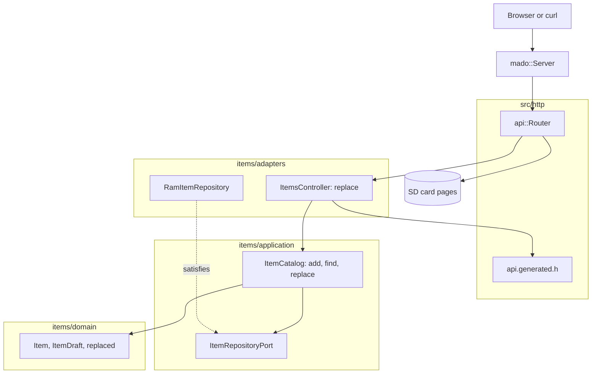

# RestPut

4件の固定テーブルにある項目の全フィールドを置き換えるRESTエンドポイントで、Ethernetシールドを載せたArduino Uno R4 Minimaが応答します。`PUT /api/items/{id}`はボディ全体を必要とし、idはボディではなく常にパスから取ります。

[English](README.md) | 日本語 | [简体中文](README.zh-Hans.md) | [繁體中文（香港）](README.zh-HK.md)

## このサンプルの内容

| 領域 | 作ったもの |
|:-----|:-----------|
| レイヤー | 境界づけられたコンテキスト`items`を1つ持ち、`domain`、`application`、`adapters`に分けています。ドメインはArduinoのヘッダーを一切インクルードしません。 |
| ドメインのルール | `replaced(current, draft)`は現在のidを保ち、それ以外のフィールドをすべてドラフトから取ります。`draft_status`は空の名前を拒否します。 |
| ポート | `ItemRepositoryPort`はユースケースが使う3つの呼び出し`insert`、`find`、`store`を名指しします。 |
| ユースケース | `ItemCatalog::replace`は`kMissing`、`kInvalid`、`kReplaced`のいずれかを返し、有効な置き換えだけを保存します。 |
| アダプター | `mado::SlotTable`上の`RamItemRepository`と、HTTP側の`ItemsController`。 |
| コンポジションルート | [`RestPut.ino`](RestPut.ino)が「lamp」と「fan」を投入し、カードをマウントし、両方をルーターに渡します。 |
| 契約 | [`openapi.json`](openapi.json)から[`api.generated.h`](src/http/api.generated.h)のルート、ボディのリーダー、JSONの書き出しを生成します。 |
| テスト | 4ファイルのホストテスト24件と、カバレッジ100パーセントのページテスト7件。 |
| ルール | JPL D-60411とPower of Ten。ヒープなし、仮想関数なし、関数ポインターなし、関数あたり2.10個のアサーション。 |

## アーキテクチャ



コントローラーはボディを読む前に`404`を返すので、空きidに大きなボディを送ったクライアントは早く知ることができます。ユースケースは呼び出し元を信用してはならないので、カタログは`replace`の中でもidを確かめます。

## プロジェクト構成

```text
RestPut/
  RestPut.ino                              コンポジションルート
  openapi.json                             API契約
  src/http/api.generated.h                 生成
  src/http/api.router.h                    置き換えのルート、それ以外のパスはカードのページ
  src/items/domain/item.entity.h           Item、ItemDraft、replaced
  src/items/application/item_repository.port.h
  src/items/application/item_catalog.service.h   add、find、replace
  src/items/adapters/ram_item.repository.h
  src/items/adapters/items.controller.h
  tests/                                   ホストテスト
  SD Card/                                 ページ
```

## APIエンドポイント

| メソッド | エンドポイント | 説明 |
|:---------|:---------------|:-----|
| PUT | `/api/items/{id}` | 項目1から4を`{"name":"desk lamp","on":false}`で置き換える |
| GET | `/api/openapi.json` | カードから読んだOpenAPIドキュメント |
| GET | その他のパス | カード上のページ |

置き換えは保存した項目とともに`200 OK`を返します。

```json
{"id":1,"name":"desk lamp","on":false}
```

| エラーの条件 | ステータス | 詳細 |
|:-------------|:----------:|:-----|
| idが空き、0、4より大きい、または数値でない | 404 | `no item has this id` |
| ボディが空 | 400 | `a JSON body is required` |
| ボディがJSONでない | 400 | `the body is not valid JSON` |
| ボディが256バイトを超える | 413 | `the body is larger than this operation accepts` |
| `Content-Type`がJSONでない | 415 | `Content-Type must be application/json` |
| 未知のフィールド、または`id`を送った | 422 | `a property is unknown, read-only or repeated` |
| `name`が16文字を超える | 422 | `a string is longer than its maxLength` |
| フィールドが足りない | 422 | `missing required property: name`または`on` |
| 名前が空 | 422 | `a string is shorter than its minLength` |

## 設計上の判断

### 置き換えはドメインの操作

PUTの意味、つまりidを除くすべてのフィールドが変わることは、`replaced`に一度だけ書いてあります。コントローラーはボディを`ItemDraft`に変えるだけで、保存済みの項目にフィールドをコピーすることはありません。スキーマとエンティティに今後フィールドを足しても、コントローラーのロジックに触れずに置き換えられます。

### ポートが呼び出しを1つ増やす

RestGetのポートは`insert`と`find`を持ちます。このポートは`store(const Item&)`を加え、そのidに項目があったかを返します。ユースケースは`false`を「存在しない」と扱うので、`find`と`store`の間で項目が消えた競合でも新しいスロットには書き込みません。

### ボディを読む前に検索する

`ItemsController::replace`はボディを読む前にidを確かめます。以前のスケッチと同じ動きです。先にボディを読むと、存在しないidに対してJSONの誤りを教えることになり、最大256バイトを無駄に読むことになります。

### エンティティはワイヤー構造体ではない

ボディは`rest_put::Item`として届きます。`id`は読み取り専用なので、リーダーは`int32_t id`を0のままにします。`draft_of`はこの2点をアサーションで確かめて`ItemDraft`を作るので、ユースケースがワイヤーの型を見ることはありません。

## トレードオフ

| できること | 今はしない理由 | このままのリスク |
|:-----------|:---------------|:-----------------|
| ETagを使った`If-Match` | クライアントは1つ、項目は4件 | 2つのクライアントが互いの変更を上書きできる |
| 項目をカードに保存する | 永続化はRestApiが示す | 起動のたびに項目は初期データに戻る |
| 空きidへのPUTで作成する | スキーマではidはボードが割り当てる | クライアントはidを選べない |

## 前提

- ネットワークは信頼できる。認証もTLSもない。
- 同時に扱うクライアントは1つ。

## テスト

```bash
cmake -S ../../tests -B build && cmake --build build --target mado_example_restput
ctest --test-dir build -R '^RestPut\.' --output-on-failure
```

| ファイル | テスト数 | 対象 |
|:---------|---------:|:-----|
| [`item.entity.test.cpp`](tests/item.entity.test.cpp) | 9 | 名前のルール、idの範囲、項目の生成 |
| [`item_catalog.service.test.cpp`](tests/item_catalog.service.test.cpp) | 6 | add、満杯のテーブル、find |
| [`item_replacement.test.cpp`](tests/item_replacement.test.cpp) | 4 | idが残る、置き換えが保存される、空の名前、空きid |
| [`items.api.test.cpp`](tests/items.api.test.cpp) | 5 | 全フィールドの置き換え、一部だけのボディ、空きid、テキストのボディ、405 |

`cd "SD Card" && pnpm run test`はカバレッジ100パーセントで7件のページテストを実行します。

## 前提条件

| ツール | バージョン | 用途 |
|:-------|:-----------|:-----|
| Arduino Uno R4 Minima | | ボード |
| microSDスロット付きのW5100、W5500、ENC28J60シールド | | ネットワークとカード |
| arduino-cli | 1.5.1 | スケッチのビルド |
| arduino:renesas_unoコア | 1.6.0 | ボードパッケージ |
| EthernetとSdFat | 2.0.2と2.3.0 | ネットワークとカードのライブラリ |
| Node.jsとpnpm | 24と12.15.0 | ページのビルド |

## はじめに

```bash
arduino-cli lib install Ethernet@2.0.2 SdFat@2.3.0
arduino-cli compile --fqbn arduino:renesas_uno:minima --library ../.. .
arduino-cli upload --fqbn arduino:renesas_uno:minima --port /dev/cu.usbmodem1101 .
cd "SD Card" && pnpm install && pnpm run build
```

`SD Card/dist`をカードにコピーしてから：

```bash
curl -X PUT -H 'Content-Type: application/json' -d '{"name":"desk lamp","on":false}' http://192.168.1.177/api/items/1
```

## 技術スタック

| 分類 | 技術 |
|:-----|:-----|
| ボード | Arduino Uno R4 Minima：フラッシュ262,144バイト中77,656バイト、RAM 32,768バイト中5,904バイト |
| HTTP | Madoguchi、ヒープを使わないC++11 |
| カード | SdFat 2.3.0 |
| ネットワーク | Ethernet 2.0.2 |
| ホストテスト | googletest 1.18.0、CMake |
| ページ | TypeScript 7.0.2、Vite 8.3.5、CDNから読み込むPico CSS 2.1.1、Vitest 5.0.5 |
| 解析 | clang-tidy 23.1.3、cppcheck 2.22.0、clang-format 23.1.3、Biome 2.6.3 |
