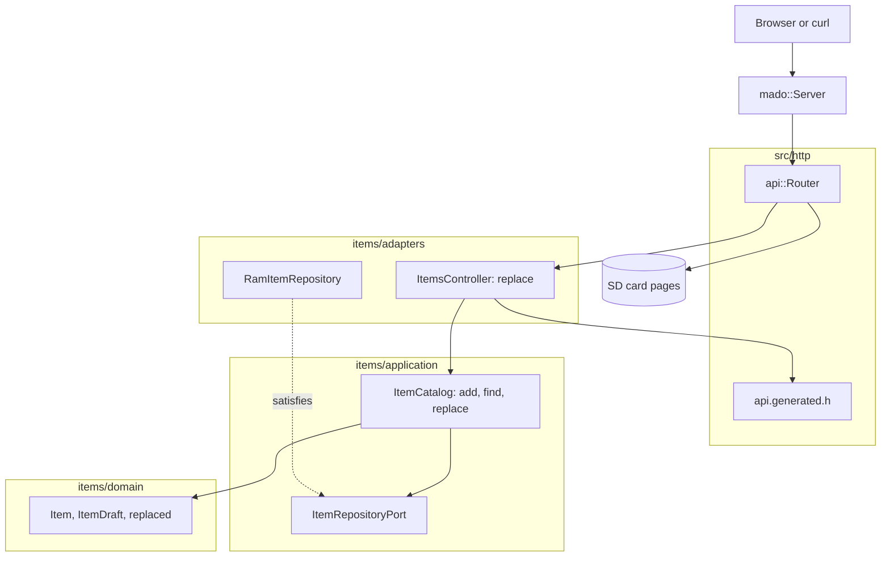

# RestPut

REST endpoint that replaces every field of an item in a fixed table of four, served by an Arduino Uno R4 Minima with an Ethernet shield. `PUT /api/items/{id}` needs the whole body; the id comes from the path and never from the body.

English | [日本語](README.ja.md) | [简体中文](README.zh-Hans.md) | [繁體中文（香港）](README.zh-HK.md)

## What this example covers

| Area | What is built |
|:-----|:--------------|
| Layers | One bounded context, `items`, split into `domain`, `application` and `adapters`. The domain includes no Arduino header. |
| Domain rule | `replaced(current, draft)` keeps the current id and takes every other field from the draft; `draft_status` refuses an empty name. |
| Ports | `ItemRepositoryPort` names `insert`, `find` and `store`, the three calls the use cases make. |
| Use case | `ItemCatalog::replace` answers `kMissing`, `kInvalid` or `kReplaced` and stores only a valid replacement. |
| Adapters | `RamItemRepository` on a `mado::SlotTable`; `ItemsController` for the HTTP side. |
| Composition root | [`RestPut.ino`](RestPut.ino) seeds "lamp" and "fan", mounts the card and attaches both to the router. |
| Contract | [`openapi.json`](openapi.json) generates the route, the body reader and the JSON writer in [`api.generated.h`](src/http/api.generated.h). |
| Tests | 24 host tests in four files and 7 page tests with 100 percent coverage. |
| Rules | JPL D-60411 and the Power of Ten: no heap, no virtual functions, no function pointers, 2.10 assertions per function. |

## Architecture



The controller answers `404` before it reads the body, so a client that sends a large body to a free id learns early. The catalog checks the id again inside `replace`, because a use case must not trust its caller.

## Project structure

```text
RestPut/
  RestPut.ino                              composition root
  openapi.json                             API contract
  src/http/api.generated.h                 generated
  src/http/api.router.h                    the replace route, card pages for every other path
  src/items/domain/item.entity.h           Item, ItemDraft, replaced
  src/items/application/item_repository.port.h
  src/items/application/item_catalog.service.h   add, find, replace
  src/items/adapters/ram_item.repository.h
  src/items/adapters/items.controller.h
  tests/                                   host tests
  SD Card/                                 the pages
```

## API endpoints

| Method | Endpoint | Description |
|:-------|:---------|:------------|
| PUT | `/api/items/{id}` | Replace item 1 to 4 with `{"name":"desk lamp","on":false}` |
| GET | `/api/openapi.json` | The OpenAPI document, read from the card |
| GET | any other path | A page from the card |

A replacement answers `200 OK` with the stored item:

```json
{"id":1,"name":"desk lamp","on":false}
```

| Error condition | Status | Detail |
|:----------------|:------:|:-------|
| The id is free, 0, above 4 or not a number | 404 | `no item has this id` |
| The body is empty | 400 | `a JSON body is required` |
| The body is not JSON | 400 | `the body is not valid JSON` |
| The body is over 256 bytes | 413 | `the body is larger than this operation accepts` |
| `Content-Type` is not JSON | 415 | `Content-Type must be application/json` |
| A field is unknown or `id` is sent | 422 | `a property is unknown, read-only or repeated` |
| `name` is over 16 characters | 422 | `a string is longer than its maxLength` |
| A field is missing | 422 | `missing required property: name` or `on` |
| The name is empty | 422 | `a string is shorter than its minLength` |

## Design decisions

### Replace is a domain operation

What PUT means, that every field changes except the id, is written once in `replaced`. The controller only turns the body into an `ItemDraft`; it never copies fields into a stored item. A future field added to the schema and the entity gets replaced without touching the controller's logic.

### The port grows by one call

RestGet's port has `insert` and `find`. This one adds `store(const Item&)`, which returns whether the id held an item. The use case treats a `false` as missing, so a race where the item vanished between `find` and `store` cannot write a new slot.

### Look up before reading the body

`ItemsController::replace` checks the id before it reads the body, which matches what the earlier version of this sketch did. Reading the body first would let a client learn about JSON mistakes for an id that does not exist, and would read up to 256 bytes for nothing.

### The entity is not the wire struct

The body arrives as `rest_put::Item`, with an `int32_t id` that the reader keeps at 0 because `id` is read-only. `draft_of` checks both facts with assertions and builds an `ItemDraft`, so the use case never sees a wire type.

## Trade-offs

| What could be done | Why it is not done | Risk as shipped |
|:-------------------|:-------------------|:----------------|
| `If-Match` with an ETag | Single client, four items | Two clients can overwrite each other's change |
| Keep items on the card | RestApi shows persistence | Items reset to the seeds on every boot |
| Create on PUT to a free id | The schema says ids are assigned by the board | A client cannot choose an id |

## Assumptions

- The network is trusted: there is no authentication and no TLS.
- One client at a time.

## Testing

```bash
cmake -S ../../tests -B build && cmake --build build --target mado_example_restput
ctest --test-dir build -R '^RestPut\.' --output-on-failure
```

| File | Tests | Covers |
|:-----|------:|:-------|
| [`item.entity.test.cpp`](tests/item.entity.test.cpp) | 9 | name rules, the id range, building an item |
| [`item_catalog.service.test.cpp`](tests/item_catalog.service.test.cpp) | 6 | add, a full table, find |
| [`item_replacement.test.cpp`](tests/item_replacement.test.cpp) | 4 | the id survives, the replacement is stored, an empty name, a free id |
| [`items.api.test.cpp`](tests/items.api.test.cpp) | 5 | every field replaced, a partial body, a free id, a text body, 405 |

`cd "SD Card" && pnpm run test` runs 7 page tests at 100 percent coverage.

## Prerequisites

| Tool | Version | Required for |
|:-----|:--------|:-------------|
| Arduino Uno R4 Minima | | the board |
| W5100, W5500 or ENC28J60 shield with a microSD slot | | network and card |
| arduino-cli | 1.5.1 | building the sketch |
| arduino:renesas_uno core | 1.6.0 | the board package |
| Ethernet and SdFat | 2.0.2 and 2.3.0 | network and card libraries |
| Node.js and pnpm | 24 and 12.15.0 | building the pages |

## Getting started

```bash
arduino-cli lib install Ethernet@2.0.2 SdFat@2.3.0
arduino-cli compile --fqbn arduino:renesas_uno:minima --library ../.. .
arduino-cli upload --fqbn arduino:renesas_uno:minima --port /dev/cu.usbmodem1101 .
cd "SD Card" && pnpm install && pnpm run build
```

Copy `SD Card/dist` to the card, then:

```bash
curl -X PUT -H 'Content-Type: application/json' -d '{"name":"desk lamp","on":false}' http://192.168.1.177/api/items/1
```

## Tech stack

| Category | Technology |
|:---------|:-----------|
| Board | Arduino Uno R4 Minima: 77,656 of 262,144 bytes of flash, 5,904 of 32,768 bytes of RAM |
| HTTP | Madoguchi, heap-free C++11 |
| Card | SdFat 2.3.0 |
| Network | Ethernet 2.0.2 |
| Host tests | googletest 1.18.0, CMake |
| Pages | TypeScript 7.0.2, Vite 8.3.5, Pico CSS 2.1.1 from a CDN, Vitest 5.0.5 |
| Analysis | clang-tidy 23.1.3, cppcheck 2.22.0, clang-format 23.1.3, Biome 2.6.3 |
