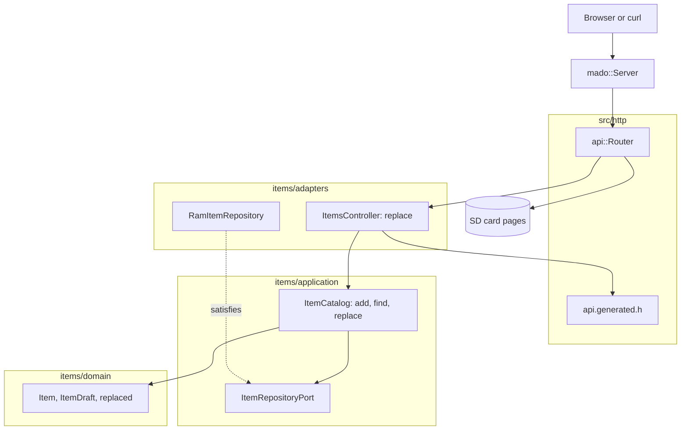

# RestPut

替換固定四項表中某個項目全部欄位的 REST 端點，由裝有以太網擴充板的 Arduino Uno R4 Minima 提供。`PUT /api/items/{id}` 需要完整的請求主體；id 總是取自路徑，從不取自請求主體。

[English](README.md) | [日本語](README.ja.md) | [简体中文](README.zh-Hans.md) | 繁體中文（香港）

## 本範例涵蓋的內容

| 範疇 | 實作內容 |
|:-----|:---------|
| 分層 | 一個限界上下文 `items`，分為 `domain`、`application` 及 `adapters`。領域層不包含任何 Arduino 標頭檔。 |
| 領域規則 | `replaced(current, draft)` 保留目前的 id，其餘欄位全部取自草稿；`draft_status` 拒絕空名稱。 |
| 端口 | `ItemRepositoryPort` 列出用例呼叫的三個函式 `insert`、`find` 及 `store`。 |
| 用例 | `ItemCatalog::replace` 回傳 `kMissing`、`kInvalid` 或 `kReplaced`，只保存有效的替換。 |
| 轉接器 | 建基於 `mado::SlotTable` 的 `RamItemRepository`，以及負責 HTTP 的 `ItemsController`。 |
| 組合根 | [`RestPut.ino`](RestPut.ino) 寫入 `lamp` 及 `fan`，掛載記憶卡，再把兩者交給路由器。 |
| 契約 | [`openapi.json`](openapi.json) 產生 [`api.generated.h`](src/http/api.generated.h) 中的路由、請求主體讀取器及 JSON 寫入函式。 |
| 測試 | 四個檔案中的 24 個主機測試，以及覆蓋率 100% 的 7 個頁面測試。 |
| 規則 | JPL D-60411 及 Power of Ten：不用堆積、不用虛擬函式、不用函式指標，每個函式平均 2.10 個斷言。 |

## 架構



控制器在讀取請求主體之前已回應 `404`，所以向空置 id 傳送大請求主體的客戶端能及早知道。用例不能信任呼叫者，所以目錄在 `replace` 內部再檢查一次 id。

## 項目結構

```text
RestPut/
  RestPut.ino                              組合根
  openapi.json                             API 契約
  src/http/api.generated.h                 由工具產生
  src/http/api.router.h                    替換路由，其餘路徑交給記憶卡上的頁面
  src/items/domain/item.entity.h           Item、ItemDraft、replaced
  src/items/application/item_repository.port.h
  src/items/application/item_catalog.service.h   add、find、replace
  src/items/adapters/ram_item.repository.h
  src/items/adapters/items.controller.h
  tests/                                   主機測試
  SD Card/                                 頁面
```

## API 端點

| 方法 | 端點 | 說明 |
|:-----|:-----|:-----|
| PUT | `/api/items/{id}` | 以 `{"name":"desk lamp","on":false}` 替換項目 1 至 4 |
| GET | `/api/openapi.json` | 從記憶卡讀取的 OpenAPI 文件 |
| GET | 其他路徑 | 記憶卡上的頁面 |

替換成功時以 `200 OK` 回傳保存後的項目：

```json
{"id":1,"name":"desk lamp","on":false}
```

| 錯誤條件 | 狀態 | 詳情 |
|:---------|:----:|:-----|
| id 空置、為 0、大於 4 或不是數字 | 404 | `no item has this id` |
| 請求主體為空 | 400 | `a JSON body is required` |
| 請求主體不是 JSON | 400 | `the body is not valid JSON` |
| 請求主體超過 256 位元組 | 413 | `the body is larger than this operation accepts` |
| `Content-Type` 不是 JSON | 415 | `Content-Type must be application/json` |
| 欄位未知或傳送了 `id` | 422 | `a property is unknown, read-only or repeated` |
| `name` 超過 16 個字元 | 422 | `a string is longer than its maxLength` |
| 缺少欄位 | 422 | `missing required property: name` 或 `on` |
| 名稱為空 | 422 | `a string is shorter than its minLength` |

## 設計決定

### 替換是領域操作

PUT 的含義，即除 id 外每個欄位都改變，只在 `replaced` 中寫一次。控制器只把請求主體變成 `ItemDraft`，從不把欄位複製到已保存的項目中。日後在結構描述及實體中新增的欄位，不改控制器的邏輯亦會被替換。

### 端口多了一個呼叫

RestGet 的端口有 `insert` 及 `find`。這個端口加入 `store(const Item&)`，回傳該 id 是否存有項目。用例把 `false` 當作不存在，所以即使項目在 `find` 與 `store` 之間消失，亦不會寫進新的槽位。

### 先查找，再讀請求主體

`ItemsController::replace` 在讀取請求主體之前檢查 id，與早前的草稿碼行為一致。先讀請求主體會令客戶端為一個不存在的 id 得到 JSON 錯誤，還會白白讀取最多 256 位元組。

### 實體不是線上結構

請求主體以 `rest_put::Item` 到達；由於 `id` 唯讀，讀取器令 `int32_t id` 保持為 0。`draft_of` 以斷言確認這兩點並建構 `ItemDraft`，所以用例從不接觸線上型別。

## 取捨

| 可以做的事 | 現在不做的原因 | 照現狀發佈的風險 |
|:-----------|:---------------|:-----------------|
| 以 ETag 實作 `If-Match` | 一個客戶端，四個項目 | 兩個客戶端可能覆寫彼此的修改 |
| 把項目保存在記憶卡上 | 持久化由 RestApi 示範 | 每次啟動項目都回復為初始值 |
| 對空置 id 的 PUT 建立項目 | 結構描述規定 id 由開發板分配 | 客戶端不能選擇 id |

## 假設

- 網絡是可信的：沒有認證，亦沒有 TLS。
- 一次一個客戶端。

## 測試

```bash
cmake -S ../../tests -B build && cmake --build build --target mado_example_restput
ctest --test-dir build -R '^RestPut\.' --output-on-failure
```

| 檔案 | 測試數目 | 涵蓋內容 |
|:-----|------:|:---------|
| [`item.entity.test.cpp`](tests/item.entity.test.cpp) | 9 | 名稱規則、id 範圍、產生項目 |
| [`item_catalog.service.test.cpp`](tests/item_catalog.service.test.cpp) | 6 | add、表已滿、find |
| [`item_replacement.test.cpp`](tests/item_replacement.test.cpp) | 4 | id 保留、替換被保存、空名稱、空置 id |
| [`items.api.test.cpp`](tests/items.api.test.cpp) | 5 | 替換全部欄位、不完整的請求主體、空置 id、文字請求主體、405 |

`cd "SD Card" && pnpm run test` 以 100% 覆蓋率執行 7 個頁面測試。

## 先決條件

| 工具 | 版本 | 用途 |
|:-----|:-----|:-----|
| Arduino Uno R4 Minima | | 開發板 |
| 附 microSD 插槽的 W5100、W5500 或 ENC28J60 擴充板 | | 網絡及記憶卡 |
| arduino-cli | 1.5.1 | 建置草稿碼 |
| arduino:renesas_uno 核心 | 1.6.0 | 開發板套件 |
| Ethernet 及 SdFat | 2.0.2 及 2.3.0 | 網絡及記憶卡程式庫 |
| Node.js 及 pnpm | 24 及 12.15.0 | 建置頁面 |

## 開始使用

```bash
arduino-cli lib install Ethernet@2.0.2 SdFat@2.3.0
arduino-cli compile --fqbn arduino:renesas_uno:minima --library ../.. .
arduino-cli upload --fqbn arduino:renesas_uno:minima --port /dev/cu.usbmodem1101 .
cd "SD Card" && pnpm install && pnpm run build
```

把 `SD Card/dist` 複製到記憶卡上，然後：

```bash
curl -X PUT -H 'Content-Type: application/json' -d '{"name":"desk lamp","on":false}' http://192.168.1.177/api/items/1
```

## 技術棧

| 類別 | 技術 |
|:-----|:-----|
| 開發板 | Arduino Uno R4 Minima：快閃記憶體 262,144 位元組中用 77,656 位元組，RAM 32,768 位元組中用 5,904 位元組 |
| HTTP | Madoguchi，不用堆積的 C++11 |
| 記憶卡 | SdFat 2.3.0 |
| 網絡 | Ethernet 2.0.2 |
| 主機測試 | googletest 1.18.0、CMake |
| 頁面 | TypeScript 7.0.2、Vite 8.3.5、從 CDN 載入的 Pico CSS 2.1.1、Vitest 5.0.5 |
| 分析 | clang-tidy 23.1.3、cppcheck 2.22.0、clang-format 23.1.3、Biome 2.6.3 |
