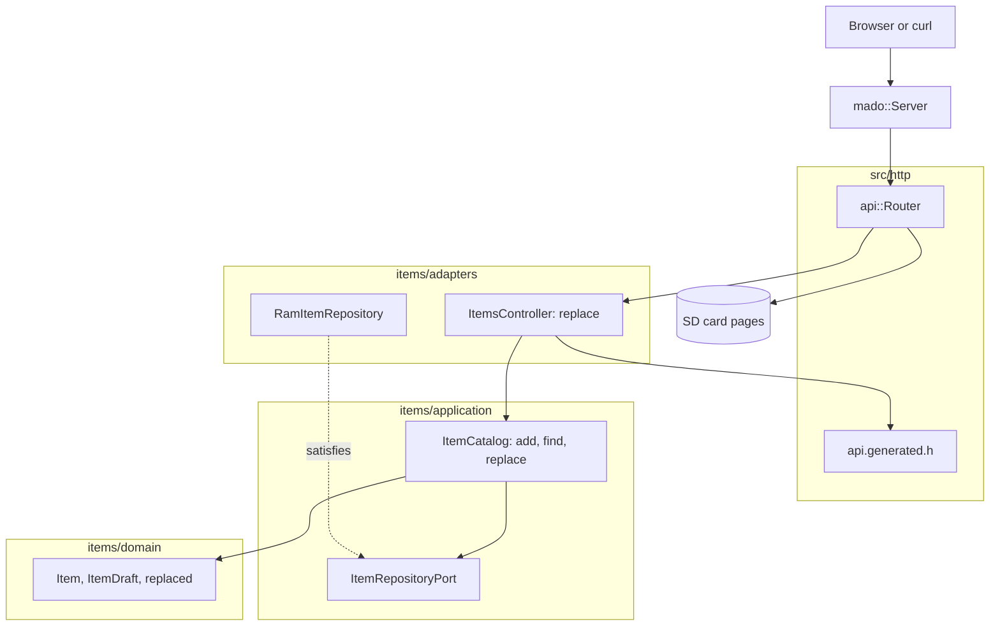

# RestPut

替换固定四项表中某个条目全部字段的 REST 端点，由装有以太网扩展板的 Arduino Uno R4 Minima 提供。`PUT /api/items/{id}` 需要完整的请求体；id 总是取自路径，从不取自请求体。

[English](README.md) | [日本語](README.ja.md) | 简体中文 | [繁體中文（香港）](README.zh-HK.md)

## 本示例涵盖的内容

| 方面 | 实现内容 |
|:-----|:---------|
| 分层 | 一个限界上下文 `items`，分为 `domain`、`application` 和 `adapters`。领域层不包含任何 Arduino 头文件。 |
| 领域规则 | `replaced(current, draft)` 保留当前 id，其余字段全部取自草稿；`draft_status` 拒绝空名称。 |
| 端口 | `ItemRepositoryPort` 列出用例调用的三个函数 `insert`、`find` 和 `store`。 |
| 用例 | `ItemCatalog::replace` 返回 `kMissing`、`kInvalid` 或 `kReplaced`，只保存有效的替换。 |
| 适配器 | 基于 `mado::SlotTable` 的 `RamItemRepository`，以及负责 HTTP 的 `ItemsController`。 |
| 组合根 | [`RestPut.ino`](RestPut.ino) 写入 `lamp` 和 `fan`，挂载卡，并把两者交给路由器。 |
| 契约 | [`openapi.json`](openapi.json) 生成 [`api.generated.h`](src/http/api.generated.h) 中的路由、请求体读取器和 JSON 写入函数。 |
| 测试 | 四个文件中的 24 个主机测试，以及覆盖率 100% 的 7 个页面测试。 |
| 规则 | JPL D-60411 与 Power of Ten：不用堆、不用虚函数、不用函数指针，每个函数平均 2.10 个断言。 |

## 架构



控制器在读取请求体之前就应答 `404`，所以向空闲 id 发送大请求体的客户端能尽早知道。用例不能信任调用者，所以目录在 `replace` 内部再检查一次 id。

## 项目结构

```text
RestPut/
  RestPut.ino                              组合根
  openapi.json                             API 契约
  src/http/api.generated.h                 由工具生成
  src/http/api.router.h                    替换路由，其余路径交给卡上的页面
  src/items/domain/item.entity.h           Item、ItemDraft、replaced
  src/items/application/item_repository.port.h
  src/items/application/item_catalog.service.h   add、find、replace
  src/items/adapters/ram_item.repository.h
  src/items/adapters/items.controller.h
  tests/                                   主机测试
  SD Card/                                 页面
```

## API 端点

| 方法 | 端点 | 说明 |
|:-----|:-----|:-----|
| PUT | `/api/items/{id}` | 用 `{"name":"desk lamp","on":false}` 替换条目 1 到 4 |
| GET | `/api/openapi.json` | 从卡上读取的 OpenAPI 文档 |
| GET | 其他路径 | 卡上的页面 |

替换成功时以 `200 OK` 返回保存后的条目：

```json
{"id":1,"name":"desk lamp","on":false}
```

| 错误条件 | 状态 | 详情 |
|:---------|:----:|:-----|
| id 空闲、为 0、大于 4 或不是数字 | 404 | `no item has this id` |
| 请求体为空 | 400 | `a JSON body is required` |
| 请求体不是 JSON | 400 | `the body is not valid JSON` |
| 请求体超过 256 字节 | 413 | `the body is larger than this operation accepts` |
| `Content-Type` 不是 JSON | 415 | `Content-Type must be application/json` |
| 字段未知或发送了 `id` | 422 | `a property is unknown, read-only or repeated` |
| `name` 超过 16 个字符 | 422 | `a string is longer than its maxLength` |
| 缺少字段 | 422 | `missing required property: name` 或 `on` |
| 名称为空 | 422 | `a string is shorter than its minLength` |

## 设计决策

### 替换是领域操作

PUT 的含义，即除 id 外每个字段都改变，只在 `replaced` 中写一次。控制器只把请求体变成 `ItemDraft`，从不把字段复制到已保存的条目中。以后在模式和实体中新增的字段，不改控制器的逻辑也会被替换。

### 端口多了一个调用

RestGet 的端口有 `insert` 和 `find`。这个端口增加 `store(const Item&)`，返回该 id 是否存有条目。用例把 `false` 当作不存在，所以即使条目在 `find` 和 `store` 之间消失，也不会写进新的槽位。

### 先查找，再读请求体

`ItemsController::replace` 在读取请求体之前检查 id，与早先的程序行为一致。先读请求体会让客户端为一个不存在的 id 得到 JSON 错误，还会白白读取最多 256 字节。

### 实体不是线上结构

请求体以 `rest_put::Item` 到达；由于 `id` 只读，读取器让 `int32_t id` 保持为 0。`draft_of` 用断言确认这两点并构建 `ItemDraft`，所以用例从不接触线上类型。

## 权衡

| 可以做的事 | 现在不做的原因 | 照现状发布的风险 |
|:-----------|:---------------|:-----------------|
| 用 ETag 实现 `If-Match` | 一个客户端，四个条目 | 两个客户端可能覆盖彼此的修改 |
| 把条目保存在卡上 | 持久化由 RestApi 演示 | 每次启动条目都恢复为初始值 |
| 对空闲 id 的 PUT 创建条目 | 模式规定 id 由开发板分配 | 客户端不能选择 id |

## 假设

- 网络是可信的：没有认证，也没有 TLS。
- 一次一个客户端。

## 测试

```bash
cmake -S ../../tests -B build && cmake --build build --target mado_example_restput
ctest --test-dir build -R '^RestPut\.' --output-on-failure
```

| 文件 | 测试数 | 覆盖内容 |
|:-----|------:|:---------|
| [`item.entity.test.cpp`](tests/item.entity.test.cpp) | 9 | 名称规则、id 范围、生成条目 |
| [`item_catalog.service.test.cpp`](tests/item_catalog.service.test.cpp) | 6 | add、表已满、find |
| [`item_replacement.test.cpp`](tests/item_replacement.test.cpp) | 4 | id 保留、替换被保存、空名称、空闲 id |
| [`items.api.test.cpp`](tests/items.api.test.cpp) | 5 | 替换全部字段、不完整的请求体、空闲 id、文本请求体、405 |

`cd "SD Card" && pnpm run test` 以 100% 覆盖率运行 7 个页面测试。

## 前提条件

| 工具 | 版本 | 用途 |
|:-----|:-----|:-----|
| Arduino Uno R4 Minima | | 开发板 |
| 带 microSD 插槽的 W5100、W5500 或 ENC28J60 扩展板 | | 网络和卡 |
| arduino-cli | 1.5.1 | 构建程序 |
| arduino:renesas_uno 核心 | 1.6.0 | 开发板软件包 |
| Ethernet 和 SdFat | 2.0.2 和 2.3.0 | 网络和卡的库 |
| Node.js 和 pnpm | 24 和 12.15.0 | 构建页面 |

## 快速开始

```bash
arduino-cli lib install Ethernet@2.0.2 SdFat@2.3.0
arduino-cli compile --fqbn arduino:renesas_uno:minima --library ../.. .
arduino-cli upload --fqbn arduino:renesas_uno:minima --port /dev/cu.usbmodem1101 .
cd "SD Card" && pnpm install && pnpm run build
```

把 `SD Card/dist` 复制到卡上，然后：

```bash
curl -X PUT -H 'Content-Type: application/json' -d '{"name":"desk lamp","on":false}' http://192.168.1.177/api/items/1
```

## 技术栈

| 类别 | 技术 |
|:-----|:-----|
| 开发板 | Arduino Uno R4 Minima：闪存 262,144 字节中用 77,656 字节，RAM 32,768 字节中用 5,904 字节 |
| HTTP | Madoguchi，不用堆的 C++11 |
| 卡 | SdFat 2.3.0 |
| 网络 | Ethernet 2.0.2 |
| 主机测试 | googletest 1.18.0、CMake |
| 页面 | TypeScript 7.0.2、Vite 8.3.5、从 CDN 加载的 Pico CSS 2.1.1、Vitest 5.0.5 |
| 分析 | clang-tidy 23.1.3、cppcheck 2.22.0、clang-format 23.1.3、Biome 2.6.3 |
